# cnv — escalation log

## MAP  (as of 2026-10-13, #E118 — the campaign is CLOSED)

### Design tree

```mermaid
graph TD
    ROOT["IR cnv v0.4<br/>mdp 6afcb1d28ddc · structural 44046a33815d"]
    ROOT ==>|"cases · scenario · S1 · required ✓ (closed 2026-09-21, #E20)"| SC1["scenario=base<br/>27.501 (dp_full = myopic_full) · RL 27.464 (full_belief) · #E1 #E20<br/>sc0"]
    ROOT -->|"cases · scenario · S3 · optional ⏸"| SC2["scenario=fig3 (grid)<br/>subsumed by paper510 (its 17 cells at 1/beta=16, mean 10) — read from its rows; tripwire: none (no fig3 cell lies outside paper510)"]
    ROOT ==>|"cases · scenario · S2 · required ✓ (closed 2026-10-13, #E118)"| SC3["scenario=paper510 (grid; ⊃ fig3, base)<br/>98.96 (full_belief_ctx, grid mean) · shipped: the fitted rules · #E21 #E28–#E32 #E118<br/>sc1"]
    SC3 ==>|"design-axes · gym.observation_mode · G1 · tier=2 ★"| G1["observation_mode=full_belief_ctx<br/>L2 98.96 · floor 510/510 · #E30"]
    SC3 -->|"design-axes · gym.observation_mode · G2 · tier=2 ✓"| G2["observation_mode=timing_belief_ctx<br/>L2 98.59 · floor 510/510 · #E28"]
    SC3 -->|"design-axes · gym.observation_mode · G3 · tier=2 · order: by generality ✓"| G3["observation_mode=full_raw<br/>L2 98.75 (Δ −0.21 vs full_belief_ctx) · #E31"]
    SC3 -->|"design-axes · gym.observation_mode · G4 · tier=2 · order: by generality ✓"| G4["observation_mode=timing_raw<br/>L2 98.42 (Δ −0.17 vs timing_belief_ctx) · #E29"]
    SC3 -->|"design-axes · gym.observation_mode · G5 · tier=1 ✓"| G5["observation_mode=event_raw<br/>L2 96.75 · #E32"]
    ROOT ==>|"cases · scenario · S4 · required ✓ (closed 2026-10-13, #E116)"| SC4["scenario=fig6a<br/>792.94 (full_raw, F12) · #E33 #E116"]
    ROOT ==>|"cases · scenario · S5 · required ✓ (closed 2026-10-13, #E117)"| SC5["scenario=fig6b<br/>340.91 (full_raw, F13) · #E34 #E117"]
    SC1 ==>|"design-axes · solver · S1 · role=relaxed · tier=1 ✓"| M0["method=perfect<br/>29.78 · #E1"]
    SC1 ==>|"design-axes · solver · S2 · role=exact · tier=1 ✓"| M1["method=dp (timing, full)<br/>27.36 / 27.50 · #E1"]
    SC1 ==>|"design-axes · solver · S3 · role=feasible · tier=1 ✓"| M2["method=myopic (timing, full, event)<br/>27.34 / 27.50 / 27.11 · #E1"]
    SC1 ==>|"design-axes · solver · S4 · role=feasible · tier=1 ✓"| M3["method=random (uniform, prior_mean)<br/>−724 / 25.72 · #E1"]
    SC1 ==>|"design-axes · solver · S5 · role=feasible · tier=1 ✓"| M4["method=ppo (L0 25.72 = prior_mean · #E2 · sc0/L0)<br/>best in subtree 27.464 (full_belief) · #E14"]
    M4 ==>|"L0→L1 escalation (Δ +0.54 / −0.16, 2 seeds) ✗ the gate at 1M"| L1["level=L1<br/>26.26 / 25.56 · #E3<br/>sc0/timing_belief/L1"]
    L1 ==>|"design-axes · gym.observation_mode · S1 · tier=2 ★"| O1["observation_mode=timing_belief<br/>27.07 @4M · #E9"]
    O1 ==>|"escalations · hp+gym (mdp_tuning, knobs all) · P1 · tier=3 ★ ✓ (Δ +0.27)"| T1["level=L3(hp+gym)<br/>27.342 (99.9% of dp_timing) · #E8<br/>unregistered cell"]
    L1 -->|"design-axes · gym.observation_mode · S2 · tier=2 · order: by generality ✓"| O2["observation_mode=timing_raw<br/>L2 27.342 (= timing_belief, paired Δ 0.000) · #E17"]
    L1 -->|"design-axes · gym.observation_mode · S3 · tier=1 ✓"| O3["observation_mode=event_raw<br/>L3 27.124 (= myopic_event) · #E18"]
    L1 -->|"design-axes · gym.observation_mode · S4 · tier=2 ✓"| O4["observation_mode=full_belief<br/>L2 27.464 (99.9% of dp_full) · #E14"]
    L1 -->|"design-axes · gym.observation_mode · S5 · tier=2 · order: by generality ✓"| O5["observation_mode=full_raw<br/>L2 27.443 (99.8% of dp_full) · #E15"]
    SC4 ==>|"solver · ppo · L0→L1 (five modes, categorical) · F1 · tier=1 ✓"| F1["level=L1 (categorical head), fig6a 4M<br/>F 564/597 · T 441/612 · Fr 710/722 · Tr 601/690 · E 652/670 · 16M Fr 742 · #E33 #E36"]
    F1 ==>|"escalations · arch.policy_dist · F2 · tier=3 ★"| F2["policy_dist=dgauss (log location), L1 4M<br/>F 741/745 · Fr 739/705 · T 288/465 · Tr 719/661 · E 659/674 · #E45 #E46"]
    F2 -.->|"diagnostic · gym.observation_mode, outside the IR · F3 ✓"| F3["observation_mode=oracle_rate / oracle_log (+ pinned-rate scenarios)<br/>oracle_log 803.7 / 803.7 (perfect 804.8) · #E53–#E62"]
    F2 ==>|"escalations · gym.observation_mode · F4 · tier=2 ★"| F4["observation_mode=full_belief_log / timing_belief_log / event_belief_log<br/>789.5 / 787.7 · 750.86 · 768.97 (L1 4M) · #E59 #E63–#E65 #E107 #E109"]
    F2 ==>|"escalations · hp (mdp_tuning, knobs all) · F5 · tier=3 ★"| F5["level=L2 (mdp_tuning, knobs all; 20M / 5M per trial)<br/>full_belief_log 792.07 · timing_belief_log 785.22 · E78 raw 784.12 / 781.23 / 754.75 · #E47 #E66 #E67 #E79–#E81"]
    F2 ==>|"escalations · arch.raw_compress · F6 · tier=2 ✓"| F6["raw_compress=True (MLP compression)<br/>full_raw 745/757 (d1) · 738/762 (d3) · #E68–#E71"]
    F6 ==>|"escalations · arch.raw_frame · F7 · tier=2 ★"| F7["raw_frame=True, raw_pool=sum<br/>E 724.7/718.3 · Fr 759.0/754.7 · Tr 683.8/678.2 (L1 4M) · #E72 #E73"]
    F7 ==>|"escalations · arch.raw_pool · F9 · tier=2 ★"| F9["raw_frame_v2=True, raw_pool=mean<br/>Tr 750.0/743.3 · Fr 781.2/773.1 · E 748.8/722.6 (L1 4M) · #E75–#E78"]
    F7 -.->|"escalations · arch · F8 ⏸ not run — the mean pool does the recoding (#E75); tripwire: a raw mode the pool cannot resolve"| F8["post-pool recoding (MLP)<br/>not run · #E73 #E74"]
    SC5 ==>|"escalations · hp by transfer (F5's belief winners, verbatim) · F10 · tier=3 ✓"| F10["level=L2 by transfer (t37 / t47 hp), the _log belief modes, 20M<br/>full_belief_log 340.57 · timing_belief_log 331.13 · #E83"]
    F4 -.->|"assistance ladder · a step back, outside the IR · F11 · tier=2 ✓"| F11["observation_mode=*_belief_log_myo, action_mode=premium_discrete (R3)<br/>+2.5 (fig6a) · +2.7 (fig6b) over myopic_timing · #E84–#E88 · #E89–#E104"]
    F9 ==>|"escalations · algo.vine · F12 · tier=3 ★"| F12["vine=True (vine_p 0.1, 3 siblings, loo), tuned for itself<br/>Fr 792.94 · Tr 788.06 · E 775.25 · #E110 #E111 #E114–#E116"]
    SC5 ==>|"escalations · algo.vine, recipes by transfer · F13 · tier=3 ★"| F13["vine=True, recipes by transfer (the plain winners #E112; the #E116 records #E117)<br/>Fr 340.91 · Tr 335.56 · E 318.76 · #E110 #E112 #E115 #E117"]
    %% M0..M3 carry no third row: analytic references hold no g/a/h (guide §3.1)
```

### Layers and node readings   (one table — kind, attributes, tier, reading, entry)

| node | kind · attributes · tier | reading | entry |
|---|---|---|---|
| `scenario=base` | cases · required · S1 | the paper's Fig. 5(a) cell (N=4, Gamma(10,1), c=1): the validation pass's target; exact DP bar in hand | [#E1](#E1) |
| `scenario=paper510` | cases · required · S2 | **the generalist target, closed 2026-09-24; read back and packaged 2026-10-13 ([#E118](#E118)): every generalist is myopic + an additive premium with per-cell scatter — the fitted rules (timing +1 / event +2 / full 0 at the first decision) ship, and the event rule beats myopic_event by +0.100 ± 0.011 over cells.** One policy per observation type over 510 cells; bars #E21 (dp_full = myopic_full cell by cell; dp_timing is a played 1/40-grid policy, not an upper bound); ladders #E22–#E26 (every L0 = one fixed order, below the floor; every L1 clears the floor, none reaches a bar); tuned round #E28–#E32 (five studies, 80 trials each, the crown per type) | [#E21](#E21)–[#E32](#E32) |
| `scenario=fig3` | cases · optional ⏸ | `fig3` ⊂ `paper510` (its 17 cells at 1/beta = 16, mean 10), read from its rows; no fig3 cell lies outside paper510 | [#E21](#E21) |
| `scenario=fig6a` | cases · required · S4 | the long-horizon cell at unit cost 1.0, entered 2026-09-24: bars (perfect 804.8 · myopic_full 793.4 · myopic_timing 787.8 · myopic_event 781.2; no DP at N=100), the L0/L1 ladder #E33, convergence #E36 (4M is the transient; curves flatten by ~12M), the gap diagnoses #E42–#E44 (#E44's heavy-tail under-fit reading void, #E74), the categorical tuned round #E37 (stopped at its centres); the campaign's main line runs here (F1–F9, F11, F12) | [#E33](#E33), [#E36](#E36), [#E37](#E37), [#E42](#E42)–[#E44](#E44), [#E74](#E74) |
| `scenario=fig6b` | cases · required · S5 | the same horizon and prior at unit cost 1.5, where information is worth more (#E83: 4.6× at N = 4): bars (perfect 348.5 · myopic_full 341.9 · myopic_timing 335.3 · myopic_event 324.0) and the L0/L1 ladder #E34; no study was run here — the belief modes by hp transfer (F10), the raw modes under the vine by recipe transfer (F13) | [#E34](#E34), [#E83](#E83), [#E112](#E112), [#E117](#E117) |
| `F1` fig6a `level=L1` | solver · ppo · L0→L1 · tier=1 | the five modes at the §8.6 derivation, categorical head, 4M: every mode 6–25% under its bar, seeds split by 30–170 | [#E33](#E33), [#E36](#E36) |
| `F2` `arch=dgauss` | escalations · arch · tier=3 ★ | the discretized-Gaussian head with a log location: +148/+177 on full_belief, a wash on event_raw, a split on timing_raw, a LOSS on timing_belief; it cut the categorical head's top-band loss (#E52), but the tail-under-fit mechanism rested on #E44's clone, now void (#E74); the base of every fig6a child below | [#E45](#E45), [#E46](#E46) |
| `F3` oracle / pinned-rate diagnostics | diagnostic · outside the IR | the isolation ladder (true rate in the obs → pinned rate): HALF of full_belief's shortfall was a PPO floor on the oracle, and that floor was the oracle's own input resolution (a log-rate input reaches 803.7/803.7 vs perfect 804.8); the head's geometry (affine, sqrt), zero atom, PopArt, norm_obs OFF, the tuned recipe — all measured on the oracle and none moved it | [#E53](#E53)–[#E62](#E62) |
| `F4` belief recoded — **CLOSED 2026-09-30** (full_belief 792.07, timing_belief 785.22 after the 2026-10-13 funnel, both tuned `_log`); **event member added 2026-10-06**: `event_belief_log` (the grid posterior as log mean, CV; outside the IR menu) L1 **768.97 / 762.52**, +36–53 over event_raw at L1 and +14 over t69's tuned 754.75 (under the vine's 775.25, F12); the head learns the DP-shaped early premium (+36/ep at λ ≥ 25) and a new low-band lock ([#E107](#E107)); **the staged form — a supervised Gamma estimator on raw frames, frozen, policy on its (log mean, CV) — reads 775.94 / 762.22 at L1 ([#E109](#E109)): a learned statistic matches the exact one; the forecast-head proposal holds in its decoupled form** — **a distilled rule, never crowned** (human, 2026-10-12): the estimator is supervised on the episode's hidden λ into the posterior's hand-designed (log mean, CV) coordinates; only the order is learned from reward ([#E109](#E109) addendum) | escalations · gym.observation_mode · tier=2 ★ | the posterior handed over as (log mean, 1/√shape) instead of (shape, rate): full_belief 741/745 → **789.5/787.7** (99.5% of the bar); coordinates vs log split (#E63); the tuned crude recipe does not transfer (#E64); timing_belief_log **750.86** with seed 1 absorbed at the order-0 first state (accepted as a learning target, not a protocol change) | [#E59](#E59), [#E63](#E63)–[#E65](#E65) |
| `F5` tuning studies — ALL CLOSED 2026-10-05 | escalations · hp (mdp_tuning, knobs all; 20M/trial on the crude and `_log` modes, 5M/trial on the E78 raw form; 80 trials) · tier=3 | protocol reads of the winners: `_log` belief — full_belief_log t37 **792.07** (ckpt 14M), timing_belief_log t47 **785.22** (ckpt 20M) (both crowns, funnelled 2026-10-13); crude — full_belief t26 785.25, full_raw t47 774.53 (below the untuned frame-MEAN); E78 raw form — timing_raw t74 **781.23** (+18.7; crown until F12), event_raw t69 **754.75** (+5.9; crown until F12), full_raw t70 784.12 (+1.1 ± 0.7 over its own L1 centre, 3.8 under E77's untuned 787.93; t70 on E77's form loses 20–100, [#E101](#E101)). Trial-block leaders run 5–7 high (winner's curse): read leaders at protocol only. E48/E49/E50 (crude timing_raw/event_raw/timing_belief) stopped at 6 trials | [#E47](#E47), [#E66](#E66), [#E67](#E67), [#E79](#E79)–[#E81](#E81), [#E101](#E101) |
| `F6` raw learned compression (MLP) | escalations · arch · tier=2 | frames → GELU MLP → running standardisation → body; works only once the statistics update ONCE PER ROLLOUT (#E68–#E70 were the per-minibatch defect's numbers); no asinh imposed (human's constraint); rediscovers the Bayesian sums (R² 0.997) | [#E68](#E68)–[#E71](#E71) |
| `F7` frame-sum extractor | escalations · arch · tier=2 ★ | one shared per-frame function, masked, SUMMED over periods (the likelihood's own aggregation), 2,528 parameters: the best L1/4M form on event_raw (724.7/718.3, +44 to +65 over the control) and full_raw (759.0/754.7, above the 64k-parameter MLP); the human's bet "sum is enough" HOLDS (a learned temporal kernel stays at ones; only the newest frame gains 1.32, a state gain that buys nothing); FAILS on timing_raw (683.8/678.2, over-orders in every band) although the statistic is fully resolved at the pool | [#E72](#E72), [#E73](#E73) |
| `F9` frame-MEAN extractor | escalations · arch · tier=2 ★ | the per-frame map pooled by the COUNT (sum / count, count as a feature), φ on the observation columns only, reset frame out, present state direct: three mode crowns from one untuned L1 wave — timing_raw 750.0 (= the hand-recoded posterior's 750.86), full_raw 781.2 (above the 20M tuned crude study; −6.7 paired vs myopic_full), event_raw 748.8; the probe reads the exact posterior at 0.97 with positive within-band values, trained = untrained — the pool IS the recoding. On the event crown t69 the exact grid posterior is in the policy latent to MAE 0.38 / 83% exact on the myopic order, and the policy's deviations from it pay 25 for G −2 — the residual is the decision layer, not the estimate ([#E105](#E105)); the timing crown t74 holds its Gamma posterior to 1.000 / 0.999 and, unlike t47, buys information (G +3.4), losing it in the zero and top bands ([#E106](#E106)). Runs peak at 1–1.6M then decline on the censored modes: the running standardisation adapting to a policy-dependent observation distribution is the suspect; the normalisation rung closed at E78's form — statistics frozen after 200 rollouts, the most consistent arm ([#E76](#E76)–[#E78](#E78)) — the base form of F5's raw studies and F12 | [#E75](#E75)–[#E78](#E78) |
| `F8` post-pool recoding | closed without running | the pooled sums ARE the crude (shape, rate) coordinates of #E59 (timing_raw sum 684 ≈ crude timing_belief centre 681; full_raw sum 759 between crude 741/745 and log 789); a learned nonlinearity after the pool and before the standardisation is the split the human asked for (compression, then recoding) with no Bayesian form imposed | [#E73](#E73) |
| `F10` fig6b — the tuned belief hp, transferred | escalations · hp by transfer (fig6a t37 / t47, verbatim), under `scenario=fig6b` (SC5) · tier=3 | no study on fig6b: fig6a's two belief winners' full hp sets retrained at c = 1.5, 20M, 2 seeds. full_belief_log **340.38 / 340.47** at the canonical, **340.57** best screened checkpoint (99.6% of myopic_full, seeds 0.09 apart, the same absolute gap −1.5 as fig6a's −1.7); timing_belief_log 320.1 / 328.6 at the canonical, **331.1** best checkpoint (98.8% of myopic_timing), noisy after an early absorbing-zero phase (s1's 1–5M checkpoints score 0). Information ledger (addendum 1): fig6a's timing crown buys NO information (G = 0.00), so its hp encode no info-buying; at c = 1.5 information is worth 4.6× more (N=4 DP), and the fig6b timing models do buy it (G up to +3.1) but mis-size it, plus lose 3–8 to late under-ordering at high rates. The timing optimum lies above myopic_timing by up to the censoring loss (6.6) and is unmeasured at N=100 | [#E83](#E83) |
| `F11` assistance ladder, R3 | a step back · obs `timing_belief_log_myo` / `full_belief_log_myo` + action `premium_discrete` · outside the IR (like the F3 oracles, but reading nothing hidden) · tier=2 | the campaign's claim is raw beating myopic; each rung hands the learner one more piece and is never a win. R3 hands over the myopic order twice — in the observation and as the action's anchor (order = y_myo + a, a ∈ {0..20}) — so the learner's whole job is the information premium. Built and gated; at N = 4 it replicates the paper's DP (c = 1.5: three of four runs at the DP's value, the DP's premium shape); at N = 100 it removes the execution gap (every arm at myopic, −1.3 to +1.0) and one fig6b run (γ 0.95) learns the DP-shaped early bet, +0.60 / +0.99 over myopic — a third to a half of the prize S0 measures (+1.95 fig6b, +2.33 fig6a, #E85); no run escapes the zero trap; the early decision is the learning bottleneck. The lever (group baseline / branch-and-grid) carried down the ladder: R1 (`timing_belief_log`) best checkpoint 786.0–786.4 at fig6a ([#E89](#E89), [#E91](#E91), [#E95](#E95)); R0 (`timing_raw`) needs the 64-world shape — at 16 × 400 it collapses the high-rate band ([#E92](#E92)–[#E98](#E98)), at K 4 on 64 × 400 it reads −8.3 best vs its control's −13.5 ([#E99](#E99)), and tuned it peaks at 783.13, +1.9 over t74 ([#E100](#E100)) — under the vine (F12); on full_raw and event_raw the lever does not help ([#E102](#E102), [#E103](#E103); the event study died at 27 trials, [#E104](#E104)) | [#E84](#E84), [#E85](#E85), [#E87](#E87)–[#E104](#E104) |
| `F12` the vine | escalations · algorithm (owmr #E30's vine: the main rollout untouched; at 10% of states the world is forked into sibling copies that take actions sampled from the policy, run to the episode's end on common noise, and are scored leave-one-out in a side PPO pass) · tier=3 ★ | on t74's recipe the vine moves R0 (+5.4 over t74, far above matched controls, [#E110](#E110)); it lifts every raw mode and none of the belief modes ([#E111](#E111), [#E112](#E112)); its gain is the side comparison, not the sharpening ([#E114](#E114)); its dose is flat ([#E115](#E115)). Tuned for itself ([#E116](#E116), 10M per trial): **timing_raw t44 788.06 (+0.28 ± 0.34, at the bar), full_raw t48 792.94 (−0.48 ± 0.05 of the optimum), event_raw t53 775.25 (−5.95 ± 0.86)** — the raw crowns, above the belief crowns on both types. fig6b: F13 | [#E110](#E110), [#E111](#E111), [#E113](#E113)–[#E116](#E116) |
| `F13` the vine on fig6b, by transfer | escalations · algorithm (F12's vine), recipes by transfer from fig6a · tier=3 ★ | no study on fig6b: the plain-PPO winners' recipes with the vine ([#E112](#E112), 10M) and the #E116 records ([#E117](#E117), 10M), seeds 1 / 2, each run's own funnel. **full_raw 340.91 (−1.00 ± 0.08 of the optimum, the tuned t48), timing_raw 335.56 (+0.26 ± 0.37, #E112's plain recipe — at the bar; the tuned t44 reads 335.27), event_raw 318.76 (−5.23 ± 0.75, the tuned t53)**; the vine lifts every raw mode against its control here too (#E112); the fig6a tuning carries to fig6b on full_raw only (#E117) | [#E112](#E112), [#E115](#E115), [#E117](#E117) |
| `method=perfect` | design-axes · solver · role=relaxed · tier=1 | the paper's model P (knows λ), emitted as the `perfect_profit` eval column; declared in IR `benchmarks` | [#E1](#E1) |
| `method=dp` | design-axes · solver · role=exact · tier=1 | backward induction over the belief at N=4 (timing: S lattice × T grid 1/40; full = myopic by Prop. 1(b)); declared in IR `benchmarks` | [#E1](#E1) |
| `method=myopic` | design-axes · solver · role=feasible · tier=1 | the paper's §5.3 myopic policies per observation type; the must-beat baselines | [#E1](#E1) |
| `method=random` | design-axes · solver · role=feasible · tier=1 | the §8.6 floors (uniform, prior_mean); build diagnostics only | [#E1](#E1) |
| `method=ppo` → `level=L1` | design-axes · solver · role=feasible · tier=1; the L0→L1 chain | the RL artifact under the real information set; L0 = faithful defaults (reporting only), L1 = the §8.6 derivation at T=4 (`cnv_ppo_train.py` `_L1_DERIVED`) | [#E2](#E2), [#E3](#E3) |
| `observation_mode=*` | design-axes · gym.observation_mode · tier=2 (timing_raw vs timing_belief, full_raw vs full_belief: the bypass instrument; the belief modes: the confirm instrument) · tier=1 (event_raw) | the IR's five modes are the research questions' declared instruments (`research_questions.tier2`), so they are write-once cells, never pruned | [#E3](#E3)… |

### Frontier   (CLOSED 2026-10-13, #E118)
1. ~~A1–A9, the base pass~~ done → [#E1](#E1)–[#E20](#E20); ~~paper510 generalist pass~~ closed → [#E35](#E35).
2. ~~the recoding step on the raw line~~ DONE by the pool → [#E75](#E75) (F9); ~~the no-statistics rung~~ → [#E76](#E76): stable training, timing crown 762.57, but full/event 20–30 under E75's deterministic crowns. ~~statistics estimated once and frozen~~ → [#E77](#E77): full_raw crown 787.93 (−4.1 paired vs myopic), timing/event not lifted. ~~freeze after K rollouts~~ → [#E78](#E78): the most consistent arm, second on every mode; **the normalisation rung is closed, base form = E78's (frozen at K = 200)**. Next on F9: the budget rung (16M) on E78's form, then the tuning study on it; event_raw's residual (censored middle bands, seed spread 17–90) is not a normalisation question.
3. ~~protocol confirms of the study leaders (F5)~~ DONE 2026-09-30: full_belief_log t37 791.67, timing_belief_log t36 783.32 → its last trial t47 **785.18** (2026-10-01), full_belief t26 785.25, full_raw t46 774.40 (trial block runs 5–6 high on leaders). The worker SIGINTs were the human's, from another session ([#E79](#E79) note). ~~the checkpoint funnel on t47 / t37~~ DONE 2026-10-13 ([#E66](#E66), [#E67](#E67) addenda): t37 @14M 792.07, t47 @20M 785.22.
4. ~~fig6a — the mean form under tuning (F9)~~ DONE 2026-10-05 → [#E79](#E79)–[#E81](#E81) (E78 form, 5M/trial, 80 trials each): timing_raw t74 **781.23** and event_raw t69 **754.75** take their crowns; full_raw t70 784.12 buys +1.1 over its own centre and stays under E77's untuned 787.93 ([#E101](#E101): t70 on E77's form is worse) — all three superseded by F12. ~~the training lever tuned on timing_raw~~ closed → [#E100](#E100): branch-and-grid at K 4 on the 64 × 400 shape, t53 783.13 (+1.9 over t74), under the vine; the same lever's pilots on full_raw and event_raw are negative ([#E102](#E102), [#E103](#E103)). ~~the vine (F12)~~ DONE → [#E110](#E110)–[#E116](#E116): side comparisons on forked worlds, then tuned for itself at 10M — **the three raw crowns: timing_raw t44 788.06 (at the bar), full_raw t48 792.94 (−0.48 of the optimum), event_raw t53 775.25 (−5.95)**.
5. **fig6a — open at the close, not pursued**  16M; the 2-feature side query (does a 2-channel φ reduce to the Bayesian statistics); event_raw's censored-level residual (5–17 bands); event_raw beyond 10M on fig6b (still rising, #E117).
6. **fig6b**  bars and ladder ([#E34](#E34)); the belief modes by hp transfer ([#E83](#E83), F10): full_belief_log 340.5 (99.6%), timing_belief_log 331.1 best checkpoint (98.8%); the timing arm read through the information ledger (addendum 1: fig6a's crown buys no information; fig6b's models buy it but mis-size it). R3 (#E84) at myopic on both cells, one fig6b run above it; the N=100 prize measured (#E85: +1.95 / +2.33). Next = the human's call (budget vs early-decision credit). ~~the raw modes~~ DONE → [#E112](#E112), [#E117](#E117) (F13, by transfer): full_raw 340.91 (−1.00 of the optimum), timing_raw 335.56 (at the bar), event_raw 318.76 (−5.23); the fig6a tuning carries to fig6b on full_raw only.
7. ~~readbacks and packaging~~ DONE → [#E118](#E118): `INTERPRET.md` (paper510 anchored on the exact DP and the paper's per-cell output; fig6 through the information ledger), the fitted rules shipped beside `cnv_policy.py`, README in its §1.3 shape; `PLAYBOOK.md` (guide §10) — LV1 the vine, LV2 Bayesian learning by a pooled per-frame map, LV3 the oracle cut (the human's selection and order). Contribution upstream: the human's call.
- parked: `scenario=fig3` (read from paper510's rows); the dp_timing T-grid refinement (off-tree register).

### Off-tree register   (budget-consuming, *not* solution-touching)
- bar calibration: the timing DP's T-grid resolution — DONE 2026-09-17 (`scratch/dp_grid_calibration.py`, base, 8192 protocol seeds): the played policy is grid-insensitive (1/80 vs 1/40 paired Δ +0.0011 ± 0.0032, same first-period order 10), while the *value* V^T_0 moves 27.495 → 27.581 (+0.086) — the right-edge bin evaluation biases the recursion's value by ~0.1, not its argmax. Cite the DP's played profit as the bar, never its V_0; re-check on a diffuse-prior cell before citing it on the grids.
- protocol construction: the record eval mode (deterministic argmax vs `--stochastic`) — decided at A3 and stated in README §Protocol.

### Current best bundle
On `scenario=fig6a` (protocol 8192, deterministic; bars myopic_full 793.4 · myopic_timing 787.8 · myopic_event 781.2): full_raw **792.94** (the vine (F12) on the #E116 study's t48 recipe, frame-MEAN E78 form, 10M, ckpt 9.5M; −0.48 ± 0.05 paired vs myopic_full, the optimum, [#E116](#E116)); timing_raw **788.06** (the vine on t44's recipe, ckpt 9.5M; +0.28 ± 0.34 — at the bar, not above it, [#E116](#E116)); event_raw **775.25** (the vine on t53's recipe, ckpt 8.5M; −5.95 ± 0.86, [#E116](#E116)); full_belief **792.07** (`full_belief_log` tuned, study t37's 14M checkpoint, [#E67](#E67) addendum; −1.34 ± 0.07); timing_belief **785.22** (`timing_belief_log` tuned, study t47's 20M checkpoint, [#E66](#E66) addendum; −2.55 ± 0.28). The tuned vine holds the three raw crowns, and the raw crowns lead the belief crowns on both types (+0.86 ± 0.08 full, +2.83 ± 0.23 timing, paired). Not crowned: the branch-and-grid lever on `timing_belief_log`, 786.0–786.4 at its best checkpoint ([#E89](#E89), [#E91](#E91), [#E95](#E95)) — the human's call; event_belief_log 768.97 (L1, [#E107](#E107); outside the IR menu); event_raw + frozen supervised estimator 775.94 (L1 4M seed 2 ckpt 2.4M, [#E109](#E109)) — **a distilled rule, never crowned** (human, 2026-10-12): the estimator is fitted by supervision on the episode's hidden λ into the hand-designed (log mean, CV) form of the exact posterior, and only the order is learned from reward. Superseded raw rows: full_raw 787.93 ([#E77](#E77)), timing_raw t74 781.23 ([#E79](#E79)), event_raw t69 754.75 ([#E81](#E81)), the tuned lever t53 783.13 ([#E100](#E100)).

On `scenario=fig6b` (bars 341.9 · 335.3 · 324.0): full_raw **340.91** (#E116's t48 recipe by transfer, seed 1 ckpt 5M; −1.00 ± 0.08 vs the optimum, [#E117](#E117)); timing_raw **335.56** (the vine on t74's plain-PPO recipe, seed 2 ckpt 9.5M; +0.26 ± 0.37 — at the bar, [#E112](#E112); t44 by transfer 335.27, [#E117](#E117)); event_raw **318.76** (t53's recipe by transfer, seed 2 final network; −5.23 ± 0.75, [#E117](#E117)); full_belief **340.57** (best screened checkpoint, s2 19M; canonical 340.47) and timing_belief **331.13** (best screened checkpoint, s1 10M) by hp transfer, [#E83](#E83).

On `scenario=paper510` (the run plan's target; means over cells on the 2048-seed prefix): **shipped — the fitted rules** ([#E118](#E118)): timing y^M + 1 at the first decision 99.28 (myopic_timing 99.28, +0.004 ± 0.007), event y^M + 2 at the first decision 97.54 (myopic_event 97.44, **+0.100 ± 0.011**, beats it on 208 cells), full y^M 99.66 (= myopic_full = the optimum); the study winners they were read from: full_belief_ctx 98.96 ([#E30](#E30)), full_raw 98.75 ([#E31](#E31)), timing_belief_ctx 98.59 ([#E28](#E28)), timing_raw 98.42 ([#E29](#E29)), event_raw 96.75 ([#E32](#E32)).

On `scenario=base`: one crowned arm per observation mode (all study winners, one artifact each, protocol block): timing_belief 27.342 (#E8, L3(hp+gym)), timing_raw 27.342 (#E17, L2(hp)), full_belief 27.464 (#E14, L2(hp)), full_raw 27.443 (#E15, L2(hp)), event_raw 27.124 (#E18, L3(hp+gym)). The paper's ordering F ≽ T ≽ E holds; both bypass contrasts are ties (#E20). Config ids not minted (the registry's data half is owed).

## FRAME-CHANGELOG
2026-10-13  PLUGIN brought to 0.11.10 (was 0.11.3; the harness pin was already 0.11.10): the skills and the harness now match. Two 0.11.10 conventions carried in: the run args file's `algo_class` records the class actually constructed (`VinePPO`, `BranchGroupPPO`, `PopArtPPO`, else `PPO`; runs trained before today say `PPO`), and the README's technical appendix opens with the environment lines.
2026-10-13  CLOSED the campaign ([#E118](#E118)): the run plan's target (`paper510`) read back and packaged — the fitted rules (the myopic order plus a first-decision premium) ship, the generalists stay loadable; `fig6a` / `fig6b` read through the information ledger. The pass found and fixed two instrument defects: the probe's `_ctx` dispatch (it had compared them against the wrong myopic rule; nothing in the record used it) and `gamma_poisson_quantile`'s hang when P(D = 0) underflows (no recorded number reached it).
2026-10-13  RE-GATED under the 0.11.10 pin (the domain repository's pin move): IR fingerprints unchanged (mdp 6afcb1d28ddc · structural 44046a33815d), conformance 32/32 after declaring scipy in `requirements.txt` (0.11.10's `static.imports` check warned on `cnv_benchmark_dp.py`'s `scipy.special.betainc`), laws 8/9 (mixture_equivalence SKIP: none declared), differential MATCH ×5 @ 40 episodes, 20 tests. The shared venv runs sb3 2.6.0 against the root requirements' 2.8.0 pin (repo-wide, not upgraded here); every cnv number was trained under 2.6.0. Built-and-gated line in CLAUDE.md stays at v0.10.14.
2026-09-17  PIN MOVED mid-campaign (repo-wide, outside this campaign): the harness went from a pinned checkout at v0.10.14 (df9ece5) to `auto-mdp-solver==0.11.0` from PyPI + plugin 0.11.0. Every gate re-run green under 0.11.0 (conformance 31/31, laws 8/9, differential MATCH ×5 @ 40 episodes, 18 tests); the #E8 study straddles the move — trials 0–7 trained under 0.10.14, trials started from 17:41 under 0.11.0; the domain code, env and scripts are unchanged, so the trial scores stay comparable. Built-and-gated line in CLAUDE.md stays at v0.10.14; conformance maintained through 0.11.0.
2026-09-21  RE-ENTERED at Stage 0 on paper510 (generalist; fig3 retyped optional — it is 17 of paper510's cells); two observation modes added to the gym block, timing_belief_ctx / full_belief_ctx, so every grid axis is in the belief vectors (human instruction; gym is mutable, fingerprint unmoved)
2026-09-21  CLOSED the base pass (#E20): every mode crowned within 0.06 of its optimum or tied with its best heuristic; bypass = tie on both types; next target fig3 by Stage-0 re-entry
2026-09-18  NARROWED the base gate: the exact DP is the bar (as a §9.9 band), myopic_timing a reported feasible arm, prior_mean the must-beat floor — on base the optimum exceeds myopic by 0.022, so "beat myopic by 2 SE" was unsatisfiable by construction (#E8, human decision)
2026-09-18  INTRODUCED the ladder for the other four observation modes (#E10–#E13): every belief L0 collapses to prior_mean; every raw arm's L1 (derived) is below its L0 — the derivation misfires on raw encodings (open)
2026-09-17  INTRODUCED the frame: Phase A froze the IR at 6afcb1d28ddc (run plan: base specialist, escalation budget one round); the five observation modes are design axes (declared instruments), not escalations.

## IR-CHANGELOG
### F1  2026-09-17 — the arrival process: summed exponential gaps → Poisson count + uniform epochs
decision:  the `epochs` / `demand` uncertainty slots and how the hidden rate λ enters them
initial:   the legacy simulator (and the first human choice) drew a fixed-length vector of exponential inter-arrival gaps at rate λ and read demand and the stock-out time off its partial sums. It looked right because it is the literal mechanism of a Poisson process, and the rate is the natural latent.
signal:    gate:validator (the catalog form declares a world latent only as a draw spec inside a candidate's setting; numpy's exponential takes a scale, so 1/λ has no setting to hang on, and an explicit `samplers` node is rejected in the catalog form)
symptom:   `python -m mdp_ir` FAIL: "the catalog form declares world latents as draw specs inside candidate settings, not scenario.samplers"
fix:       demand ~ Poisson(rate = draw Gamma(prior_rate·prior_mean, 1/prior_rate)), the shipped inv_single shape; epochs ~ iid uniform(0,1) × arrivals_buffer; stock-out time = the y-th smallest of the first D epochs (`topk(u[:demand], demand-order+1)[-1]`). Identical in law (conditional-uniform representation); the legacy buffer's truncation (26–86 slots vs a 1e-8 quantile of 402) was also found and fixed here.
rule:      if a hidden per-episode parameter enters a per-period family only through a transform of that family's numpy parameter (a rate where the family takes a scale), re-express the source so the latent is a parameter the family takes directly (Poisson takes a rate; the within-period structure moves to a second, latent-free slot) — or file a draw-transform proposal upstream before freezing.

### F2  2026-09-17 — model-layer quantities renamed after the uncertainty slots (post-freeze fingerprint move)
decision:  `mdp.model.quantities` keys `arrivals`, `lambda` → `demand`, `epochs` (λ folded into `demand`'s domain text and `notation`)
initial:   the theory layer named the stochastic quantities in the paper's vocabulary (the arrival process, the rate) — natural for a paper translation, and the interview signed it off that way.
signal:    gate:mdp_conformance `model.boundary` (a quantity declared stochastic must be an uncertainty slot of the same name)
symptom:   "'arrivals' is declared stochastic by the model but is no uncertainty source"; mdp fingerprint c557de9a71a8 → 6afcb1d28ddc after the fix, sign-off re-confirmed by the human the same day
fix:       the two stochastic quantities carry the slot names; λ is `notation`, not a quantity
rule:      if the model layer names a stochastic quantity, name it after the uncertainty slot that renders it, and keep a latent inside the quantity it parameterises — run `mdp_conformance` before the sign-off round so a naming move never re-opens a freeze.

## CONFIG-REGISTRY   (living — ids append-only; guide §13)
*Adopted in the reader-facing form only for this validation pass: the data half (`cnv_configs.py`) is owed before any L2 run cites a tuple (the run plan grants one round).*

### scenario

| id | key in SCENARIOS (or GRIDS) | note |
|---|---|---|
| `sc0` | `base` (SCENARIOS) | the paper's Fig. 5(a) cell: N=4, r=2, c=1, prior Gamma(10, 1) |
| `sc1` | `paper510` (GRIDS) | the §5.1 study: 17 costs × 6 prior scales × 5 prior means at N=4; a generalist target, cells are separate leaderboards |

### gym · `g`   |   arch · `a`   |   hp · `h`

| id | parent | delta | why it exists / what promoted it | cell tuned in |
|---|---|---|---|---|
| `g0` | — (L1 origin) | `norm_obs=True norm_reward=True vecnorm_clip_obs=10 frame_stack=derived(mode)`; the design axes are the cell | the §8.6 derivation; reserved | — |
| `a0` | — (L1 origin) | `MlpPolicy`, no extractor | the derivation; reserved | — |
| `h0` | — (L1 origin) | `cnv_ppo_train.py` `_L1_DERIVED` (lr 1e-4→1e-5, clip 0.2→0.05, n_envs 4, n_steps 512, batch 128, epochs 10, kl 0.02, γ 1.0, λ 0.95, ent 0.01, arch 64-64) + vf_coef 0.5, max_grad_norm 0.5 | the derivation; reserved | — |

### Current bases

| axis | current | since |
|---|---|---|
| `sc` / `g` / `a` / `h` | `sc0` / `g0` / `a0` / `h0` | the run plan, 2026-09-17 |

## LEDGER

### #E1 2026-09-17 — baselines at base: the bracket the RL arms are read against
address: scenario=base / solver layer / A1
↑ [design tree](#MAP) — explains method=perfect, method=dp, method=myopic, method=random
hypothesis: the ordering is sane — perfect ≽ dp ≽ myopic ≽ prior_mean ≫ uniform — and dp_timing exceeds myopic_timing by at most the paper's ~1 pp of loss recovery.
runs: `cnv_benchmark_{myopic,dp,random}_eval.py -s base --policy 
 --n-seeds 8192` (protocol block from seed 0); `results/base/benchmark/benchmark_*_eval_base.tsv`
verdict: ordering sane; the bracket is set. Protocol block 0..8191, CRN across arms, profit per 4-period episode:

  | arm                 | role     | profit  | Δ vs myopic_timing | note |
  |---------------------|----------|---------|--------------------|------|
  | perfect (column)    | relaxed  | 29.783  | +2.442             | knows λ; the paper's model P |
  | dp_full             | exact    | 27.501  | +0.160             | = myopic_full to the last digit (Prop. 1(b), y^F = y^M) |
  | myopic_full         | feasible | 27.501  | +0.160             | |
  | dp_timing           | exact    | 27.363  | +0.022             | T grid 1/40; the value function's V^T_0 = 27.495 at the prior |
  | myopic_timing       | feasible | 27.341  | —                  | the must-beat bar |
  | myopic_event        | feasible | 27.107  | −0.234             | grid posterior, 2000 points |
  | random prior_mean   | floor    | 25.722  | −1.619             | never learns |
  | random uniform      | floor    | −724.25 | —                  | the did-it-learn-anything floor |

  Loss recovery of timing over event, measured on the myopic policies: (27.341 − 27.107) / (27.501 − 27.107) = 59.4% — the paper's Fig. 5(a) reports ≈54% for the myopic timing model at this cell (α=10, β=1, c=1), so the simulator reproduces the paper's headline mechanism. dp_timing − myopic_timing = +0.022 (paired SE not yet computed; the paper puts the myopic timing model within ~1 pp of optimal). Off-tree: the DP's T-grid resolution is still to be calibrated before the DP is cited as `exact` beyond this cell.   status: ✓

### #E2 2026-09-17 — L0 faithful defaults at base, timing_belief (the ruler, reporting only)
address: scenario=base / method=ppo / level=L0 / A2
↑ [design tree](#MAP) — explains method=ppo (sc0/L0)
hypothesis: the library defaults alone (no VecNormalize, constant lr 3e-4, clip 0.2, ent 0, batch 64, 1 env, 2M steps, terminal checkpoint) land somewhere between prior_mean and myopic_timing; Δ(L1−L0) then measures the configuration layer on this cell.
runs: `cnv_ppo_train.py -s base -o timing_belief --level L0 --learning_rate 3e-4 --lr-final 3e-4 --clip-init 0.2 --clip-final 0.2 --n-steps 2048 --batch-size 64 --n-epochs 10 --ent-coef 0 --target-kl -1 --n-envs 1 --no-norm-obs --no-norm-reward --checkpoint-every-frac 0 --total-timesteps 2000000 --tag E2` (seed 1), plus the same with `--seed 2` (replicate, launched 2026-09-17 on request); protocol eval of each terminal model (L0 has no screen by definition)
verdict (seed 1): `PPO_20260917_105917_L0_obstiming_belief_actorder_discrete_rewprofit_steps2000000_lr0.0003_lrf0.0003_clipf0.2_nsteps2048_bs64_ent0_kl-1_nenvs1_normrewFalse_normobsFalse_E2`, ran to budget (2M). Protocol block: 25.7219 ± 0.148 — identical to random prior_mean (25.721924, variance 180.35) to the last digit: the terminal policy IS "stock 10 every period", the prior mean, ignoring the posterior. GATE FAIL: paired Δ vs myopic_timing −1.619 ± 0.051 (z −8.2); Δ vs prior_mean 0.000. Convergence (train.log): the categorical head collapsed to near-deterministic (entropy 0.001) by ~500k steps and every later update was a no-op (approx_kl = clip_fraction = 0); rollout mean flat at 26.0 from 20% of the budget on — converged, to the constant policy. Δ(L1−L0) on this cell = +0.54 (seed 1) / −0.16 (seed 2): the derivation's contribution is within seed spread. Seed 2 (`PPO_20260917_111753_L0_..._seed2_E2`, ran to budget): 25.7219, paired Δ vs prior_mean +0.0000 ± 0.0000 — the same constant policy, bit for bit; entropy collapsed by ~450k steps, frozen thereafter. Both L0 seeds converge to "stock the prior mean".   status: ✗ (reporting only; L0 is never a gate)

### #E3 2026-09-17 — L1 at base, timing_belief: the §8.6 derivation against the myopic bar
address: scenario=base / method=ppo / level=L1 / observation_mode=timing_belief / A3
↑ [design tree](#MAP) — explains level=L1, observation_mode=timing_belief
hypothesis: the derived configuration (lr 1e-4→1e-5, clip 0.2→0.05, 4×512 rollout, batch 128, ent 0.01, γ 1, λ 0.95, VecNormalize on, 1M steps) clears myopic_timing by ≥ 2 SE on the protocol block and sits within the DP's band; the belief-fed net's orders lie at or above y^M (the confirm stance's first reading).
runs: `cnv_ppo_train.py -s base -o timing_belief --tag E3` (1M steps, ~20 checkpoints; seed 1) plus `--seed 2` (replicate, launched 2026-09-17 on request) → `cnv_select.py <run>` (screen block 1e6, 2048 seeds) → `cnv_ppo_eval.py` on the top-3 (protocol block, 8192) → `mdp_gates --candidate <best> --baseline myopic_timing --baseline random_prior_mean --reference dp_timing --ir cnv_schema.json --n-seeds 8192`
verdict (seed 1): GATE FAIL — learned something, but well short of the myopic bar. Run `PPO_20260917_110005_L1_obstiming_belief_actorder_discrete_rewprofit_E3`, ran to budget (1,000,000). Screen (2048 seeds from 1e6, never quoted): still climbing at the budget's end (26.15 @ 600k → 26.53 @ 900k → 26.34 terminal). Protocol block 0..8191, CRN, paired against the bar:

  | arm                          | profit  | Δ vs myopic_timing (paired) | z     | Δ vs prior_mean | z    |
  |------------------------------|---------|-----------------------------|-------|-----------------|------|
  | ckpt 900k (screen best)      | 26.259  | −1.082 ± 0.037              | −6.0  | +0.537          | +2.8 |
  | ckpt 950k                    | 26.224  | −1.117                      | −6.2  | +0.502          | +2.6 |
  | terminal 1M                  | 26.064  | −1.277                      | −6.4  | +0.342          | +1.6 |

  96.0% of dp_timing (27.363). Readback of the 900k checkpoint (`probe/surface_base.tsv`, 256 screen seeds on-policy): agreement with y^M 21%, at/above y^M 43%, mean excess −0.46 — the net UNDER-orders on average; the surface is nearly flat in the posterior (period 0: y_net 8–12 for shapes 10–37 while y^M runs 9–37; last period: a constant 9 while y^M runs 2–9) and explodes to 310–387 at shapes ≥ 48 the policy never visits. Reading: the policy has not learned the posterior's effect on the order — consistent with a 403-way categorical head on a cell whose optimal orders live in 2..12 (400 dead actions, an entropy bonus over all of them) plus an undertrained run (still climbing). Seed 2 (`PPO_20260917_111753_L1_obstiming_belief_actorder_discrete_rewprofit_seed2_E3`, ran to budget): the screen plateaus at 25.57–25.72 from 150k steps on with a dozen identical checkpoint scores — a policy collapsed onto one constant order. Protocol block, screen-best ckpt 700k: 25.561 ± 0.119; paired Δ vs myopic_timing −1.780 ± 0.050 (z −35), vs prior_mean −0.161 ± 0.037 (z −4.3) — BELOW the never-learns floor. Readback: y_net = 10 at every first-period belief (y^M 9–24), agreement with y^M 14%, mean excess −0.66. Two seeds: 26.26 / 25.56 (spread 0.70), both far short of the 27.34 bar; seed 2 did not learn to read the posterior at all. Diagnosis entry to follow once L0 lands.   status: ✗ (L1 gate, both seeds)

### #E4 2026-09-17 — DIAGNOSIS: L1 fails the gate on base; neither level has converged to a posterior-reading policy
reads:    #E1 (the bracket: floor 25.72, bar 27.34, dp 27.36, ceiling 29.78), #E2 (L0 × 2 seeds), #E3 (L1 × 2 seeds + readbacks), the train.log convergence tables (entropy, approx_kl, clip_fraction, explained_variance per decile of budget; `scratch` analysis 2026-09-17).
observed: (1) L0 both seeds converge — entropy 0.001, KL and clip fraction exactly 0 from ~25% of budget — to the constant policy "stock the prior mean", scoring the prior_mean floor to the last digit. (2) L1 seed 1 was still learning when its schedule ran out: entropy 0.58, rollout MA rising 24.7 → 25.8 across the run and still rising in the last 20k episodes, learning rate decayed to 1e-5; its best checkpoint 26.26 beats the floor (+0.54, z 2.8) but not the bar (−1.08, z −6). (3) L1 seed 2 stalled at 25.1–25.6 from 40% of budget with entropy 0.5; its policy is a constant order 10 at every first-period belief. (4) Every run opens with hundreds of episodes at −400 and worse from random orders over the 403-way head; in the L1 runs that phase sets VecNormalize's return scale to 79 for good, so a one-profit-unit difference reaches the learner as ≈ 0.013. (5) Explained variance never exceeds 0.55. (6) The whole prize on this cell is 1.62 profit units (floor → bar) against a per-episode sd of 12–13. Scope: base only, timing_belief only, the derived L1 and the faithful L0.
missing:  whether the L1 configuration converges at all given time — the schedule confounds "too slow" with "stuck". Candidate mechanisms, each a separate lever, none yet isolated: the LR schedule (hp); the 403-way action head with its early catastrophe and the inflated return scale (gym: action cap; gym: norm_reward); the small signal-to-noise on this cell (a property of the target, not a lever — the diffuse-prior cells have a larger prize).
plan:     A8 (proposed) — convergence test first, per the human's instruction: L1 seed 1's configuration with the learning rate held at 1e-4 (`--lr-final 1e-4`, an L2(hp) deviation of one knob) for 4M steps, ~20 checkpoints, screened at every checkpoint. Arbiter: the screen curve's slope over the last 40% of the run. Pre-decided branches: (a) still rising at 4M → undertraining is real; extend, and read the level against the bar before any other lever; (b) plateau below the bar with entropy > 0.3 → the configuration is stuck, not slow: open the action-cap rung (gym) as the first lever, with norm_reward as its control; (c) plateau at or above the bar → L1 clears with budget alone, record Δ(budget) and move on to A4. Escalation budget: this is the one granted round if branch (b) follows; the convergence test itself is a budget extension, the cheapest L2 move (spec §8.6).

### #E5 2026-09-17 — convergence test: L1 configuration at a constant learning rate over 4M steps (A8)
address: scenario=base / method=ppo / level=L2(hp) / observation_mode=timing_belief / A8 — config sc0/g0/a0/h0 + deviation `lr_final 1e-5 → 1e-4`, budget 4M
↑ [design tree](#MAP) — explains level=L1 → the budget/schedule edge, observation_mode=timing_belief
hypothesis: pre-decided in #E4 — (a) the screen curve still rises at 4M: undertraining is real; (b) it plateaus below 27.34 with entropy > 0.3: the configuration is stuck and the action-cap rung opens; (c) it plateaus at or above the bar: budget alone clears L1.
runs: `cnv_ppo_train.py -s base -o timing_belief --level "L2(hp)" --lr-final 1e-4 --total-timesteps 4000000 --seed 1 --tag E5` → `cnv_select.py` over the ~20 checkpoints (screen block) → top-3 on the protocol block → gate. Run `PPO_20260917_135525_L2(hp)_obstiming_belief_actorder_discrete_rewprofit_steps4000000_lrf0.0001_E5` (the parentheses in the level token are a naming mistake — quote the path; later runs use `L2hp`).
verdict: CONVERGED, below the bar — branch (b). Screen (2048 seeds from 1e6, never quoted): rises 25.6 @ 200k → 26.5 @ 1M → 27.10 @ 1.4M, then flat: mean 27.153 over the 13 checkpoints from 1.6M to 4M (min 26.98, max 27.19); end-of-run entropy 0.52, approx_kl 2e-4, clip fraction 3.8% (still moving a little, going nowhere). Protocol block 0..8191, CRN:

  | arm                    | profit  | Δ vs myopic_timing (paired) | z     | Δ vs dp_timing (paired) | vs L1 seed-1 best |
  |------------------------|---------|-----------------------------|-------|-------------------------|-------------------|
  | terminal 4M (= ckpt 4M)| 26.926  | −0.416 ± 0.023              | −18   | −0.437 ± 0.030          | +0.667 ± 0.033    |
  | ckpt 2M                | 26.900  | −0.441 ± 0.023              | −19   | −0.463 ± 0.030          |                   |

  98.4% of dp_timing; beats prior_mean by +1.204 (z 6.2). GATE FAIL by 0.42 of the 1.62-unit prize (74% of the floor→bar distance recovered). Screen-vs-protocol offset −0.26 (27.19 vs 26.93: different blocks, plus selection). Readback of the terminal policy (512 screen seeds on-policy): agreement with y^M 39%, at/above y^M 60%, mean excess −0.19, agreement with y^DP 40% — the net now reads the posterior (last-period orders track y^M from shape 37 up) but floors at 7 where y^M is 2–6, i.e. it under-orders in the low-belief states. The return scale of the normaliser is still 41 (vs 79 at 1M steps) from the opening catastrophe. Reading per #E4's pre-decision: the configuration converges to a plateau 0.42 below the bar with entropy > 0.3 → stuck, not slow; the schedule alone was worth +0.67 (paired vs L1 seed 1's best) and the action-cap rung opens as the first lever.   status: ✗ (gate) / ✓ (as a convergence test: the L1 family's ceiling on this cell is measured)

### #E6 2026-09-17 — the head-to-head board: every observation mode at the converged recipe (A4–A6, plus timing_belief seed 2)
address: scenario=base / method=ppo / level=L2hp (E5's recipe: constant lr 1e-4, 4M steps, otherwise the L1 derivation) / observation_mode ∈ {timing_belief (seed 2), timing_raw, event_raw, full_belief, full_raw} × seeds {1, 2}
↑ [design tree](#MAP) — explains observation_mode=timing_belief, timing_raw, event_raw, full_belief, full_raw
hypothesis: (1) the paper's ordering holds for the trained policies — full ≽ timing ≽ event; (2) bypass: timing_raw (frame stack 4) matches timing_belief within seed spread, and full_raw matches full_belief; (3) each belief arm lands within ~0.5 of its own myopic bar, as timing_belief did (#E5). The convergence question is closed by #E5 (4M is more than enough) and is not re-examined per arm.
runs: `cnv_ppo_train.py -s base -o <mode> --level L2hp --lr-final 1e-4 --total-timesteps 4000000 --seed <s> --tag E6`, nine runs in parallel; each screened (`cnv_select.py`, 2048 seeds from 1e6) and its top-3 confirmed on the protocol block by `scratch/finish_run.sh` as it finishes; gate per arm against its own type's myopic bar (timing → myopic_timing, event → myopic_event, full → myopic_full) with the DP of its type as reference where one exists.
verdict (2026-10-11, closing the slot): **void** — withdrawn by [#E7](#E7) before any result. An `L2hp` label on a recipe copied from one convergence test is not a search; the nine runs were killed at ~5% of budget and their directories left uncited. The board this entry asked for was answered by the base tuning round, #E8 onward. Nothing here is quoted.

status: ✗ (void)

### #E7 2026-09-17 — CORRECTION: #E6 withdrawn before any result — "L2" without a search is not L2
address: scenario=base / method=ppo / level=L2 — correction of [#E6](#E6)
↑ [design tree](#MAP) — explains level=L1 → L2 edge, observation_mode=* (queued again)
what happened: nine runs were launched as `L2hp` carrying E5's hand-picked recipe (constant lr, 4M) across the five observation modes. Spec §8.6 defines the level by search — level ≥ L2 ⟺ more than one training configuration was tried on the target — and the mdp-escalate skill says the hp lever is opened by an `mdp_tuning` study (core tier, warm-started at the L1 centre, winner re-evaluated at full protocol). A recipe copied from one convergence test is neither an L1 derivation nor a search; the runs were killed at ~5% of budget (the human's correction) and their directories left in place, uncited. #E5 stands as what it is: the convergence test that fixed the budget (4M is more than enough) and moved one knob.
plan: A9 (revised) — the L2(hp) round is an `mdp_tuning` study on base / timing_belief: `--knobs core` (learning_rate, net_arch, n_steps, ent_coef, gae_lambda), warm-started at the L1 centre, per-trial budget 2M steps (E5's plateau point + margin), trial score on 512 screen-block seeds, winner confirmed at the protocol block and gated; the other observation modes get their own L1 → L2 ladders afterwards on the same recipe.
status: ✗ (#E6 void)

### #E8 2026-09-17 — L2(hp) round: full tuning study on base / timing_belief (A9, the granted round)
address: scenario=base / method=ppo / level=L2 / observation_mode=timing_belief / A9 — config sc0/g0/a0/h0 + the study's delta
↑ [design tree](#MAP) — explains level=L1 → L2 edge
hypothesis: a searched configuration clears the myopic_timing bar (27.34) at the protocol block; the L1 centre (trial 0) reproduces #E3's shortfall and the 4M budget removes undertraining as a confound (#E5). Which layers the winner moved is read off its knobs (`all` reaches gym: norm_obs, norm_reward; hp otherwise).
runs: `python -m mdp_tuning cnv -s base --algo ppo --knobs all --n-trials 200 --timeout 86400 --total-timesteps 4000000 --eval-seeds 2048 --eval-arg first_seed=2000000 --beta 1.0 --episode-len 4 --min-rollout-episodes 10 --train-arg n_envs=4 --train-arg observation_mode=timing_belief --train-arg level=L2hp --train-arg tag=E8 --study-name cnv_base_ppo_timing_belief_all --storage sqlite:///results/tuning/cnv_base_ppo_timing_belief_all.db --seed 10$i` — 4 workers (i = 1..4, staggered; workers 2–4 with --no-warm-start so the L1 centre is enqueued once), 4 CPU cores, 24 h wall clock; trials scored on the trial block (seeds 2,000,000+), never quoted. Winner: re-evaluated at the protocol block (8192 from 0) and gated; a stage-2 seed replication of the winning cfg follows if it clears.
verdict: study ended 2026-09-18 15:36 by its 24 h timeout — 92 trials completed, none crashed. Trial 0 (the L1 centre) 27.62 on the trial block; the top five sit within 0.04 (27.93–27.97): a plateau, all at clip 0.1, lr 3e-4 – 9e-4, n_steps 512, γ = 1, λ ≈ 0.999. Winner trial 90 (run `PPO_20260918_..._L2hp_..._E8` under `results/tuning/cnv_base_ppo_timing_belief_all/trial_0090/`): lr 6.0e-4 → 6.0e-5, clip 0.1 → 0.025, n_steps 512 × 4, batch 256, epochs 20, ent 3.7e-4, λ 0.9994, γ 1, vf 0.32, max_grad_norm 5, net 128-128, **norm_obs off, normalize_advantage off** (both §8.3/§8.6 prior rows overturned) — layers moved: hp + gym ⇒ the row is **L3(hp+gym)** by §8.6's tagging, though one study produced it.
  Protocol block 0..8191, CRN, paired:

  | arm                          | profit | Δ vs dp_timing   | Δ vs myopic_timing | Δ vs prior_mean | % of dp |
  |------------------------------|--------|------------------|--------------------|-----------------|---------|
  | trial 90 (winner)            | 27.342 | −0.020 ± 0.010   | +0.001 ± 0.016     | +1.620 ± 0.050  | 99.93%  |
  | trial 40 (runner-up, #E8 interim) | 27.324 | −0.039 ± 0.010 | −0.018 ± 0.016   | +1.602          | 99.86%  |
  | L1 centre @4M (#E9)          | 27.074 | −0.289          | −0.267 ± 0.021     | +1.352          | 98.9%   |

  Gate, on the reading settled with the human 2026-09-18 (the DP is the bar as a band, myopic_timing a reported feasible arm, prior_mean the must-beat floor): **PASS** — inside the DP's band (−0.020, 2 SE = 0.020), tied with the best heuristic, +1.62 over the floor at z 8. Under the earlier must-beat-myopic reading it would still read FAIL by construction (the optimum itself is only +0.022 over myopic here). Δ(L2 − L1) = +0.27 ± 0.02 at 4M. Trial 90 − trial 40 = +0.019 ± 0.009 (paired): the two are one plateau; the study's own best_trial is shipped. Readback owed (A7).   status: ✓ (gate) — timing_belief on base is solved to 99.9% of the optimum

### #E9 2026-09-17 — the L1 centre at the settled budget (4M): #E8's trial 0 scored at the protocol block
address: scenario=base / method=ppo / level=L1 / observation_mode=timing_belief — the same configuration as #E3 (every knob at the derivation) at the 4M budget #E5 settled; artifact `results/tuning/cnv_base_ppo_timing_belief_all/trial_0000/base/PPO_*/base_ppo.zip` (worker seed 101)
↑ [design tree](#MAP) — explains level=L1
hypothesis: the derived configuration, given the budget it needs, lands where the convergence test's constant-lr variant did (26.93) or above.
runs: the study's warm-start trial 0 (`cnv_ppo_train.py` at the L1 centre, 4M steps, seed 101) → `cnv_ppo_eval.py -s base -o timing_belief --n-seeds 8192` (protocol block, terminal artifact — no screen for a trial artifact, per §9.7 the trial ships what it scored)
verdict: 27.074 ± 0.134 at the protocol block; paired Δ vs myopic_timing −0.267 ± 0.021 (z −12.5 paired; the gate's unpaired z −1.4), 98.9% of dp_timing; GATE FAIL. Above #E5's constant-lr plateau (26.93) by +0.15 and above the 1M L1 best (26.26) by +0.82 — the derived schedule was never the problem, the budget was. Trial-block score of the same artifact 27.62 (2048 seeds from 2,000,000): the trial block reads ≈ +0.55 above the protocol block on this cell, a shared offset (CRN across trials) that ranks but never quotes.   status: ✗ (gate) — the L1 row of the ladder at 4M

### #E10 2026-09-18 — full_belief ladder at 4M: L0 and L1, two seeds each (A6, the full-information belief arm)
address: scenario=base / method=ppo / observation_mode=full_belief / levels L0 → L1 / A6
↑ [design tree](#MAP) — explains observation_mode=full_belief
hypothesis: same ladder as timing_belief (#E2, #E9) at the settled 4M budget. Bars for the full type: dp_full = myopic_full 27.50 (exact; Prop. 1(b)), floor prior_mean 25.72. Expect L0 to collapse to the constant policy as it did for timing, and L1 to land within a few tenths of the DP band.
runs: lanes `scratch/lane.sh full_belief <seed>` (seeds 1, 2; one core each, sequential L0 → L1): L0 = `cnv_ppo_train.py -s base -o full_belief --level L0 --learning_rate 3e-4 --lr-final 3e-4 --clip-init 0.2 --clip-final 0.2 --n-steps 2048 --batch-size 64 --n-epochs 10 --ent-coef 0 --target-kl -1 --n-envs 1 --no-norm-obs --no-norm-reward --checkpoint-every-frac 0 --total-timesteps 4000000 --seed <s> --tag E10` → protocol eval of the terminal model; L1 = `cnv_ppo_train.py -s base -o full_belief --total-timesteps 4000000 --seed <s> --tag E10` → screen → top-3 at the protocol block. Gate: reference dp_full (band), must-beat prior_mean; myopic_full reported.
verdict: protocol block 0..8191, CRN, best confirmed artifact per run (L0: terminal; L1: screen-best of top-3):

  | arm                         | profit | Δ vs dp_full (paired) | Δ vs prior_mean | reading |
  |-----------------------------|--------|-----------------------|-----------------|---------|
  | L0 seed 1 (2026-09-18_090934) | 25.766 | −1.735 ± 0.052        | +0.044 ± 0.031  | the prior-mean policy, as for timing |
  | L0 seed 2                   | 25.722 | −1.779 ± 0.052        | +0.000          | identical to prior_mean bit for bit |
  | L1 seed 1 (4M, derived)     | 26.557 | −0.944 ± 0.039        | +0.836 ± 0.051  | 96.6% of the optimum |
  | L1 seed 2                   | 26.250 | −1.251 ± 0.039        | +0.528 ± 0.054  | 95.5% |

  Same shape as timing_belief at L1 (#E9 27.07 was 98.9% of ITS optimum): the belief encoding learns but sits ~1 below the DP band at the derivation; the L2 study is owed. Gate: ✗ (band), ✓ vs the floor.   status: ✗ (L1 gate)

### #E11 2026-09-18 — full_raw ladder at 4M: L0 and L1, two seeds each (A6, the bypass contrast to full_belief)
address: scenario=base / method=ppo / observation_mode=full_raw (frame stack 4) / levels L0 → L1 / A6
↑ [design tree](#MAP) — explains observation_mode=full_raw
hypothesis: the raw arm with a 4-period memory matches full_belief's L1 within seed spread (the bypass stance, Prop. 2: the sufficient statistic need not be handed over). Same bars as #E10.
runs: lanes `scratch/lane.sh full_raw <seed>` (seeds 1, 2), the same two commands with `-o full_raw` and tag E11; frame stack derived (4).
verdict: protocol block 0..8191, CRN:

  | arm                     | profit | Δ vs dp_full (paired) | Δ vs prior_mean | reading |
  |-------------------------|--------|-----------------------|-----------------|---------|
  | L0 seed 1               | 27.152 | −0.349 ± 0.023        | +1.430 ± 0.043  | 98.7% of the optimum at FAITHFUL DEFAULTS |
  | L0 seed 2               | 27.052 | −0.449 ± 0.028        | +1.330 ± 0.035  | 98.4% |
  | L1 seed 1 (4M, derived) | 26.189 | −1.312 ± 0.039        | +0.467 ± 0.040  | 95.2% — a full point BELOW its L0 |
  | L1 seed 2               | 26.886 | −0.615 ± 0.024        | +1.164 ± 0.053  | 97.8% |

  L1 < L0 on both seeds: the §8.6 derivation MISFIRES for this encoding (spec §8.6 diagnosis: "L1 < L0 → the derivation misfired; recheck it against the table"). What differs between L0 and L1 here: VecNormalize (obs norm over a 4×5 frame-stacked vector whose demand entries are the only informative ones; reward norm with the inflated return scale), ent_coef 0.01 vs 0, the decaying lr schedule, 4 envs × 512 vs 1 × 2048. Bypass reading at this rung: full_raw at L0 (27.05–27.15) is ABOVE full_belief at L1 (26.25–26.56) — the raw encoding with a 4-period memory does not need the sufficient statistic handed over on this cell, and the statistic-fed arm is the one that is harder to train. Not a verdict yet: both arms' L2 studies are owed, and the L1 derivation's misfire on the raw encoding is itself a finding to carry.   status: ✗ (L1 gate); L1 < L0 flagged

### #E12 2026-09-18 — timing_raw ladder at 4M: L0 and L1, two seeds each (A4, the bypass contrast to timing_belief)
address: scenario=base / method=ppo / observation_mode=timing_raw (frame stack 4) / levels L0 → L1 / A4
↑ [design tree](#MAP) — explains observation_mode=timing_raw
hypothesis: as full_raw (#E11): the raw arm with a 4-period memory is competitive with timing_belief without the conjugate statistic; watch for the same L1 < L0 misfire. Bars: dp_timing 27.36 (band), myopic_timing 27.34 reported, floor prior_mean.
runs: lanes `scratch/lane.sh timing_raw <seed> E12` (seeds 1, 2): the #E10 L0 and L1 commands with `-o timing_raw`.
verdict: protocol block 0..8191, CRN:

  | arm                     | profit | Δ vs myopic_timing (paired) | Δ vs prior_mean | reading |
  |-------------------------|--------|-----------------------------|-----------------|---------|
  | L0 seed 1               | 26.703 | −0.638 ± 0.035              | +0.981 ± 0.036  | 97.6% of dp_timing at faithful defaults |
  | L0 seed 2               | 26.660 | −0.682 ± 0.036              | +0.938 ± 0.035  | |
  | L1 seed 1 (4M, derived) | 26.503 | −0.838 ± 0.029              | +0.781 ± 0.050  | below its L0 |
  | L1 seed 2               | 26.609 | −0.732 ± 0.033              | +0.888 ± 0.049  | below its L0 |

  L1 < L0 on both seeds, as for full_raw (#E11): the derivation misfires on the raw encodings. Against the belief arm: timing_raw L0 (26.66–26.70) sits between timing_belief L1 at 1M (26.26 / 25.56, #E3) and at 4M (27.07, #E9); the L2 studies decide the bypass contrast.   status: ✗ (L1 gate); L1 < L0 flagged

### #E13 2026-09-18 — event_raw ladder at 4M: L0 and L1, two seeds each (A5, the event arm of the head-to-head board)
address: scenario=base / method=ppo / observation_mode=event_raw (frame stack 4) / levels L0 → L1 / A5
↑ [design tree](#MAP) — explains observation_mode=event_raw
hypothesis: the event arm lands below the timing arms (the paper's ordering); no exact bar exists for this type, so the readings are against myopic_event 27.11 (feasible) and the floor.
runs: lanes `scratch/lane.sh event_raw <seed> E13` (seeds 1, 2).
verdict: protocol block 0..8191, CRN (no exact bar for the event type):

  | arm                     | profit | Δ vs myopic_event (paired) | Δ vs prior_mean | reading |
  |-------------------------|--------|----------------------------|-----------------|---------|
  | L0 seed 1               | 26.995 | −0.112 ± 0.024             | +1.273 ± 0.041  | within 0.11 of the myopic event policy at faithful defaults |
  | L0 seed 2               | 26.907 | −0.200 ± 0.023             | +1.185 ± 0.033  | |
  | L1 seed 1 (4M, derived) | 26.207 | −0.900 ± 0.029             | +0.486 ± 0.047  | well below its L0 |
  | L1 seed 2               | 26.892 | −0.215 ± 0.031             | +1.170 ± 0.048  | ≈ its L0 |

  L1 ≤ L0 again. The paper's ordering across types holds at L0 for the raw arms: full_raw 27.05–27.15 > event_raw 26.91–27.00 > timing_raw 26.66–26.70?? — NO: timing_raw sits BELOW event_raw at L0, the reverse of the paper's timing ≽ event, on this cell where the two myopic bars differ by only 0.23. Scope: L0, base, 2 seeds; the L2 studies decide it.   status: ✗ (L1 gate); L1 ≤ L0 flagged

### #E14 2026-09-18 — L2(hp) round: full tuning study on base / full_belief (A6)
address: scenario=base / method=ppo / level=L2 / observation_mode=full_belief — config sc0/g0/a0/h0 + the study's delta
↑ [design tree](#MAP) — explains observation_mode=full_belief → L2
hypothesis: the searched configuration closes the ~1-unit gap the L1 arm leaves to dp_full (#E10); trial 0 (the L1 centre at 4M) reproduces #E10's L1.
runs: `python -m mdp_tuning cnv -s base --algo ppo --knobs all --n-trials 400 --timeout 259200 --total-timesteps 4000000 --eval-seeds 2048 --eval-arg first_seed=2000000 --beta 1.0 --episode-len 4 --min-rollout-episodes 10 --train-arg n_envs=4 --train-arg observation_mode=full_belief --train-arg level=L2hp --train-arg tag=E14 --study-name cnv_base_ppo_full_belief_all --storage sqlite:///results/tuning/cnv_base_ppo_full_belief_all.db --seed 20$i` — 2 workers (i = 1, 2; worker 2 with --no-warm-start), 2 CPU cores, 72 h wall clock. Winner re-scored at the protocol block; reference dp_full (band), must-beat prior_mean.
STOPPED by the human 2026-09-21 ~00:30 after 82 trials (top three within 0.003 on the trial block).
verdict: winner trial 71 (`results/tuning/cnv_base_ppo_full_belief_all/trial_0071/`): lr 6.0e-5 → 6.0e-6, clip 0.1, n_steps 4096 × 4, batch 64, epochs 20, ent 3.9e-6, λ 0.95, γ 0.9998, vf 0.78, max_grad_norm 0.3, net 64-64-64, norm_obs ON, normalize_advantage ON ⇒ **L2(hp)**. Protocol block 0..8191, CRN, paired:

  | arm                      | profit | Δ vs dp_full (= myopic_full) | Δ vs prior_mean | % of dp |
  |--------------------------|--------|------------------------------|-----------------|---------|
  | trial 71 (winner)        | 27.464 | −0.037 ± 0.014               | +1.742 ± 0.050  | 99.9%   |
  | full_belief L1 best (#E10) | 26.557 | −0.944 ± 0.039             | +0.836          | 96.6%   |

  GATE PASS (DP band: −0.037 vs 2 SE = 0.028 — a hair outside, reported; floor z 8.6). Δ(L2 − L1) = +0.91. Readback (1024 screen episodes, on-policy): at/above y^M 93%, agreement 59%, mean excess +0.26 — the same needless period-0 over-order the full_raw winner shows (#E19), which is the residual gap.   status: ✓ (gate)

### #E15 2026-09-18 — L2(hp) round: full tuning study on base / full_raw (A6, the bypass arm)
address: scenario=base / method=ppo / level=L2 / observation_mode=full_raw (frame stack 4) — config sc0/g0/a0/h0 + the study's delta
↑ [design tree](#MAP) — explains observation_mode=full_raw → L2
hypothesis: the study recovers at least the L0 level (27.05–27.15, #E11) that the L1 derivation lost, and says which of the derivation's knobs misfired on the raw encoding (the winner's delta from trial 0).
runs: as #E14 with `--train-arg observation_mode=full_raw --train-arg tag=E15 --study-name cnv_base_ppo_full_raw_all --seed 30$i`, 2 workers, 72 h. STOPPED by the human 2026-09-20 ~00:10 after 84 trials started / 82 scored (the top of the study had been flat for the last ~30 trials); the study's best_trial at the stop is the winner.
verdict: winner trial 57 (`results/tuning/cnv_base_ppo_full_raw_all/trial_0057/`, worker seed 30x): lr 1.05e-4 → 1.05e-5, clip 0.1, n_steps 1024 × 4, batch 64, epochs 4, ent 0.016, λ 0.909, γ 0.9996, vf 0.92, net 128-128-128-128, norm_obs ON, normalize_advantage ON — the derivation's prior rows kept, the search moved depth (4 layers), epochs (4), λ (0.91), ent (×1.6) and γ ⇒ **L2(hp)** by the knobs that moved. Top three within 0.01 on the trial block (28.07–28.08).
  Protocol block 0..8191, CRN, paired:

  | arm                   | profit | Δ vs dp_full (= myopic_full) | Δ vs prior_mean | % of dp |
  |-----------------------|--------|------------------------------|-----------------|---------|
  | trial 57 (winner)     | 27.443 | −0.058 ± 0.015               | +1.721 ± 0.052  | 99.8%   |
  | full_raw L0 best (#E11) | 27.152 | −0.349 ± 0.023             | +1.430          | 98.7%   |
  | full_raw L1 best (#E11) | 26.886 | −0.615 ± 0.024             | +1.164          | 97.8%   |

  GATE PASS (DP band as the bar: −0.058 vs 2 SE = 0.030 — just OUTSIDE the band, reported as a 0.2% gap; must-beat floor +1.72, z 8.5). Δ(L2 − L0) = +0.29; Δ(L2 − L1) = +0.56. The stop cost nothing visible: the best trial was #57 of 82 and the top of the study had not moved since. Bypass contrast waits on #E14 (full_belief).   status: ✓ (gate)

### #E16 2026-09-18 — readback of the crowned timing_belief policy (#E8 trial 90): the over-ordering structure (A7, tier 2 confirm)
address: scenario=base / observation_mode=timing_belief / L3(hp+gym) ★ / A7
↑ [design tree](#MAP) — explains level=L3(hp+gym) (readback), observation_mode=timing_belief
hypothesis: the confirm stance — the net stocks at or above the myopic level y^M as a function of the posterior, and its excess shrinks toward the horizon's end (no information is worth buying in the last period).
runs: `cnv_policy_probe.py --model-path <trial_0090>/base_ppo.zip -s base -o timing_belief --n-seeds 1024 --dp-table results/base/benchmark/dp/base_timing.npz` (screen block, on-policy), plus a per-period on-policy readout over 1024 episodes; outputs in the run dir's `probe/`.
verdict: on-policy over 4096 visited states: action agreement with the DP 83%, with y^M 57%; at or above y^M 93%; mean excess over y^M +0.28. Per period (mean order, 1024 episodes):

  | period | net   | y^M  | y^DP | net ≥ y^M | net = y^DP | net − y^M |
  |--------|-------|------|------|-----------|------------|-----------|
  | 0      | 10.00 | 9.00 | 10.00| 1.00      | 1.00       | +1.00     |
  | 1      | 9.85  | 9.71 | 9.77 | 0.95      | 0.79       | +0.14     |
  | 2      | 9.62  | 9.68 | 9.70 | 0.82      | 0.71       | −0.06     |
  | 3      | 9.77  | 9.74 | 9.73 | 0.93      | 0.82       | +0.03     |

  Period 0 is exact: every episode stocks 10 — the DP's over-order above the myopic 9 (Proposition 1(b), y^T > y^M at the prior) — and the excess decays to ≈ 0 by the last period, where the DP equals the myopic level (nothing left to learn for). On the belief surface (states swept, many unvisited) the last-period rule tracks y^M = y^DP exactly from shape 17 upward and over-orders by 1–2 at low shapes the policy never reaches. CONFIRM ✓ for timing_belief on base, with the scope condition that the whole over-ordering here is one unit in period 0 (a concentrated prior); the diffuse cells are where the structure has room. Bypass contrast (timing_raw vs timing_belief) waits on the timing_raw study.   status: ✓

### #E17 2026-09-18 — L2(hp) round: full tuning study on base / timing_raw (A4, the bypass arm for timing)
address: scenario=base / method=ppo / level=L2 / observation_mode=timing_raw (frame stack 4) — config sc0/g0/a0/h0 + the study's delta
↑ [design tree](#MAP) — explains observation_mode=timing_raw → L2
hypothesis: the study recovers at least the L0 level (26.66–26.70, #E12) the derivation lost and closes on timing_belief's crowned 27.34 (#E8) — the bypass contrast for the timing type.
runs: as #E14 with `--train-arg observation_mode=timing_raw --train-arg tag=E17 --study-name cnv_base_ppo_timing_raw_all --seed 40$i --timeout 288000`, 2 workers (worker 2 --no-warm-start), 2 CPU cores, 80 h wall clock.
STOPPED by the human 2026-09-21 ~00:30 after 89 trials started / 87 scored (top three within 0.004).
verdict: winner trial 74 (`results/tuning/cnv_base_ppo_timing_raw_all/trial_0074/`): lr 6.3e-5 → 6.3e-6, clip 0.1, n_steps 4096 × 4, batch 256, epochs 20, ent 3.9e-5, λ 0.878, γ 0.952, vf 0.39, net 128-128-128-128, norm_obs ON, normalize_advantage ON ⇒ **L2(hp)**. Protocol block 0..8191, CRN, paired:

  | arm                     | profit | Δ vs dp_timing | Δ vs myopic_timing | Δ vs prior_mean | Δ vs timing_belief winner (#E8) |
  |-------------------------|--------|----------------|--------------------|-----------------|---------------------------------|
  | trial 74 (winner)       | 27.342 | −0.020 ± 0.009 | +0.001 ± 0.015     | +1.620 ± 0.048  | **+0.0000 ± 0.0105**            |
  | timing_raw L0 best (#E12) | 26.703 | −0.660       | −0.638             | +0.981          |                                 |

  GATE PASS (DP band −0.020 vs 2 SE 0.017 — at the edge, 99.9%; floor z 8.0). Δ(L2 − L0) = +0.64. The raw-vs-belief paired delta is exactly zero on every one of the 8192 seeds — the two crowned policies, fed different inputs (a 4-period memory of sales and stock-out times vs the conjugate posterior) and found by separate searches, play the SAME action sequence on every protocol episode.   status: ✓ (gate)

### #E18 2026-09-18 — L2(hp) round: full tuning study on base / event_raw (A5, the event arm)
address: scenario=base / method=ppo / level=L2 / observation_mode=event_raw (frame stack 4) — config sc0/g0/a0/h0 + the study's delta
↑ [design tree](#MAP) — explains observation_mode=event_raw → L2
hypothesis: the study reaches myopic_event (27.11) or above; no exact bar exists for this type, so the reading is against myopic_event and the floor, and against the timing arms for the paper's ordering.
runs: as #E17 with `--train-arg observation_mode=event_raw --train-arg tag=E18 --study-name cnv_base_ppo_event_raw_all --seed 50$i`, 2 workers, 80 h. STOPPED by the human 2026-09-20 ~00:10 after 84 trials started / 81 scored; the study's best_trial at the stop is the winner.
verdict: winner trial 33 (`results/tuning/cnv_base_ppo_event_raw_all/trial_0033/`): lr 1.6e-3 → 1.6e-4, clip 0.1, n_steps 512 × 4, batch 32, epochs 10, ent 8.7e-4, λ 0.998, γ 0.998, vf 0.62, max_grad_norm 5, net 32-32, norm_obs OFF, normalize_advantage OFF ⇒ **L3(hp+gym)** by the knobs that moved (the same two prior rows the timing_belief winner overturned, #E8). Top three within 0.01 (27.73–27.74 on the trial block).
  Protocol block 0..8191, CRN, paired (no exact bar for the event type):

  | arm                    | profit | Δ vs myopic_event | Δ vs myopic_timing | Δ vs prior_mean |
  |------------------------|--------|-------------------|--------------------|-----------------|
  | trial 33 (winner)      | 27.124 | +0.017 ± 0.021    | −0.217 ± 0.023     | +1.402 ± 0.048  |
  | event_raw L0 best (#E13) | 26.995 | −0.112 ± 0.024  | −0.346             | +1.273          |
  | event_raw L1 best (#E13) | 26.892 | −0.215 ± 0.031  |                    | +1.170          |

  GATE PASS (must-beat floor z 6.9; myopic_event reported: the tuned event policy TIES the paper's myopic event policy). The head-to-head ordering across types now holds for the TUNED arms — full_raw 27.44 ≥ timing_belief 27.34 ≥ event_raw 27.12 (paper: F ≽ T ≽ E) — and the timing-over-event margin on this cell, +0.22 ± 0.02 paired, matches the myopic bars' 0.23 (#E1): the trained policies recover the same information value the paper's models do. Loss recovery of timing over event among the trained arms: (27.342 − 27.124) / (27.443 − 27.124) = 68%.   status: ✓ (gate)

### #E19 2026-09-20 — readback of the full_raw (#E15) and event_raw (#E18) winners: over-ordering under each observation type
address: scenario=base / observation_mode=full_raw, event_raw / L2 ★ / A7
↑ [design tree](#MAP) — explains observation_mode=full_raw, observation_mode=event_raw
hypothesis: (full) under full observation the optimum is the myopic level (Prop. 1(b), y^F = y^M), so the tuned raw arm should NOT over-order; (event) under event observations it should over-order MORE than the timing arm does (Prop. 1, §5.1).
runs: per-period on-policy readout, 1024 screen episodes (seeds 1e6+), each winner against its type's reference rule (myopic_full for full; the grid-posterior myopic_event for event).
verdict:

  | arm / period      | 0            | 1            | 2            | 3            |
  |-------------------|--------------|--------------|--------------|--------------|
  | full_raw − y^F    | +1.00 (10 vs 9, every episode) | −0.05 | +0.01 | +0.09 |
  | event_raw − y^E_M | +1.00 (10 vs 9, every episode) | +0.43 | −0.03 | +0.08 |
  | timing_belief − y^M (#E16) | +1.00 | +0.14 | −0.06 | +0.03 |

  All three tuned arms stock 10 in period 0 where the myopic level is 9. For timing that is the DP's own answer (y^T = 10). For event it is the predicted direction and persists into period 1 (+0.43, the largest excess of the three — event observations are the least informative, so a stock-out is worth the most). For full it is a deviation from the optimum: the theory says y^F = y^M = 9, and the extra unit costs 0.06 — which is the arm's whole gap to dp_full (−0.058 ± 0.015, #E15). Reading: under full observation the net has learned the timing-style over-order it does not need; the cost is one unit of profit per episode. Scope: base, period 0 (where the prior is the whole belief), 1024 episodes.   status: ✓ (readback; event: confirm ✓ in direction and magnitude; full: the residual gap is explained)

### #E20 2026-09-21 — DIAGNOSIS: the base pass closes — every observation mode crowned, both bypass contrasts read
reads:    #E1 (bars), #E8/#E16 (timing_belief), #E14 (full_belief), #E15/#E19 (full_raw), #E17 (timing_raw), #E18/#E19 (event_raw), the L0/L1 ladders #E2–#E3, #E9–#E13.
observed: (1) Every mode's tuned arm reaches its type's optimum to within 0.06 or ties its best heuristic: timing_belief 27.342 and timing_raw 27.342 (99.9% of dp_timing), full_belief 27.464 and full_raw 27.443 (99.9% / 99.8% of dp_full), event_raw 27.124 (= myopic_event; no exact bar). (2) The paper's ordering F ≽ T ≽ E holds for the trained policies with the same margins as its own models: full − timing +0.12, timing − event +0.22 (paper's myopic models: +0.16, +0.23). (3) **Bypass, timing type: exact tie** — timing_raw − timing_belief = 0.0000 ± 0.0105 paired, identical profit on all 8192 seeds; the raw arm rebuilt the sufficient statistic's decision rule from a 4-period memory. (4) **Bypass, full type: near-tie** — full_raw − full_belief = −0.022 ± 0.010 paired (2 SE in favour of the belief encoding, 0.08% of the optimum). (5) Confirm: all three information types over-order by one unit in period 0; for timing that is the DP's answer, for event the predicted direction (persisting into period 1), for full a needless unit that is the residual gap. (6) Two derivation findings: every belief L0 collapses to the prior-mean policy; every raw arm's L1 (derived) is below its L0, and the winning raw configurations differ from the derivation in depth (3–4 layers), rollout (4096) and a smaller lr — the L1 table's width-only net_arch row and 512-step rollout are the rows that misfire on frame-stacked inputs. (7) Studies stopped early by the human at 82–92 trials; each top-3 sat within 0.01 on the trial block, so the stops cost nothing visible.
missing:  a seed replication of any crowned configuration (every crowned arm is one seed; the study winners are one artifact each — §9.7's selection caveat applies to the procedure, not the shipped artifacts); the diffuse-prior cells (fig3, paper510), where the myopic-to-DP gap is large enough for the gate's must-beat form to mean something and where the over-ordering claim has room; the N=100 pair.
plan:     the base pass is closed at this diagnosis. Next targets are a Stage-0 re-entry (the run plan names one target per pass): fig3 first, then paper510. Package (cnv_policy.py + README TL;DR) can proceed on the base artifacts now.

### #E21 2026-09-21 — Stage-0 re-entry: paper510 as a generalist; the bars over the 510 cells
address: scenario=paper510 (grid, 17 × 6 × 5, N=4) / solver layer / A10 — `cnv.runplan.json` rewritten 2026-09-21 (target paper510, generalist, budget: one full study per observation mode after the ladder)
↑ [design tree](#MAP) — explains scenario=paper510 (sc1), method=dp / myopic / random on it
hypothesis: the bars reproduce the paper's §5.1 study — myopic timing recovers most of the loss between event and full on average across the cells (paper: 75% for the myopic timing model), with the largest gaps at the diffuse priors and low newsvendor ratios.
runs: `cnv_benchmark_{myopic,dp,random}_eval.py -g paper510 --policy 
 --n-seeds 8192` (protocol block from seed 0), the slow arms sharded 4 ways (`--shard i/4`, merged by `cnv_benchmark_common.py --merge`): myopic event ≈ 90 core-hours (grid posterior, 79 ms/episode on the widest cell), dp timing ≈ 15–20 core-hours (400 s on the widest cell, 66 s mid-grid, seconds on the concentrated cells); myopic timing / full, dp full and the floors take minutes. Eight processes in the background.
progress (2026-09-22 05:5x): landed at 8192/cell over all 510 cells — myopic_timing 99.412, myopic_full 99.826 = dp_full on every cell (Prop. 1(b) holds cell by cell), dp_timing 99.413 (shards merged), random prior_mean 81.742, random uniform; dp_timing − myopic_timing per cell: mean +0.001, wins 33 cells (max +3.26 at `unit_cost=1.7,prior_rate=0.0625,prior_mean=10`), loses 168 at z ≤ −2 — the 1/40 T-grid DP is a played policy with a discretisation bias, so on this grid it is read beside myopic_timing, not above it. myopic_event: 366/510 cells (4 shards, ~90 core-hours). The loss-recovery reading (the hypothesis) waits for it.
verdict: all seven bars landed (myopic_event merged 2026-09-22 ~09:10, grid mean 97.696; the bar table is in README §paper510). **The paper's §5.1 reading reproduces**: over the 491 cells whose full−event gap exceeds 0.05, the myopic timing policy recovers a median **79.6%** (mean 77.5%, IQR 72–85%) of the loss between the event and full models — the paper reports ≈75% — and the recovery grows with the prior's diffuseness (prior_rate 2 → 0.0625: 73% → 86%) and the prior mean (10 → 50: 65% → 85%), while the full−event gap itself grows the same way (0.23 → 5.92 by prior_rate; max 12.17 at `unit_cost=1.5,prior_rate=0.0625,prior_mean=50`) and peaks in unit cost near 1.5 (3.5). Where timing recovers nothing: the low-mean × diffuse × expensive corner (`unit_cost=1.7,prior_rate=0.0625,prior_mean=10`, recovery 0) — the same corner where every L1 generalist loses most (#E22–#E25). On the grid means: full 99.83, timing 99.41, event 97.70, floor 81.74 (F ≽ T ≽ E holds on the means and on 491/510 cells). dp_full = myopic_full cell by cell; dp_timing (1/40 T grid) is read beside myopic_timing (progress line above).   status: closed; the bars are the paper510 record. **Owed (human, 2026-09-22): refine dp_timing's T discretisation** (`solve_timing(grid_m=40)` in `cnv_benchmark_dp.py` — no CLI flag yet: expose one and carry the value in the IR's `benchmarks[dp].basis`; the recursion is ~quadratic in grid_m, so 1/80 ≈ 4× and 1/160 ≈ 16× the 1/40 cost) so the timing reference separates from myopic_timing per cell; the 1/40 pass cost ~4 shards × a day at 8192/cell — size the refinement on base first (V_0 vs played profit at 1/40, 1/80, 1/160) before re-running the grid.

### #E22 2026-09-21 — paper510 generalist ladder, timing_belief_ctx: L0 and L1 at 4M, two seeds (A11)
address: scenario=paper510 / method=ppo / observation_mode=timing_belief_ctx / levels L0 → L1 / A11
↑ [design tree](#MAP) — explains scenario=paper510 → observation_mode=timing_belief_ctx
hypothesis: the ladder's shape repeats on the grid — L0 collapses to a constant-per-cell policy, L1 learns — and the per-cell gaps to dp_timing are largest at the diffuse priors and low ratios (paper Fig. 4). One policy over 510 cells at 4M steps ≈ 2000 episodes per cell; the screen (2048 sampled episodes) ranks, the per-cell protocol eval (510 × 8192) quotes.
runs: `scratch/lane.sh timing_belief_ctx <seed> E22 paper510` (seeds 1, 2): `cnv_ppo_train.py -g paper510 -o timing_belief_ctx ...` L0 then L1 (the #E10 commands with the grid target), each finished with `cnv_ppo_eval.py -g paper510 --n-seeds 8192` (one row per cell). Gate per cell: dp_timing band, prior_mean floor; the aggregate is the per-seed pooled paired mean (spec §9.7), never a score.
verdict: **L0 = one fixed order for every cell** (both seeds: profit falls exactly 10 per +0.1 unit cost at every prior mean, and is flat in the prior mean above 30 — a constant order of ~100 units per episode ignoring the context features): 73.1 / 56.6 over cells at 2048/cell (the 8192 runs were cut at ~250 cells to free the cores, #E27), BELOW the prior_mean floor 81.7 — on base a constant is the floor; on the grid one constant is a wrong answer to 510 questions. **L1 learns**: top-3 confirm at 2048/cell — s1 3.6M **91.82**, s2 4M **95.06** (feasible bar myopic_timing 99.41 over cells; the top-3 checkpoints within 0.15 on both seeds, so 4M is not the limit). Per cell, paired on the shared 2048 prefix (`cnv_grid_gate.py`, `.gate.tsv` beside each crown's sidecar): above the floor 427/510 (s1) and 445/510 (s2); beats the bar 0/510; within 2 SE of it 0/510; within 2 SE of the dp_timing band 0/510 (shards merged 2026-09-22 05:5x, grid mean 99.413) ⇒ **GATE FAIL at L1 on every cell**. Note on the reference: over the 510 cells dp_timing − myopic_timing averages +0.001 but is not one-sided — dp_timing wins on 33 cells (max +3.26 at `unit_cost=1.7,prior_rate=0.0625,prior_mean=10`) and loses on 168 (z ≤ −2): the 1/40 T-grid DP is a played policy with a discretisation bias (base: ~0.1), not a per-cell upper bound; the per-cell reference is therefore read as the better of the two. Where the loss is: the prior_mean=10 column (mean Δ −23.5 / −12.2), worst at the diffuse prior × high cost corner (`unit_cost=1.8,prior_rate=0.0625,prior_mean=10`: −64.9 ± 1.1 / −43.1 ± 0.9) — the generalist over-orders on the small, expensive cells; at prior_mean ≥ 30 the gap is 1.6–3.5. Seed spread 3.2 > every L1 mode gap on the board. Hypothesis: the ladder's shape ✓ (L0 collapses, L1 learns), the diffuse-prior axis ✓, but the dominant axis is the low-mean × high-cost corner, not the ratio alone.   status: closed at L1 → L2 study #E28.

### #E23 2026-09-21 — paper510 generalist ladder, timing_raw: L0 and L1 at 4M, two seeds (A11)
address: scenario=paper510 / method=ppo / observation_mode=timing_raw (frame stack 4; prior_rate, prior_mean, critical ratio in the vector) / levels L0 → L1 / A11
↑ [design tree](#MAP) — explains scenario=paper510 → observation_mode=timing_raw
hypothesis: as #E22, and the raw arm's L1 < L0 misfire (#E12) recurs on the grid.
runs: `scratch/lane.sh timing_raw <seed> E23 paper510` (seeds 1, 2).
verdict: **L0 = one fixed order for every cell** (35.1 / 56.6 over cells at 2048/cell — s1 is the worst L0 on the board, worst cell −248; s2 lands on exactly the same constant as #E22's s2, 56.644 on the same seeds). **L1 learns**: top-3 confirm at 2048/cell — s1 3.0M **94.87**, s2 4M (the canonical model) **95.52** (bar myopic_timing 99.41; top-3 within 0.1 / 0.2). Per cell, paired on the shared 2048 prefix (`cnv_grid_gate.py`): above the floor 434/510 (s1), **478/510** (s2, the most of any L1); beats the bar 0/510; within 2 SE of it 0/510; within 2 SE of the dp_timing band 0/510 ⇒ **GATE FAIL at L1 on every cell** (dp_timing vs myopic_timing per cell: see #E22). Loss profile: s1 as the belief arms (prior_mean=10 column −12.1, worst corner `unit_cost=1.8,prior_rate=0.0625,prior_mean=10` −43.1 ± 0.9); **s2 loses elsewhere** — worst cell `unit_cost=0.2,prior_rate=0.0625,prior_mean=50` −34.4 ± 2.0, the prior_mean=50 column −5.8: the frame-stacked arm under-orders on the large, cheap, diffuse cells instead of over-ordering on the small expensive ones. Two seeds, two failure corners — the L1 recipe is not converging to one policy on the grid. #E12's L1 < L0 misfire does not recur (L1 ≫ L0). Bypass contrast at L1 (aggregate, unpaired): timing_raw − timing_belief_ctx = +3.06 (s1) / +0.46 (s2) — read at the tuned rung (#E29 vs #E28).   status: closed at L1 → L2 study #E29.

### #E24 2026-09-21 — paper510 generalist ladder, full_belief_ctx: L0 and L1 at 4M, two seeds (A11; on the Alibaba box)
address: scenario=paper510 / method=ppo / observation_mode=full_belief_ctx / levels L0 → L1 / A11
↑ [design tree](#MAP) — explains scenario=paper510 → observation_mode=full_belief_ctx
hypothesis: as #E22 for the full type; the bar is dp_full = myopic_full per cell.
runs: on the HPC (harness 0.11.0 installed 2026-09-21; code rsync'd, md5-matched, 18 tests green, a 64-seed eval reproduced bit-exactly): `scratch/remote/lane.sh full_belief_ctx <seed> E24 paper510` (seeds 1, 2). Run dirs come back by rsync under `results/paper510/`.
verdict: **L0 = one fixed order for every cell** (as #E22: 73.5 / 56.99 over cells at 8192/cell, below the floor 81.7). **L1 learns**: top-3 confirm at 2048/cell — s1 3.8M **92.47**, s2 3.8M **95.37** (bar myopic_full = dp_full 99.83 over cells; top-3 within 0.04 per seed). Per cell, paired on the shared 2048 prefix (`cnv_grid_gate.py`): above the floor 427/510 (s1), 445/510 (s2); beats the bar 0/510; within 2 SE of the dp_full band 0/510 ⇒ **GATE FAIL at L1 on every cell**. Loss profile identical to the timing arm: prior_mean=10 column −24.0 / −12.6, worst corner `unit_cost=1.8,prior_rate=0.0625,prior_mean=10` −67.8 ± 1.0 / −45.9 ± 0.8; prior_mean ≥ 30 within 1.5–2.8. The base misfire L1 < L0 (#E10's belief arm collapsed at L0 anyway) has no analogue here: L1 ≫ L0. The remote lane's finish step had not run (script missing on the box, fixed and rerun by hand 2026-09-22 00:1x — the finish rows are the record, the lane log's empty "L1 done" line is not).   status: closed at L1 → L2 study #E30.

### #E25 2026-09-21 — paper510 generalist ladder, full_raw: L0 and L1 at 4M, two seeds (A11; on the Alibaba box)
address: scenario=paper510 / method=ppo / observation_mode=full_raw (frame stack 4) / levels L0 → L1 / A11
↑ [design tree](#MAP) — explains scenario=paper510 → observation_mode=full_raw
hypothesis: as #E25's sibling #E23 for the full type.
runs: on the HPC: `scratch/remote/lane.sh full_raw <seed> E25 paper510` (seeds 1, 2).
verdict: **L0 = one fixed order for every cell** (62.0 / 56.9 over cells at 8192/cell, below the floor). **L1 learns**: top-3 confirm at 2048/cell — s1 4M **91.73**, s2 4M **95.11** (bar 99.83). Per cell: above the floor 422/510 (s1), 424/510 (s2); beats the bar 0/510; within the dp_full band 0/510 ⇒ **GATE FAIL at L1 on every cell**. Same loss corner (−73.6 ± 1.1 / −45.9 ± 0.8; prior_mean=10 column −27.2 / −12.7). Bypass contrast at L1 (same seeds, aggregate, unpaired): full_raw − full_belief_ctx = −0.74 (s1) / −0.26 (s2) — inside the seed spread; the contrast is read at the tuned rung (#E31 vs #E30), not here. #E11's L1 < L0 misfire does not recur on the grid.   status: closed at L1 → L2 study #E31.

### #E26 2026-09-21 — paper510 generalist ladder, event_raw: L0 and L1 at 4M, two seeds (A11; on the second Alibaba box)
address: scenario=paper510 / method=ppo / observation_mode=event_raw (frame stack 4) / levels L0 → L1 / A11
↑ [design tree](#MAP) — explains scenario=paper510 → observation_mode=event_raw
hypothesis: the event arm sits below the timing arms per cell (the paper's ordering), by a margin that grows with the prior's spread; the bar is myopic_event per cell (no exact bar), floor prior_mean.
runs: on the HPC (harness 0.11.0 installed 2026-09-21; code md5-matched, 18 tests green, 64-seed eval reproduced bit-exactly): `scratch/remote/lane.sh event_raw <seed> E26 paper510` (seeds 1, 2), two cores beside six game2048 trainers.
verdict: **L0 = one fixed order for every cell** (57.3 / 56.6 over cells at 8192/cell, below the floor 81.7). **L1 learns**: top-3 confirm at 2048/cell — s1 4M **91.87**, s2 4M **91.13** (bar myopic_event 97.70 over cells, merged 2026-09-22; top-3 within 0.1 / 0.02 per seed — flat, 4M is not the limit). Per cell, paired on the shared 2048 prefix (`cnv_grid_gate.py`): above the floor 418/510 (s1), 417/510 (s2); beats the bar 0/510; within 2 SE of it **13/510 (s1) and 19/510 (s2)** — the only L1 arms on the board that reach their bar's band on any cell, because the event bar is the lowest (no exact bar for the event type). Same loss corner as every other arm (`unit_cost=1.8,prior_rate=0.0625,prior_mean=10`: −54.1 ± 1.0 / −59.6 ± 1.0; the prior_mean=10 column −16.9 / −19.8) ⇒ **GATE FAIL at L1** (13–19 cells in band is not a pass; the gate is per cell and the aggregate lags the bar by 5.6–6.3). This is the one mode whose two seeds agree (Δ 0.74, the smallest seed spread on the board). The remote lane's finish step ran on the box after the script fix (the finish rows are the record).   status: closed at L1 → L2 study #E32 (best trial so far 97.51 on the trial block, within 0.2 of the bar's grid mean).

### #E27 2026-09-21 — protocol for the paper510 target: 2048 seeds per cell, paired on the bars' shared prefix
address: scenario=paper510 / protocol (off-tree: protocol construction)
↑ [design tree](#MAP) — explains scenario=paper510
what: the per-cell eval of a trained artifact costs ~1–3 ms per episode (two seeded generators are constructed per period — the price of the bit-exact seed tree — not the forward pass: a lockstep batched rollout, gated bit-exact, gained little). At 8192 seeds × 510 cells that is 1.5–4 h per artifact and three artifacts per L1 run. Spec §9.7 sizes the protocol at the smallest power of two that meets precision and names 2048 for cheap domains; per cell the episode sd is 12–13, so 2048 seeds give a per-cell SE ≈ 0.27 against per-cell prizes of 0.7–75 and myopic-to-full gaps up to 5, and the pooled paired SE across 510 cells is ~0.01.
decision: for grid targets the RL protocol block is seeds 0..2047 per cell — the first quarter of the bars' 0..8191 block, so every paired contrast reads the shared prefix (the `--pair` helper intersects seeds). The bars keep 8192. The four local L0 evals already running at 8192 finish as they are. Single-scenario targets keep 8192.   status: ✓ (protocol)

### #E28 2026-09-22 — L2(hp) round on paper510 / timing_belief_ctx: full tuning study (A6 form on the A11 target)
address: scenario=paper510 / method=ppo / level=L2 / observation_mode=timing_belief_ctx — the L1 centre + the study's delta
↑ [design tree](#MAP) — explains scenario=paper510 → observation_mode=timing_belief_ctx → L2
decision (human, 2026-09-22): L2 = one full `mdp_tuning` study per observation mode, launched on the box that ran the mode's L1 ladder, the moment that ladder closes; budget as #E14 (72 h, 2 workers, 4M per trial).
stopping rule (human, 2026-09-23 09:2x): **each study stops at 80 COMPLETE trials**, whichever comes first with the 72 h timeout; `scratch/stop_at.sh STUDY MODE 80` polls the study db, kills that study's workers (its in-flight trials are discarded), then `scratch/finish_study.sh` scores the winner's canonical artifact on the protocol block (`-g paper510 --n-seeds 2048`, #E27) for the per-cell gate. Counts when the rule was armed: #E28 76, #E29 29, #E30 89 (stopped on the spot), #E31 75, #E32 40.
hypothesis: as on base (#E8), the searched configuration closes the gap the L1 generalist leaves to the per-cell bar (L1 best 91.8 / 95.0 over cells against myopic_timing 99.4, #E22); trial 0 (the L1 centre at 4M) reproduces the #E22 L1.
runs: `scratch/study.sh timing_belief_ctx E28 28` (local; waits for both #E22 lanes' `LANE DONE`, then 2 workers, seeds 2801 / 2802, worker 2 `--no-warm-start`, 180 s stagger): `python -m mdp_tuning cnv -s paper510 --algo ppo --knobs all --n-trials 400 --timeout 259200 --total-timesteps 4000000 --eval-seeds 256 --eval-arg first_seed=2000000 --eval-arg grid_name=paper510 --beta 1.0 --episode-len 4 --min-rollout-episodes 10 --train-arg n_envs=4 --train-arg observation_mode=timing_belief_ctx --train-arg level=L2hp --train-arg tag=E28 --study-name cnv_paper510_ppo_timing_belief_ctx_all --storage sqlite:///<domain>/results/tuning/cnv_paper510_ppo_timing_belief_ctx_all.db --seed 280$i`. Trial score = the eval's column mean over the 510 per-cell rows (equal weight per cell — the upstream inv_single form, `--eval-arg grid_name=<grid>`), 256 seeds per cell on the trial block 2,000,000.. (~130k episodes, a few minutes per trial). Winner → protocol re-score (#E27: 2048 per cell from 0) → per-cell gate (dp_timing band, prior_mean floor) → readback.
note (2026-09-22 20:5x): trial 37 (seed 2802: 4-layer net, long lr strings) FAILED before training — the run-dir name reached 260 bytes, over the filesystem's 255-byte component limit (`OSError: File name too long`); the tuner recorded its penalised value 39.67, one spurious point for the sampler. Fix: `build_run_name` now caps the name at 240 bytes and closes it with an 8-hex digest of the knob string (the full configuration is in the run dir's `*_args.txt`); shipped to both boxes, 19 tests green; the four other studies had no such failure. Trials from here on are unaffected; trial 37 stays in the record as a failed trial.
verdict: **STOPPED at exactly 80 complete trials** 2026-09-23 ~10:5x. Winner **trial 62**, trial-block 99.572; re-scored on the protocol block (#E27): **98.591 over the 510 cells** (the trial block was +0.98 optimistic, as on #E30 — never quote it). Per cell, paired: **above the prior_mean floor 510/510** (L1: 427 / 445), mean Δ vs myopic_timing −0.685 (0.7%), 331/510 cells inside 1% of their own bar, and — the first arm on this board to do it — **it BEATS its bar on 2 cells and enters the 2-SE band on 10** (6 of them inside the dp_timing band). Against the better L1 seed, per cell: higher on **470/510**, mean +3.53.
**Where it beats the bar is the point.** The two cells are `unit_cost=1.7,prior_rate=0.0625,prior_mean=10` (+2.201 ± 0.169, z 13.0) and `unit_cost=1.8,…` (+0.335 ± 0.124, z 2.7) — the only two cells on the whole grid where **myopic_timing earns exactly 0.000**: the critical ratio is so low under a diffuse prior that the myopic newsvendor stocks nothing, learns nothing, and collects nothing for four periods. The exact DP does stock there (3.258 and 1.522) — it pays for the stock-out that buys information (#E21's reading that dp_timing wins 33 cells, this corner most of all). **The tuned generalist finds the same information-buying behaviour unprompted**, recovering 68% and 22% of the DP's advantage over myopic on those cells; it is still under the DP (−0.93 and −1.10, z −13 / −18), so the band stays shut there. Elsewhere the residual is the same thin, diffuseness-driven shortfall as #E30 (prior_rate 2 → 0.0625: −0.27 → −1.63; worst cell `unit_cost=0.2,prior_rate=0.0625,prior_mean=50` −8.40 ± 0.91). Readback owed (INTERPRET.md) — this is the confirm/bypass evidence the campaign was built for.   status: closed; the artifact is the paper510 timing-type candidate.

### #E29 2026-09-22 — L2(hp) round on paper510 / timing_raw: full tuning study
address: scenario=paper510 / method=ppo / level=L2 / observation_mode=timing_raw (frame stack 4)
↑ [design tree](#MAP) — explains scenario=paper510 → observation_mode=timing_raw → L2
hypothesis: as #E28 for the bypass arm of the timing type (#E23's L1: 94.8 / 95.5 over cells).
runs: as #E28 with `scratch/study.sh timing_raw E29 29` (local; seeds 2901 / 2902; study `cnv_paper510_ppo_timing_raw_all`).
verdict: **STOPPED at exactly 80 complete trials** 2026-09-24 00:2x. The study was the slowest on the board — median trial 101 min against 40–50 for the belief arms (frame stack 4 over a 4-period horizon, and the sampler kept drawing 32-sized minibatches) — and would have reached ~66 trials by its 72 h timeout, so **two more workers were added 2026-09-23 11:14** on the human's call once #E28 freed the cores (`scratch/add_workers.sh`, seeds 2903/2904, `--no-warm-start`, 36 h; the four in-flight configurations were checked distinct — no TPE collapse). It went 31 → 80 trials in 15 hours.
Winner **trial 79**, trial-block 99.392 (within 0.02 of the bar there); protocol block (#E27): **98.418 over the 510 cells** (trial block +0.97 optimistic — the fourth study to run ~1 point high). Per cell: above the floor **508/510** (two ties, not losses), mean Δ vs myopic_timing −0.858, **beats the bar on 1 cell**, in its band on 5, in the dp_timing band on 0; 268/510 inside 1% of their bar. Against its L1 best seed: higher on **480/510**, mean +2.90.
The one cell it wins is `unit_cost=1.7,prior_rate=0.0625,prior_mean=10` (+1.976 ± 0.177) — the same information-buying corner the belief arm won (#E28), where myopic_timing earns 0.000; the raw arm recovers 61% of the DP's edge there against the belief arm's 68%. Its worst cell is different and sharper than any other tuned arm: `unit_cost=0.2,prior_rate=0.0625,prior_mean=30` at −13.59 ± 0.30.
**Bypass contrast at the tuned rung, timing type** (#E28 belief_ctx − #E29 raw, per cell, same seeds): **+0.174 mean**, belief ahead on 369 cells, raw ahead on 141 — the same sign and size as the full type's +0.211 (#E31). Two observation types, two independent searches of 80 trials each, both putting the sufficient statistic ~0.2 ahead of the frame stack over the grid, where base had them tied (#E20). Readback owed.   status: closed; the artifact is the paper510 timing-type bypass arm.

### #E30 2026-09-22 — L2(hp) round on paper510 / full_belief_ctx: full tuning study (on the Alibaba box)
address: scenario=paper510 / method=ppo / level=L2 / observation_mode=full_belief_ctx
↑ [design tree](#MAP) — explains scenario=paper510 → observation_mode=full_belief_ctx → L2
hypothesis: as #E28 for the full type (#E24's L1: 92.5 / 95.4 over cells against myopic_full = dp_full 99.8).
runs: as #E28 with `scratch/study.sh full_belief_ctx E30 30` on the HPC (seeds 3001 / 3002; study `cnv_paper510_ppo_full_belief_ctx_all`; the study db and trial dirs come back by the sync loop under `results/tuning/`).
verdict: **STOPPED at 89 complete trials** 2026-09-23 09:23 (the 80-trial rule caught it past the mark; the two in-flight trials were discarded). Winner **trial 62**, trial-block 99.971: lr 1.54e-3 → 1.54e-4, n_steps 4096 × 4 envs, batch 512, 4 epochs, γ 0.99, λ 0.998, ent 0.061, vf 0.999, max_grad_norm 5, **net 32-32-32**, norm rows at the L1 derivation ⇒ **L2(hp)**. Re-scored on the protocol block (#E27: `-g paper510 --n-seeds 2048`, seeds 0..2047 per cell): **98.957 over the 510 cells** — the trial block (256 seeds/cell from 2,000,000) was **+1.01 optimistic**, which is what the re-score exists to catch; quote only the protocol number. Per cell, paired on the shared prefix (`cnv_grid_gate.py`): **above the prior_mean floor 510/510** (L1: 427 and 445), beats the bar 0/510, within 2 SE of the dp_full = myopic_full band 0/510 ⇒ **must-beat PASS on every cell, band FAIL on every cell**; mean Δ vs bar −0.706 (0.7%), 312/510 cells inside 1% of their own optimum. Against the better L1 seed, paired per cell: higher on **466/510 cells**, mean +3.59.
**The loss corner moved.** L1 lost catastrophically at small prior mean × diffuse prior × high cost (−67.8 at `c=1.8,r=0.0625,mean=10`); the tuned arm's worst cell is now `unit_cost=0.5,prior_rate=0.0625,prior_mean=50` at −5.78 ± 0.50, and the prior_mean=10 column is its **best** (−0.44). Tuning bought the small-mean cells outright and left a thin, nearly uniform residual that grows with the prior's diffuseness (prior_rate 2 → 0.0625: −0.42 → −1.52) and the prior mean (10 → 50: −0.44 → −0.98) — the regime where a single policy must straddle the widest range of optimal orders. Readback owed (INTERPRET.md).   status: closed; the artifact is the paper510 full-type candidate.

### #E31 2026-09-22 — L2(hp) round on paper510 / full_raw: full tuning study (on the Alibaba box)
address: scenario=paper510 / method=ppo / level=L2 / observation_mode=full_raw (frame stack 4)
↑ [design tree](#MAP) — explains scenario=paper510 → observation_mode=full_raw → L2
hypothesis: as #E28 for the bypass arm of the full type (#E25's L1: 91.7 / 95.1 over cells).
runs: as #E30 with `study.sh full_raw E31 31` on the HPC (seeds 3101 / 3102; study `cnv_paper510_ppo_full_raw_all`).
verdict: **STOPPED at exactly 80 complete trials** 2026-09-23 ~11:2x. Winner **trial 66**, trial-block 99.777; protocol block (#E27): **98.746 over the 510 cells** (trial block +1.03 optimistic, the third study in a row to run ~1 point high — treat the trial aggregate as a ranking device only). Per cell: above the floor **509/510** (the miss is `unit_cost=0.9,prior_rate=2,prior_mean=40`, +0.08 ± 0.20 over the floor — a tie, not a loss), mean Δ vs the dp_full = myopic_full bar −0.916, beats the bar 0/510, in band 0/510 ⇒ **must-beat PASS on 509 cells, band FAIL on every cell**; 275/510 cells inside 1% of their bar. Against its own L1 best seed: higher on **462/510**, mean +3.63. Same residual shape as #E30 (prior_rate 2 → 0.0625: −0.64 → −1.88; worst cell `unit_cost=0.2,prior_rate=0.0625,prior_mean=50` −6.44 ± 0.76).
**Bypass contrast at the tuned rung, full type** (#E30 belief_ctx − #E31 raw, per cell, same protocol seeds): **+0.211 mean**, belief ahead on 364 cells, raw ahead on 146, and the edge is widest at the most diffuse prior (+0.36 at prior_rate 0.0625). On base the two tied (27.464 vs 27.443, #E20); over the grid the sufficient statistic carries a small but consistent advantage over the frame stack — the generalist has to infer the cell as well as the rate, and the explicit posterior helps it do so. Not a structural verdict on its own: the studies are 80 trials of a stochastic search, so the honest reading is "belief ≥ raw, by a fifth of a unit". Readback owed.   status: closed; the artifact is the paper510 full-type bypass arm.

### #E32 2026-09-22 — L2(hp) round on paper510 / event_raw: full tuning study (on the second Alibaba box)
address: scenario=paper510 / method=ppo / level=L2 / observation_mode=event_raw (frame stack 4)
↑ [design tree](#MAP) — explains scenario=paper510 → observation_mode=event_raw → L2
hypothesis: as #E28 for the event type (#E26's L1: 91.9 / 91.1 over cells; bar myopic_event, still computing).
runs: as #E30 with `study.sh event_raw E32 32` on the HPC (seeds 3201 / 3202; study `cnv_paper510_ppo_event_raw_all`).
addendum (2026-09-23 11:2x, human): the study is slow on the loaded second box (median trial 99 min vs 40–50 for the belief arms) and would have reached ~66 trials by its 72 h timeout, so **two more workers were added on the HPC** once #E30/#E31 freed it. They cannot join the study's db — sqlite has no safe shared path across two cloud boxes — so they run a **second shard**, `cnv_paper510_ppo_event_raw_all_b` (tag E32b, seeds 3203/3204, `--no-warm-start`, 36 h, same space and same per-trial budget), an independent TPE search over the same space. `scratch/stop_pair_event.sh` counts COMPLETE across both synced dbs, stops both fleets at 80 together, unions the completed trials into `cnv_paper510_ppo_event_raw_union` and scores that union's winner on the protocol block. The union is the record; the two shards are one search split across two boxes, not two experiments, and the sampler efficiency lost to splitting is the price of the extra cores.
verdict: **STOPPED at exactly 80 complete trials across the two shards** 2026-09-24 01:2x (56 on one HPC box + 24 on another; the four in-flight trials discarded). Union study `cnv_paper510_ppo_event_raw_union` (80 trials, built by `add_trials` from both dbs — the record; the shards are one search split across two boxes). **The winner came from the added shard**: `all_b` trial 23, trial-block 97.891, against the main shard's best 97.794 — the two extra workers earned their cores in 14 hours. Protocol block (#E27): **96.748 over the 510 cells** (trial block +1.14 optimistic — the fifth study in a row to run ~1 point high).
Per cell, paired against myopic_event (the event type's only bar; no DP exists for it, §3): above the floor **504/510**, mean Δ vs bar −0.692, **beats the bar on 15 cells and lands inside its 2-SE band on 81** — by far the most of any arm on this board (#E28's timing winner: 2 and 10). 323/510 cells inside 1% of their bar. Against its L1 best seed: higher on **467/510**, mean +4.88, the largest L1→L2 gain of the five modes.
**Where it wins is the mirror of the timing arms' corner.** The 15 winning cells are all at **high unit cost × large prior mean × diffuse prior** (`c=1.4,r=0.0625,mean=50`: +1.164 ± 0.329, z 3.5; 13 of 15 at c ≥ 1.1, 13 of 15 at prior_mean ≥ 30) — the regime where the event posterior is coarsest (a stock-out reports only "≥ y", and with a large mean and a tight ratio almost every period stocks out), so the myopic event rule learns slowest and a policy that deliberately over-orders to uncensor a period gains most. Worst cell `unit_cost=0.2,prior_rate=0.0625,prior_mean=50` at −6.22 ± 0.59. Readback owed.   status: closed; the artifact is the paper510 event-type candidate, and the paper510 tuned round is complete (#E28–#E32).

### #E33 2026-09-24 — Stage-0 re-entry on the long-horizon pair: `fig6a` (N=100, c=1.0) — bars, then the L0/L1 ladder (A12)

address: scenario=fig6a (N=100, c=1.0, prior Gamma(0.625, 0.0625) — the paper's Fig. 6(a) cell) / bars + method=ppo / levels L0 → L1 / A12

↑ [design tree](#MAP) — explains scenario=fig6a (SC4) → F1 (fig6a level=L1, the five modes under the categorical head)

**No exact bar exists at N=100, by construction.** The timing DP's lattice is `S ≤ N·d_cap = 31,700` × `T points = N·grid_m + 1 = 4,001` × `y ≤ 317` per period — a ~0.1 TB table, unsolvable; and the full DP is redundant, since Proposition 1(b) makes `dp_full = myopic_full` (verified cell by cell across all 510 paper510 cells, #E21). **So the myopic policies ARE the bars here** (human's call, 2026-09-24), one per observation type, with random `prior_mean` as the must-beat floor and perfect knowledge as the relaxed ceiling column. A gate on this scenario is therefore "beat the myopic policy of your own type", not a band.

hypothesis: the long horizon is where learning should finally pay. At N=4 the myopic rule is near-optimal because there is almost nothing left to cash the information in on (#E20: dp_timing − myopic_timing = +0.022 on base); at N=100, under the most diffuse prior on the board (1/β = 16), an early deliberate stock-out is repaid over ~99 remaining periods, so a learned policy should beat myopic_timing outright — the first cell of this campaign where the feasible bar is genuinely beatable, and the same behaviour the tuned grid arms already showed in the one corner where myopic earns 0 (#E28/#E29).

runs: bars `scratch/bars_fig6.sh` (myopic timing/full/event + random prior_mean/uniform, 8192 protocol seeds, ~15 min for both scenarios). Ladder on the HPC: `scratch/lane_queue.sh fig6a E33 4 <mode:seed ×10>` — the five canonical observation modes (timing_belief, full_belief, event_raw, timing_raw, full_raw) × seeds 1, 2, four lanes at a time, each lane L0 → protocol eval → L1 → screen + top-3 protocol evals. 4M steps per training as on base (#E5), which at N=100 is ~40k episodes rather than the 1M at N=4 — **the budget is in steps, not episodes; convergence is read off the monitor curves and the L0/L1 pair before any L2 is proposed.** Frame stack for the raw modes is the derived `horizon = 100`. Measured chassis: ~2,300 fps at N=100 (belief and raw alike), ~29 min per training.

bars (2026-09-24 00:58, 8192 protocol seeds): perfect 804.818 · myopic_full **793.413** · myopic_timing **787.776** · myopic_event **781.206** · floor random prior_mean 88.874 · random uniform −18,128.8. Loss recovery of timing over event: (787.776 − 781.206) / (793.413 − 781.206) = **53.8%** — the paper's ≈54% for the myopic timing model, reproduced at the long horizon (base gave 59.4%, #E20). Two readings worth carrying: myopic_full sits only 11.4 (1.4%) under perfect knowledge, so at N=100 the full-information myopic policy has nearly learned the rate; and the floor is 88.9 against the bar's 787.8 — over 100 periods, **not learning is catastrophic**, which makes prior_mean a formality here and the myopic bar the only real test.

defect + repair (2026-09-24 02:5x): the first four lanes on each box trained their L1 and then lost the finish step — `scratch/finish_run.sh` had been shipped from the `scratch/remote/` copy, whose `D=$(dirname $0)/../..` resolves one level too high when the file sits in `scratch/`, so it called a venv path that does not exist on the HPC. **Only bookkeeping was lost, not training**: the eight L1 models and their checkpoints are on disk; their screen and top-3 protocol evals are being re-run by `scratch/repair_finish.sh` (one slot per box, sequential). The script now finds the domain folder by walking up from itself, so it works from either location, and the remaining six lanes per box use the fixed copy. The L0 rows are unaffected — `lane.sh` runs those evals itself.

verdict (ladder complete 2026-09-24 08:00, all 10 lanes): protocol block, 8192 seeds, best screened checkpoint per run.

  | mode | L0 s1 / s2 | L1 s1 / s2 | best L1 vs its bar |
  |---|---|---|---|
  | `full_raw` | 118.5 / 159.0 | **710.4 / 722.4** | **91.0%** of myopic_full 793.4 |
  | `timing_raw` | −2003.6 / 66.1 | 601.2 / 690.2 | 87.6% of myopic_timing 787.8 |
  | `event_raw` | 142.1 / 66.1 | 651.8 / 670.1 | 85.8% of myopic_event 781.2 |
  | `timing_belief` | −123.7 / −248.6 | 440.8 / 611.9 | 77.7% |
  | `full_belief` | −448.8 / −247.0 | 564.3 / 596.5 | 75.2% |

**L0 is worse than useless at this horizon.** Every L0 lands at or below the floor (88.9) and two are deeply negative; the exact tie at 66.106 between `event_raw` s2 and `timing_raw` s2 is the grid's signature (#E22) — the faithful-defaults rung converges to one constant order and pays for it 100 times instead of 4. **L1 recovers 75–91% of the bar but clears none of them**, so the gate fails on both types; the best arm is 71 short of myopic_full.

**The observation-mode ordering inverts.** On the 510-cell grid the belief modes led the frame stack by ~0.2 (#E35); here the raw modes lead by 100–130 points, `full_raw` first at 710–722 against `full_belief`'s 564–597. The likely mechanism is scale, not information: the belief vector carries running totals (S, T, cum_demand) that grow all episode — into the thousands by period 100 — while every frame of the stack stays on a per-period scale, and the L1 derivation normalises observations from a running estimate that a growing feature defeats. **This is a hypothesis for the readback, not a verdict**; it is testable by re-running one belief arm with the totals rescaled by the period index.

The budget is also binding here — see #E36; the numbers above are 4M-step numbers and every curve was still climbing.   status: L0/L1 closed, gate ✗ on both types; the 16M follow-ups (#E36) decide whether an L2 study is the right next rung.

### #E34 2026-09-24 — the long-horizon pair: `fig6b` (N=100, c=1.5) — bars, then the L0/L1 ladder (A12)

address: scenario=fig6b (N=100, c=1.5, same prior — the paper's Fig. 6(b) cell) / bars + method=ppo / levels L0 → L1 / A12

↑ [design tree](#MAP) — explains scenario=fig6b (SC5)

hypothesis: as #E33, sharper. The higher unit cost lowers the critical ratio, so the myopic policy stocks less, censors more and learns more slowly — the regime where it was worst on the grid (the `c ≥ 1.5, 1/β = 16` corner) and where deliberate over-ordering should be worth most. The paired reading against #E33 is the campaign's cost-axis contrast at long horizon.

runs: bars as #E33. Ladder on the HPC: `scratch/lane_queue.sh fig6b E34 4 <mode:seed ×10>`, same protocol and budget. Both boxes were carrying 8 game2048 jobs from another session, so each queue takes four slots, not eight.

bars (2026-09-24 00:58, 8192 protocol seeds): perfect 348.499 · myopic_full **341.915** · myopic_timing **335.293** · myopic_event **323.987** · floor random prior_mean **−411.126** (negative: stocking the prior mean for 100 periods at c=1.5 loses money) · random uniform −28,170.3. Loss recovery of timing over event: (335.293 − 323.987) / (341.915 − 323.987) = **63.1%**, higher than fig6a's 53.8% — as hypothesised, the tighter critical ratio makes stock-out timing worth more, because the myopic policy censors more of the demand it needs to learn from.

defect + repair (2026-09-24 02:5x): the first four lanes on each box trained their L1 and then lost the finish step — `scratch/finish_run.sh` had been shipped from the `scratch/remote/` copy, whose `D=$(dirname $0)/../..` resolves one level too high when the file sits in `scratch/`, so it called a venv path that does not exist on the HPC. **Only bookkeeping was lost, not training**: the eight L1 models and their checkpoints are on disk; their screen and top-3 protocol evals are being re-run by `scratch/repair_finish.sh` (one slot per box, sequential). The script now finds the domain folder by walking up from itself, so it works from either location, and the remaining six lanes per box use the fixed copy. The L0 rows are unaffected — `lane.sh` runs those evals itself.

verdict (ladder complete 2026-09-24 07:43, all 10 lanes): protocol block, 8192 seeds.

  | mode | L0 s1 / s2 | L1 s1 / s2 | best L1 vs its bar |
  |---|---|---|---|
  | `full_raw` | −331.5 / −411.1 | **283.7 / 242.8** | **83.0%** of myopic_full 341.9 |
  | `event_raw` | −38.0 / −586.1 | 211.6 / 199.0 | 65.3% of myopic_event 324.0 |
  | `timing_raw` | −38.0 / −191.0 | 210.5 / 181.4 | 62.8% of myopic_timing 335.3 |
  | `full_belief` | −621.4 / −877.7 | 140.4 / 154.7 | 45.2% |
  | `timing_belief` | −622.5 / −881.2 | 147.7 / 109.1 | 44.0% |

Same shape as #E33 and sharper: every L0 below the floor (−411.1), the raw modes ahead of the belief modes by ~2×, gate ✗ everywhere. **The cost axis bites exactly as hypothesised**: the same recipe that reaches 91% of the bar at c=1.0 reaches 83% at c=1.5 for the best mode and 44% for the worst, and the ordering of the two cells' *bars* (recovery 53.8% vs 63.1%, #E21) says the information is worth more at the higher cost while the learner captures less of it. The paired reading across the two cells is the campaign's cost-axis contrast at long horizon: **RL degrades faster than the myopic policy does when the margin tightens.**   status: L0/L1 closed, gate ✗; see #E36 for the budget and the 16M follow-ups.

### #E35 2026-09-24 — the paper510 generalist pass, closed: what one policy over 510 cells buys, and what it still cannot do

address: scenario=paper510 / pass summary (off-tree: a reading over #E21–#E32)

↑ [design tree](#MAP) — explains scenario=paper510 (SC3) and its five observation-mode children

**The board.** One generalist per observation type, each the winner of an 80-trial `mdp_tuning` study at 4M steps, each re-scored on the protocol block (2048 seeds per cell, #E27) and gated per cell against its own type's bar. Means over the 510 cells; cells are separate leaderboards and the mean is a summary, never a score.

  | arm | mean over cells | above the floor | in its bar's band | beats its bar | entry |
  |---|---|---|---|---|---|
  | L2(hp) `full_belief_ctx` | **98.96** | 510 / 510 | 0 | 0 | [#E30](#E30) |
  | L2(hp) `full_raw` | 98.75 | 509 / 510 | 0 | 0 | [#E31](#E31) |
  | L2(hp) `timing_belief_ctx` | 98.59 | 510 / 510 | 10 | **2** | [#E28](#E28) |
  | L2(hp) `timing_raw` | 98.42 | 508 / 510 | 5 | **1** | [#E29](#E29) |
  | L2(hp) `event_raw` (union of 2 shards) | 96.75 | 504 / 510 | **81** | **15** | [#E32](#E32) |
  | bars: myopic_full = dp_full 99.83 · myopic_timing 99.41 (dp_timing 99.41, a played 1/40-grid policy) · myopic_event 97.70 · floor prior_mean 81.74 · perfect 105.84 | | | | | [#E21](#E21) |

**1 — the type ordering survives generalisation.** full 98.96 ≥ timing 98.59 ≥ event 96.75, the same F ≽ T ≽ E as base (#E20), and each arm sits 0.7–1.0 under its *own* type's bar rather than under a common one. What the observation type is worth does not change when one policy has to cover 510 cells; what changes is that nobody reaches the bar.

**2 — the bypass costs about a fifth of a unit, consistently.** Paired per cell at the tuned rung: belief − raw = **+0.211** for the full type (#E31), **+0.174** for the timing type (#E29), belief ahead on 364 and 369 of 510 cells. On base the two tied exactly (#E20). Two observation types, two independent 80-trial searches, same sign and size: over a grid the explicit sufficient statistic is worth a small but real amount, because the generalist must infer *which cell it is in* as well as the demand rate, and the posterior features hand it the first half for free.

**3 — the confirm stance holds where the myopic rule is weakest.** 18 cells across three arms beat a feasible bar outright, and they are not scattered: the timing arms win at **small prior mean × diffuse × expensive** (`c=1.7,r=0.0625,mean=10`, the two cells where myopic_timing earns exactly 0.000 — it stocks nothing, learns nothing, collects nothing, while the DP stocks to buy information and the RL arm recovers 61–68% of that edge), and the event arm wins at **large prior mean × diffuse × expensive** (13 of its 15 wins at c ≥ 1.1 and mean ≥ 30, where the event posterior is coarsest because nearly every period censors). Both are the same mechanism read through different information sets: deliberate over-ordering pays exactly where the myopic rule's own censoring starves it.

**4 — tuning moves the failure, it does not shrink it uniformly.** Every L1 lost catastrophically in one corner (up to −68 at `c=1.8,r=0.0625,mean=10`); every tuned winner turned that corner into its *best* column and left a thin, nearly uniform residual that grows with the prior's diffuseness (prior_rate 2 → 0.0625: −0.42 → −1.52 on #E30) and with the prior mean. The generalist's remaining loss is the price of one policy straddling a 100× range of optimal order quantities, not a learning failure.

**5 — the trial block is not the record.** All five studies scored ~1.0 higher on their 256-seed trial aggregate than at protocol (99.97 → 98.96, 99.57 → 98.59, 99.78 → 98.75, 99.39 → 98.42, 97.89 → 96.75). The ranking it produces is sound — it is what the sampler needs — but a number quoted from it would be wrong by more than every effect on this board.

owed: readbacks (INTERPRET.md) on the crowned artifacts, particularly the 18 bar-beating cells; `cnv_policy.py` and the package stage; the dp_timing discretisation refinement (#E21) before the timing reference can be called a bound.   status: the paper510 pass is CLOSED; the campaign moves to the long-horizon pair (#E33, #E34).

### #E36 2026-09-24 — is 4M steps the binding constraint at N=100? The convergence test before any L2

address: scenario=fig6a and fig6b / method=ppo / level=L1 at a 4× budget (off-tree: budget diagnosis, as #E5 was for base)

↑ [design tree](#MAP) — explains scenario=fig6a (SC4) → F1 (fig6a level=L1, the five modes under the categorical head)

what forced it: **every L1 run at both cells is still climbing when the budget runs out.** Mean episode return by quarter of training, all fourteen L1 runs finished so far (4M steps, n_envs 4):

  | run | Q1 | Q2 | Q3 | Q4 | Q4 − Q3 |
  |---|---|---|---|---|---|
  | fig6a full_belief s1 | −1651 | 172 | 368 | 491 | **+122** |
  | fig6a timing_belief s1 | −1458 | 195 | 288 | 372 | **+83** |
  | fig6a timing_belief s2 | −1243 | 330 | 457 | 489 | +32 |
  | fig6a full_belief s2 | −1140 | 332 | 447 | 481 | +34 |
  | fig6a timing_raw s1 | −8080 | −185 | −361 | −155 | +206 |
  | fig6a event_raw s1 / s2 | −10149 / −10563 | −472 / −1053 | −61 / −254 | −30 / −117 | +31 / +137 |
  | fig6a timing_raw s2 | −17709 | −12443 | −5324 | −2697 | **+2627** |
  | fig6b timing_belief s1 | −2276 | −9 | 31 | 99 | +67 |
  | fig6b full_belief s1 / s2 | −2157 / −1948 | 73 / 55 | 88 / 83 | 117 / 97 | +30 / +14 |
  | fig6b timing_belief s2 | −2185 | −41 | 26 | 55 | +29 |
  | fig6b event_raw s1 | −20726 | −2892 | −666 | −395 | +272 |
  | fig6b timing_raw s1 | −21703 | −3227 | −490 | −819 | −329 |

Not one curve has flattened; the raw arms (frame stack = horizon = 100) are still deeply negative at 4M and are climbing fastest of all. The protocol rows agree: the best fig6a L1 reaches **612** against the myopic_timing bar of **787.8** (78%), the best fig6b L1 **155** against **335.3** (46%). **At N=100 the 4M-step budget buys ~40k episodes against the 1M episodes it bought at N=4 (#E5), and the ladder is measuring the budget, not the recipe.** Tuning hyperparameters on top of an unconverged arm would tune the transient, so the L2 question is not yet askable — exactly the order the campaign used at base, where the convergence test came before the study.

runs: `scratch/long_run.sh timing_belief 1 E36A fig6a 16000000` on the HPC and `... E36B fig6b 16000000` on the HPC, launched 04:31 — the L1 derivation untouched, only `--total-timesteps` moved (4M → 16M, ~5 h each at the ~870 fps the shared boxes give), finished with the standard screen + top-3 protocol evals. Reading: where the curve plateaus, and how much of the bar's remaining 22% / 54% the extra budget recovers.

progress (2026-09-24, the two belief runs at 16M are in; the four raw runs are training):

  | run | 4M (the ladder) | 16M (protocol, best ckpt) | its bar | plateau |
  |---|---|---|---|---|
  | fig6a `timing_belief` s1 (E36A) | 440.8 | **627.9** (at 15.2M) | 787.8 | flat from ~12M: 593, 592, 600, 600, 610, 602 |
  | fig6b `timing_belief` s1 (E36B) | 109.1 | **232.3** (at 14.4M) | 335.3 | flat from ~12M: 222, 216, 224, 224, 219, 220 |

**1 — 4M was measuring the transient.** Quadrupling the budget adds +187 at fig6a (+42%) and +123 at fig6b (+113%); both curves then flatten, so 16M is a converged number and 4M was not.

**2 — but the budget does not explain the representation gap.** At fig6a the raw arms scored **690 (timing_raw) and 722 (full_raw) at 4M** — *above* the belief arm's converged 628 at 16M. The frame stack at a quarter of the budget beats the sufficient statistic at full budget. Whatever separates them is not learning speed alone; it survives convergence, which is what makes the scale hypothesis (#E33) worth testing rather than assuming.

**3 — the gap to the bar is real, not a budget artifact.** Converged, the belief arm sits at 79.7% of myopic_timing at fig6a and 69.3% at fig6b. An L2 study is now a fair question for this scenario — the arm it would tune has stopped moving — but the evidence says to ask it of the **raw** arms, whose 16M runs (E36C/E36D/E36E/E36F) are in flight and whose 4M numbers already lead by 100+ points.

verdict: all six 16M runs are in. Protocol block (8192 seeds), best screened checkpoint, against the same 4M ladder rows:

  | cell · mode | 4M | 16M | gain | % of its bar |
  |---|---|---|---|---|
  | fig6a `full_raw` s2 | 722.4 | **742.0** | +19.6 | **93.5%** of myopic_full 793.4 |
  | fig6a `timing_raw` s2 | 690.2 | 708.7 | +18.5 | 90.0% of myopic_timing 787.8 |
  | fig6a `timing_belief` s1 | 440.8 | 627.9 | **+187.1** | 79.7% |
  | fig6b `full_raw` s1 | 283.7 | 312.3 | +28.6 | **91.3%** of myopic_full 341.9 |
  | fig6b `event_raw` s1 | 211.6 | 282.6 | +71.0 | 87.2% of myopic_event 324.0 |
  | fig6b `timing_belief` s1 | 109.1 | 232.3 | **+123.2** | 69.3% |

**1 — 4M was the transient, and the error it caused was not uniform.** What the extra 12M steps buy falls monotonically as the representation improves: +187 and +123 for the belief arms, +71 for event, +29 and +20 and +18 for the leaders. **A ladder run at one budget across modes does not compare modes; it compares how far each one had got.** The 4M board (#E33/#E34) understated the belief arms by ~40% and the raw arms by ~3%.

**2 — but the inversion survives convergence, which is the point.** fig6a `full_raw` at **4M (722.4)** still beats `timing_belief` at **16M (627.9)**; converged-to-converged the gap is 742.0 vs 627.9, **+114**. The frame stack is not merely faster to train here — it ends higher. The grid said the opposite (belief +0.21, #E35), so the ordering is a property of the horizon, not of the domain.

**3 — where the curves flatten.** Every 16M run's best checkpoint sits at 12.8–15.2M with the last 3M flat inside noise (fig6b belief: 222, 216, 224, 224, 219, 220; fig6a full_raw: 742.0, 741.0, 741.8), so **20M is a converged per-trial budget** and the L2 round (#E37) is tuning a policy rather than a transient.

**4 — what is left is not budget** (#E44's "not the horizon either — a heavy-tail under-fit" is withdrawn, #E74)**.** Converged, the best arm is 51.4 short at fig6a (6.5%) and 29.6 short at fig6b (8.7%) of a *myopic* bar — a bar the tuned grid arms beat outright on 18 cells (#E35). The gap is the recipe or the representation, which is exactly what #E37 searches.   status: closed; it set the 20M budget for #E37 and the scale hypothesis (#E33) is now the open question the tuned belief arms will answer.

### #E37 2026-09-24 — the fig6a L2 round: one tuning study per observation mode at a converged budget

address: scenario=fig6a / method=ppo / level=L2 / all five observation modes / A12

↑ [design tree](#MAP) — explains scenario=fig6a (SC4) → L2

decision (human, 2026-09-24 ~11:00): **five `mdp_tuning` studies on fig6a, 2 workers each, 20M steps per trial, 80 complete trials each, on the LOCAL box** (both Alibaba boxes had refilled with another session's work — 16 and 9 jobs).

why now, and why 20M: #E36 established that 4M was the transient at N=100 and that the curves flatten by ~12M; **20M is a converged per-trial budget for every mode**, so the search tunes the policy rather than the transient — the order the campaign used at base (#E5 before #E8) and could not have used earlier here.

hypothesis: the tuned arms close some of the 9–25% that L1 leaves to the myopic bars (best L1: full_raw 91.0%, timing_raw 87.6%, event_raw 85.8%, timing_belief 77.7%, full_belief 75.2%), and the **raw ≫ belief inversion of #E33 either survives tuning or is revealed as a recipe artifact** — the decisive test of the scale hypothesis, since a search that can move `norm_obs`, the learning rate and the network shape is exactly what would rescue a belief arm whose running totals grow to the thousands.

runs: `scratch/launch_fig6a_l2.sh` → `scratch/study_single.sh MODE TAG SEEDBASE fig6a 20000000 2 80` per mode (`--knobs all`, `--eval-seeds 2048` on the trial block 2,000,000.., `--beta 1.0`, **`--episode-len 100` read from the scenario** so the sampler's rollout floor scales to this horizon, `n_envs=4`, worker 2 `--no-warm-start`, 180 s stagger). Studies: `cnv_fig6a_ppo_{full_raw,timing_raw,event_raw,timing_belief,full_belief}_all`, tags E37–E41, seeds 37x1/37x2. Each has its own `scratch/stop_at.sh … 80 fig6a` supervisor, which on 80 complete trials kills that study's workers and scores its winner on the **full 8192-seed protocol block** (a single scenario, not a grid — `finish_study.sh` now picks `-s`/8192 vs `-g`/2048 from the registry).

cost, measured: ~1,800 fps with ten workers sharing the box ⇒ ~3 h per 20M trial, ~40 trials per worker ⇒ **~5 days per mode, all five in parallel**. The box is memory-bound (31 GB, 12 GB free with the fleet up, another session holding two studies of its own): the launcher carries a 6 GB floor and a study will be stopped before an OOM cascade, not after.

verdict (2026-10-11, closing the slot): **stopped before any search, superseded by [#E47](#E47).** The human's overnight instruction (2026-09-24 ~23:40) stopped the five categorical studies once the dgauss head cleared its rule, and re-ran the round on that head with this entry's formula. Each study had scored only its trial 0 — the L1 centre at 20M — and those five scores are the categorical centres of #E45's matched 20M table. No tuned result exists on the categorical head. The hypothesis (tuning closes what L1 leaves to the bars; the raw ≫ belief inversion of #E33 survives or not) went to #E47, whose verdict answers it.

status: closed, superseded (#E47).

### #E42 2026-09-24 — diagnosis: what the long-horizon gap actually is (it is not learning)

address: scenario=fig6a / diagnosis (off-tree: a reading on the #E36 artifacts and an #E37 trial)

↑ [design tree](#MAP) — explains scenario=fig6a (SC4)

question (human): the arms sit 6–25% under a *myopic* bar at N=100 while they beat it on 18 cells of paper510 — is training simply insufficient? And: `full_belief` is handed the conjugate posterior, so why is it not close?

**1 — where in the episode the loss falls** (`scratch/where_gap.py`, 256 shared seeds, RL vs the myopic policy of its own type, mean profit per 10-period bucket):

  | arm | periods 0–9 | periods 10–19 | steady state (20–99) | total |
  |---|---|---|---|---|
  | `full_raw` 16M (#E36F) | **−26.3** | −6.8 | −3.3 per bucket | −61.0 vs myopic_full |
  | `timing_belief` 16M (#E36A) | **−27.7** | −17.8 | −17.8 per bucket | −187.7 vs myopic_timing |

  **43% of the raw arm's whole gap is incurred in the first ten periods**, and the belief arm loses the same ~27 there. Both representations fail the transient equally, which **kills the frame-stack-padding explanation** (the belief arm has no stack and no padding). Under this prior the first ten periods are where all the learning happens, and the myopic rule gets them free from its analytic posterior.

**2 — what the policy actually orders** (`scratch/paired_orders.py`: on the RL policy's *own* trajectory, the myopic order recomputed at the identical state; tuned `full_belief`, #E41 trial 2, 256 seeds):

  | periods | RL order | myopic @ same state | signed | mean abs | exact match |
  |---|---|---|---|---|---|
  | 0–9 | 9.12 | 9.43 | −0.31 | **2.82** | 16.6% |
  | 20–39 | 9.4–9.5 | 10.04 | −0.6 | 1.5 | ~30% |
  | 50–99 | 10.34 | 10.08 | +0.26 | 1.31 | ~30% |
  | all | — | — | **−0.070** | **1.557** | **28.2%** |

**The tuned full-observation arm is unbiased and imprecise — and confident about it.** (The eval is deterministic, so this is the learned mapping, not sampling noise: at visited states the policy puts 0.87 of its mass on its own mode, entropy 0.37 nats, and that mode is 1.81 off the myopic action on average, matching exactly 31.9%. "Jitter" would be the wrong word — the error is state-to-state in a committed function.) Over 100 periods its order differs from the myopic order *at the same state* by −0.07 on average — no systematic bias — but by 1.56 in absolute value, matching exactly 28% of the time. Under full observation the posterior is handed to it in the vector, so **this is not inference and not learning the rate: it is execution precision.** The newsvendor loss is convex in the order, so symmetric jitter is pure loss; the policy pays a small convexity penalty 100 times per episode.

**3 — why the jitter is hard to remove.** Realised episode profit has sd **1081** against a mean of **747**. Tightening one order by one unit is worth a fraction of a point per period. The policy gradient must resolve that from returns whose noise is three orders of magnitude larger, while the myopic rule computes the quantile in closed form. At N=4 the same per-decision imprecision costs little (four decisions, small episode variance) and the RL arms beat myopic on 18 grid cells (#E35); **at N=100 the identical imprecision compounds 100× while the signal for fixing it stays buried.** The horizon, not the domain, is what separates the two boards.

consequence for #E37: the search can shrink the jitter (entropy, lr schedule, width all bear on action concentration) but cannot supply a closed-form quantile, so the expectation is convergence a few percent short of the bar rather than at it. The first-ten-period transient is a separate, likely structural, deficit that no knob in the space addresses — a candidate for the next design axis (e.g. a warm-start or an explicit exploration phase), **not** for this round.   status: reading recorded; feeds INTERPRET.md.

### #E43 2026-09-24 — validation against the paper's own raw output (github.com/tong-wang/NVLearning), and the train/eval gap

address: scenario=base, paper510, fig6a, fig6b / validation (off-tree: an external check of the bars)

↑ [design tree](#MAP) — explains every `method=myopic` / `method=dp` node

**The source.** The paper's repository ships the C++ that solves the DPs and the **raw per-cell output** of every model: `NVLearning_Full.txt` (F), `NVLearning_Timing{,_myopic}.txt` (T, Tm), `NVLearning_Event{,_myopic}.txt` (E, Em) — **510 rows each, the same 17 costs × 30 (α, β) pairs as our `paper510`** — plus `output/Simulation/` for the §5.3 long-horizon study. Its `NVLearning_Full.cpp` fixes `N 4`, r = 2, prior Gamma(α₀, β₀), and computes the myopic order from α₀ + cumulative quantity over β₀ + cumulative time — **our model, our grid, our parameterisation.**

**1 — N=4, the 510 cells.** Ours minus theirs, per cell, over all 510: mean −0.87 (−1.03% relative), and **490 of 510 negative**, |z| > 2 on 172, z distribution centred at −1.83 with sd 0.84.  A systematic-looking shift — but it is **one Monte Carlo draw, not a bias**, and the protocol block is the unlucky draw:

  | our seed block for `myopic_full` on `base` | our estimate | paper's exact Pi_F = 27.8039 |
  |---|---|---|
  | 0..8191 (the protocol block) | 27.5010 | −0.3029 (2.3 SE) |
  | 0..65535 | 27.8566 | +0.0527 |
  | 5,000,000..5,065,535 | **27.8038** | **−0.0001** |
  | 9,000,000..9,065,535 | 27.7562 | −0.0477 |

  Four times the seeds from a different offset reproduces their exact DP **to four decimals**. Every cell is evaluated on the same block by design (CRN), so the whole grid leans together: the 510-cell mean carries roughly the standard error of ONE cell, not SE/√510. **Paired contrasts are unaffected; absolute levels are ~1% low.**

**2 — N=100, the long-horizon pair.** Their simulation runs **101 periods** (n = 0..100) against our 100, so their per-period file was summed over n = 0..99:

  | cell | arm | paper (periods 0–99) | ours (8192 seeds) | diff | our SE |
  |---|---|---|---|---|---|
  | fig6a | event / timing / full / perfect | 768.75 / 775.64 / 781.42 / 792.67 | 781.21 / 787.78 / 793.41 / 804.82 | +12.5 / +12.1 / +12.0 / +12.2 | ~12.4 |
  | fig6b | event / timing / full / perfect | 319.34 / 330.79 / 337.43 / 344.02 | 323.99 / 335.29 / 341.92 / 348.50 | +4.7 / +4.5 / +4.5 / +4.5 | ~5.6 |

  Again **one common ~1-SE offset shared by all four arms** (here positive; at N=4 it was negative). The quantities the paper actually plots — the gaps — agree closely: full − timing **5.78 vs 5.63** (fig6a) and **6.64 vs 6.63** (fig6b); timing − event **6.89 vs 6.57** and **11.45 vs 11.30**.

**3 — verdict.** The domain reproduces the paper on both boards; the deviations are Monte Carlo, identical across arms, and cancel in every reported gap. **Correction owed to the record: an exact DP for the event model DOES exist** — the paper solves it (`NVLearning_Event.txt` carries `Q_E_bar`, `Q_E`, `Pi_E` for all 510 cells). This campaign has no event reference because we did not build one, **not** because none can exist; #E21's and #E32's "no exact bar for the event type" must be read as "none in this repo". The paper's Pi_E is available as an external reference for the N=4 event board.

**4 — the train/eval gap (human's question).** On the tuned `full_belief` artifact (#E41 trial 2, 20M steps): training mean episode return over the last three quarters **590**, stochastic eval on 2048 protocol seeds **593.8**, deterministic eval on the same seeds **720.7**, deterministic on the full protocol block **738.8 ± 11.5**, the study's trial-block score **748.2**. So training ≍ stochastic eval (no distribution shift, nothing memorised); **argmax over sampling is worth +127 (+21%)**; and trial-block minus protocol is +9.4, under one SE — seed luck. The policy gradient optimises the 590; the study ranks on the 739. `ent_coef` is what couples them, and this trial ran it at 4.3e-08, so its 0.37 nats of entropy are residual rather than encouraged.   status: recorded; the README's paper-comparison claims are updated.

### #E44 2026-09-25 — the long-horizon gap is a HEAVY-TAIL under-fit, not a horizon or a learning problem (supersedes the reading in #E42)

> **VOID in its played-profit column and its conclusion — an eval bug; repaired, the clone plays 788.5 (paired −4.9 ± 1.1 vs myopic). See [#E74](#E74).**

address: scenario=fig6a / diagnosis (off-tree) — a behaviour-cloning control

↑ [design tree](#MAP) — explains scenario=fig6a (SC4), `observation_mode=full_belief`

what forced it (human, 2026-09-25): "`full_belief` has perfect knowledge and a perfect learning mechanism and still falls far behind myopic — that has nothing to do with headroom." Correct, and it retires two of my earlier framings. Under **full** observation the arm is handed `[time_to_go, critical_ratio, post_shape = α + cum_demand, post_rate = β + n]`, and the myopic order is exactly the newsvendor quantile of that posterior at that ratio — **every input is in the vector, so the failure is approximation, not information**, and "how much room is there above myopic" (the headroom table) answers a different question entirely.

**The control.** Clone the myopic rule supervised from the same observation into the same-sized net (4 × 32, tanh), then play it. Under full observation **the belief state is exogenous** — `cum_demand` accrues whatever you order — so a clone visits the same states as myopic and there is **no distribution shift** to blame.

  | variant | fit on held-out states | played profit |
  |---|---|---|
  | A — the raw belief vector, as the policy gets it | \|err\| 0.156, **exact 96.5%** | **328.2** |
  | B — + the posterior mean (shape/rate) | \|err\| 0.223, exact 82.4% | 308.3 |
  | C — log-compressed + posterior mean | \|err\| 0.115, exact 91.5% | 29.8 |
  | myopic_full bar / best PPO (#E36F) | — | 793.4 / 742.0 |

**A net that matches the myopic action 96.5% of the time earns 41% of its profit.** Stratifying the error by the size of the correct order says why:

  | true order | share of states | mean \|err\| | mean signed |
  |---|---|---|---|
  | 0–25 | 89% | 0.01–0.04 | ~0 |
  | 25–50 | 9% | 0.110 | −0.04 |
  | **> 50** | **1.8%** | **7.305** | **−7.042** |

  The order distribution is median 5, p90 26, p99 64, max 107: under this prior (1/β = 16) λ is drawn once per episode and varies by two orders of magnitude, so **the profit lives in a 2% tail of high-demand episodes, and both the clone and PPO systematically under-order there by ~7 units.** A squared loss — and equally an advantage-weighted policy gradient — is dominated by the 89% of small-order states and spends capacity where the data is, not where the payoff is.

**What this retracts.** #E42's "the horizon makes credit assignment hard" and #E36's implicit "N=100 is the difficulty" are at best secondary: the mechanism here is a heavy-tailed target under-fitted in its tail, which is a property of **the prior**, not of the horizon, and would show at any N. It also predicts the same weakness on the grid's large-mean diffuse cells — where #E30/#E31 did indeed put their worst cells (`c=0.5,r=0.0625,mean=50`: −5.78; `c=0.2,r=0.0625,mean=50`: −6.44). **That prediction is checkable against the per-cell gate files already on disk and should be checked before anything is launched.**

**What it implies for #E37** (running): nothing in the searched knob set targets a tail under-fit. The levers that would are outside it — a relative/multiplicative action parameterisation instead of an absolute `Discrete(403)`, or a loss/advantage scaling that stops the small-order states dominating. Neither is a knob; both are design axes, and neither should be started on this reading alone.   status: ✗ (void, #E74) — the profit column measured a near-constant order; the horizon readings in #E42 and #E36 are no longer superseded by it.

### #E45 2026-09-25 — a discretized-Gaussian action head (arch): the categorical softmax was the tail under-fit's mechanism

address: scenario=base, fig6a / method=ppo / **level L2(arch)** / observation_mode=full_belief, full_raw — an arch-layer deviation, `--policy-dist dgauss`

↑ [design tree](#MAP) — explains scenario=fig6a (SC4) → F2 (arch=dgauss head — the base of every fig6a child)

why (human's call, 2026-09-25, from #E44): the order target is heavy-tailed and a flat `Discrete(403)` softmax must learn each large order from the ~2% of states where it is correct. `clark_scarf_dgauss_head.py` (tested on that domain) replaces n logits with a location and a width, and **its location gradient pools every sample into one estimate of where the order sits** — the mechanism a categorical lacks. **This changes no IR**: the action space is still `Discrete(403)`; only the policy distribution moves, so it is an arch deviation (`_ARCH_KNOBS` now carries `policy_dist`, `mu_param`, `tau_min`, `tau_scale`, and a run with the head tags `arch`). **#E44's premise is void (#E74)**: the repaired clone plays within 5 of myopic, so the tail under-fit was not shown to be costly and the clone never tested a categorical head. The head's case rests on the direct comparisons below, which stand.

the head (`cnv_dgauss_head.py`): location `mu = exp(log_center + 2 m)` — multiplicative, so d mu / d m = 2 mu gives **constant relative resolution** over a target spanning two orders of magnitude, and the tail is reached by extrapolation, not by learning a rare class. Width `tau = tau_min + tau_scale * softplus(s)`, floored, per state. **No solution is injected** (human: "do not inject your solution into the head, start with flat; at most, use the prior info at the very beginning"): at raw = 0 the distribution is near-uniform over all 403 levels (measured: P(argmax) 0.0040 vs uniform 0.0025, max/min 6.6), and `log_center` is `log(E[lambda])` of the scenario's **own prior** — held by the agent before it acts, rendered explicitly by the *_ctx modes. A first design anchored the location on the posterior mean read from the observation; it is **discarded and recorded as a bug** — `norm_obs` standardises those columns so the ratio is not the posterior mean (it scored −15.5 at base, below the floor), and the *_raw modes carry no posterior at all.

**base, 300k steps, the same recipe, one seed:**

  | head | protocol (8192) | train-end episode return |
  |---|---|---|
  | dgauss | **27.449 ± 0.133** | 27.53 |
  | categorical | 24.656 ± 0.173 | 24.38 |
  | bars: myopic_full = dp_full 27.501, floor 25.722 | | |

  At a twentieth of the ladder's budget the head is within 0.05 of the exact optimum while the categorical arm has not cleared the do-nothing floor. The train/eval gap (#E43: +127 on the tuned categorical arm) is **gone** — 27.53 training vs 27.449 deterministic — because location-and-width concentrates without needing entropy to collapse. Cost: ~20% throughput (1595 vs 2012 fps).

**fig6a, 4M, the #E33 rows as the control (same target, recipe, budget, seeds):**

  | mode · seed | categorical (#E33) | dgauss (E45) | delta |
  |---|---|---|---|
  | full_belief s1 | 564.32 | **741.44** | **+177.1** |
  | full_belief s2 | 596.51 | **744.95** | **+148.4** |
  | full_raw s1 | 710.38 | 739.26 | +28.9 |
  | full_raw s2 | 722.40 | 705.10 | −17.3 |
  | bar myopic_full 793.41; the categorical belief arm needed 16M to reach 627.9 (#E36A) | | | |

  **full_belief is transformed**: 741.4 and 744.9 against 564.3 and 596.5 — **both seeds**, +177 and +148, and the two dgauss seeds agree to within 3.5 where the categorical pair differed by 32. 94% of the bar at 4M, beating every categorical arm on this cell including those given 4x the budget, and the seed instability that made the belief arms unreadable (#E36) is gone. **full_raw is a wash**: +28.9 and −17.3 across seeds, mean +5.8 against a protocol SE of ~12.5. Read the raw arms as "the head does not hurt", not as a gain — the frame stack was already reaching 722 with the categorical head, so it had less to gain.

**the overnight rule** (pre-committed, `scratch/overnight.sh`, logged before any result): proceed only if the dgauss arm beats its own control by > 1 SE on BOTH full modes, best seed of each. It fired GO on 744.95 vs 596.51 and 739.26 vs 722.40 — **and best-of-seeds is a max statistic that flatters full_raw given its 34-point seed spread**, which the log records. The sequence then stopped the categorical full_belief study (#E41, 7 trials), ran dgauss at 4M on the remaining three modes (#E46), and started five L2(hp+arch) studies (#E47–#E51, 20M/trial, 80 trials, 2 workers).

verdict (the matched 20M comparison, 2026-09-25): every mode's warm-start centre — the SAME L1 recipe at the SAME 20M budget on the SAME trial block, differing only in the head. The categorical centres come from #E37–#E41, each of which scored its trial 0 before the overnight sequence stopped it; the dgauss centres are #E47–#E51 trial 0.

  | mode | categorical centre | dgauss centre | delta | and at 4M (#E45/#E46 vs #E33) |
  |---|---|---|---|---|
  | `full_belief` | 720.8 | **759.3** | **+38.5** | +148 / +177 |
  | `timing_raw` | 722.0 | 738.0 | +16.0 | +118 / −29 |
  | `full_raw` | 750.6 | 749.4 | −1.1 | +29 / −17 |
  | `timing_belief` | 733.2 | **681.3** | **−51.9** | −152 / −147 |
  | `event_raw` | 712.0 | **731.6** | **+19.5** | +8 / +4 |

**1 — the head is a conditioning fix, and its value is mostly SPEED.** On `full_belief` it is worth +148 at 4M and +38.5 at 20M: the categorical arm buys back most of the gap with 5x the compute. That is what a badly-conditioned output layer looks like from the outside — not a capability the categorical head lacks, but a rate at which it can find it. The speed is still worth having when a study needs 80 trials of it.

**2 — `timing_belief` is a genuine loss, not a budget artifact.** −147 at 4M narrows to −52 at 20M and does not close. It is the one mode whose observation is ENDOGENOUS (ordering more buys more observation time before the stock-out censors), and its 4M curve collapsed after 400k before partially recovering — a location that commits early can starve its own learning. Hypothesis, untested; the tuner cannot answer it because `tau_min` / `tau_scale` are not in its space.

**3 — a degenerate attractor exists.** `event_raw` trial 1 scored **exactly 0.0** — order nothing every period, no revenue, no cost. With a log location, mu below the first bin plus a tight width makes zero absorbing, and zero is a safe local optimum here (the floor is 88.9, but 0 beats any loss-making policy). clark_scarf hit the same family from the other side (its hurdle gate made "ship nothing" the argmax and 28 of 57 trials scored one constant). Watch the fraction of trials returning exactly 0.0; if it is material, the fix is a width floor or a location floor, not a hyperparameter.

**4 — what the head also bought: reproducibility.** The two `full_belief` seeds at 4M land 741.4 and 744.9, 3.5 apart, where the categorical pair differed by 32 and the 16M convergence runs were one draw of a wide distribution (#E36). On base it reaches 27.449 ± 0.133 against the exact optimum 27.501 at a twentieth of the ladder budget, and the train/eval gap of #E43 (+127) disappears.

standing recommendation: keep the head for `full_belief` (+38.5 converged, and 5x faster), treat `full_raw` / `timing_raw` / `event_raw` as free swaps, and **run `timing_belief` categorical** — its dgauss study (#E50) is the one to stop.   status: this verdict covers the HEAD itself; the runs it reads are addressed separately — the 4M round on the remaining three modes at [#E46](#E46), the five tuning studies at [#E47](#E47). All five studies run on.

### #E46 2026-09-25 — the head on the other three observation modes at 4M: the paired control round

address: scenario=fig6a / method=ppo / **level L2(arch)** / observation_mode=timing_belief, timing_raw, event_raw — the same `--policy-dist dgauss` deviation as #E45, on the modes #E45 did not cover

↑ [design tree](#MAP) — explains scenario=fig6a (SC4) → F2 (arch=dgauss head — the base of every fig6a child)

why: #E45 tested the head on the two `full` modes only, because the overnight rule was written to gate on those two. The rule fired GO, and its consequent was "do dgauss on the rest three obs modes too" (human, 2026-09-24 ~23:40). This is that round: **the head is a design axis, so it must be read on every mode**, not only the two that authorised it. The comparison is exact — the #E33 rows are the same target, the same L1 recipe, the same 4M budget and the same two seeds, differing only in the distribution.

runs: `scratch/dg_run.sh MODE 4000000 E46` per mode × 2 seeds, six runs, local, launched 2026-09-25 ~00:44, all DONE. Seeds 37x1/37x2; each scored on the **full 8192-seed protocol block** by `finish_run.sh`.

  | mode · seed | categorical (#E33) | dgauss (E46) | delta |
  |---|---|---|---|
  | `timing_belief` s1 | 440.80 | **288.47** | **−152.3** |
  | `timing_belief` s2 | 611.95 | **465.30** | **−146.6** |
  | `timing_raw` s1 | 601.21 | 719.14 | **+117.9** |
  | `timing_raw` s2 | 690.23 | 661.26 | −29.0 |
  | `event_raw` s1 | 651.78 | 659.45 | +7.7 |
  | `event_raw` s2 | 670.14 | 674.25 | +4.1 |
  | bars: myopic_timing 787.8, myopic_event 781.2, floor 88.9 | | | |

verdict: **the head is not uniformly good, and this round is the only reason we know it.** `event_raw` is a clean wash (+7.7 / +4.1, inside a protocol SE of ~12.5 — the head neither helps nor hurts a mode whose censoring already bounds what any order can learn). `timing_raw` is the widest seed disagreement in the campaign (+118 and −29 on the same recipe): read it as "no established effect at 4M", not as a gain, and defer to the matched 20M centres in #E45. **`timing_belief` loses on both seeds by ~150** — the only mode where both seeds agree on a loss, and the reading that #E45's converged table then confirmed at −51.9. Two of the three modes were therefore swapped on evidence that does not support a gain, which is acceptable only because the studies re-tune around the head; the one mode that should not have been swapped is flagged in #E45's standing recommendation.   status: read; the six artifacts are the matched-control record for the head on these modes.

### #E47 2026-09-25 — the fig6a L2(hp+arch) round: one dgauss tuning study per observation mode   (tags E47–E51)

address: scenario=fig6a / method=ppo / **level=L2(hp+arch)** / all five observation modes / A12 — the #E37 round re-run on the new head

↑ [design tree](#MAP) — explains scenario=fig6a (SC4) → F5 (the dgauss tuning studies, 20M/trial)

decision (human, 2026-09-24 ~23:40, the overnight instruction): once the head cleared its rule, **stop the categorical studies and re-run the round on the dgauss head — "same formula as before"**, i.e. #E37's formula exactly: five `mdp_tuning` studies, 2 workers each, 20M steps per trial, 80 complete trials each, `--knobs all`, on the local box.

why the round restarts rather than continues: the head is an **arch-layer deviation**, so it moves the object being tuned. #E37's five studies had each scored trial 0 and no more, which makes them the matched categorical centres (#E45's verdict table) and costs nothing to abandon. Tuning the old head to 80 trials and then swapping would have been the expensive order.

what is being asked: the knob set cannot reach `tau_min` / `tau_scale` (they are arch, not hp), so this round does **not** test the head. It tests whether the tuned ceiling under the new head clears the myopic bars that L1 leaves 6–25% below, and whether the **raw ≫ belief inversion of #E33 survives** now that the belief modes are no longer crippled by the categorical output layer — #E45 already shows `full_belief` recovering +177 at 4M, so this is the round where that either becomes a crown or does not.

runs: `scratch/study_single.sh MODE TAG SEEDBASE fig6a 20000000 2 80 dgauss` per mode, launched 2026-09-25 02:38–02:58 with a stagger, worker 2 `--no-warm-start` (the TPE collapse guard). Studies and tags:

  | tag | study | seeds |
  |---|---|---|
  | E47 | `cnv_fig6a_ppo_full_raw_dgauss_all` | 4701 / 4702 |
  | E48 | `cnv_fig6a_ppo_timing_raw_dgauss_all` | 4711 / 4712 |
  | E49 | `cnv_fig6a_ppo_event_raw_dgauss_all` | 4721 / 4722 |
  | E50 | `cnv_fig6a_ppo_timing_belief_dgauss_all` | 4731 / 4732 |
  | E51 | `cnv_fig6a_ppo_full_belief_dgauss_all` | 4741 / 4742 |

Common: `-s fig6a --n-trials 80 --eval-seeds 2048 --episode-len 100 --train-arg policy_dist=dgauss`, `n_envs=4`, `--beta 1.0`. Each study carries its own `scratch/stop_at.sh … 80 fig6a` supervisor, which on 80 complete trials kills that study's workers and scores its winner on the full 8192-seed protocol block.

cost, measured over the first 7.6 h: 1,600–3,300 fps per worker (the spread is the observation mode — a `*_raw` vector at N=100 is 500–600 dims against 4 for a belief mode), **18 complete trials fleet-wide**, so ≈2.4 trials/h and **≈7 days for all 400 trials**. Memory 15 of 31 GB used with the fleet up.

**two things to watch, both from #E45.** (1) `event_raw` has already returned one trial scoring **exactly 0.0** — the order-nothing attractor a log location makes reachable. The fraction of exactly-zero trials is the instrument; if it is material the fix is a location or width floor, not a hyperparameter. (2) **#E50 is the study the head should not have got**: `timing_belief` is −146/−152 at 4M (#E46) and −51.9 at its 20M centre (#E45), and no knob in this round's space can recover an arch loss. The standing recommendation is to stop it and run that mode categorical; it is left running pending the human's call.

verdict (2026-10-11, closing the slot; leaders read at protocol, 8192 seeds, deterministic, paired against the bar — `results/tuning/<study>/winner_protocol_fig6a.gate.tsv`, `results/tuning/leader_protocol/`; trial counts and trial-block scores from the study dbs):

  | tag | study | how it ended | complete trials | leader: trial block → protocol | vs its bar, paired |
  |---|---|---|---|---|---|
  | E47 | `full_raw` | stopped 09-25 at 7 ("also kill full_raw tuning"), resumed 09-26 01:20, last trial 09-30 18:25 | 60 | t47 780.46 → **774.53** (t46 → 774.40) | −18.88 ± 0.37 (myopic_full) |
  | E48 | `timing_raw` | stopped 09-25, "it is hopeless" | 6 | t4 761.56 (trial block only) | — |
  | E49 | `event_raw` | stopped 09-25, "it is hopeless" | 6 | t0, the L1 centre, 731.56 (trial block only) | — |
  | E50 | `timing_belief` | stopped 09-25, "it is hopeless" | 5 | t0, the L1 centre, 681.29 (trial block only) | — |
  | E51 | `full_belief` | stopped at trial boundaries from 09-29 22:30 ("ok to stop full_belief at boundary") | 50 | t26 791.40 → **785.25** | −8.16 ± 0.54 (myopic_full) |

  **No study cleared its bar** — the best, `full_belief`, ends 8.2 under `myopic_full`; `full_raw` ends 18.9 under. **The raw ≫ belief inversion of #E33 does not survive tuning on the full modes:** tuned, `full_belief` sits 10.7 above `full_raw`. On the timing and event modes the round says nothing — their studies were stopped inside the random start-up; `timing_belief` was the study the head should not have got (stopped, as recommended above). Watched: exactly-zero trials — 1 of 6 on `event_raw` (t1), 2 of 60 on `full_raw`, 1 of 50 on `full_belief`; not material at this head. Both protocol rows are canonical reads; no checkpoint funnel ran on either study. Where the line went: the input-resolution diagnosis (#E56), the recoded belief modes (#E66 / #E67: 785.18 / 791.67), then the E78 raw form (#E79–#E81).

  Retention note (2026-10-11): this slot carried an annotation, and `cnv_prune_results.py`'s gate matched only a bare `verdict: ▶`, so the first prune pass removed the `full_raw` study's non-top-3 checkpoints and thinned its top-3 to the 25 / 50 / 75 % grid before this verdict existed — after the study had ended and its leaders were read. Every evaluated checkpoint and canonical model was kept; a full funnel over t47 / t46 / t30 is no longer possible. The gate now counts annotated slots, and maps this header's `(tags E47–E51)` to the entry.

status: closed.

### #E52 2026-09-25 — where `full_belief`'s residual 26.7 actually is: BOTH tails, and the low one is new

address: scenario=fig6a / diagnosis (off-tree: a reading on the #E51 and #E41 tuned artifacts, no new training)

↑ [design tree](#MAP) — explains scenario=fig6a (SC4)

question (human): the head fixed a great deal, and `full_belief` is still far from myopic. Why? The force of the question is that **`full_belief` has no information excuse**: it is handed the conjugate posterior, and under full observation the myopic rule is OPTIMAL (Prop. 1(b), so `dp_full = myopic_full`). Any gap is execution.

**0 — first, the gap is real, and the board understates it.** The watcher compares a trial-block score to a protocol-block bar, which are **disjoint seed blocks** — the #E43 error. Scoring `myopic_full` on the trial's own block (`--first-seed 2000000 --n-seeds 2048`) makes it paired:

  | on the trial block, 2048 shared seeds | |
  |---|---|
  | RL, `full_belief` dgauss, #E51 trial 3 | 772.10 |
  | `myopic_full` (= the optimum) | 798.77 |
  | perfect (knows λ) | 810.11 |
  | **paired Δ** | **−26.67 ± 1.02  (z −26.2)** |

  The trial block is *kinder* to the bar than the protocol block (798.77 vs 793.41), so the honest gap is wider than the board's 772 vs 793, not narrower. RL beats myopic on 14.6% of seeds; the median seed is −18.

**1 — the average order is right, which is why the period view missed it.** `scratch/paired_orders.py` on this artifact: overall signed error **−0.037 units**, |error| 0.658, exact match 72.6%, and by period the error decays from |4.03| in periods 0–9 to |0.15| by period 70. Read alone this says "the policy plays myopic". It is an average over (seed, period) and it **hides the whole failure**.

**2 — rebucketed by the seed's realised demand (`cnv_order_by_lambda.py`, 512 trial-block seeds), the loss is U-shaped, and the two ends carry 74% of it:**

  | demand/period | n | mean y RL | mean y myopic | ratio | paired profit | share of shortfall |
  |---|---|---|---|---|---|---|
  | 0.00–0.66 | 85 | 0.73 | **0.08** | **9.0x** | **−48.46** | **34%** |
  | 0.66–2.40 | 85 | 1.68 | 1.39 | 1.20 | −22.48 | 16% |
  | 2.40–4.87 | 86 | 3.51 | 3.23 | 1.09 | −11.76 | 8% |
  | 4.87–9.16 | 85 | 6.80 | 6.73 | 1.01 | **+1.07** | −1% |
  | 9.16–16.57 | 85 | 12.00 | 12.07 | 0.99 | −2.55 | 2% |
  | 16.57–76.53 | 86 | 28.92 | 29.70 | 0.97 | **−56.24** | **40%** |

**3 — the categorical control (#E41 trial 2, same block, same diagnostic) says what the head did and did not fix:**

  | demand/period | categorical paired | dgauss paired | what happened |
  |---|---|---|---|
  | 0.00–0.66 | −59.96 | −48.46 | **barely touched** |
  | 0.66–2.40 | −6.75 | −22.48 | worse |
  | 2.40–4.87 | −9.51 | −11.76 | flat |
  | 4.87–9.16 | −25.89 | +1.07 | **fixed** |
  | 9.16–16.57 | −54.92 | −2.55 | **fixed** |
  | 16.57–76.53 | −108.00 | −56.24 | **halved** |
  | total | −44.23 | **−23.45** | |

  The head did exactly what #E45 claimed — it fixed the middle and halved the upper tail, cutting the whole shortfall in half. **What it did not fix is the low end**, and now that everything else is repaired, the low end is a third of what remains.

**4 — the low band is not a representation limit.** With `mu = 0.1` and `tau = tau_min = 0.5` the head puts P(0) ∝ 0.98 against P(1) ∝ 0.20, so **argmax 0 is easily expressible** and `exp()` reaches 1e-4 long before it has to saturate. The policy simply is not driven there. The mechanism that fits: **PPO weights a state by its reward scale, and this objective does not.** Seed profits span three orders of magnitude (sd 1168 against a mean of 780 — the prior's CV = 1/√α = 1.26), `norm_reward` divides every episode by one global return scale, and a low-λ episode's advantages are then ~100x smaller than a high-λ one's. Being wrong in the bottom band costs −48 and being wrong in the top band costs −56 — **equal in the objective, two orders of magnitude apart in the gradient.** Untested; the three scored trials cannot separate it (the one with `norm_reward=False` also carried `n_epochs=20`, `bs=32` and scored 332.8).

**5 — what this means for the five running studies (#E47).** Nothing in the knob set addresses either tail. Closing the bottom band alone would be worth **+8.0** (772.1 → 780.1) and both bands **+17.5** (→ 789.6, 98.8% of the bar). The levers that would reach them are reward-shaping or arch, not hp:

  | rung | lever | mechanism it attacks | cost | isolates |
  |---|---|---|---|---|
  | 1 | reward_mode = regret (`profit − perfect_profit`, both already per-seed columns) | equalises gradient weight across λ; the eval still reports profit | a gym axis + one ladder | whether the loss is gradient weighting |
  | 2 | per-episode return scaling instead of `norm_reward`'s global scale | same, without changing the reward the agent is paid | a train-script change | the same, more cheaply |
  | 3 | `tau_min` / location floor in the head | lets the policy commit to 0 and stay there | arch, and risks the #E45 §3 zero attractor | whether the bottom band is the head after all |
  | 4 | stratified λ sampling in training | low-λ states seen more often | a scenario/sampler change | frequency, not magnitude — weakest |

verdict: **the campaign's standing reading is now wrong in its emphasis.** #E44 called this a heavy-tail under-fit (its clone evidence is void, #E74); this entry's own λ bands show the categorical head's top-band loss directly, and with the dgauss head the upper tail is halved and **the low-demand half now carries 58% of the shortfall** — the policy cannot stop ordering when the posterior says demand is negligible. `full_belief` has no information excuse and no representation excuse, so the remaining 26.7 is an optimisation-weighting problem. Rungs 1–4 are a menu, not a plan; none is launched.   status: read, awaiting the human's choice of rung. The five studies (#E47) run on and cannot answer this.

### #E53 2026-09-25 — the oracle cut: hand the policy the true rate and see whether PPO can do a newsvendor at all

address: scenario=fig6a / method=ppo / **off-tree diagnostic** / observation_mode=**oracle_rate** (clairvoyant; NOT an IR mode, never a board arm)

↑ [design tree](#MAP) — explains scenario=fig6a (SC4) → F3 (the oracle / pinned-rate diagnostics, outside the IR)

decision (human, 2026-09-25, from #E52): before spending anything on reward shaping, **cut the problem in half.** "A new obs with true demand, no learning, just 100 rounds of newsvendor. I want to completely isolate the learning/representation and the optimization part. My guess is this should be a trivial problem for PPO."

**why this is a clean cut, and why `full_raw` is NOT already it** (the human's own check). The paper's *full observation* removes CENSORING, not LEARNING: `full_raw` shows the realized draws and `full_belief` shows the posterior over λ, and both must still infer the rate. Only *perfect information* removes learning. The campaign's bars already price the difference on the trial block: `myopic_full` (optimal under full observation) **798.77** against `perfect` (optimal under a known rate) **810.11** — an 11.34 spread that is exactly the cost of learning λ from 100 uncensored draws. So the oracle arm has a *higher* ceiling than `full_belief` and nothing whatever to learn.

what the task becomes: the transition carries **no inventory** between periods (`cnv_mdp.advance` discards leftover, `sales = min(demand, order)`), so with λ known an episode is **100 independent newsvendor draws whose optimal order is ONE CONSTANT**, the Poisson(λ) critical-ratio quantile — a monotone step function of a single observed number. **Verified, not assumed**: simulating that constant against the `perfect_profit` column over 256 trial-block seeds reproduces it **exactly** (paired Δ +0.000 ± 0.000, max |diff| 0.000). Optimal order median 6, range 0–74, and **exactly 0 on 18% of seeds** — so this also probes #E52's low band directly.

the build (`cnv_gym.py`): `oracle_rate` renders `[time_to_go, critical_ratio, λ]`, reading the realized rate off the resolved episode scenario. `LatentPoissonDemand` declares the rate hidden (spec §5.2, "no observation mode may expose it ... a benchmark that reads it is clairvoyant"), so the mode is deliberately **outside** the IR menu: `OBSERVATION_MODES` is untouched and a new `DIAGNOSTIC_OBSERVATION_MODES` sits beside it, with `ALL_OBSERVATION_MODES` for the CLIs. **Conformance 31/31 and the domain tests 19/19 stay green**, and the mode is structurally ineligible for a board or a crown.

runs: `scratch/dg_run.sh oracle_rate SEED E53 fig6a 4000000 HEAD` — **2 heads × 2 seeds at 4M**, the L1 recipe and the ladder's own finish (screen + protocol), so the #E33/#E45/#E46 rows are the matched controls. Local, detached.

**A launch defect, caught in flight and recorded.** The 10:45 launch was killed at ~140k steps and relaunched at 11:02. `dg_run.sh` named its log `${TAG}_${MODE}_s${SEED}.log` with **no head in the name**, so the two heads at the same seed wrote one file — and line 12 recovers the run directory by grepping `outdir=` out of exactly that log. Both finishers would have resolved to whichever run wrote last: one model evaluated twice, the other never. This is the same shape as the 2026-09-24 `finish_run.sh` path bug that cost 8 lanes their finish, and the same lesson — **the finish step addresses a run through a name, so every name must carry every arm of the contrast.** Fixed to `${TAG}_${MODE}_${HEAD}_s${SEED}.log`; the four partial directories held no model and were removed.

what each outcome would mean:

  | result at 4M | reading |
  |---|---|
  | reaches ≈810 (the `perfect` bar) | PPO optimises this problem fine. The whole 26.7 of #E52 is inference or representation, and reward shaping is the wrong rung |
  | lands short, low band still over-ordering | **PPO cannot do a known-rate newsvendor.** The shortfall is optimisation weighting, #E52 rung 1 or 2 is the lever, and no amount of belief engineering will help |
  | dgauss ≫ categorical | the head matters even with nothing to infer, i.e. it is an output-layer conditioning fix and not a belief fix |

verdict (2026-09-25, 4M, both heads, 2 seeds each — paired against `perfect` on 512 protocol seeds):

  | arm | paired Δ vs the known-rate optimum | order exactly optimal | within 1 unit |
  |---|---|---|---|
  | categorical s1 | −56.24 ± 8.87 | 35% of seeds | 73% |
  | categorical s2 | −103.92 ± 18.89 | 17% | 53% |
  | **dgauss s1** | **−14.18 ± 2.04** | | |
  | **dgauss s2** | **−12.40 ± 1.50** | | |

**The human's guess was wrong, and that is the finding.** This is not a trivial problem for PPO. With λ handed over, no inference, no censoring, no memory needed and a one-number input, the categorical arm leaves **56 and 104** on the table and the dgauss arm **13 to 14**, against a bar of 781.

**1 — PPO learns the right FORM.** The order is **exactly constant within an episode** (sd 0.00 over all 100 periods, checked on three seeds per arm), so the policy correctly ignores `time_to_go` and reads only λ. The distractor worry this entry was launched with is **disproved**; the residual is not spurious time dependence.

**2 — it learns the wrong LEVEL, and that is the whole loss.** Pricing each arm's constant against the optimal constant under its own λ, the expected profit lost to the integer miscalibration is **49.0** (s1) and **83.7** (s2) against measured shortfalls of 56.2 and 103.9 — **80–87% of the gap, explained by picking the neighbouring integer.** Categorical misses by up to 35 and 65 units at high λ; dgauss is within ~1.

**3 — dgauss is a 4x improvement and it is REPRODUCIBLE.** −14.18 and −12.40, band for band nearly identical, where the categorical seeds differ by a factor of two. It solves every band but one.

  | demand/period | dgauss s1 | dgauss s2 | categorical s1 | categorical s2 |
  |---|---|---|---|---|
  | 0.00–0.73 | **−56.49** | **−56.15** | +0.26 | −148.00 |
  | 0.73–2.15 | −1.45 | −1.14 | −42.37 | −25.49 |
  | 2.15–5.39 | −3.92 | −2.80 | −12.82 | −18.01 |
  | 5.39–10.16 | −0.96 | −1.56 | −24.29 | −26.11 |
  | 10.16–18.24 | +0.15 | −0.17 | −13.50 | −36.31 |
  | 18.24–100.75 | −22.44 | −12.74 | −242.83 | −367.29 |

  **Band 1 alone is 66% and 75% of what dgauss has left.** It orders exactly 1.00 where the optimum is 0.04.

**4 — the head is NOT the limit; #E52's reading survives a direct probe.** Reading μ and τ out of the trained network in low-λ states: it sits at raw `m` = −1.21 to −1.36, giving μ 0.66–0.89, τ 0.55, and **P(0) 0.20–0.35 against P(1) 0.61–0.71 — argmax 1**. Sweeping the raw output shows **`m` = −1.5 already flips the argmax to 0**. The policy is **0.15 of one raw unit away from the right answer and does not go there**, while `m` still tracks λ monotonically across the band. Representation is not the constraint; it never was. (The mid-flight suspicion that the log location floors above zero is **withdrawn** — measured, not argued.)

**5 — what it is.** Ordering 1 instead of 0 costs **−0.90/period at λ=0.05 and −0.47 at λ=0.31, i.e. −47 to −90 per episode**, on 17% of episodes. The policy declines a fix worth that much because the L1 recipe carries **`norm_reward: True`** — one global return scale, set by episodes whose profits run to the thousands — so a −0.47 signal enters the advantage at ~1e-3, and **`ent_coef: 0.01`**, which actively pays the policy to keep mass on both 0 and 1. Gradient weight and objective weight are mismatched by orders of magnitude, exactly as #E52 rung 1/2 proposed, now shown with **nothing left to infer**.

**CORRECTION to #E52 §5.** That entry said "nothing in the knob set addresses either tail". **Wrong** — `ent_coef` and `norm_reward` are both tuned knobs and the #E47 studies sample them (trial 1 of the `full_belief` dgauss study ran `norm_reward=False`). What the tuner cannot reach is the reward function itself or a per-episode return scale. But note the tuned `full_belief` winner already runs `ent_coef` 0.0011, nine times lower than L1, **and still over-orders the low band** (0.73 against 0.08, #E52) — so the entropy bonus alone is not the explanation and `norm_reward` is the stronger suspect.

status: read. The oracle cut did its job — **inference, censoring, the horizon, the belief encoding and the action head are all eliminated as causes.** What remains is the optimiser's weighting of states by reward scale. #E52 rung 2 (per-episode return scaling) is now testable on THIS mode, where a failure cannot be blamed on anything else. Not launched; the human's call.

**#E53 addendum — the decomposition this buys.** Every row is a paired shortfall against **its own information set's optimum**, so they are commensurable even though the bars differ:

  | arm | bar | paired Δ |
  |---|---|---|
  | `full_belief` dgauss, tuned 20M (#E52) | myopic_full | −26.67 ± 1.02 |
  | oracle dgauss s1, L1 4M | perfect | −14.18 ± 2.04 |
  | oracle dgauss s2, L1 4M | perfect | −12.40 ± 1.50 |
  | `full_belief` categorical, 20M (#E52) | myopic_full | −44.23 |
  | oracle categorical s1, L1 4M | perfect | −56.24 ± 8.87 |
  | oracle categorical s2, L1 4M | perfect | −103.92 ± 18.89 |

**With the dgauss head, ~50% of `full_belief`'s entire shortfall (13.3 of 26.7) is reproduced by a task with no inference in it at all.** Half the gap the campaign has spent this pass chasing is an optimiser floor; at most the other half is the price of learning λ, and that half is legitimate. **With the categorical head the floor (80.1) EXCEEDS the whole observed gap (44.2)** — before the swap, the output layer was the dominant term and the belief encoding was never the binding constraint. That retrospectively explains why #E33's raw ≫ belief inversion looked like a representation story: it was an output-layer story all along.

**Caveat, stated because it bounds the claim.** The oracle arms are **L1 at 4M**; `full_belief` is **tuned at 20M**. The floor is therefore measured at the weaker configuration and 13.3 is an upper bound on it — a tuned 20M oracle arm would bound it tighter and is the obvious next measurement if the number matters. The qualitative reading does not depend on it: a policy 0.15 raw units from the right answer, declining a 47-to-90 per-episode fix, is not short of capacity or budget.

**Protocol-block confirmations** (8192 seeds, `perfect` = 804.8): dgauss s2 **793.70 (98.6%)**, categorical s1 743.20 (92.3%), categorical s2 707.01 (87.8%). These agree with the paired 512-seed reading; the 512-seed block is simply a harder draw (its `perfect` is 781.23), which is why the two sets of absolute numbers differ and only the paired deltas should be quoted across them.

### #E54 2026-09-25 — WHY the oracle arm misses: GAE's future-period noise, not representation, entropy or normalisation

address: scenario=fig6a / diagnosis (off-tree: exact-objective simulations of the #E53 oracle task, `scratch/oracle_mechanism.py`, no campaign training)

↑ [design tree](#MAP) — explains scenario=fig6a (SC4) → F3 (the oracle / pinned-rate diagnostics, outside the IR)

question (human): "you just describe the phenomenon, but why? dig deeper."

**method.** With the rate known and no inventory carried, an order changes nothing about the future, so the oracle task is a contextual bandit and the expected profit of every order at every rate is closed-form, `f(y; λ) = 2·E[min(D, y)] − y`. That lets the SAME actor (3 → 64 tanh → 64 tanh → 2, SB3 orthogonal init, the dgauss head, the trained run's VecNormalize statistics, Adam 1e-4 → 1e-5, grad clip 0.5, 150k steps × 256) be trained on PPO's objective with each suspected cause switched on or off. Scored EXACTLY against the known-rate optimum, per episode, on 20,000 prior draws.

**1 — four suspects eliminated, three of them mine.**

  | suspect | test | result |
  |---|---|---|
  | `norm_reward` (#E52/#E53 said "the stronger suspect") | the run has `normalize_advantage: True`, which cancels any global reward divisor | **cannot act on the policy gradient — withdrawn** |
  | the head cannot express zero | sweep its raw outputs | argmax 0 reachable (#E53 §4) |
  | the entropy bonus holds the zero band off zero | solve PPO's own `J/σ_A + 0.01·H` state by state at PPO's measured σ_A = 11.26 | the optimum is argmax 0 with P(0) 0.81 at every zero-band rate |
  | the network cannot separate low rates from their neighbours | exact-gradient training, standardised input | **solves it** (below) |

**2 — the exact gradient solves the whole problem.**

  | arm | loss / episode | zero band exact | top band (λ ≥ 18) exact |
  |---|---|---|---|
  | A trained PPO net (#E53 s2), scored exactly | 10.76 | 0.3% | 74.2% |
  | B behaviour cloning, equal weight per state | 0.05 | 100% | 84.6% |
  | C exact gradient, no entropy | 0.12 | 100% | 97.1% |
  | D exact gradient + PPO's entropy at PPO's scale | 0.04 | 100% | 96.6% |
  | E D with per-state reward scaling | 0.04 | 100% | 98.5% |
  | F D with log(λ) input | 0.01 | 100% | 98.3% |

  Same network, same head, same standardised input, same optimiser, same entropy: 0.04 against 10.76. **The architecture, the head, the input encoding, the entropy bonus and the objective's own weighting are all fine in expectation.** The coupling kernel measured on the PPO net (location gradients at λ 0.1–1.7 correlated 0.99, the zero band's pull anti-parallel to λ 1.68–5's at cos −0.97) describes where PPO LEFT the weights, not a limit of the network: D carves the bend.

**3 — the noise ladder: PPO's estimator, one source at a time (perfect critic throughout, so value error is excluded):**

  | arm | adds | loss / ep | zero band loss | zero band exact | zero-band μ (median) |
  |---|---|---|---|---|---|
  | G-act | sampled action, exact profit | 0.22 | 0.00 | 100% | 0.036 |
  | G-dem | + sampled demand (one-period advantage) | 0.92 | 0.16 | 94.6% | 0.358 |
  | **G-gae** | **+ GAE(γ=1, λ=0.95): each advantage also carries the later periods' noise** | **9.33** | **56.30** | **0.0%** | **0.638** |
  | G-ctx | + only 8 rates per 256-row batch | 3.42 | 15.63 | 48.6% | 0.502 |
  | PPO, both #E53 seeds | — | 10.76 / 12.76 | 56.01 / 56.30 | 0.3% / 0.0% | 0.597 |

  **G-gae reproduces PPO's zero-band failure to within 0.3 per episode, with a perfect critic and none of PPO's clipping, ratio, KL stop or rollout reuse.** One-period demand noise leaves it marginal but correct (μ 0.358 against the 0.5 flip point); adding the future periods tips it over.

**the mechanism.** In this task the order at period t affects only period t's profit, so its true advantage is that period's profit against a baseline. The recipe's GAE with γ = 1, λ = 0.95 adds Σₖ 0.95ᵏ × (noise of period t+k) — zero-mean, so harmless in expectation (arms C–F), but it multiplies each advantage's variance by ~9 (measured: PPO's advantage sd 11.26 raw against ~3.4 for one-period noise). That noise is concentrated in high-demand episodes (sd 20.7 in the top band, 3.1 in the zero band), it rides into the shared weights, and per-batch normalisation divides everything by it. The zero band's genuine signal — ordering 1 instead of 0 costs 0.47–0.90 per period — needs roughly an order of magnitude more samples to surface through it, and within the budget it does not: the zero band never builds its own feature and inherits the smooth fit of the one-band next door, where the argmax is 1. G-ctx is consistent with this — batches holding few rates are sometimes free of high-demand noise, and the zero band half-recovers.

**what this does NOT yet explain: the top band.** PPO misses the top band far worse (6.30 and 15.40 per episode in-band, worst single miss 24–38 units) than any ladder arm (0.67–3.60). With the ladder's perfect critic ruled in, the leading candidates for the extra top-band loss are critic error at rare high rates and PPO's clip / KL-stop / reuse machinery. Single seeds; not separated.

**why this reaches the real problem.** Under FULL observation the order does not change what is observed (demand is seen whatever is stocked) and no inventory carries, which is exactly why myopic is optimal there (Prop. 1(b)). So `full_belief` and `full_raw` are sequences of one-period decisions too, and the recipe's γ = 1, GAE 0.95 injects the same pure noise into every advantage. The censored modes are different — stocking more reveals more demand, so the order does affect the future and credit beyond one period is legitimate there. **The long-horizon difficulty campaign-wide (#E36, #E42) may be this, not inference**: at N=4 (base, paper510) GAE can carry at most 3 later periods, a ~3.4x variance inflation instead of ~9x. Arm G-gae3 tests that.

status: replication running (G-gae and G-dem seed 2, G-gae3 seed 1). **Proposed confirmation in real PPO, not launched:** the oracle arm, then `full_belief`, with `gae_lambda = 0` (γ stays 1, so the objective is unchanged and only the estimator moves).

**#E54 addendum — replication and the horizon arm (2026-09-25).**

  | arm | seed | loss / ep | zero band loss | zero band exact | zero-band μ | top band exact |
  |---|---|---|---|---|---|---|
  | G-dem, one-period demand noise | 1 / 2 | 0.92 / 0.76 | 0.16 / 0.63 | 94.6% / 89.9% | 0.358 / 0.373 | 45.4% / 75.3% |
  | G-gae, + GAE's later periods | 1 / 2 | 9.33 / 9.30 | 56.30 / 56.30 | 0.0% / 0.0% | 0.638 / 0.664 | 79.7% / 83.6% |
  | G-gae3, GAE capped at 3 later periods (as at N=4) | 1 | 3.12 | 15.58 | 48.5% | 0.504 | 66.6% |

**The zero-band result replicates exactly** (9.33 / 9.30, 56.30 / 56.30, 0.0% / 0.0%), and so does its absence under one-period noise. **The horizon matters, through the credit window**: capping GAE at the three later periods a 4-period episode can carry cuts the loss from 9.3 to 3.1 and leaves the zero band sitting on the flip point (μ 0.504, half the states right) — much less damage, not none. That is consistent with base and paper510 (N=4) being solved to within ~1% while fig6a (N=100) is not, but it is one seed on the oracle, not a reading of those campaigns. **The top band is NOT ordered by noise level in this lab** (45–84% exact with no monotone pattern across arms and seeds), which confirms #E54's caveat: the lab reproduces PPO's zero band, not its top band.

**#E54 addendum — the exposure check (human, 2026-09-25: "run the log-uniform check in the oracle lab").** The human's hypothesis: both ends fail on too few samples, so rebalance the training draws across the rate range. First the premise, measured (plot: `scratch/figs/fig6a_prior.png`): the fig6a prior is diffuse but **not flat** — shape 0.625 < 1 piles density at zero, median 5.4, mean 10 at the 66th percentile, 15.4% of draws in the optimum-0 band and 0.9% above 60. So exposure plausibly explains the **top** (every gross miss sits above the 99th percentile) but not obviously the **zero band**, which already gets one draw in seven and has the strongest per-sample signal (124 samples for a 2-sigma one-unit call, against ~310,000 at λ ≥ 18).

design: the G-gae arm (the one that reproduces PPO) with TRAINING rates drawn log-uniform on [0.01, 135] — equal mass per decade, top kept inside the input clip — and nothing else changed; **evaluation still draws from the fig6a prior**, so the objective is fig6a's. In the oracle the rate is observed, so the per-rate optimum does not depend on the training distribution and no importance weights are needed (they WOULD be in the hidden-rate modes). Training shares vs the prior:

  | band | prior | log-uniform |
  |---|---|---|
  | optimum 0 | 15.4% | 44.6% |
  | optimum 1 | 10.8% | 9.1% |
  | 1.68–5 | 21.8% | 11.8% |
  | 5–18 | 34.2% | 13.4% |
  | 18–60 | 16.9% | 12.3% |
  | 60+ | 0.9% | 8.8% |

runs: `oracle_mechanism.py --arm G --noise gae --lam-dist loguniform`, seeds 1 and 2, 150k steps; controls = G-gae under the prior, seeds 1 (9.33) and 2 (running). Launched 2026-09-25.

predictions, written before any result: **top band** — if exposure is the constraint, the 60+ gross misses shrink and top-band exact rises. **Zero band** — two opposing effects: three times the samples (helps if the signal is merely thin), but also ten times the 60+ episodes, whose noise is what #E54 says keeps the zero band's bend from forming (hurts). Which one wins is the informative part. **Middle** — 5–18 loses 60% of its draws, so some degradation there would be the price, not a surprise.

verdict (both seeds, exact scoring on fig6a-prior draws; G-gae trained on the prior is the control):

  | band | prior-trained, s1 / s2 | log-uniform, s1 / s2 |
  |---|---|---|
  | optimum 0 | 0% exact, 56.30 / 56.30 | **100% / 100%, 0.00 / 0.00** |
  | optimum 1 | 100% / 100%, 0.00 / 0.00 | **66% / 58%, 4.56 / 6.71** |
  | 1.68–5 | 75% / 73%, 1.50 / 1.77 | **57% / 45%, 5.60 / 8.63** |
  | 5–18 | 83% / 85%, 0.61 / 0.39 | 76% / 79%, 0.89 / 0.77 |
  | 18+ | 80% / 84%, 0.67 / 0.56 | **47% / 56%, 5.71 / 1.93** |
  | total per episode | 9.33 / 9.30 | **3.02 / 3.19** |

**Over-sampling moves the error; it does not remove it.** The zero band is fixed on both seeds, and the loss reappears in the two bands next to it: the one band now orders 0 on a third to two-fifths of its states, and 1.68–5 under-orders by about half a unit. Under the prior the shared curve honoured the one band; under log-uniform it honours the zero band; in neither case can the noisy gradient build the bend that the exact gradient builds (#E54 arm D, every band right). The training mix only decides which neighbour loses.

**The top band got WORSE on both seeds despite nine times the draws above 60** — against the prediction written above. Exposure is not what limits the top in this lab; the extra tail draws bring the noisiest episodes into every batch with them. (The lab never reproduced PPO's top-band loss, so this bounds the lab, not PPO.)

**The total improves threefold (9.3 → 3.0–3.2)**, by trading one large error for several medium ones. For the hidden-rate modes the verdict is weaker still: over-sampling there also changes the prior the policy implicitly learns (this entry's premise note), so a gain of this kind would come with an early-period bias unless importance-weighted.   status: read; the exposure hypothesis is answered for the oracle — it is not the constraint on either end.

### #E55 2026-09-25 — the head's location geometry on the oracle: affine and square-root against log

address: scenario=fig6a / method=ppo / off-tree diagnostic / observation_mode=oracle_rate / **arch: `--mu-param {affine, sqrt}`** against #E53's log

↑ [design tree](#MAP) — explains scenario=fig6a (SC4) → F3 (the oracle / pinned-rate diagnostics, outside the IR)

decision (human): "we test affine and square root on oracle?" — real PPO on the oracle mode, not the lab, because the lab never reproduced the top band and the top band is what a location geometry would change.

what differs, and only this: the map from the head's raw location `m` to the distribution's centre. Width, init, recipe, seeds, budget and finish are #E53's.

  | form | mu(m) | centre at m = 0 | one order unit costs this much `m` at order 3 / 80 | unit error under fixed noise in `m` |
  |---|---|---|---|---|
  | log (#E53) | exp(log 10 + 2m) | 10 (prior mean) | 0.17 / 0.006 | grows like the order |
  | affine (clark_scarf's, unchanged) | 201·(1 + m) | 201 (mid-support; carries no prior) | 0.005 / 0.005 | constant |
  | **sqrt (new)** | (√10 + 3m)², floored at 0 | 10 (prior mean) | 0.29 / 0.056 | grows like √order — the Poisson spread and the profit peak's width |

  All three start flat (P(argmax) 0.0040 / 0.0029 / 0.0040 against uniform 0.0025). Affine is the reference implementation's form exactly, so it is NOT prior-centred; that is a confound if it wins or loses by a little, and is stated here rather than patched.

runs: `scratch/dg_run.sh oracle_rate SEED E55 fig6a 4000000 dgauss MU`, 2 seeds × {affine, sqrt}, local, launched 2026-09-25 (the helper now carries MU in the log name, per #E53's lesson). Controls: #E53 log s1 / s2 — exact loss 12.76 / 10.76, zero band 0.0% / 0.3% exact, top band 29.2% / 74.2% exact, top-band gross misses of 24–38 units above the 99th percentile.

predictions, written first: **sqrt** — top band tightens (unit error grows only like √order), zero band unchanged (the bend problem is the gradient's, #E54, not the geometry's). **Affine** — top band tightens further, low end coarsens (one raw unit is 200 orders), and 2×#E45's mechanism argument says the low end is where a coarse location hurts.

verdict (affine both seeds at protocol; sqrt seed 2 at protocol and exact-scored; sqrt seed 1 void):

  | arm | protocol (8192) | paired vs `perfect`, 512 seeds | exact loss / ep | zero band exact | one band exact | top band exact | top loss / ep | worst top miss |
  |---|---|---|---|---|---|---|---|---|
  | log s1 / s2 (#E53) | 791.98 / 793.70 | −14.18 / −12.40 | 12.76 / 10.76 | 0% / 0% | 100% / 100% | 29% / 74% | 15.4 / 6.3 | 38 / 24 |
  | affine s1 / s2 | 788.30 / 784.22 | −20.27 / −25.93 | 16.26 / 20.64 | **100% / 100%** | **44% / 12%** | 45% / 41% | **72.3 / 79.0** | 68 / 75 |
  | sqrt s2 (clamp floor) | 781.79 | — | 14.68 | 94% | 100% | 28% | **68.9** | 68 |
  | sqrt s1 (clamp floor) | 0.13 | — | **VOID: absorbing floor** | | | | | |

**Both predictions were wrong, in the same direction: log is the BEST of the three at the top.** Affine's and sqrt's top-band loss is 69–79 per episode against log's 6–15, with gross misses of 68–75 units against 24–38. The "unit error under fixed noise in `m`" argument in this entry's table assumed the noise in the raw location is the same across geometries; it is not. What the rare, noisy top band rewards is the geometry that needs the **smallest excursion of the raw output from where the data is dense** (orders 3–15) to where it is rare (60+): log gets from order 10 to 80 in +1.04 of `m`, sqrt needs +1.93, affine has to pull the centre DOWN from 201 to 80 and then hold it to 0.005 per unit. Under a gradient that rarely sees the top and is noisy when it does, the shorter trip wins.

**Affine trades the zero band for the one band.** It orders 0 perfectly (100% on both seeds) and then orders 0 on 56–88% of the states where 1 is right — the same one-curve-can't-bend failure as #E54's over-sampling result, with the coarse geometry (0.005 of `m` per unit) picking which neighbour loses.

**sqrt seed 1 is void, by my bug.** I floored the root with a hard clamp at 0, whose gradient below 0 is exactly zero; the run drove the root to −4 inside the first 100k steps and was absorbed at "order nothing" for the remaining 3.9M (0.13 at protocol). Fixed to a softplus floor (gradient alive, verified), tests green, **relaunched both seeds as E55B** so the sqrt pair is clean. Seed 2 never touched the floor (roots +0.5 to +7.7), so its band table above stands as one legitimate sqrt sample.

status (superseded below): geometry is not the top band's lever. E55B running for the record.

**E55B — the sqrt pair with the softplus floor (2026-09-25 18:35).** The clamp bug had masked the geometry:

  | arm | protocol (8192) | paired vs `perfect`, 512 | exact loss / ep | zero band exact / loss | top band exact / loss |
  |---|---|---|---|---|---|
  | log s1 / s2 (#E53) | 791.98 / 793.70 | −14.18 / −12.40 | 12.76 / 10.76 | 0% / 0%, 56.3 / 56.0 | 29% / 74%, 15.4 / 6.3 |
  | **sqrt (softplus) s1 / s2** | **790.66 / 798.19** | −16.74 / −8.12 | 13.96 / 6.08 | **80% / 64%, 3.1 / 7.7** | 22% / 30%, 67.6 / 23.2 |
  | affine s1 / s2 | 788.30 / 784.22 | −20.27 / −25.93 | 16.26 / 20.64 | 100% / 100%, 0 / 0 | 45% / 41%, 72.3 / 79.0 |

**sqrt matches log overall and is the best single oracle result so far (798.19, 99.2% of the bar) — but it wins at the OPPOSITE end.** It gets the zero band mostly right (log never does) and the top band worse. That is exactly the "shortest raw-output trip" reading this verdict arrived at: to order 0 the sqrt location needs `m` < −0.82 against log's −1.5, so under a noisy gradient it gets there; to order 80 it needs +1.93 against log's +1.04, so it does not. Each geometry solves the end it can reach cheaply. The two seeds differ by 8 points at protocol, so "sqrt ≥ log" is not established; "sqrt ≈ log with the errors relocated" is.

**Revised status.** Geometry does not remove the noise floor; it chooses which end pays for it. The ~13 floor (log) and the ~12 floor (sqrt, mean of two seeds) are the same floor. The head stays log for the campaign because the belief modes' losses sit in the top tail more than the zero band (#E52); this could be revisited if #E56's input recoding moves the balance. A location that is sqrt-like below the centre and log-like above it would be the natural third form — noted, not built.

### #E56 2026-09-25 — the belief modes hand over the sufficient statistic in a form the network cannot resolve

address: scenario=fig6a / diagnosis (off-tree: a probe of the #E51 tuned `full_belief` artifact's input space, no training)

↑ [design tree](#MAP) — explains scenario=fig6a (SC4) → F3 (the oracle / pinned-rate diagnostics, outside the IR)

question (human): "how about re-code the posterior into mean and stdev? is that stabler?"

**the probe.** `full_belief` renders `[time_to_go, critical_ratio, post_shape, post_rate]`, and `norm_obs` standardises each by running statistics accumulated over WHOLE episodes. Those statistics are set by the late periods, where the shape runs into the thousands (tuned net: mean 494, sd 778 for the shape; 50 / 29 for the rate). The decisions that matter most (#E42: 43% of the gap in periods 0–9) happen where the posterior is still near the prior, and there the standardised inputs barely move:

  | state | posterior mean / sd | myopic order | distance from the prior state, standardised input units |
  |---|---|---|---|
  | t = 0, the prior | 10.00 / 12.65 | 5 | — |
  | t = 1, saw demand 0 | 0.59 / 0.74 | **0** | 0.035 |
  | t = 1, saw demand 10 | 10.00 / 3.07 | **10** | 0.037 |
  | t = 1, saw demand 30 | 28.82 / 5.21 | **28** | 0.052 |

  Three states the policy must map to orders 0, 10 and 28 sit **0.03–0.05 apart** in its input space — the whole first-period decision lives in a sliver the size of the network's numerical noise, and a `tanh` net would need slopes of hundreds to separate them. The same fork under a recoding, standardised by its own population statistics over the same trajectories:

  | encoding | distance prior → saw 0 | → saw 10 | → saw 30 |
  |---|---|---|---|
  | (post_shape, post_rate), as shipped | 0.035 | 0.037 | 0.052 |
  | (posterior mean, posterior sd) — the human's proposal | 9.02 | 7.24 | 5.78 |
  | (log posterior mean, posterior CV = 1/√shape) | 1.66 | 3.96 | 4.53 |

**answer: yes, materially.** Either recoding is a bijection of (shape, rate) — nothing is lost, the statistic stays sufficient, and it is expressible in the IR as derived features (`post_shape / post_rate`, `sqrt(post_shape) / post_rate`), so unlike the oracle it can be a declared mode. It separates the early fork by 100–250x. **This is the input-side twin of the output-side fix in #E45**, and it would explain the raw ≫ belief inversion of #E33: the raw modes are handed per-period demands that standardise sensibly, and they build the statistic themselves in a usable scale.

which recoding: (mean, sd)'s population sd is set by the high-rate tail (mean runs 0.01–138), so the low end, where the zero band lives, is compressed again — less than now, but the same shape of problem. (log mean, CV) gives the low end its own room, and with the log location in the head the map from input to order is close to linear: log(order) ≈ log(mean) + g(CV). Both are cheap to run.

proposed test (not launched): a new declared mode, 4M, dgauss, 2 seeds, against the #E45 `full_belief` control (741.4 / 744.9 at protocol, myopic_full 793.4) — first (log mean, CV); (mean, sd) as the second arm if the human wants the comparison. Same recoding then applies to `timing_belief`, whose statistic has the same two-number form.

verdict (2026-10-13, closing the slot): the probe's answer stood. The proposed test ran as [#E59](#E59) — `full_belief_log` (log mean, CV) at L1 4M: 789.53 / 787.70 at protocol against the #E45 control 741.4 / 744.9 — and on `timing_belief` as [#E65](#E65) (750.86); the recoding is the F4 node and the tuned belief crowns [#E66](#E66) / [#E67](#E67). (mean, sd) was not run.

status: closed.

**#E54 addendum — the top band reproduced (2026-09-25 evening).** The simulation until now lacked two of PPO's ingredients: a LEARNED critic in place of the exact per-period baseline, and PPO's UPDATE (10 epochs over a 2,000-sample rollout in minibatches of 128, clipped ratio 0.2 → 0.05, KL stop). Added at PPO's exact budget, 2,000 rollouts × 2,000 samples = 4M:

  | ingredients | seed | loss / ep | zero band exact | top band loss / exact | worst top miss (a mean − y*) |
  |---|---|---|---|---|---|
  | GAE noise, exact baseline, one step per fresh batch (the earlier result) | 1 / 2 | 9.33 / 9.30 | 0% / 0% | 0.67 / 0.56, 80% / 84% | — |
  | + learned critic + PPO's clipped reuse update | 1 / 2 | **15.40 / 12.32** | 33% / 0% | **52.1 / 14.6, 26% / 42%** | matches PPO |
  | real PPO (#E53) | 1 / 2 | 12.76 / 10.76 | 0% / 0% | 15.4 / 6.3, 29% / 74% | 38 / 24 |

  **With both ingredients the simulation reproduces PPO whole**, top band included, where the earlier form reproduced only the zero band. Which of the two carries the top band is being split now: the same update with the exact baseline restored, two seeds. (A run with the learned critic but ONE gradient step per rollout collapsed to order-nothing on both seeds — it was under-trained 160-fold relative to PPO's update and is **void, not evidence**.)

**#E47 status change (human, 2026-09-25 evening): "stop the tuning except full_belief and full_raw. it is hopeless."** E48 `timing_raw`, E49 `event_raw` and E50 `timing_belief` stopped at 6 / 6 / 6 trials (4 / 4 / 4 scored), workers, supervisors and in-flight trainers killed by captured PID. Their best trial-block scores stay trial 0, the L1 centre (738.0 / 731.6 / 681.3). E47 `full_raw` and E51 `full_belief` run on, 2 workers each. Reading: with the dgauss head the studies' first random trials were losing to the centre everywhere (#E47's startup phase, the log head's runaway at high learning rates), and #E53–#E54 have since shown the gap on this target is an optimiser floor the knob set does not reach — the human's call is to stop paying for the three modes that also carry an information-value credit problem the same recipe cannot solve.

**#E47 status change (human, 2026-09-25 evening): "also kill full_raw tuning."** E47 `full_raw` stopped at 7 trials (5 scored; best trial 0, the L1 centre, 749.4; the four high-learning-rate trials ran away to −8,000..−17,500 under the log location). Workers, supervisor and both in-flight trainers killed by captured PID. **Only E51 `full_belief` runs on**, 2 workers.

**#E54 addendum — the split (2026-09-25 19:20): the top band is the CRITIC's.** The same PPO update (10 epochs, minibatch 128, clip 0.2 → 0.05, KL stop), the same GAE and reward scaling, the same 4M budget — with the learned 64-64 critic replaced by the exact per-period expected reward as the baseline:

  | baseline in the same clipped-reuse update | seed | loss / ep | zero band exact / loss | top band exact / loss |
  |---|---|---|---|---|
  | learned critic (PPO's) | 1 / 2 | 15.40 / 12.32 | 33% / 0%, 27.6 / 56.3 | 26% / 42%, **52.1 / 14.6** |
  | exact baseline | 1 / 2 | **5.12 / 2.56** | 45% / 65%, 17.8 / 7.2 | 31% / 60%, **9.5 / 1.5** |
  | real PPO (#E53) | 1 / 2 | 12.76 / 10.76 | 0% / 0.3% | 29% / 74%, 15.4 / 6.3 |

  Swapping only the critic cuts the total 3–5x and the top-band loss 5–10x. **The critic is what the top band was missing** in every earlier simulation, and it is why no amount of geometry (#E55) or exposure (#E54 over-sampling) moved it: those changed the actor; the error was in the value the actor was scored against.

**why a critic hurts there — mechanism, stated as hypothesis.** The value at a rate of 100 with 100 periods to go is ~10,000, i.e. ~12 in reward-normalised units, learned from ~1% of episodes; the 64-64 critic regresses those states toward typical values, so every advantage in a high-rate episode carries the same wrong offset. In an exact policy gradient a state-wide offset cancels (∑ π ∇log π = 0). Under PPO's clipped objective it does not: the ratio clip removes the gradient from part of the sample, and the offset survives in what remains — the update pushes probability toward whatever was sampled in those episodes rather than toward the better order. With `normalize_advantage` on top, an offset in the rare tail also inflates the batch scale that every other state is divided by. Untested beyond the split; the split alone establishes the cause.

**where the oracle stands, closed for the "why" (#E53 → #E55):**

  | end of the rate range | cause | evidence |
  |---|---|---|
  | zero band (15% of episodes, orders 1 where 0 is right) | GAE carries later periods' demand noise into each order's credit; the shared network's bend never forms and the band inherits its neighbour's answer | exact gradient solves it; one-period noise leaves it correct; GAE noise reproduces PPO to 0.3/episode, two seeds |
  | top band (1% of episodes above the 99th percentile, misses of 24–38 units) | the learned critic's error at rare high-rate states, acting through the clipped update | exact baseline in the same update cuts the top-band loss 5–10x, two seeds |
  | ruled out | reward normalisation, entropy bonus, the head's ability to express 0, network capacity, input standardisation (on the oracle), rate exposure, location geometry as a fix (it relocates the error) | #E53 §4, #E54 arms B–F, over-sampling, #E55 |

status: read. Levers that follow are the critic (its target scale, inputs or capacity at the tail) for the top band, and the credit noise for the zero band — the latter parked by the human (gae_lambda rejected for the censored modes; regret reward last resort). Nothing launched.

### #E57 2026-09-25 — the two treatments on the oracle: a zero atom in the head, and a PopArt value head

address: scenario=fig6a / method=ppo / off-tree diagnostic / observation_mode=oracle_rate / **arch: `--zero-atom`** and **hp: `--popart`**, each alone, against #E53's log runs

↑ [design tree](#MAP) — explains scenario=fig6a (SC4) → F3 (the oracle / pinned-rate diagnostics, outside the IR)

decision (human): "run the zero atom and value normalization on oracle." One lever per world, two seeds each; the combination is not run until each is read alone.

  | treatment | what it treats (#E54) | mechanism | what changes |
  |---|---|---|---|
  | zero atom (`cnv_dgauss_head.py`, `zero_atom=True`) | the ZERO band: under GAE noise the shared location never bends down to 0 | a third head output `z` owns P(order 0): `p = w·δ0 + (1−w)·dgauss`, `w = sigmoid(z − 6)`; order 0 gets its own parameter | init stays flat (P(0) 0.0065 vs uniform 0.0025 — NOT the clark_scarf hurdle's gate at 0.5, which froze 28/57 trials at zero); everything else identical |
  | PopArt value head (`cnv_popart.py`, `PopArtPPO`) | the TOP band: the critic regresses rare high-rate values (~10,000) toward typical ones, and the offset survives PPO's clip | the value net predicts a unit-scale target; its last layer is rescaled whenever the running return statistics move so the de-normalised prediction is preserved (van Hasselt et al. 2016); rollouts, GAE and the policy loss are PPO's exactly | value loss only; EMA rate 0.05 per rollout; saves as a plain Linear so the finish pipeline loads it |

runs: `scratch/dg_run.sh oracle_rate SEED E57 fig6a 4000000 dgauss log atom --zero-atom` and `… popart --popart`, seeds 1 / 2, local, launched 2026-09-25 19:10. Controls: #E53 log s1 / s2 — protocol 791.98 / 793.70, paired −14.18 / −12.40, zero band 0% / 0% exact (loss 56.3 / 56.0), top band 29% / 74% exact (loss 15.4 / 6.3).

predictions, written first: **atom** — zero band fixed (≥ 80% exact), everything else unchanged; a deterministic-argmax caveat: at init the atom makes bin 0 the argmax (0.0065), so an under-trained atom model scores 0.0 on a smoke eval — meaningless at 4M, noted so a 0.0 is read correctly if a trial dies early. **PopArt** — top-band loss falls toward the exact-baseline simulation's 1.5–9.5, zero band unchanged. If PopArt does NOT move the top band, the critic's problem is its INPUT scale (the rate sits 7 sd out, tanh-saturated), not its output scale, and the next lever is a critic-side input.

verdict (2026-09-25 20:15, both arms at protocol and exact-scored; controls = #E53 log):

  | arm | protocol (8192) | paired vs `perfect`, 512 | exact loss / ep | zero band exact / loss | top band exact / loss |
  |---|---|---|---|---|---|
  | log s1 / s2 (#E53) | 791.98 / 793.70 | −14.18 / −12.40 | 12.76 / 10.76 | 0% / 0%, 56.3 / 56.0 | 29% / 74%, 15.4 / 6.3 |
  | zero atom s1 / s2 — **VOID** | 789.73 / 799.58 | −19.46 / −8.34 | 15.09 / 7.12 | 26% / 33%, 33.4 / 27.3 | 17% / 33%, 46.5 / 12.6 |
  | PopArt s1 / s2 | 781.83 / 785.41 | −23.97 / −26.72 | 22.05 / 26.44 | 0% / 2%, 56.3 / 53.9 | **18% / 2%, 61.9 / 87.7** |

**The zero atom never turned on — void, my bug, the third of its kind today.** Its weight `w` is 0.000–0.001 in every band of both trained nets. I started the mixture gate at sigmoid(−6) so the init would stay flat, and a sigmoid that far into saturation gives `z` a gradient ~200x smaller than the location's; the atom could not move. The zero-band numbers in that row (26–33% exact against log's 0%) came from the LOCATION, and with a dead atom they are a seed perturbation — the extra output row changes the head's orthogonal init — not a treatment effect; the 799.58 at protocol is the best oracle number so far and is not attributable. Rebuilt as an ADDITIVE logit bump on bin 0 (`logit(0) += z`, renormalised): flat at `z = 0` exactly, `d logp(0)/dz = 1 − p(0)`, never saturated, never a gate at 0.5. Relaunched both seeds as **E57B**.

**PopArt made the top band WORSE on both seeds** (61.9 / 87.7 against log's 15.4 / 6.3; exact 18% / 2%), and the whole arm with it (−24 / −27 paired against −14 / −12). The prediction stated above therefore fires: **the critic's problem is not its output scale.** Normalising the target does nothing for a value that grows with a rate sitting seven standard deviations out on a tanh input, and rescaling the last layer every rollout (EMA 0.05) adds non-stationarity on top. The critic-side lever that remains is its INPUT (a log-rate feature for the critic on the oracle; #E56's recoding in the belief modes) — and that is the same lever the actor needs, which is convenient. PopArt is dropped.

status: E57B running (the atom, correctly built). PopArt closed as a negative result.

**E57B — the zero atom, correctly built (2026-09-25 21:15).** Both seeds at 4M, additive logit bump on bin 0:

  | arm | protocol (8192) | exact loss / ep | zero band exact / loss | ONE band exact / loss | top band exact / loss |
  |---|---|---|---|---|---|
  | log control (#E53) s1 / s2 | 791.98 / 793.70 | 12.76 / 10.76 | 0% / 0%, 56.3 / 56.0 | 100% / 100%, 0 / 0 | 29% / 74%, 15.4 / 6.3 |
  | **atom (bump) s1 / s2** | 784.70 / 782.77 | 20.85 / 21.39 | **100% / 100%, 0 / 0** | **0% / 0%, 27.0 / 24.7** | 12% / 5%, 86.2 / 91.8 |

**The atom is alive this time, and it fixes the zero band completely — and then it does not switch off.** Its bump `z` is +6 to +7 in the zero band, still +6 to +7 in the ONE band (where it orders 0 on 60–70% of states), and +3 to +4 in the top band. `z` is a smooth function of the same standardised input the location reads, and under the same noisy gradient it cannot be turned off sharply at a rate of 0.69 any more than the location could be turned on there: the atom became a global tilt toward zero that every other band has to fight, and the top band, already the noisiest, loses most (86 / 92 against 15 / 6). Net −7 to −11 at protocol against the control.

**Reading, across #E54–#E57.** This is the fourth intervention that relocates the zero-band error rather than removing it — over-sampling, affine, sqrt and now the atom each buy the zero band by paying in the one band or the top. They share a cause: any new parameter or re-weighting still reaches the network through the SAME standardised input on which rates 0.3 and 1.3 are 0.08 apart, and the noise that stops the location bending there stops a gate bending there too. **The zero band is not going to be fixed on the actor side while the input and the noise are what they are.** The two levers left are the ones the diagnosis named first: the input (a log-rate feature — #E56's recoding in the belief modes) and the noise (the reward-side change, parked). The atom is dropped for this campaign.

status: E57 closed — both treatments negative. Nothing running on the oracle.

### #E58 2026-09-25 — the fully relaxed problem: a PINNED rate, 100 rounds of a standard newsvendor

address: scenario=**fixed_low, fixed_high** (diagnostic, not in the IR) / method=ppo / off-tree diagnostic / observation_mode=oracle_rate / dgauss log head, L1 recipe, 4M

↑ [design tree](#MAP) — explains scenario=fig6a (SC4) → F3 (the oracle / pinned-rate diagnostics, outside the IR)

decision (human): "I am still not convinced that we have found the root of the problem. can we further relax the problem, the demand is not even latent; make it fixed, very low and very high rate. see if the PPO solves the 100 rounds of standard newsvendor." Then: "make a scenario with degenerate prior."

the cut: `fixed_low` and `fixed_high` are fig6a's costs and horizon with the prior made degenerate, Gamma(1e6·λ, 1e6) — sd(λ) = √(λ/1e6), so the rate is 0.300 ± 0.001 and 80.00 ± 0.01 across episodes. **Nothing is latent, nothing varies between episodes, the observation is a constant** (plus the clock), and the optimum is ONE constant order for the whole scenario: 0 at the low rate (bar: profit 0.00 — the policy must learn to do nothing) and 80 at the high (bar 7,287.82 at 8192 seeds; `myopic_full` = `perfect` on both, as they must be). This is the newsvendor with the two ends of #E53's range pulled apart and every source of difficulty except PPO's own estimator removed: no context to read, no bend to carve, no rare states.

what it separates: #E53–#E57 established WHERE PPO fails (the two ends) and reproduced HOW (GAE's demand noise at the low end, the critic at the high end), but every fix that touched the actor relocated the error, and the shared standardised input was always in the picture. Here it is not. **If PPO misses at a pinned rate, the estimator alone is enough to fail a newsvendor**, and the input-recoding line (#E56) cannot be the whole story. If it hits both, the failure on fig6a needs the rate to VARY — i.e. it is about reading the rate, and #E56 is the right next step.

runs: `scratch/dg_run.sh oracle_rate SEED E58 {fixed_low, fixed_high} 4000000 dgauss log base`, seeds 1 / 2, local. (First launch killed at 30 s: the helper's log name carried no target, the #E53 collision again, one level up — fixed to `${TAG}_${TARGET}_…`.) Gates: conformance 31/31, tests 19/19 with the two scenarios registered.

predictions, written first: **fixed_high** — the constant is found to within ±1 (a −1 to −2 unit bias would match #E53's top-band imprecision without its gross misses, since nothing is rare here); the critic has one value to learn. **fixed_low** — the interesting one: with ttg the only moving input there is no neighbouring band to inherit from, so the location either reaches 0 or sits at 1 on the entropy/noise balance alone; #E54's per-state solution of PPO's own objective says argmax 0 with P(0) 0.81, so a miss here would put the cause in the update dynamics, not the objective.

verdict (2026-09-25 22:30; the human stopped the runs at 1.4M / 2.2M — "not moving any more" — and the latest checkpoints were scored deterministically on the protocol block):

  | scenario | optimum | plays (s1 / s2, constant over the episode) | P(argmax) | entropy, nats | protocol (8192) | bar |
  |---|---|---|---|---|---|---|
  | fixed_low, rate 0.3 | 0 | **0 / 0** | 0.88 | 0.37 | **0.00 / 0.00** | 0.00 |
  | fixed_high, rate 80 | 80 | **82 / 80** | 0.16–0.32 | 1.6–2.3 | **7267.31 / 7282.13** | 7287.82 |

**With the rate pinned, PPO solves the 100-round newsvendor.** Zero exactly, on both seeds — the "order nothing" the zero band never reached on fig6a. Eighty to within two units: −20.5 and −5.7 per episode (0.3% and 0.08%). The training-return gap the curves showed (~7,000 against 7,288) was the STOCHASTIC policy's width, not its location: the argmax is right, the distribution around it is not narrow.

**what it decides.** #E58 was launched to separate "the estimator alone fails a newsvendor" from "the failure needs the rate to vary". It is the second. The zero band fails on fig6a only because a neighbour exists to inherit from; the top band fails only because rates above 60 are 1% of episodes. Both are properties of one network serving every rate at once through one standardised input — which is what #E56's recoding addresses — and neither exists here. **The input line is confirmed as the next step; the estimator-noise line (#E54) explains HOW the shared network loses the ends, not WHY a newsvendor is hard.**

**what PPO still leaves on the table with nothing to learn, and the curves' "obviously problematic" features (2026-09-25, `scratch/figs/tb_*.png`).** Learning stops at 0.13–1.1M in every run and the remaining budget changes nothing. The policy never sharpens: 1–2 nats of entropy through the plateau, RISING at the pinned high rate, widening toward the end of each episode (τ 1.2 → 1.8 as ttg → 1) — the entropy bonus of 0.01 against a profit that moves 0.074 per unit near the optimum. At the pinned high rate the KL sits at the target on every update (median 0.012, 17% clipped), so its updates are cut by noise-driven ratio moves. In the tuning studies the `norm_reward=False` trials carry value losses of 1e3–1e7 and KL 0.1–1 — every update stops after one minibatch, they never train, and they oscillate between −100 and −10,000 for 20M steps; trial 1's collapse at 10M is the log location's runaway. (A correction to my own first reading of the panels: the log-head oracle and fig6a 4M runs exceed the KL target on only 0–4% of updates — the KL cap limits the pinned high rate and the tuning trials, not those.)

status: closed. `fixed_low` / `fixed_high` stay in the registry as diagnostic brackets. Next, per the human's plan: the belief modes (#E56).

### #E59 2026-09-25 — the belief statistic recoded: `full_belief_log` against `full_belief`

address: scenario=fig6a / method=ppo / level L1 + arch(dgauss log) / **observation_mode=full_belief_log** (NEW declared mode, gym layer) vs full_belief (#E45)

↑ [design tree](#MAP) — explains scenario=fig6a (SC4) → F4 (the belief recoded: log mean, CV)

decision (human, after #E56 and #E58): "launch the pair." The pinned-rate cut (#E58) showed PPO solves the newsvendor when the rate does not vary, so the fig6a failure is one network serving every rate through one input; #E56 measured that input as unresolvable in the early periods.

what changes, and only this: `full_belief` renders `[time_to_go, critical_ratio, post_shape, post_rate]`; `full_belief_log` renders `[time_to_go, critical_ratio, log(post_shape / post_rate), 1 / sqrt(post_shape)]` — the log posterior mean and the posterior CV, a **bijection** of the same two numbers, declared in the IR's gym block as derived features (the `_ctx` precedent; `ir_mdp_fingerprint` 6afcb1d28ddc unmoved, conformance 31/31, tests 19/19). Why these two: the mean is the location the order tracks over two decades and the head's location is already logarithmic, so the map becomes near-linear; the CV is "how much has been learned", 1.26 at the prior to 0.03 by period 100. The raw modes are deliberately untouched — they are the bypass instrument and they already scale per frame.

runs: `scratch/dg_run.sh full_belief_log SEED E59 fig6a 4000000 dgauss log base`, seeds 1 / 2, local, launched 2026-09-25 22:50. Control: #E45 `full_belief` dgauss log, same recipe, budget and seeds — **741.44 / 744.95** at protocol; bar `myopic_full` 793.41; the tuned 20M `full_belief` winner 772.1 on the trial block (#E52: −26.67 paired).

predictions, written first: the early-period loss (#E42: 43% of the gap in periods 0–9) shrinks — that is where the old encoding could not resolve the states; the two ends (#E52's zero band and top band) move less, since the noise mechanism of #E54 is not touched. A result above ~760 at 4M would beat the categorical head's 20M and approach the tuned dgauss winner with a fifth of the budget; a null result would put the belief/raw inversion back on the noise side.

verdict (2026-09-26 00:40, trial block, paired against `myopic_full` on 512 shared seeds; protocol pending in the finish step):

  | arm, 4M, L1 recipe, dgauss log head | seed 1 | seed 2 |
  |---|---|---|
  | `full_belief` (#E45 control), shape and rate as inputs | −50.78 ± 2.50 | −46.62 ± 2.36 |
  | **`full_belief_log`**, log mean and CV | **−4.06 ± 0.44** | **−13.08 ± 1.35** |
  | for scale: the tuned 20M `full_belief` winner, trial 9 | −12.41 ± 1.65 | |

**Changing only how the same two numbers are written removes 72–92% of the gap at a fifth of the tuned budget with the recipe untouched.** Seed 1 beats the 20M tuned winner threefold; seed 2 matches it. Both seeds: the zero band is FIXED (+0.55 / +1.12 paired, orders 0.17 where myopic orders 0.08) and the one band is won (+2.45 / +2.60). The first ten periods, where #E42 put 43% of the gap and #E56 measured the old input as unresolvable: seed 1 plays 9.68 against myopic's 9.43 (control: 8.56 and 7.89), exact-match 47% against the control's 5%.

what remains, and the seed spread: seed 1 over-orders by 2–3% in every band above 2.4, seed 2 under-orders by 4–6% and its early periods are still short (6.97 vs 9.43); the top band carries the residual on both (−15.4 / −48.7). Nine points between seeds on the same recipe is the same instability the categorical head showed (#E36) and the L1 recipe's width (#E58: entropy 0.01 never lets the policy narrow). That is where the tuner's trial-9 recipe (`ent_coef` 1e-5, `norm_obs` off) and this recoding should compound — the obvious next run.

**reading against the oracle (#E53):** the recoded belief at −4.06 is BETTER than the oracle's −12 to −14 with the crude input, on a harder information set. The oracle's floor was therefore never PPO's floor; it was the oracle's own input, and #E60/#E61/#E62 (running) measure how much of it. The human's pessimism ("if you cannot learn the oracle, what is the point of reshaping the posteriors") is answered by the order of the two numbers.

**protocol (8192 seeds, the ladder's own finish: screen, top-3, confirm): seed 1 789.53, seed 2 787.70** — 99.5% and 99.3% of the bar 793.41, against the #E45 control's 741.44 / 744.95 and the tuned 20M winner's 775.44. The best `full_belief` numbers of the campaign, at 4M, with the L1 recipe.

status: read. Next: the same recoding on `timing_belief` (the same two-number statistic, the mode the human cares about), and the recoding combined with the trial-9 recipe on `full_belief`.

### #E60 2026-09-25 — the oracle with a LOG-rate input: is the oracle's floor PPO's noise, or the oracle's own input?

address: scenario=fig6a / method=ppo / off-tree diagnostic / observation_mode=**oracle_log** (clairvoyant, not in the IR) vs oracle_rate (#E53), dgauss log head, L1 recipe, 4M

↑ [design tree](#MAP) — explains scenario=fig6a (SC4) → F3 (the oracle / pinned-rate diagnostics, outside the IR)

decision (human): "i am very pessimistic. if you cannot learn the oracle, what is the point of reshaping the posteriors" → "ok, launch the oracle with log-rate input."

the gap this closes: the recoding's ceiling (#E59) is the oracle's level, and the oracle loses ~13 per episode (#E53) — but every oracle experiment since #E53 used the CRUDE input, the rate standardised by its population spread, on which rates 0.3 and 1.3 sit 0.08 apart: the same resolution problem #E56 measured in the belief. The log input was tried only in the noiseless simulation (#E54 arm F), where every input succeeded, so it said nothing about noise. And #E58 showed PPO solves the newsvendor once there is no range of rates to resolve. So "the oracle's floor" has never been split into PPO's noise versus the oracle's input.

what changes, and only this: `oracle_log` renders `[time_to_go, critical_ratio, log λ]` in place of `[…, λ]`. Same head, recipe, budget, seeds, finish; same bar (`perfect`, 804.8 at 8192). Gates: tests 19/19, conformance 31/31.

  | outcome | reading |
  |---|---|
  | still ≈ −13 paired (zero band 0% exact, top band gross misses) | the human is right: input shaping is pointless, the floor is the estimator's noise and width; what is left is the reward-side change or the entropy coefficient |
  | drops to a few units | the floor was input resolution all along; #E59's ceiling is high and the belief modes are the right place to be |

runs: `scratch/dg_run.sh oracle_log SEED E60 fig6a 4000000 dgauss log base`, seeds 1 / 2, local, launched 2026-09-25 23:05, beside the #E59 pair. Controls: #E53 oracle_rate dgauss — protocol 791.98 / 793.70, paired −14.18 / −12.40, zero band 0% / 0%, top band 29% / 74% exact.

prediction, written first: the zero band improves materially (it is the band the crude input squashed — 0.3 and 1.3 are 0.08 apart there, 1.5 apart in log); the top band improves less, since rarity, not resolution, is its problem (log compresses the top). Net: paired somewhere between −5 and −10, i.e. **the floor splits**, part input, part noise — which would make both #E59 and the noise lever worth having.

verdict (2026-09-26 00:40, protocol block, 8192 seeds, the ladder's own finish):

  | oracle input, same head / recipe / budget / seeds | seed 1 | seed 2 | bar `perfect` |
  |---|---|---|---|
  | rate, standardised (#E53) | 791.98 | 793.70 | 804.8 |
  | **log rate, standardised (this entry)** | **803.68** | **803.72** | 804.8 |

**99.86% of the known-rate optimum on both seeds, and the two seeds agree to 0.04.** The oracle's "floor" of 11–13 per episode (#E53), which #E54–#E58 spent a day attributing to GAE's noise, the critic, the head's geometry and rarity, was the INPUT: the rate standardised by its population spread, on which the low rates sat a hair apart and the high ones seven sd out on a tanh. Written as its log, the same network under the same noisy estimator finds the whole curve.

what this retracts, and what it keeps. #E54's mechanism work stands as a description of HOW a network fed the crude input loses the two ends under noise — every one of those simulations used that input. What it does not stand as is a statement about PPO: with a resolvable input there is no floor to explain. #E55 (geometry), #E57 (atom, PopArt) and #E54's over-sampling were all treatments of a symptom of the input. The prediction written above ("the floor splits, part input, part noise") was too cautious — it is all input.

with #E59 (`full_belief` recoded, 789.5 / 787.7 against 793.4): the same lesson on the real mode, one day apart. The human's question — "if you cannot learn the oracle, what is the point of reshaping the posteriors" — is answered in the direction opposite to the pessimism: the oracle could not be learned for the same reason the belief could not, and the same fix solves both.

by band (512 protocol seeds, paired vs `perfect`): seed 1 **−1.42 ± 0.34**, seed 2 **−0.82 ± 0.27**.

  | demand / period | mean order RL, s1 / s2 | optimum | paired, s1 / s2 |
  |---|---|---|---|
  | 0.00–0.73 | 0.05 / 0.05 | 0.04 | −0.11 / −0.14 |
  | 0.73–2.15 | 1.18 / 1.20 | 1.24 | +0.05 / +0.13 |
  | 2.15–5.39 | 3.58 / 3.62 | 3.67 | −0.01 / −0.15 |
  | 5.39–10.16 | 7.25 / 7.33 | 7.37 | −0.39 / −0.04 |
  | 10.16–18.24 | 13.24 / 13.26 | 13.19 | +0.28 / +0.56 |
  | 18.24–100.75 | 33.05 / 32.69 | 32.06 | −8.30 / −5.26 |

  Every band is within a fraction of a unit of the optimum; the zero band, which the crude input never got (#E53: 0% exact, −56 per episode), orders 0.05 against 0.04. The only residual is a 2–3% over-order above a rate of 18, worth 5–8 per episode — the width the L1 recipe never closes (#E58) meeting the flat top of the profit curve.

status: closed. #E61 (raw input, no standardisation) and #E62 (trial 9's recipe) are still running and now measure the same thing from two more angles; their verdicts are owed for the record only.

### #E61 2026-09-25 — the oracle with observation normalisation OFF

address: scenario=fig6a / method=ppo / off-tree diagnostic / observation_mode=oracle_rate / L1 recipe with `norm_obs=False` (hp), dgauss log head, 4M — the third input arm beside #E53 (standardised rate) and #E60 (log rate)

↑ [design tree](#MAP) — explains scenario=fig6a (SC4) → F3 (the oracle / pinned-rate diagnostics, outside the IR)

decision (human): "turn off norm_obs and try oracle?" — prompted by the tuner's own finding: the best fig6a trial so far (full_belief dgauss trial 9, 781.5 on the trial block) runs with observation normalisation OFF, and across all 76 fig6a trials the eight normalisation combinations put the disasters on `norm_reward=False`, not on `norm_obs=False`.

what changes, and only this: the actor and critic read the raw `[time_to_go, critical_ratio, λ]` — λ from 0.01 to 138 unscaled, time-to-go 1..100 — with no running standardisation (clip 10 no longer applies). Everything else is #E53's.

what it separates: #E60 asks whether the oracle's floor is the crude input's RESOLUTION at the low end (the log fixes that and compresses the top). This arm asks whether it is the STANDARDISATION itself — the running statistics that put rates 0.3 and 1.3 a hair apart and rate 100 seven sd out on a tanh input. Raw inputs keep the low end linear (0.3 vs 1.3 is a full unit apart, but so is 80 vs 81) and put the top far outside the tanh's linear range, so the prediction is the mirror of #E60's: **top band improves less than under log, low end improves less than under log, and whether either improves at all says whether standardisation was the culprit.**

runs: `scratch/dg_run.sh oracle_rate SEED E61 fig6a 4000000 dgauss log nonormobs --no-norm-obs`, seeds 1 / 2, local, launched 2026-09-25 23:35. Controls: #E53 (protocol 791.98 / 793.70, paired −14.18 / −12.40), #E60 (running).

verdict (2026-09-26 00:47, protocol block, 8192 seeds):

  | oracle input | seed 1 | seed 2 |
  |---|---|---|
  | rate, standardised (#E53) | 791.98 | 793.70 |
  | **rate, raw — no standardisation (this entry)** | **774.74** | **763.77** |
  | log rate, standardised (#E60) | 803.68 | 803.72 |

**Turning standardisation off makes the oracle WORSE by 18–30, not better.** Standardisation was never the culprit on the oracle: for a single scalar input it is a fixed affine map, and removing it puts 0.01–138 raw onto the tanh, which is worse resolution at the low end than the standardised version had, not better. What fixed the oracle (#E60) is the log's COMPRESSION of the range — a change of the function the network has to represent — and that is not something standardisation on or off can supply.

why this does not contradict trial 9 (#E51, `norm_obs=False` the best `full_belief` trial): on the belief modes the standardisation is over WHOLE-episode statistics of running totals (shape into the thousands), which squashed the early-period states to 0.03 apart (#E56); switching it off there removed a specific harm. On the oracle the input is one bounded number and there was no such harm to remove. Same knob, two different situations — the human's observation about trial 9 was right about the belief modes and this entry says why it does not carry to the oracle.

status: closed, negative. The three oracle inputs now rank: log ≫ standardised rate > raw rate.

**#E47 / #E51 interim (2026-09-25 23:50) — the `full_belief` study's trial 9 is the new leader, and it landed where the diagnosis pointed.** 12 trials, 10 scored. Trial 9: 781.5 on the trial block (trial 3: 772.1); **paired against `myopic_full` on 512 shared trial-block seeds −12.41 ± 1.65** (trial 3: −26.67); **protocol (8192): 775.44 against the bar 793.41, gap −17.97** (97.7% of the bar; #E45's 4M L1 centre was 741.4 / 744.9, the categorical tuned best 748.2). Its recipe against L1: `norm_obs=False`, `ent_coef` 1e-5 (L1: 1e-2), `gae_lambda` 0.91 (0.95), lr 5e-5, `n_steps` 2048, net 128×128, `vf_coef` 0.25; reward and advantage normalisation on. **The zero band is gone** (orders 0.05 where myopic orders 0.08; +2.1 and +1.9 paired in the two lowest bands); what remains is a mild under-order in the middle and the top (−13.3 and −59.1 in the two highest bands) and the first ten periods (plays 7.8 against myopic's 9.4; 43% of the gap). Three of the knobs the search moved are the three the diagnosis named — standardisation of the belief (#E56), the entropy bonus (#E58), the credit window (#E54). Across all 76 fig6a trials the eight (norm_obs, norm_reward, normalize_advantage) combinations put every runaway on `norm_reward=False`; `norm_obs=False` holds the best trial. One trial; the study runs on.

### #E62 2026-09-26 — the oracle with the `full_belief` study's best recipe (trial 9)

address: scenario=fig6a / method=ppo / off-tree diagnostic / observation_mode=oracle_rate / dgauss log head / **hp = #E51 trial 9's recipe**, 4M — beside #E53 (L1 recipe), #E60 (log input), #E61 (no obs normalisation)

↑ [design tree](#MAP) — explains scenario=fig6a (SC4) → F3 (the oracle / pinned-rate diagnostics, outside the IR)

decision (human): "how about run oracle with the tuned HP above?" — trial 9 reached 775.44 at protocol on `full_belief` (#E47/#E51 interim) with the zero band gone; does the same recipe lift the oracle's floor, whose zero band is the same failure?

the recipe (from trial 9's args, verbatim): `norm_obs=False`, lr 5.0144e-5 → 5.0144e-6, `ent_coef` 1.0249e-5, `gae_lambda` 0.912, `n_steps` 2048, `batch_size` 128, `n_epochs` 10, net 128×128, `vf_coef` 0.254; reward and advantage normalisation on; clip and KL as L1. Budget 4M (the controls' budget; trial 9 itself ran 20M, and #E58 showed the plateaus form by ~1M).

runs: `scratch/dg_run.sh oracle_rate SEED E62 fig6a 4000000 dgauss log tunedhp <recipe flags>`, seeds 1 / 2, local, launched 2026-09-26 00:05 (a first launch died on argparse — the train script's knob flags are hyphenated, `--ent-coef`, not underscored like `--net_arch`; nothing was produced). Controls: #E53 −14.18 / −12.40 paired, zero band 0% / 0% exact.

prediction, written first: the zero band clears (the recipe removed it on `full_belief`, and #E61 tests its `norm_obs` half alone); the top band improves on the entropy half (1e-5 lets the width close; #E58's pinned high rate held 2 nats under 1e-2) but not on rarity. If the oracle lands near −5, the "floor" of #E53 was the L1 recipe's, not PPO's.

verdict (2026-09-26 01:50, protocol block, 8192 seeds):

  | oracle, dgauss log head, 4M | seed 1 | seed 2 |
  |---|---|---|
  | L1 recipe (#E53) | 791.98 | 793.70 |
  | **trial 9's recipe (this entry)** | **750.39** | **749.52** |
  | log input, L1 recipe (#E60) | 803.68 | 803.72 |

**The recipe that lifted `full_belief` (775.44, #E51 trial 9) drops the oracle by 40–50.** The prediction above ("the zero band clears, the oracle lands near −5") is wrong. Two of its knobs explain it: `norm_obs=False` puts the raw rate on the tanh, which #E61 priced at −18 to −30 on its own; and `ent_coef` 1e-5 lets the policy narrow early onto whatever the location is at the time — seed 1's best checkpoint is at 0.6M (750.39) and it drifts DOWN from there, the opposite of every L1-recipe curve, which plateaus and holds. On `full_belief` the same two knobs removed a real harm (standardisation over running totals, #E56) and closed a real width; on the oracle neither harm existed, so only the costs remain.

**reading across #E60–#E62: a recipe is not transferable across inputs, an input is.** The log input fixed the oracle under the untouched L1 recipe (803.7 on both seeds); trial 9's recipe on the crude input did not, and on the belief it got 775 where the log recoding under L1 got 789.5. The order of levers is now settled for this campaign: input first, recipe second — and #E64 (both recodings under trial 9's recipe) will say whether the recipe still adds anything once the input is right.

status: closed, negative for the oracle. The three oracle-input arms and this one are the record; no further oracle runs are planned.

### #E63 2026-09-26 — the belief recoded WITHOUT the log: `full_belief_ms` (posterior mean, posterior sd)

address: scenario=fig6a / method=ppo / level L1 + arch(dgauss log) / **observation_mode=full_belief_ms** (NEW declared mode, gym layer) — the split of #E59

↑ [design tree](#MAP) — explains scenario=fig6a (SC4) → F4 (the belief recoded: log mean, CV)

decision (human): "is this about the log or is this about mean/variance vs shape/rate?" → "ok, launch the mean/sd pair." #E59 bundled two changes: the coordinates (shape, rate) → (mean, spread), and a log on the mean. #E56's probe says the coordinates do most of the separating (first-period fork 5.8–9.0 apart under (mean, sd), 1.7–4.5 under (log mean, CV), 0.03–0.05 under (shape, rate)); the log is a separate bet on the low end's room under standardisation and on linearity to the head's log location.

what changes, and only this: `[time_to_go, critical_ratio, post_shape/post_rate, sqrt(post_shape)/post_rate]` — the human's original proposal, a bijection of (shape, rate), standardisation on, **L1 recipe** (not trial 9's), same head, budget, seeds and finish as #E59 and #E45, so the three arms differ in the encoding alone.

runs: `scratch/dg_run.sh full_belief_ms SEED E63 fig6a 4000000 dgauss log base`, seeds 1 / 2, local, launched 2026-09-26 01:05. Controls: #E45 741.44 / 744.95; #E59 **789.53 / 787.70** at protocol (paired on the trial block −4.06 / −13.08).

prediction, written first: matches #E59 within the seed spread → the coordinates are the whole story and the log is decoration; trails it by more than the spread, with the loss at the zero band or the top → the log earns its place (low-end room, top-end compression to the head). Either way the winning form is what goes to `timing_belief`.

verdict, interim (2026-09-26 02:50, terminal models, trial block, paired vs `myopic_full` on 512 shared seeds; protocol pending in the finish step):

  | encoding, L1 recipe, 4M | seed 1 | seed 2 | zero band (orders / paired) | periods 0–9 (plays vs 9.43) |
  |---|---|---|---|---|
  | shape + rate (#E45 control) | −50.78 | −46.62 | — | 8.56 / 7.89 |
  | **mean + sd (this entry)** | **−21.27 ± 1.72** | **−25.72 ± 2.14** | **1.00 / −57.0, 1.01 / −57.9** | 9.75 / 11.22 |
  | log mean + CV (#E59) | −4.06 | −13.08 | 0.17 / +0.6, 0.17 / +1.1 | 9.68 / 6.97 |

**The two effects separate cleanly, and both are real.** The coordinate change alone (mean, sd) fixes the early periods — the first ten play 9.75 and 11.22 against the control's 8.56 and 7.89 — and halves the gap. What it does NOT fix is the zero band: it orders 1.00 where myopic orders 0.08, on both seeds, −57 per episode in that band, the exact signature of the crude-input oracle (#E53: 0% exact, −56). The log fixes that: under (log mean, CV) the zero band is +0.6 / +1.1. So the answer to the human's question "is this about the log or about mean/variance vs shape/rate": **the coordinates buy the early-period resolution (#E56's measurement), the log buys the low end's room under standardisation — and the log form is the one to carry.**

**protocol (8192 seeds, best checkpoint of the finish): 778.44 / 773.97** — between the control (741.4 / 745.0) and the log form (789.5 / 787.7), above the tuned 20M winner on the crude encoding (775.4). The ranking at protocol matches the paired trial-block reading exactly: shape+rate < mean+sd < log mean+CV.

status: closed. The log form (`full_belief_log`) is the encoding carried forward; it went to `timing_belief` as #E65.

### #E64 2026-09-26 — both recodings under the tuned recipe: `full_belief_log` and `full_belief_ms` × trial 9's hyperparameters

address: scenario=fig6a / method=ppo / **L2(hp+arch)** / observation_mode ∈ {full_belief_log, full_belief_ms} / hp = #E51 trial 9's recipe / 4M — the 2×2 with #E59 and #E63 (L1 recipe)

↑ [design tree](#MAP) — explains scenario=fig6a (SC4) → F4 (the belief recoded: log mean, CV)

decision (human): "then also launch the set under the tuned HP" / "also the log version too."

design: the encoding lever (#E59 log / #E63 mean-sd, both at L1) crossed with the recipe lever (L1 / trial 9: `norm_obs` off, `ent_coef` 1e-5, `gae_lambda` 0.91, lr 5e-5, `n_steps` 2048, 128×128, `vf_coef` 0.25). Two seeds per cell, 4M, same head, seeds and finish. Note the interaction to watch: trial 9's recipe turns `norm_obs` OFF, so under it the encodings are read RAW — the mean's 0.01–138 range and the sd's 0.7–13 range hit the tanh unscaled, where under L1 they were standardised. The log form is the one built for that.

runs: `scratch/dg_run.sh {full_belief_log, full_belief_ms} SEED E64 fig6a 4000000 dgauss log tunedhp <trial-9 flags>`, seeds 1 / 2, local, launched 2026-09-26 01:15 (14 trainers on the box, 7 GB free — the floor; nothing else launches until #E60–#E62 land). Controls: L1 cells — #E59 789.53 / 787.70, #E63 running; trial 9 itself on plain `full_belief` 775.44.

prediction, written first: the recipe adds on top of the encoding (the residual in #E59 was width and seed spread, which `ent_coef` 1e-5 attacks): the log cell lands ≥ 790 on both seeds with the spread closed; the mean-sd cell is the one at risk under raw inputs.

**correction before any result (human, 2026-09-26 01:20): "I don't agree. the tuning result shows even full_belief in the shape/rate format survives norm_obs=OFF."** Right — trial 9 reads shape (0.6 to the thousands) and rate (0.06–100) RAW and is the best tuned result; mean (0.01–138) and sd (0.7–13) span far less, so the "at risk" line above had no basis. The tanh layer learns its own input scale; standardisation only sets where it starts. The reading flips: with `norm_obs` off nothing squashes the early states, so shape/rate already recovers much of the resolution. **The tuned cells therefore ask whether the coordinate change adds anything once standardisation is out of the way — or whether trial 9's gain (775.44) and #E59's gain (789.5) were the same gain reached two ways.** Revised prediction: both tuned cells land close to each other; the log cell's edge, if any, is at the ends.

verdict, interim (2026-09-26 02:30, terminal models, trial block, paired vs `myopic_full` on 512 shared seeds; protocol pending in the finish step):

  | encoding × recipe, 4M | seed 1 | seed 2 |
  |---|---|---|
  | log mean + CV × **L1** (#E59) | −4.06 ± 0.44 | −13.08 ± 1.35 |
  | log mean + CV × **trial 9** (this entry) | **−52.21 ± 7.84** | **−85.36 ± 12.26** |
  | mean + sd × **trial 9** (this entry) | **−52.18 ± 5.77** | **−45.32 ± 3.85** |
  | mean + sd × L1 (#E63) | running | running |
  | shape + rate × trial 9 (#E51 trial 9, 20M) | −12.41 ± 1.65 | |

**The tuned recipe on top of the recoding is a disaster, on both encodings and all four seeds** — a factor 4–13 worse than the recoding under L1, and worse than trial 9 itself on the crude encoding. The loss is at the TOP: the log cells under-order badly above a rate of 16 (25.9 and 22.4 against 29.7; −234 and −466 in that band) and the mean-sd cells mis-order every band (the zero band 1.1–1.2 against 0.08, the top −83 to −179). The revised prediction (both tuned cells close to each other, log's edge at the ends) is wrong; the original "at risk under raw inputs" line was wrong too, in the other direction — the log cell is the WORSE of the two.

why, on the #E62 reading: the recipe's `ent_coef` 1e-5 lets the policy narrow early, and `norm_obs=False` hands the recoded inputs to the tanh raw. On the crude shape/rate encoding those knobs removed a real harm (#E56's squashing) — that is what trial 9 found. On an encoding that is already resolvable there is no harm to remove, and what remains is a policy that commits at 0.5–1M to a location that is wrong at the top and never moves again (#E62's curve shape). **Two levers that each help alone can cancel when the second was compensating for the absence of the first.** The tuner's recipe is a fix for the crude input, not a recipe for the mode.

**protocol (8192 seeds, best checkpoint of the finish): log × trial 9 = 727.5 / 690.8; mean-sd × trial 9 = 732.1 / 741.0** — against the recoding under L1 at 789.5 / 787.7 and even the crude-encoding L1 control at 741.4 / 745.0. Three of the four cells are below the control. The finish's best checkpoints are early ones (1.6M–3.4M), as #E62 predicted, and they do not close the gap.

status: closed, negative. The tuner's recipe is not carried to the recoded modes; the L1 recipe is the recipe for them until a search is run ON the recoded input (which is what a follow-up study would be — trial 9 was a search on the crude one). #E63 (mean-sd under L1) decides the encoding question on its own.

### #E65 2026-09-26 — the recoding on the mode that matters: `timing_belief_log`

address: scenario=fig6a / method=ppo / level L1 + arch(dgauss log) / **observation_mode=timing_belief_log** (NEW declared mode, gym layer) vs timing_belief

↑ [design tree](#MAP) — explains scenario=fig6a (SC4) → F4 (the belief recoded: log mean, CV)

decision (human): "launch the log recoding on timing_belief." #E59 fixed `full_belief`; #E63 said the log form is the one to carry; this is the censored mode the campaign is about — under timing observation the order changes what is observed, so the information value that #E54's credit-window discussion was protecting is live here.

what changes, and only this: `timing_belief` renders `[time_to_go, critical_ratio, post_shape, post_rate]` with shape = prior + cum_sales and rate = prior + cum_duration; `timing_belief_log` renders `[time_to_go, critical_ratio, log(shape / rate), 1 / sqrt(shape)]` — the same bijection as #E59 applied to the timing posterior, declared in the IR's gym block (fingerprint 6afcb1d28ddc unmoved; conformance 31/31, tests 19/19). L1 recipe, dgauss log head, 4M, seeds 1 / 2, the ladder's finish.

controls, and the awkward one: #E46 `timing_belief` dgauss log at 4M/L1 = **288.5 / 465.3** at protocol — the dgauss head HURT this mode (categorical #E33 L1: 440.8 / 611.9; categorical 16M: 627.9; the tuned dgauss centre 681.3, categorical 733.2). Bar `myopic_timing` 787.8. So the like-for-like control (same head) is the weak one, and the categorical rows are the honest second reference. If the recoding lifts the dgauss arm above the categorical rows, the head's loss on this mode (#E45 §2, "a location that commits early can starve its own learning") was the crude input's doing too.

runs: `scratch/dg_run.sh timing_belief_log SEED E65 fig6a 4000000 dgauss log base`, seeds 1 / 2, local, launched 2026-09-26 03:00.

prediction, written first: a large gain over the dgauss control (the early periods and the zero band, as on `full_belief`), landing above the categorical 16M row (628) — and the remaining gap to the bar larger than `full_belief`'s, because here the policy must also learn to order UP for information, which no encoding supplies.

verdict (2026-09-26 04:10; protocol 8192 deterministic; stochastic on 512 protocol seeds; bar `myopic_timing` 787.8):

  | `timing_belief_log`, L1, 4M | seed 1 | seed 2 |
  |---|---|---|
  | protocol, deterministic (the record) | **0.000** | **750.86** |
  | stochastic play, 512 protocol seeds | 683.73 | 678.27 |
  | training return at 4M (stochastic) | ~740 | ~740 |
  | controls at protocol: dgauss 4M 288.5 / 465.3 · categorical 4M 440.8 / 611.9 · categorical 16M 627.9 · tuned centres 681.3 / 733.2 | | |

**Seed 2 is the best `timing_belief` number of the campaign — 750.86, 95.3% of the bar, above every categorical row including the 16M and the tuned centres — and seed 1 is exactly zero. As stochastic policies the two seeds are the same policy (683.7 / 678.3).** The zero is not a failed policy; it is an evaluation artifact with a mechanism worth writing down:

  * at the PRIOR state (t = 0, identical in every episode) both policies are nearly flat — width τ ≈ 90 over 403 orders, P(argmax) 0.009 — with locations μ = 0.26 (seed 1) and 0.89 (seed 2). The argmax of a flat discretized Gaussian is its nearest bin: **0 for seed 1, 1 for seed 2.**
  * under TIMING observation an order of 0 sells 0 and stocks out at time 0, so the posterior does not move and the observation is frozen; the policy sees the same state, orders 0 again, and the episode earns exactly 0.000. An order of 1 sells 1, the belief moves, and from t = 1 the same network is sharp (τ ≈ 1.3, P(argmax) 0.3) and plays 3, 4, 6, 8 as the posterior climbs.
  * so the 751-point difference between the seeds is ONE argmax at ONE state, decided by whether a near-flat location sat below or above 0.5. Under stochastic play the first order is a random draw, the belief moves, and both seeds earn ~680.

why the first state stays flat: it is one sample in a hundred, its advantage carries the other 99 periods' demand noise (#E54), and the L1 entropy bonus of 0.01 holds the width open where the signal is that thin. On `full_belief` the same flat first state exists but costs one period, because demand is observed whatever is ordered; under censoring, ordering nothing at a flat state is absorbing — the endogenous-observation trap #E45 §2 named, in its sharpest form, and the same family as the event_raw trial that scored exactly 0.0 (#E45 §3).

**what this settles and what it opens.** The recoding transfers to the censored mode: with the input resolvable, the dgauss head that lost 150 on this mode at 4M (#E46) is now the best arm on it. What it opens is the protocol: a deterministic argmax at a state the policy is indifferent about is a coin flip with an absorbing tail, on every censored mode. Candidates, none launched: (a) evaluate with the stochastic policy at t = 0 only (the paper's own policies are deterministic, so this needs stating in README §Protocol); (b) sharpen the first state in training — an entropy schedule, or more first-period samples; (c) a minimum first order in the policy wrapper (spec §12 allows a deployable rule; it is a one-line business rule, not a learned one). The human's call.

seed 2 by band (512 trial-block seeds, paired vs `myopic_timing`, which scores 793.23 on the full 2048-seed trial block and 701.17 on these 512): **−41.79 ± 4.50**.

  | demand / period | mean order RL | paired vs `myopic_timing` |
  |---|---|---|
  | 0.00–0.66 | 0.01 | +4.07 |
  | 0.66–2.40 | 0.21 | −30.11 |
  | 2.40–4.87 | 2.25 | −59.28 |
  | 4.87–9.16 | 5.91 | −63.21 |
  | 9.16–16.57 | 11.39 | −49.94 |
  | 16.57–76.53 | 30.19 | −51.97 |

  (The diagnostic's "myopic order" column is the FULL-observation rule recomputed from demand and is not the timing benchmark's order; only the paired profit column is against `myopic_timing`.) The top band is level — the recoding did its job there — and the loss sits in the low and middle rates, where the policy under-orders: 0.21 where the full rule says 1.39, 2.25 against 3.23. That is the censored mode's own problem, not the input's: at low rates a small order sells out early and reveals little, so the timing posterior needs orders ABOVE the myopic quantile to learn, and this policy has not learned to pay for information. It is exactly the residual the entry predicted, and it is the part of `timing_belief` that no encoding supplies — the value-of-information credit that #E54's GAE discussion was protecting.

status: read.

**#E47 / #E51 progress (2026-09-26 09:10).** `full_belief` (E51): 19 trials, 17 scored, 2 workers; leader still trial 9 at 781.5 on the trial block (775.44 at protocol), then trial 3 (772.1), trial 0 (759.3), trial 11 (753.7, `norm_obs` off, ent 1e-8, gae 0.99, 256×3). `full_raw` (E47, resumed 01:20): 16 trials, 11 scored, 2 workers; leader still trial 0, the L1 centre, at 749.4; best sampled trial 725.4 (ent 2e-6, gae 0.85, lr 4e-5, 64×3). **Two of its eleven scored trials are duplicates** — trials 8/9 and 11/12 carry identical configurations. **Cause found 2026-09-26 10:20, and it was mine, not the sampler's:** the resume launcher's stagger child DID survive and started worker 2 (seed 4752) at 180 s, and I had also started a worker 2 by hand with the SAME seed after concluding it had not — so the study ran THREE workers, two of them on one sampler seed, and a shared seed draws the same random start-up configurations. The hand-launched duplicate is stopped as soon as its current trial (14, at 17.7M) scores; the study returns to two workers on distinct seeds. The TPE-collapse note in memory stands as a hazard, but it is not what happened here. The five trials in flight now are distinct. Trials 5 and 6 in that study are orphan directories from the killed first launch (14.6M and 8.6M steps, no process) and will never be scored. Both studies well short of the random start-up's end for the tuner's model to matter on `full_raw`; on `full_belief` the search has been in the TPE phase since trial 10 and has not beaten trial 9 in eight tries.

### #E66 2026-09-26 — the tuning study on `timing_belief_log`

address: scenario=fig6a / method=ppo / **level=L2(hp+arch)** / observation_mode=timing_belief_log / A12 — the #E47 formula on the recoded censored mode

↑ [design tree](#MAP) — explains scenario=fig6a (SC4) → F5 (the dgauss tuning studies, 20M/trial)

decision (human): "tunine timing_belief_log, same setup." The crude-input study (E50) stays stopped at 6 trials (best its L1 centre, 681.3); #E65 put the recoded mode at 750.86 with no tuning.

runs: `mdp_tuning cnv -s fig6a --knobs all`, 20M per trial, 80 trials, 2 workers (seeds 4861 / 4862, worker 2 `--no-warm-start`), `--train-arg policy_dist=dgauss`, level L2hparch, study `cnv_fig6a_ppo_timing_belief_log_dgauss_all`, the 80-trial supervisor armed; launched 2026-09-26 09:38, local (workers launched by hand — the launcher's stagger child does not survive its shell, see #E47's resume). Three studies now run on the box: E51 `full_belief`, E47 `full_raw`, E66 `timing_belief_log`, 2 workers each.

**the known hazard, stated before the first trial scores:** the tuner scores each trial DETERMINISTICALLY on the 2048-seed trial block, and #E65 showed a recoded timing policy is nearly flat at the prior state, so its first argmax is a coin flip between 0 and 1 — and 0 is absorbing under censoring. Trials whose flip lands on 0 will score exactly 0.0 regardless of recipe. **Read the study's zeros as flips, not as bad recipes**, and expect the tuner's model to be confused by them; the fraction of exactly-zero trials is the instrument (as in #E45 §3). A recipe that sharpens the first state (a lower or decaying entropy bonus) would show up as a trial that both scores high AND is not a flip — which is what the search should find if it is findable. The evaluator-side fix (stochastic play at t = 0) is not applied here so that the study's numbers stay on the same protocol as every other row.

verdict (2026-10-11, closing the slot; protocol 8192 seeds, deterministic, paired against `myopic_timing` 787.78): **t47 785.18** (trial block 791.19), −2.60 ± 0.28 — the `timing_belief` crown, 99.7% of the bar; t36 783.32 (789.23), t37 781.85 (788.14). Tuning bought **+34.3** over the untuned recoded mode (750.86, #E65); the L1 centre, trial 0, scored 717.04 on the trial block and lost the lead at t3. 47 trials completed (4 FAIL). The study ended when its workers were interrupted on 09-30 / 10-01 (the human's SIGINTs from another session, #E79's note) and was not relaunched; t47 was its last trial. The hazard named above: 2 of 47 trials scored exactly 0.0 — not material. The winner's recipe: lr 1.15e-5, entropy 8e-7, γ 0.951, λ 0.962, 4 × 1024, 20 epochs, batch 128, 256 × 3, `norm_obs` on. The leaders are canonical reads — **no checkpoint funnel has run on t47 / t36 / t37**; their checkpoints stay whole (the retention rule thins only screened runs). Carried to fig6b by transfer in #E83 (320.1 / 328.6, best checkpoint 331.1, 98.8% of 335.3).

addendum (2026-10-13, the owed funnel (`scratch/funnel_belief_crowns.sh`, local: every checkpoint of the study's top-3 trials screened on 2048 seeds from 1,000,000, each trial's top-3 @8192 on the protocol block)): t47 — ckpt 20M 785.22, canonical 785.18, ckpt 19M 783.42; t36 — canonical 783.32 (ckpt 20M the same); t37 — ckpt 15M 784.60. **The crown stays t47, now its 20M checkpoint: 785.22 = −2.55 ± 0.28** paired vs myopic_timing (99.7%).

status: closed; funnel closed 2026-10-13.

### #E67 2026-09-26 — the tuning study on `full_belief_log`

address: scenario=fig6a / method=ppo / **level=L2(hp+arch)** / observation_mode=full_belief_log / A12 — the #E47 formula on the recoded full mode

↑ [design tree](#MAP) — explains scenario=fig6a (SC4) → F5 (the dgauss tuning studies, 20M/trial)

decision (human): "also tuni full_belief_log." The L1 centre of this mode is already 789.53 / 787.70 at protocol (#E59); the question is what a search ON the recoded input finds, given that trial 9's recipe, found on the crude input, was a disaster on it (#E64).

runs: `mdp_tuning cnv -s fig6a --knobs all`, 20M per trial, 80 trials, 2 workers (seeds 4871 / 4872, worker 2 `--no-warm-start`), dgauss head, level L2hparch, study `cnv_fig6a_ppo_full_belief_log_dgauss_all`, supervisor armed; launched 2026-09-26 09:40, local. **Four studies now share the box** (E51 `full_belief`, E47 `full_raw`, E66 `timing_belief_log`, E67 `full_belief_log`), 8 workers, 9 GB free — the floor; nothing else launches while they run.

prediction, written first: trial 0 (the L1 centre) scores ~790 on the trial block and stays the leader through the random start-up; the search's job is the last 5 to the bar (793.4), which is the width (#E58) — a lower entropy bonus WITH standardisation kept on, i.e. not trial 9's recipe. A trial that turns `norm_obs` off on this input should lose (#E64), which is a check on whether the tuner's model has learned anything by trial 20.

verdict (2026-10-11, closing the slot; protocol 8192 seeds, deterministic, paired against `myopic_full` 793.41): **t37 791.67** (trial block 796.97), −1.74 ± 0.08 — the `full_belief` crown, 99.8% of the bar; t44 790.87 (796.20), t14 790.27 (795.79), the top-3 within 1.4. Tuning bought **+2.1** over the untuned L1 (789.53, #E59). 51 trials completed (4 FAIL); the study ended on 09-30 (last trial 16:53) when its workers were interrupted (#E79's note) and was not relaunched. The winner's recipe: lr 3.0e-5, entropy 3e-8, γ 0.955, λ 0.96, 4 × 4096, 10 epochs, batch 256, 128 × 3, `norm_obs` on.

  Predictions: (1) trial 0 scores ~790 on the trial block and leads through the random start-up — **fails**: 778.01, overtaken at t8. (2) the search closes the last few units to the bar with a lower entropy bonus, standardisation kept on — **holds in direction**: t37's entropy is 3e-8 against the centre's 1e-2, `norm_obs` on; it closes 2.1 of the 3.9 that L1 left. (3) a trial that turns `norm_obs` off loses — **holds**: the 12 off trials score median 661.4 / best 767.3 on the trial block against the 39 on trials' 786.4 / 797.0.

  The leaders are canonical reads — **no checkpoint funnel has run on t37 / t44 / t14**; their checkpoints stay whole (the retention rule thins only screened runs). Carried to fig6b by transfer in #E83 (340.38 / 340.47, 99.6% of 341.9).

addendum (2026-10-13, the owed funnel (`scratch/funnel_belief_crowns.sh`, local: every checkpoint of the study's top-3 trials screened on 2048 seeds from 1,000,000, each trial's top-3 @8192 on the protocol block)): t37 — ckpt 14M 792.07, ckpt 13M 791.93, ckpt 15M 791.92 (canonical 791.67 not in the top-3); t44 — canonical 790.87; t14 — ckpt 20M 790.29. **The crown stays t37, now its 14M checkpoint: 792.07 = −1.34 ± 0.07** paired vs myopic_full (99.8%; +0.40 over the canonical read).

status: closed; funnel closed 2026-10-13.

**#E65 / #E66 decision (human, 2026-09-26 09:50): "do not worry about the deterministic 0 policy; i think it should be eventually learned that 0 buys no information."** No protocol change, no wrapper rule, no evaluator flag. The flat first state is a LEARNING target, not an artifact to route around: ordering nothing at t = 0 under censoring costs the whole episode, and a policy indifferent there has not finished learning. Why 4M did not learn it: under stochastic play the first-period distribution is near-flat over 403 orders, so order 0 is sampled ~1% of the time — the trap is almost never experienced, the pressure to move the first-period location off zero is correspondingly rare, though enormous when it fires (an advantage of ~−700). At 20M per trial the studies see five times as many such episodes; **a trial that scores high AND is not a flip is a recipe that learned it, and that is what #E66 is for.** The record stays deterministic; the study's exact-zero trials are logged as such.

**Fleet top-up (human, 2026-09-26 12:05): "add one more worker to each of the running tuning experiments."** A third worker on each of E51 `full_belief` (seed 4743), E47 `full_raw` (4753), E66 `timing_belief_log` (4863), E67 `full_belief_log` (4873), all `--no-warm-start`, seeds checked against the eight in use. 12 workers, 12 trainers; the box at 8 GB free — the floor; nothing else launches. In-flight configurations re-checked for duplicates after the top-up (the `project_optuna_parallel_collapse` rule); the watcher's tuning panel counts duplicate configs per study from here on.

**Remote boxes (2026-09-27).** One HPC box: every cnv file pulled and verified (3,013 files, 3.0 GB — the fig6b ladder's checkpoints and per-seed evals, the paper510 event_raw study's trials, the paper510 benchmark per-seed files). the other: **went down before the pull completed** — two rsync attempts dropped at 09:02 and 09:30, the third timed out. Inventory of what that box held for cnv against what is local: every fig6a run that lived there (E33 L0/L1 ladder, E36A/C/F 16M) has its **final model and its three protocol evals local**; every paper510 study winner's model is local; the fig6a benchmark per-seed files (the bars) are local. **Not pulled, and now on the dead box:** those runs' checkpoints, their RL-arm per-seed evaluation files, and the losing paper510 trials' checkpoints. None of it is irreplaceable — a per-seed file is regenerated from the local model by one protocol eval (~10 min), and no ledger number depended on the missing files. If the box comes back, an rsync of its `results/` resumes the pull; if not, nothing in the record changes. (The box also carried another campaign's game2048 evaluation queue, which is not this ledger's to account for.)

### #E68 2026-09-28 — the raw frame stack compressed by a learned network, then the spread treatment: `--raw-compress` on `full_raw`

address: scenario=fig6a / method=ppo / level L1 + **arch(`raw_compress`) + gym(`norm_obs=False`)** / observation_mode=full_raw / dgauss log head / 4M — the raw modes' analogue of #E59

↑ [design tree](#MAP) — explains scenario=fig6a (SC4) → F6 (raw frames → learned MLP compression)

decision (human, 2026-09-28): the raw modes have the belief modes' input-resolution problem one level down — a per-frame demand count standardised per frame position puts counts 0, 1, 2 **0.10 apart** and clips everything above 102 (measured on #E45's `full_raw` VecNormalize) — but the fix must not assume what the statistic is: **"linearity is human input coming from the bayesian theory. we should not rely on that."** The design the human set: split the two steps. (1) COMPRESS the raw, un-normalised 100×5 stack with an MLP that assumes nothing, with a non-saturating activation so raw counts do not hit a tanh in the first layer (the raw-input oracle's failure, #E61) and no normalisation inside it. (2) THE SPREAD: the compressed features are running-total-like and widely spread, so they get the treatment the oracle validated (#E60) — asinh (sign-safe log), then per-feature RUNNING standardisation, VecNormalize's rule moved inside the network (never a per-sample LayerNorm, which would erase the magnitude that is the signal). (3) The tanh body and the dgauss head, unchanged. A sum over frames is one function the compression can represent; nothing makes it choose that.

the build (`cnv_raw_extractor.py`, `RawCompressExtractor`): Flatten → Linear(500, 128) → GELU → Linear(128, 32) → asinh → `RunningStandardize(32)` (EMA mean/var, momentum 0.01, clip 10, first batch sets the statistics, updates only in training mode — SB3 sets that during `train()`; the buffers persist in the saved model so eval uses the trained statistics). Shared by actor and critic. Flag `--raw-compress` (`_ARCH_KNOBS`), run with `--no-norm-obs` (gym); the run tags `gym+arch`. Smoke: trains, saves, reloads with statistics intact (320 updates at 4k steps), evaluates; tests 19/19, conformance 31/31.

where: **HPC** (human's call; the local box is at its memory floor with 12 tuning workers). The HPC was refreshed 2026-09-28: code rsync'd (the domain repository's `requirements.txt` still named the pre-PyPI pin, so the harness was installed by the LOCAL venv's version, `auto-mdp-solver[dev]==0.11.0`; the HPC's python 3.12.3, torch 2.6.0+cpu — a torch version skew against the local 2.7 controls); tests, conformance and a smoke on the login node before submission; two serial-queue jobs, one seed each, `dg_run.sh full_raw SEED E68 fig6a 4000000 dgauss log rawcompress --raw-compress --no-norm-obs` with the ladder's finish inside the job, outputs under `results/fig6a/` on the HPC, pulled back by rsync when they land.

controls: `full_raw` at 4M/L1: categorical #E33 **710.4 / 722.4**, dgauss #E45 **739.3 / 705.1**; 16M categorical #E36F 742.0; bar `myopic_full` 793.4.

HPC state found and fixed on the way (2026-09-28): the box carried the harness packages as plain directories in the HPC home from an earlier editable-install setup, which shadowed the installed pin when conformance ran from there (`ModuleNotFoundError: mdp_ir.runtime`); moved to an archive folder, after which conformance reads 30/31 with the one non-pass a SKIP (`run.provenance`: no results synced there), tests 19/19, smoke green. **Submitted 2026-09-28 11:55: PBS 1013021 (seed 1) and 1013022 (seed 2)**, serial queue, 1 core / 4 GB / 24 h, job scripts `scratch/launch/E68_hpc_s{1,2}.pbs` on the HPC.

prediction, written first: a gain of the same kind as #E59's — the early periods and the low end — landing above every raw control; the width and the value-of-information questions are not touched, so the remaining gap to the bar is larger than `full_belief_log`'s 4–6. If it does NOT move, the compression is too small (128 → 32) or the sum is not found, which the learned features will show: a probe of the 32 features against the true cumulative demand is the readback.

verdict, interim (2026-09-28 20:30, terminal models pulled from the HPC, trial block, paired vs `myopic_full` on 512 shared seeds; protocol pending in a local finish):

  | `full_raw` at 4M | seed 1 | seed 2 | periods 0–9 (plays vs myopic's 9.43) |
  |---|---|---|---|
  | control (#E45: VecNormalize on the frames, dgauss) | −48.15 ± 3.58 | −72.43 ± 7.93 | 8.93 / 7.51 |
  | **learned compression (this entry)** | **−134.65 ± 12.08** | **−67.73 ± 6.02** | **2.50 / 4.62** |

**Negative: worse than the control on one seed, level on the other, and the loss is in the early periods and the top band** (top: plays 21.9 / 26.4 where myopic plays 29.7, −536 / −228 in that band).

**The probe of the 32 learned features (60 episodes × 100 periods, the compression's raw output before asinh):** a linear regression of the 32 features explains **cumulative demand with R² 0.997 and periods played with R² 0.999** — and the posterior mean 0.97–0.98, the LOG posterior mean only 0.62–0.65. **The compression rediscovered the Bayesian sufficient statistics on its own, from nothing but raw frames and reward**: the sums. That is the human's side query answered at 32 features (the 2-feature form stays owed), and it is the good news.

**It is also why the arm failed.** The sums GROW along the episode (mean magnitude 174 in periods 0–9, 667 after period 50); asinh of each feature separately gives log-of-sum quantities, and the policy needs their RATIO — log(mean) = log(sum) − log(count) — which the compression did not form (R² 0.62 for the log mean) and the tanh body then has to assemble from two log-scale inputs while the running standardisation, dominated by late-episode magnitudes, puts the early states 2 sd out. This is #E56/#E63 exactly: (shape, rate) are the wrong COORDINATES for the policy even when they are the right statistics, and the belief recoding worked because it handed over log(mean) and CV directly. The spread treatment was applied one step too early — to the sums rather than to their ratios.

**The next iteration, assumption-free:** let the network form ratios where ratios are cheap — a linear mixing layer AFTER the asinh (differences of asinh'd sums are log-ratios), then the running standardisation, then the body: compress → asinh → Linear → standardise → policy. Nothing Bayesian is assumed; the network is merely given the arithmetic it needs at the point where it is linear. Proposed, not built.

**protocol (8192 seeds, best checkpoint of a LOCAL finish; version-skew caveat): seed 1 679.84 (at 2.4M; the terminal 637.85), seed 2 710.69** — against the dgauss control's 739.3 / 705.1 and the categorical 710.4 / 722.4. Seed 1 also DECLINES from 2.4M to 4M, the shape #E62 showed for a policy committing to a wrong location.

status: closed as a negative for this form; iteration 2 (mixing after asinh) proposed; the 2-feature side query owed.

**#E68 side query, owed (human, 2026-09-28):** GELU stays for generality (ReLU would be the choice under the linearity prior; the point is not to assume it). **Squeeze the compression to 2 features and ask whether the network rediscovers the Bayesian statistics** — whether the two learned features are functions of cumulative demand and periods played (the posterior's shape and rate), or something else that serves as well. One flag (`RawCompressExtractor(features=2)`); the readback is a regression of the two features against the true statistics along held-out episodes, and its R². To run after the 32-feature pair reads.

**#E68 on the HPC — trained, but the finish silently skipped (2026-09-28 19:40).** Both jobs ran 4M steps at ~265 fps (a quarter of local speed on the 500-dim stack; 4.1 h each after a 3.6 h queue wait) and saved their models, then `finish_run.sh` failed at its first line: it carried the LOCAL box's absolute paths (the local machine's absolute paths) for the venv and the domain — the walk-up fix of 2026-09-24 had gone into `dg_run.sh` only — so `cnv_select.py` and the protocol evals never ran, and `dg_run.sh` printed `DONE` with no numbers. Fixed: `finish_run.sh` now resolves the domain by walking up from its own location, like the launcher, and is synced to the HPC. The two models were pulled and are being finished LOCALLY (screen + top-3 protocol; the torch-skew caveat — trained on 2.6, evaluated on 2.7 — applies to these two rows). Lesson, the third of its kind: **every helper that runs on a remote box must locate itself; a hard-coded path fails silently downstream of the expensive step.**

**#E68, a second remote defect (2026-09-28 20:00): SB3 skew.** The HPC venv took `stable-baselines3 2.8.0` with the pin's extras where local is 2.6.0, and 2.8 pickles its learning-rate and clip schedules as objects 2.6 cannot unpickle (`FloatSchedule`), so the two HPC models would not load here. Fixed on both ends: `cnv_ppo_eval.load_policy` now retries a failed load with the training-only schedules overridden (SB3's own remedy for skew; eval needs the policy alone), and the HPC is pinned to `stable-baselines3==2.6.0` / `sb3-contrib==2.6.0` for anything it trains next. The two #E68 models load (the extractor and its 148,995 running-statistic updates intact). Also found on the way: the campaign's own diagnostics (`order_by_lambda.py`, `paired_orders.py`) had never frame-stacked the raw modes and could not load a raw policy at all — fixed; they had only ever been run on belief and oracle inputs. Both rows of #E68 carry the version-skew caveat: trained under torch 2.6 / SB3 2.8, evaluated under 2.7 / 2.6.

### #E69 2026-09-28 — the learned compression, iteration 2: a mixing layer after the asinh (`--raw-compress --raw-mix`)

address: scenario=fig6a / method=ppo / level L1 + arch(`raw_compress`, `raw_mix`) + gym(`norm_obs=False`) / observation_mode=full_raw / dgauss log head / 4M — #E68's form with one linear layer added between the asinh and the standardisation

↑ [design tree](#MAP) — explains scenario=fig6a (SC4) → F6 (raw frames → learned MLP compression)

decision (human): "go ahead with the proposed version." #E68's probe: the compression rediscovers the Bayesian sums (R² 0.997 / 0.999 for cumulative demand and periods played) but the policy needs their RATIO, and log(sum) − log(count) is a difference of asinh'd features — linear after the asinh. So: compress → asinh → **Linear(32, 32)** → running standardisation → body. Nothing Bayesian assumed; the network is given the arithmetic at the point where it is linear, and nothing makes it use it.

runs: `scratch/dg_run.sh full_raw SEED E69 fig6a 4000000 dgauss log rawmix --raw-compress --raw-mix --no-norm-obs`, seeds 1 / 2, **local** (the HPC's serial queue took 3.6 h to start #E68 and its cores run the 500-dim stack at a quarter of local speed; the box has 11 GB free with 12 tuning workers, so two trainers fit), launched 2026-09-28 20:50. Controls: #E68 iteration 1 **679.8 / 710.7**; dgauss #E45 739.3 / 705.1; categorical #E33 710.4 / 722.4.

predictions, written first: the early periods recover (they were the ratio's failure: 2.5 / 4.6 against 9.43 in periods 0–9), the top band with them; the arm lands above both controls if the mixing layer learns the log-ratio, which the probe will show as a jump in the linear R² for the log posterior mean from 0.62 to above 0.95. If it does not, the ratio is not what the body was missing, and the remaining suspect is the running standardisation's episode-position dependence.

verdict, interim (2026-09-28 22:40; training done, the finish and the paired diagnostic running):

training return over the last million: **472 / 459** — level with iteration 1 (~480 / 450), well below the control (620 / 600); seed 1 still climbing (390 → 472 from the 2–3M window), seed 2 flat.

**the probe, i.e. the prediction's instrument — the mixing layer did NOT form the log-ratio.** Linear R² for the log posterior mean: before the asinh 0.60 / 0.60 (as in #E68), after the mixing layer **0.75 / 0.70** — not the > 0.95 the prediction required. The compression still rediscovers the sums (cumulative demand 0.997, periods 0.998); the arithmetic was available and PPO did not drive the network to it in 4M. One reason it is harder than "one linear step": each learned feature is asinh of a linear COMBINATION of the two sums plus a bias, not of one sum alone, so a difference of two such features is not log(cum / periods) unless the features are pure — the mixing layer can only approximate the ratio from what the compression happened to separate.

paired on the trial block (512 shared seeds, terminal models): **−173.93 ± 12.57 / −126.39 ± 6.11** — worse than iteration 1 (−134.65 / −67.73) on both seeds, and 2–3x the control (−48.15 / −72.43); exact-match rate 14% against the control's 35%; periods 0–9 play 4.4 / 10.5 against 9.43.

**protocol (8192 seeds, best checkpoint of the finish): 597.61 / 694.86** — against iteration 1's 679.8 / 710.7 and the controls' 739.3 / 705.1 (dgauss) and 710.4 / 722.4 (categorical).

status: closed, negative; the raw line's remaining levers are budget (seed 1 is still rising at 4M — a 16M run is the campaign's own convergence pattern) and the input-side alternative that was set aside (the per-frame log1p channel), which gives the resolution directly and lets the compression stay linear where the statistic is a sum. To be decided on the protocol numbers.

### #E70 2026-09-28 — the ablation the human asked for: the learned compression WITHOUT the asinh, at depth 1 and depth 3

address: scenario=fig6a / method=ppo / level L1 + arch(`raw_compress`, `raw_asinh=False`, `raw_depth` ∈ {1, 3}) + gym(`norm_obs=False`) / observation_mode=full_raw / dgauss log head / 4M

↑ [design tree](#MAP) — explains scenario=fig6a (SC4) → F6 (raw frames → learned MLP compression)

decision (human): "given the first stage of the network is supposed to compress the raw observations, why do we need the asinh or log transformation there? should the network learn the best representation? … here there is no super-imposed input shape, just raw data." → "launch both forms." The asinh in #E68/#E69 was carried over from the belief line's recipe (#E60) one step too literally; the human's split was compression THEN normalisation, nothing between.

the two forms, each 2 seeds, each against #E68 (asinh, −134.7 / −67.7 paired), #E69 (asinh + mix, −173.9 / −126.4) and the control (−48.2 / −72.4):

  | form | extractor | what it tests |
  |---|---|---|
  | `noasinh` | Flatten → Linear(500,128) → GELU → Linear(128,32) → running standardisation → body | whether the network learns its own scale when nothing does it for it |
  | `noasinhd3` | the same with three GELU layers (500→128→128→128→32) | whether capacity was the limit |

runs: `scratch/dg_run.sh full_raw SEED E70 fig6a 4000000 dgauss log {noasinh, noasinhd3} --raw-compress --raw-no-asinh [--raw-depth 3] --no-norm-obs`, local. The `noasinh` pair launched 2026-09-28 23:10; the `noasinhd3` pair is queued behind the #E69 finish steps because the box is at its memory floor (8 GB free with 12 tuning workers + 2 finishes + 2 trainers — the 2026-09-02 OOM-cascade rule), starting automatically when they end.

predictions, written first: the plain form does NOT rescue the early periods — its compressed sums (174 → 667 along an episode) go into a running standardisation dominated by late-episode magnitudes, the crude belief's squashing reproduced (#E56), so it lands at or below #E68; the depth-3 form has the capacity for a log-like compression but no gradient pressure toward one in 4M, so it lands near the plain form. If either beats #E68, the asinh was in the way and the lesson is "let it learn"; if both lose to #E68, the scale help is needed and belongs in the INPUT, per frame, where it is not an assumption about the statistic.

verdict, interim (2026-09-29 morning; training done on all four, the finish steps screening, the paired diagnostic running):

  | E70 form | training return 2–3M | 3–4M |
  |---|---|---|
  | no asinh, depth 1 (s1 / s2) | 517 / 520 | **399 / 396** (peaks ~2.5M, then falls) |
  | no asinh, depth 3 (s1 / s2) | 341 / 392 | 350 / 458 (s2 still rising) |
  | #E68, asinh, for scale | 521 / 489 | ~480 / 450 |
  | control | 599 / 563 | 620 / 600 |

**Removing the asinh made both forms worse, not better** — the prediction held, and the "let it learn" reading is answered for this budget. The probe of the four compressions: every one again finds the Bayesian sums (R² 0.996–0.998 for cumulative demand, 0.999 for periods played) and only weakly the log mean (0.59 / 0.67 at depth 1, 0.59 / 0.80 at depth 3); the GELU compressions do bend the scale on their own (late/early magnitude ratio 1.5–2.8x against the raw sums' 3.8x) but not enough, and what the policy sees still puts the early states 1.4–1.9 sd out against 0.3–0.6 late — the squashing that the standardisation over whole-run statistics produces whenever its inputs grow along the episode. Depth-3 seed 2's 0.80 for the log mean is the closest any learned compression has come to the belief recoding's coordinate, and it is the only one of the four still rising at 4M.

**reading across #E68–#E70.** Four learned-compression forms, eight runs: all find the sums, none finds the ratio, none beats the crude control at 4M. The sums are the right statistic and the wrong coordinate for the policy (#E63), and nothing in a reward-only gradient at this budget pushes the network from one to the other. The scale help is needed; the question is only where it belongs. The two places left are (a) BUDGET — depth-3 seed 2 is still rising, and #E36's pattern is a 16M run before reading — and (b) the INPUT, per frame (the count and its log1p side by side), which gives the low-count resolution without assuming anything about the statistic and leaves the compression free to be linear where a sum is right.

paired on the trial block (512 shared seeds, terminal models): no-asinh depth 1 **−102.4 / −267.5**, depth 3 **−181.4 / −152.9** — against #E68's −134.7 / −67.7 and the control's −48.2 / −72.4. All four trained under the running-statistics defect diagnosed the same day (see the addendum above #E71); the numbers are the defect's, not the design's.

**protocol (8192, best checkpoint): no-asinh depth 1 685.83 / 726.62, depth 3 643.36 / 653.80** — against #E68's 679.8 / 710.7, #E69's 597.6 / 694.9 and the controls' 739.3 / 705.1 and 710.4 / 722.4.

status: closed; superseded by #E71 (the rerun with the fix).

**Fleet loss, found 2026-09-29 (studies E47 / E51 / E66 / E67).** Each study is back to TWO workers: the third workers added on 2026-09-28 (seeds 4753, 4863, 4873) died with a `KeyboardInterrupt` (SIGINT) at 13:23, 15:11 and 12:54 that day, and `full_belief`'s original second worker (seed 4742) stopped after finishing trial 30 at 13:22 with no error in its log. No kernel OOM record; the workers ran in their own sessions, so a terminal interrupt should not have reached them; the kills this campaign made that day were by explicit PID and are logged as such. **Sender unknown — recorded, not guessed.** What was lost: each dead worker's in-flight trial at the time (four RUNNING rows the databases will never close), and about 18 hours of one worker per study. Relaunch armed on fresh seeds (4744, 4754, 4864, 4874), deferred until the four #E70 runs finish because the box is at 7 GB free with 16 trainers (the 2026-09-02 OOM-cascade rule). Found because TensorBoard showed two E70 runs where four were training — a name collision in the index, fixed — and the process count then did not match the fleet.

**#E68–#E70 — the instability in every learned-compression run, diagnosed from the training scalars (2026-09-29, `scratch/figs/tb_rawcompress.png`).** All eight compression runs share a signature the dgauss control lacks: between ~0.5M and ~2.5M the training return crashes repeatedly to −100 and below with partial recoveries, each crash coinciding with a value-loss spike (0.1–0.5 against the control's smooth ~0.01) and an explained-variance dive to 0 and below (to −1.3); and the clip fraction climbs through training to 0.2–0.4 where the control holds ~0.10.

**Cause: the `RunningStandardize` module updates its statistics on every minibatch DURING PPO's update** (160 times per rollout, momentum 0.01) — VecNormalize updates during rollout collection and holds its statistics fixed through the epochs. Two consequences. (1) Within one update the same observation is standardised differently in epoch 1 and epoch 10, so the policy's probability ratio drifts without the policy changing — a ratio move PPO's clip then fights, which is the rising clip fraction. (2) The critic shares the extractor, so its input distribution drifts with no trust region protecting it — the explained-variance collapses, the advantages go wrong, and the policy crashes with the critic. **Every compression result so far (#E68, #E69, #E70) was trained under this defect**, and their relative readings stand only within the defect; none of them is a fair read of the design. The fix is VecNormalize's timing: update the statistics once per rollout from the collected observations (a rollout-end callback), hold them fixed through the epochs. Proposed, not built; the 16M question waits behind it.

### #E71 2026-09-29 — every learned-compression form rerun with the running statistics fixed

address: scenario=fig6a / method=ppo / level L1 + arch(`raw_compress` × {asinh, asinh+mix, no-asinh d1, no-asinh d3}) + gym(`norm_obs=False`) / observation_mode=full_raw / dgauss log head / 4M — #E68, #E69 and both #E70 forms, re-run under the fix

↑ [design tree](#MAP) — explains scenario=fig6a (SC4) → F6 (raw frames → learned MLP compression)

decision (human): "fix it and rerun all the compression experiments."

the fix (`cnv_raw_extractor.py`): `RunningStandardize` no longer updates in its forward pass; a rollout-end callback (`RawStatsCallback`, wired by the train script under `--raw-compress`) refreshes the statistics ONCE per rollout from the collected observations, and they stay fixed through PPO's epochs — VecNormalize's timing. Smoke: 8,192 steps at 2,048 per rollout give exactly 4 updates in the saved model; tests 19/19. Everything else in the four forms is unchanged, so #E68–#E70 are the matched controls for the defect's cost, and #E45 (739.3 / 705.1) and #E33 (710.4 / 722.4) the controls for the design.

runs: `scratch/rerun_e71.sh` (detached; log `scratch/launch/E71_orchestrator.log`) — wave 1 = `asinh` and `asinhmix`, wave 2 = `noasinh` and `noasinhd3`, 2 seeds each, each wave started only when the box has 10 GB free, wave 2 only after wave 1's trainings have saved; then the four missing tuning workers (seeds 4744 / 4754 / 4864 / 4874) are relaunched. Two waves because 8 trainers on top of the 12 already running would breach the memory floor.

predictions, written first: the crashes and explained-variance dives of #E68–#E70 disappear from the curves, the clip fraction stays near the control's 0.10, and every form scores above its defective twin; the ORDER of the forms is the design question the reruns actually answer — the previous readings (asinh > no-asinh; mixing hurts) were made inside the defect and are not trusted. If the asinh form now reaches the control (~720–740), the learned-compression line is alive; if all four still trail it, the scale help belongs in the input.

verdict (2026-09-29 04:00; protocol 8192, best checkpoint of the finish; bands pending):

  | form, `full_raw` 4M, running statistics fixed | seed 1 | seed 2 | the same form under the defect (#E68–#E70) |
  |---|---|---|---|
  | asinh | 624.49 | 688.01 | 679.8 / 710.7 |
  | asinh + mixing layer | 606.82 | 621.10 | 597.6 / 694.9 |
  | **no asinh, one layer** | **745.19** | **757.29** | 685.8 / 726.6 |
  | **no asinh, three layers** | **737.75** | **762.09** | 643.4 / 653.8 |
  | dgauss control (#E45) | 739.3 | 705.1 | |
  | categorical control (#E33), and its 16M run (#E36F) | 710.4 / 722.4, 742.0 | | |
  | bar `myopic_full` | 793.4 | | |

**The curves.** The defect's signature is gone from all eight: no crashes after 0.5M, explained variance ≥ 0.95 throughout, value loss smooth; the clip fraction still runs above the control's 0.10 (0.12–0.15 for the no-asinh forms, ~0.20 for the mixing form) — a moving representation is still a moving representation, just no longer a broken one.

**The order flipped, and the human was right.** Under the fix the two no-asinh forms are **the best raw arms of the campaign** — 745 / 757 and 738 / 762 — above the dgauss control on both seeds, above the categorical control, and above the 16M categorical convergence run; the asinh forms are the worst. The earlier reading (#E68–#E70: asinh > no-asinh, mixing hurts) was the defect's reading and is withdrawn. The prediction written above ("every form scores above its defective twin") failed for the two asinh forms, which scored BELOW their defective twins — the fix removed the instability the asinh had been partly masking, and left its cost.

**The probe (40 episodes × 100 periods) says why.** Every form still finds the sums (R² 0.993–0.997 for cumulative demand, ≥ 0.997 for periods played). What differs: (1) with no asinh the compression's own output grows only 1.7–3.1x along an episode against the asinh forms' 3.5–4.2x — **the GELU network learns its own scale when nothing does it for it**, which is exactly the human's hypothesis; (2) the no-asinh features encode the posterior MEAN linearly at 0.987–0.993 (asinh forms 0.965–0.971) and the log mean at 0.73–0.80 (asinh forms 0.50–0.64) — closer to the coordinate the policy wants, though still short of the belief recoding's exact log mean; (3) the asinh squeezed the large sums into a narrow range before standardisation, which is the log head's trade-off at the top end (#E55) applied to the input: resolution given to the low end at the expense of the high, on a mode whose loss sits at the top.

**What this settles.** With the running statistics updated once per rollout, the assumption-free two-stage design — an MLP compression of the raw frames, then standardisation, then the policy — beats every raw control at 4M without imposing a transform. The compression rediscovers the Bayesian sums on its own and learns a scale for them. Two things remain owed on this line: the bands (below), and the 2-feature side query (does a 2-wide compression reduce to the Bayesian pair?), now worth running on the winning form. The 16M question is live again for the no-asinh forms.

bands (terminal models, 512 trial-block seeds, paired vs `myopic_full`; the control's terminal models read −48.2 / −72.4 here):

  | demand / period | no-asinh d1 s1 / s2, mean order (myopic) → paired | no-asinh d3 s1 / s2 |
  |---|---|---|
  | 0.00–0.66 | 1.36 / 1.18 (0.08) → **−91.2 / −74.3** | 1.34 / 1.39 → −88.9 / −94.2 |
  | 0.66–2.40 | 1.69 / 1.54 (1.39) → −19.3 / −7.9 | 1.76 / 1.89 → −11.6 / −21.0 |
  | 2.40–4.87 | 3.06 / 3.14 (3.23) → −6.9 / −4.6 | 3.21 / 3.50 → −1.1 / −7.8 |
  | 4.87–9.16 | 6.57 / 6.64 (6.73) → −6.9 / −9.0 | 6.72 / 7.20 → −9.8 / −11.1 |
  | 9.16–16.57 | 11.81 / 12.04 (12.07) → −28.3 / −27.4 | 11.60 / 12.79 → −33.7 / −20.3 |
  | 16.57–76.53 | 29.52 / 30.27 (29.70) → **−106.6 / −99.2** | 27.16 / 32.41 → −137.1 / −110.8 |
  | total | **−43.3 / −37.1** | −47.1 / −44.2 |

  The middle four bands are within 2–5% of myopic's orders on every seed — the compression reads the rate. The loss is at the two ends, and it is the crude belief's pattern (#E52) rather than the asinh forms': **the zero band orders 1.2–1.4 where 0.08 is right** (−74 to −94 per episode in that band — the "cannot order nothing" signature the belief's log-mean recoding removed and this line has not), and the top band is imprecise by 2.6–3.2 units per period. Both are exactly where a learned compression with no log-scale coordinate would be expected to run out of resolution; the belief line answered them with the log mean and CV handed over, which this line, by design, does not do.

status: closed as a positive; carries to `timing_raw` / `event_raw` unchanged (their statistics are sums of sales and stock-out durations).

**#E47 interim (2026-09-29 05:30) — the `full_raw` study's leaders, scored at protocol by hand.** 53 trials, 46 scored, 3 workers. Trial 47 (trial block 780.5; ent 3e-3, gae 0.92, lr 8e-5, 128×3) and trial 46 (779.8; ent 4e-2, gae 0.97, lr 8e-5, 128×3) — **protocol (8192): 774.53 and 774.40**, 97.6% of the bar. Against the learned compression's 745 / 757 and 738 / 762 (#E71, L1 recipe, 4M) and the L1 controls' 739 / 705 and 710 / 722. Both leaders run the crude per-frame input with `norm_obs` on: the tuner has found, at 20M and with the recipe free, what the compression finds at 4M with the recipe fixed — the two are not yet combined.

### #E72 2026-09-29 — event_raw: a learned per-frame log-likelihood term, summed over periods

address: scenario=fig6a / method=ppo / level L1 + **arch(`raw_frame`, `raw_pool` ∈ {sum, kernel})** + gym(`norm_obs=False`) / **observation_mode=event_raw** / dgauss log head / 4M — the first raw-compression run on the censored mode with no closed-form statistic

↑ [design tree](#MAP) — explains scenario=fig6a (SC4) → F7 (the frame-sum extractor: a per-frame log-likelihood term, summed)

decision (human): "let's not worry about full_raw … let's think about event_raw where nobody knows how to compress. This is the main objective: can we find a compression scheme that goes beyond the bayesian version?" and, on the form, "it is beautiful if you frame the kernel as a loglikelihood and sum them over independent observations!"

the form (`cnv_raw_extractor.FrameSumExtractor`): the exact log-likelihood of an episode is ADDITIVE over independent periods — a Poisson term per uncensored period, a survival term at the placed order per censored one — so the sufficient statistic is a sum over frames of a per-frame function; under event observation that function has no finite closed form (each censored period enters at its own level), which is why no two-number compression exists. The network learns the per-frame function as a bank of 32 channels — `phi`: one frame's 6 features → 64 → 32 with a GELU, the SAME weights on every frame (2,528 parameters against the MLP compression's 64,000) — masked to the real frames (a frame is real iff its time-to-go ≥ 1; the stack zero-pads before the episode; derived from the input, not the domain), and pools them over time. Two poolings, the human's and the log-likelihood's own:

  | pool | what it is |
  |---|---|
  | `sum` | the sum over real frames — the log-likelihood's aggregation, fixed |
  | `kernel` | the human's column kernel: a learned length-100 weight per channel down the time axis, initialised to ones (= the sum), free to learn a recency weighting |

  then the running standardisation (once per rollout, fixed through the epochs — the #E71 fix) and the unchanged body and head. `mean` (sum / count with the count as a channel) is built and held for the ablation.

runs: `scratch/dg_run.sh event_raw SEED E72 fig6a 4000000 dgauss log frame{sum,kernel} --raw-frame --raw-pool {sum,kernel} --no-norm-obs`, seeds 1 / 2, local, launched 2026-09-29 06:20. Controls: event_raw at 4M/L1 — categorical #E33 **651.8 / 670.1**, dgauss #E46 **659.4 / 674.2**; the crude tuned centre 731.6 (#E49, trial block); bar `myopic_event` **781.2** (the paper's approximate update, ordering myopically).

what "beyond the Bayesian version" means here: two routes above 781.2 — a better approximation of the exact posterior than the paper's update, and paying for information by ordering above the myopic quantile, which no myopic rule does. Both are the policy's to find; the extractor only makes the statistic representable.

predictions, written first: both poolings beat the 4M controls (the crude per-frame input squashes low counts, #E68's measurement, and this form does not standardise the frames at all); `sum` and `kernel` land within the seed spread of each other at full budget, the kernel staying near ones (nothing in full-observation-like statistics wants recency; under censoring it might); the gap to the bar stays large at 4M because the value of information is the slow part (#E65). The readback: probe the 32 channels against the exact per-period log-likelihood terms and see how many of them the network spends on the censored levels.

verdict (2026-09-29 14:35; protocol 8192, best checkpoint of each finish; paired bands on the trial block's first 512 seeds against `myopic_event`, `cnv_order_by_lambda.py --myopic-seeds …/benchmark_myopic_event_eval_fig6a.seeds.tsv`):

  | pool | seed 1 | seed 2 | vs dgauss control (#E46 659.4 / 674.2) | vs bar 781.2 |
  |---|---|---|---|---|
  | `sum` | **724.68** (3.4M) | **718.31** (3.4M) | +65.3 / +44.1 | −56.5 / −62.9 |
  | `kernel` | 713.05 (2.4M) | 714.43 (2.6M) | +53.7 / +40.2 | −68.2 / −66.8 |

  Run dirs: `PPO_20260929_1021{34,37}…raw_frameTrue_normobsFalse_E72` (sum, seeds 1/2) and `PPO_20260929_1021{41,44}…raw_poolkernel_normobsFalse_E72` (kernel); TB index `E72_event_raw_dgauss+frame{sum,kernel}_s{1,2}`. Prediction 1 holds on all four runs: the per-frame form beats every event_raw L1 control (categorical #E33 651.8 / 670.1, dgauss #E46 659.4 / 674.2) by +40 to +65 at the same 4M and the same L1 hyper-parameters, with 2,528 extractor parameters. It does NOT yet reach the tuned crude centre (#E49 trial 731.6 on the trial block, 80 trials of tuning) — untuned form against tuned crude, a ~7-point shortfall that a tuning study on this form would be expected to close. Prediction 3 holds: the gap to the bar is −57 / −63, the same size as full_raw's compression gap at 4M (#E71 −31 to −48 against 793.4), so the censored mode is now within one budget rung of the uncensored one rather than a different problem.

  The two poolings. `sum` leads on both seeds (+11.6 and +3.9), the seed spreads being 6.4 (sum) and 1.4 (kernel) — prediction 2's "within the seed spread" reads as a marginal miss in the sum's favour, and the finishes say why: the sum's protocol reads rise to the last evaluated checkpoint (seed 1: 714.9 → 720.7 → 724.7), the kernel's peak early and decay (seed 1: 713.1 at 2.4M → 707.0 → 689.9 at 3.0M; seed 2: 714.4 at 2.6M → 690.6 → 697.9). The kernel's 3,200 extra free weights sit before the running standardisation and drift under it; the fixed sum has nothing to drift.

  Bands (paired profit per episode against `myopic_event`, six rate sextiles; sum seed 1 / sum seed 2 / kernel seed 1 / kernel seed 2): zero band [0, 0.66) **−92 / −86 / −106 / −84** (orders 1.1 where myopic orders 0.08 — the first-state indifference of #E65, unchanged by the extractor); [0.66, 2.4) −60 / −44 / −55 / −41; [2.4, 4.9) −71 / −40 / −51 / −37; [4.9, 9.2) −39 / −20 / −39 / −21; [9.2, 16.6) −15 / −5 / −40 / −36; top sextile −37 / −99 / −99 / −129 (the seeds disagree on the top band's sign of order error: sum seed 1 over-orders 1.3%, sum seed 2 under-orders 6%). So the residual against the paper's approximate update is NOT concentrated in the zero band: the middle bands 0.66–9 lose 20–70 per episode each, and the rate band where censoring bites hardest (orders of 1–4 against a rate of 1–5) is where the RL policy is furthest from the myopic rule. The statistic is representable (below); what is missing at 4M is the policy's use of it at low rates under censoring — the value-of-information part (#E65), plus whatever tuning buys.

  Degeneracy check (`probe_loglik.py`, trained best checkpoints): no dead channels, no rank collapse — sum seed 1 reads R² 0.999–1.000 for the exact summed log-likelihood at every grid rate and 0.98–0.995 for the residual beyond the three sums; kernel seed 2 reads 0.990–0.999 and 0.84–0.93 on the residual (a little less of the censored-level content survives the kernel). Both spend one principal component on the period count (98% of the channels' variance; `periods played` R² 1.000) and the rest on the sales/censoring content — 2 PCs reach 0.91, 8 PCs 0.96–0.997. As registered, the probe cannot say the extractor LEARNED this (the untrained one read the same), only that training did not break it.

  **Bet outcome — "sum is enough": HOLDS.** Instrument (1): the sum is at least as good as the kernel on both seeds and more stable in the finish. Instrument (2): the learned kernel, read from both seeds' saved models (100 positions × 32 channels, initialised at ones): mean 1.03 / 1.02, sd over positions 0.09 / 0.08, per-position means over the 99 HISTORY slots all within 0.99–1.02 of ones on both seeds — no recency weighting, no structure down the time axis, the bet's claim exactly. The one departure, identical on both seeds: the NEWEST frame's weight is **1.32 / 1.33**. That frame is the only one carrying the present state (the current time-to-go and the ratio alongside the last period's sales and stock-out flag), so the network gave the state variables a separate gain from the history's likelihood terms — a state/statistic split it could not express otherwise, since the sum treats the present frame as one more observation. It is not a use of time position the likelihood lacks; it is the present state being under-weighted by a plain sum of 100 frames, and it bought no score. Recommendation for the form: keep `sum`, and if the present state wants its own gain, pass the newest frame's state features to the body directly beside the pooled statistic (a split, not a kernel) — held, not launched.

  Owed from this entry: a tuning study on the `sum` form (the untuned form is 7 below the tuned crude centre, and the crude line's tuning bought +57 on event_raw, #E49); a 16M `sum` run (the budget rung: #E36 said 4M is the transient on the raw modes); `timing_raw` on the same extractor (the survival term is the timing likelihood's; the same form should transfer with one more feature per frame); the `mean` pooling ablation (held).

**#E72 bet, registered before any result (human, 2026-09-29 06:30): "as a bayesian, I bet that sum is enough here."** The argument: given the rate the periods are exchangeable, so no weighting down the time axis can carry information the plain sum does not; a learned temporal kernel could earn its place only if the rate drifted within an episode, and it does not. Censoring does not change this — each period's order depends on the past, but the likelihood is still a product over periods given the orders placed, so the sum of per-period terms is exact. The bet's instruments: (1) `sum` and `kernel` land within the seed spread of each other; (2) the learned kernel stays near ones — its per-position weights, read from the saved model, have no structure beyond noise. A kernel that moves away from ones would mean the network found a use for time position the likelihood does not have — most likely a shortcut for the first-period indifference (#E65) or noise, either of which is a finding in its own right.

**#E72 readback instrument, calibrated on an UNTRAINED extractor first (2026-09-29 06:45, `cnv_probe_loglik.py`).** The exact per-period log-likelihood terms (Poisson at an uncensored period, survival at the placed order at a censored one) summed along the history and evaluated on a grid of six rates are a vector-valued sufficient statistic; the probe regresses the extractor's pooled channels on it. On a 4k-step (effectively untrained) `kernel` extractor: **R² 0.998–1.000 at every rate**, four principal components reach 0.99, and even the RESIDUAL beyond the two sums and the stock-out count (0.6–14% of the variance, depending on the rate) is explained at 0.93–0.99. **So, on the probe's own range, the form reads as complete without any training** — 32 summed per-frame GELU channels over the frame values the probe visits are a near-complete basis for the additive statistics of that history. (Corrected by review, 2026-09-29 evening: the probe fits and scores on the SAME rows and draws orders only from 0..24 against a cap of 402, so this is an in-sample, low-order reading — see the #E73 review addendum. What survives: the probe cannot discriminate trained from untrained and is a degeneracy check only.) Two consequences. (1) The probe cannot tell a trained extractor from a random one — it is retired as a "what did it learn" readback and kept only as a degeneracy check (dead channels, rank collapse). (2) The learning burden of this design sits entirely DOWNSTREAM: the extractor is, to first order, a fixed complete basis with a learned scale, and what the runs test is whether the tanh body can turn a complete additive statistic into the order — which is the same question the recoded belief answered (yes, once the coordinates are resolvable) and the crude belief did not. The kernel's per-position weights remain the instrument for the human's bet.

### #E73 2026-09-29 — the per-frame log-likelihood `sum` extractor on the other two raw modes: `full_raw` and `timing_raw`

address: scenario=fig6a / method=ppo / level L1 + **arch(`raw_frame`, `raw_pool=sum`)** + gym(`norm_obs=False`) / **observation_mode ∈ {full_raw, timing_raw}** / dgauss log head / 4M — the #E72 form, transferred unchanged

↑ [design tree](#MAP) — explains scenario=fig6a (SC4) → F7 (the frame-sum extractor: a per-frame log-likelihood term, summed); proposes F8 (post-pool recoding)

decision (human, 2026-09-29 14:50): "test on full_raw and timing_raw first? not enough cores for tuning now" — the #E72 owed list's item 3 (timing_raw) plus full_raw as the calibration mode, ahead of any tuning study; the tuning study on the `sum` form stays owed until a study's workers free up.

why both: `full_raw` is the mode where the per-frame form is provably sufficient with two channels (count, sum of demands — the Poisson likelihood's own statistic), so it calibrates the form against the MLP compression of #E71 on a mode where the answer is known; `timing_raw` is the mode whose likelihood has a survival term at a TIME (the stock-out time within the period), so its per-frame term is a different function of a different frame (6 features: ttg, ratio, prior rate, prior mean, last sales, last stock-out time) — the transfer test for a form that was designed on event_raw. Nothing in the extractor is mode-specific: the same shared 6→64→32 GELU φ (5→64→32 on full_raw), the realness mask on ttg ≥ 1, the sum, the once-per-rollout standardisation.

runs: `scratch/dg_run.sh {full_raw,timing_raw} SEED E73 fig6a 4000000 dgauss log framesum --raw-frame --raw-pool sum --no-norm-obs`, seeds 1 / 2, local, launched 2026-09-29 14:57 (four trainers, the slots #E72 just released; the four studies keep running). Logs `scratch/launch/E73_launch_framesum_{full_raw,timing_raw}_s{1,2}.out`.

controls, all at 4M/L1 protocol 8192:

  | mode | categorical #E33 | dgauss #E45/#E46 | MLP compression #E71 (no asinh, d1 / d3) | bar |
  |---|---|---|---|---|
  | `full_raw` | 710.4 / 722.4 | 739.3 / 705.1 (16M categorical #E36F 742.0) | 745.2 / 757.4 and 738.0 / 761.9 | `myopic_full` 793.4 |
  | `timing_raw` | 601.2 / 690.2 | 719.1 / 661.3 | — | `myopic_timing` 787.8 |

predictions, written first: (1) `full_raw` sum lands with the #E71 MLP compression (within its 745–762 band) — the form has 25× fewer parameters and the statistic it needs is two sums, so it should be no worse and possibly steadier, but not better: #E71 already reads the Bayesian sums at R² 0.997 and the remaining gap to 793 is the policy's (zero band + top band), not the compression's. (2) `timing_raw` sum beats both its controls on both seeds by a margin like event_raw's (+40 to +65), landing 710–740, and closes the seed split (601/690, 719/661) that every crude timing_raw run has shown — the split is the crude frame's doing (a stock-out time standardised across frames is unreadable at low counts, the #E68 measurement), and the frame form does not standardise frames. (3) The residual against the bars stays the same shape as #E72's: zero band plus the low-mid bands, not the top. If (1) fails LOW, the sum form is losing something on the uncensored mode that the MLP keeps — the present-state gain the kernel found (#E72) would be the first suspect, and the state-split variant goes from held to next. If (2) fails, the timing likelihood's per-frame term does not fit a 32-channel per-frame basis at these counts, which the probe (adapted to the timing survival term) would show as a residual R² well below the event_raw 0.98.

verdict (2026-09-29 19:10; protocol 8192, best checkpoint of each finish; paired bands on the trial block's first 512 seeds against the mode's own myopic bar):

  | mode | seed 1 | seed 2 | paired vs bar (trial 512) | best control at 4M | bar |
  |---|---|---|---|---|---|
  | `full_raw` sum | **758.99** (2.8M) | **754.67** (3.2M) | −30.5 ± 1.8 / −36.1 ± 2.0 | #E71 MLP 745.2 / 757.4, 738.0 / 761.9 (paired −43.3 / −37.1, −47.1 / −44.2) | 793.4 |
  | `timing_raw` sum | 683.80 (2.4M) | 678.18 (2.2M) | −99.1 ± 2.6 / −95.3 ± 5.3 | dgauss #E46 719.1 / 661.3; categorical 601.2 / 690.2 | 787.8 |

  Run dirs `PPO_20260929_1457{00,03}…obsfull_raw…raw_frameTrue_normobsFalse_E73` and `PPO_20260929_1457{08,10}…obstiming_raw…E73`; TB `E73_{full,timing}_raw_L1_dg-log+framesum-nobs_4M_s{1,2}`.

  **Prediction 1 holds, at the top of the band**: `full_raw` sum lands 759 / 755 against the MLP compression's 745–762, and on the paired measure it is the best full_raw at 4M on both seeds (−30.5 / −36.1 against the MLP's −37 to −47 and the crude controls' −48 / −72), with the seed spread down from 12 to 4. The 2,528-parameter form is not worse than the 64,000-parameter one; it is marginally better and steadier. Its bands are #E71's bands: the zero band (−64 / −76; orders 0.9–1.1 where myopic orders 0.08) and the top sextile (−74 / −86; 1.6% under / 4.6% over), with the middle four bands within −20.

  **Prediction 2 FAILS on the level and holds on the split**: `timing_raw` sum lands 684 / 678 — 5.6 apart where every crude timing_raw pair split by 60–90 — but it beats neither control on both seeds (+83 / −12 on categorical, −35 / +17 on dgauss) and sits BELOW `event_raw` on the same form (725 / 718, #E72), a mode that carries strictly less information. Its bands are unlike any other run's: the policy **over-orders in every sextile** (order ratios 24 / 2.0 / 1.4–1.5 / 1.2 / 1.2 / 1.05 — seeds agree to two digits), losing −150 to −160 at both ends and −50 to −80 across the middle.

  The pre-registered failure reading for (2) — "the timing likelihood's per-frame term does not fit the basis" — is ruled out by the probe: the timing statistic is two sums (Σ sales, Σ duration; the survival term at time τ with y arrivals is y·log λ − λ·τ, linear in the frame), and the 32 pooled channels read Σ duration at R² 1.0000 with 0.9999 left AFTER partialling out (count, Σ sales) — untrained and trained alike, first-layer weights flat across the six frame features. The statistic is complete and resolved at the extractor's output.

  **The finding, then, is the same one as #E59 / #E60, one layer downstream.** The sum form hands the body the posterior in its *sum* coordinates — (Σ sales, Σ duration) is (shape − α, rate − β) — and those are exactly the crude belief coordinates that the recoding line measured as unresolvable after standardisation (period-0 and period-1 states 0.03 apart; #E59). The numbers line up mode by mode: `timing_raw` sum 684 / 678 ≈ the crude `timing_belief` tuned centre **681.3** (#E50) and far below `timing_belief_log` **750.86** (#E65); `full_raw` sum 759 / 755 sits between crude `full_belief` dgauss **741 / 745** (#E45) and `full_belief_log` **789.5 / 787.7** (#E59). The learned compression does not fail to find the statistic; it finds it and stops at the coordinates the likelihood is additive in, because the log-ratio that resolves it is a nonlinearity AFTER the pool, and nothing after the pool in this design is a learned recoding — only the running standardisation and the tanh body, which is the #E59 control's exact situation. Why timing suffers more than full: under timing the two sums are nearly collinear at low rates (Σ duration ≈ count until stock-outs are frequent), so the rate is a ratio of two large, correlated, standardised numbers — the worst case for the resolution defect — while under full observation the count is exact and only one sum is noisy. The uniform over-ordering is what a policy does when its rate estimate is unresolved on the low side: the asymmetric cost of a stock-out under timing (a lost period's demand and a censored observation) pushes the hedge up.

  What this settles on the raw line: the extractor question is closed — a per-frame log-likelihood term summed over periods is sufficient on all three modes, it is the cheapest form built, and it is the best at 4M on full_raw and event_raw. The open question moves to the recoding step, which is the split the human asked about on 2026-09-27 ("whether we can split the two steps"): compression (frames → sums, now solved by the sum form) and recoding (sums → resolvable coordinates, solved for belief by the log/CV recoding and for nothing on the raw line). The candidate is a learned recoding AFTER the pool and BEFORE the standardisation — pool → small GELU MLP → running standardisation → body — which imposes no Bayesian form (the human's constraint of 2026-09-27: "linearity is human input… we should not rely on that") and gives the network the one thing the sum form denies it, a nonlinearity of the pooled statistic. Prediction for that form, if run: timing_raw closes most of the 67-point gap to `timing_belief_log`, full_raw closes toward `full_belief_log` (789), event_raw moves by less (its residual is in the low-mid bands, where the censored levels matter more than the coordinates). Held, not launched.

  Owed from this entry: the post-pool recoding form (above), the tuning study on the sum form (still waiting on cores), 16M sum on event_raw, the `mean` ablation, the state-split.

### #E74 2026-09-29 — CORRECTION: #E44's cloned policy was never played — an eval bug; repaired, the clone plays to within 5 of myopic

address: scenario=fig6a / diagnosis (off-tree) — correction of [#E44](#E44)

↑ [design tree](#MAP) — explains scenario=fig6a (SC4), `observation_mode=full_belief`; corrects the reading of F2 (arch=dgauss)

what happened (external review, 2026-09-29): in `scratch/bc_test.py` the eval loop `for sd in eval_seed_block(0, 2048)` rebound `sd`, the per-feature standard deviations fitted on the training set, to the episode seed, so every observation the clone was played on was standardised by its seed. Seed 0 divided by zero (the `np.isfinite` guard turned the NaN into order 0 and hid it); seeds 1–2047 shrank the input by 1/seed and the net returned a near-constant order. **#E44's played-profit column (328.2 / 308.3 / 29.8) measured a near-constant order, not the clone**, and the headline "a net that matches the myopic action 96.5% of the time earns 41% of its profit" is void. The check that should have caught it: at fig6a (r = 2, c = 1) a one-unit order change moves period profit by exactly ±1, and under full observation the belief is exogenous, so on shared seeds |ΔJ| ≤ Σ_t |y_t − ŷ_t| per episode; a mean |err| of 0.156 bounds the expected gap by 15.6, not ~465. #E44 also labelled a training-state fit "held-out".

the repair (`scratch/bc_test.py`, repaired in place, docstring records it; log `scratch/bc_test_repaired_2026-09-29.log`): loop variable renamed; myopic played once on the protocol block 0..8191 with every visited state recorded; each clone played on the same seeds, **asserting it visits myopic's exact states** and **asserting the per-episode bound** |ΔJ| ≤ max(r − c, c) · Σ|Δy|; fit reported on training states and on the held-out protocol states. Training is unchanged (same data, net, 60 epochs), run single-threaded. The myopic pass reproduces the bar exactly, 793.413.

  | variant (same 4 × 32 tanh net, scalar regression head) | fit, held-out protocol states | played (8192) | paired vs myopic | bound, mean K·Σ\|Δy\| |
  |---|---|---|---|---|
  | A — the raw belief vector, as the policy gets it | \|err\| 0.140, exact 93.2% | **788.49 ± 12.15** | **−4.93 ± 1.12** | 14.01 |
  | B — + the posterior mean (shape/rate) | \|err\| 0.178, exact 88.1% | 789.92 ± 12.29 | −3.49 ± 0.76 | 17.83 |
  | C — log-compressed + posterior mean | \|err\| 0.160, exact 87.9% | 790.66 ± 12.30 | −2.76 ± 0.73 | 15.96 |
  | myopic_full bar / best categorical PPO (#E36F) | — | 793.41 / 742.0 | | |

  The bound held on 8192 / 8192 episodes for every variant; the realised loss is a third of it. The training-state fits (A 0.128 / 93.4%, B 0.169 / 88.1%, C 0.150 / 88.0%) do **not** reproduce #E44's (0.156 / 96.5%, 0.223 / 82.4%, 0.115 / 91.5%); the cause is not established (thread count changes float reductions in training, and #E44 may have been read from an earlier edit of the script), and it does not matter to the verdict — every fit on either side bounds the loss below 23.

verdict: **a same-sized net fed the belief vector reproduces the myopic rule to 99.4–99.7% of its profit under a supervised target** — even variant A, the raw standardised vector the policy is handed. The approximation-failure reading is withdrawn: the body can carry the rule, so the 51-point categorical-PPO gap at fig6a was never the net's capacity. The fit's tail concentration (`scratch/bc_strat.py`: |err| 7.3 on the 1.8% of states with order > 50; that script has no eval and is unaffected) is a real property of the regression fit, but the whole clone costs 4.9 per episode, so it cannot be where PPO's 51 went. And because the clone has a scalar regression head, it was never evidence about the categorical softmax either way.

what this retracts, and what it keeps.
- **Retracted:** #E44's played-profit column and its conclusion that the long-horizon gap is an approximation failure; its retraction of #E42's horizon reading, which rested on those numbers (#E42's reading is not restored by this — it is simply unaddressed); the "per #E44, not the horizon either" clause in #E36 §4.
- **Kept, on its own evidence:** #E45's direct PPO comparisons (fig6a 4M: +177.1 / +148.4 over the #E33 categorical rows; base 300k: 27.449 vs 24.656); #E52's λ-band shortfall table (a PPO measurement: top band −108.0 categorical → −56.2 dgauss). Those show the head change cut the top-band loss; they do not show that a rare-class tail under-fit is *why* the categorical head lost it, which #E45's title asserts on #E44's premise.
- **Consistent with #E59/#E60** (the log-coded input closing `full_belief` to 789.5 / 787.7): under a clean supervised gradient even the standardised raw vector gets within 5, so what the log coding repaired is how PPO's noisy gradient resolves the input, not whether the input can carry the rule — the reading #E54 already keeps ("HOW a network fed the crude input loses the two ends under noise").

status: closed; #E44's profit column and conclusion void, amendments applied to #E36 §4, #E44, #E45, #E52.

**#E71 review finding (external review, 2026-09-29 evening) — the normalisation fix was INCOMPLETE; reproduced, fixed, verified.** The review: `RawStatsCallback` refreshed the statistics at `_on_rollout_end`, i.e. after the rollout's log-probabilities were stored under the OLD statistics and before `train()` recomputed them under the NEW — so the probability ratio does not start at one, an unintended policy change PPO's clip then sees. The review's measurement on the #E72 event model, no optimiser step: mean |Δ log p| 0.0313, approx KL 0.00119, 0.68% of ratios outside [0.8, 1.2]. Reproduced here on the same model with a fresh 2048-sample rollout: **mean |Δ log p| 0.0238, approx KL 0.00067, 0.29% outside the clip, max |Δ log p| 0.26**; with the statistics held fixed, the recomputation reproduces the stored values exactly. VecNormalize does not have this problem because it normalises at collection time and the buffer holds the normalised observations. The size: ~7e-4 of KL per iteration against the ~4e-3 an update itself produces here — a sixth of the trust region spent before the first gradient. Whether it costs profit is not measured.

Fix (`cnv_raw_extractor.RawStatsCallback`, 2026-09-29 20:30): the refresh is COMPUTED at rollout end (the rollout's observations are held) and APPLIED at the next `_on_rollout_start`, through the current extractor weights — the statistics are fixed across a rollout's collection and the update that consumes it, and move only between an update and the next collection (the review's recommendation). The first iteration trains under the identity statistics. The check the review asked for is built in: on the first three rollouts the callback recomputes the buffer's log-probabilities under the statistics in force and asserts they reproduce the stored ones (logged as `train/rawstats_logp_maxdiff`). Smoke run (event_raw, `--raw-frame --raw-pool sum`, 10,240 steps = 5 rollouts): max |Δ log p| **4.8e-7** on all three checked rollouts; `rawstats_updates` 1, 2, 3, 4 at rollouts 2–5 (rollouts − 1, as designed).

Scope: **#E71, #E72 and #E73 were all trained under this second defect** (twelve runs; the first defect's runs #E68–#E70 are already superseded). Their readings stand as measurements of the defective form; the comparisons inside them (sum vs kernel, sum vs MLP, the mode ordering) are within ±10 and could move under the fix. Decision owed (human): which of them to rerun on the fixed code. Recommendation: the `sum` form only — event_raw, full_raw, timing_raw × 2 seeds (six runs, one 3.5 h wave) — since it is the crowned form and F8 builds on it; the MLP and kernel forms are superseded and their reruns would only re-rank losers. Any F8 run is on the fixed code by construction.

**#E72 / #E73 review finding (external review, 2026-09-29 evening) — the learned-statistic probe overstates what it verifies, and the frame-sum form pools a synthetic period.** Four points, each checked against the code:

1. `cnv_probe_loglik.py` fits and evaluates every regression on the SAME 6,000 rows (60 episodes × 100 periods, 33 regressors) while its docstring says "held-out"; and it draws orders from 0..24 against an action cap of 402, so the censored levels it probes are the low ones only. Both true. The R² of 0.999–1.000 is therefore an in-sample reading on a narrow order range; "the form is complete without training" (#E72) was too strong and is softened in place above. What survives of the readback: the probe cannot tell a trained extractor from an untrained one, so it is a degeneracy check, nothing more.

2. **The pooled sum includes the reset frame.** The frame stack's oldest real frame is the reset observation (ttg = N, sales 0, demand 0, stock-out time 1.0 — `cnv_mdp.py`'s initial `info`), and the realness mask (ttg ≥ 1) admits it: after two steps the extractor pools THREE frames. As a likelihood term that frame is a phantom zero-demand uncensored period — against the prior Gamma(0.625, 0.0625) it moves the implied rate from 0.0625 to 1.0625 (prior mean 10 → 0.59) unless φ learns to gate it out by reading ttg = N, which is a burden placed on the per-frame map for no reason. This is a defect in the form, not a lever.

3. The per-frame map sees each frame's time index (ttg) although the whole point of the sum is exchangeability given the rate; and the present state (ttg, ratio, prior) reaches the body ONLY through the pooled sum, as one more summand — which is exactly what the #E72 kernel's 1.32 gain on the newest frame was compensating for. The review's architecture is Deep Sets (Zaheer et al. 2017) done properly: pool the actual history with a per-observation map over the observation features alone (sales / stock-out flag or time / demand — 1–2 features), excluding the reset frame; pass the present state, prior and economic context to the body directly.

4. An exact finite-dimensional sufficient statistic EXISTS for event observation under the finite cap: uncensored count and sales totals plus a histogram of censored order levels (403 bins here). Larger than the timing model's two numbers, but a concrete diagnostic target — the exact posterior under it is computable by quadrature over the rate (the log-likelihood on a rate grid × the Gamma prior), so a probe can score channels on the exact posterior mean and the myopic order, not only on likelihood values.

Proposed (not built): (a) `probe_loglik` v2 — fit/score on disjoint episodes, orders drawn from the trained policy's own actions plus a log-uniform draw up to the cap, rates stratified (0.3 / 1 / 3 / 10 / 30 / 80 pinned via the diagnostic scenarios), targets = the log-likelihood vector, the exact posterior mean and log-mean by quadrature, and the myopic order under the exact posterior; (b) the CORRECTED frame-sum form — history pooled excluding the reset frame, φ over the observation features only, the present frame's state features concatenated to the pooled statistic before the standardisation — as the new base, run on the three raw modes × 2 seeds on the fixed callback (this wave doubles as the #E71-review rerun); (c) the post-pool recoding (F8) as the ONE lever on top of (b), afterwards — bundling it into (b) would break the one-lever rule.

### #E74 2026-09-29 — the CORRECTED frame-sum form (review fixes) on the three raw modes, on the fixed callback

address: scenario=fig6a / method=ppo / level L1 + **arch(`raw_frame_v2`, `raw_pool=sum`)** + gym(`norm_obs=False`) / **observation_mode ∈ {timing_raw, full_raw, event_raw}** / dgauss log head / 4M — F7's form with the review's defects removed, trained under the completed statistics fix

↑ [design tree](#MAP) — explains scenario=fig6a (SC4) → F7 (the frame-sum extractor), corrected; the wave that also stands in for the #E71-review rerun

decision (human, 2026-09-29 20:40): "do a and b first" — (a) the probe rebuilt, (b) this form; and on the twelve runs trained under the incomplete fix: no rerun of the superseded forms, this wave is the rerun (same modes, same seeds, fixed callback).

the form (`FrameSumExtractor(v2=True)`, `--raw-frame-v2`): three changes to F7, all defect removals rather than levers — (1) the reset frame is OUT of the pool (real history = 1 ≤ ttg ≤ N−1; F7 summed it as a phantom zero-demand uncensored period, which against Gamma(0.625, 0.0625) moves the implied rate 0.0625 → 1.0625 unless φ gates it by reading ttg = N); (2) φ sees the OBSERVATION features only (full_raw: demand; timing_raw: sales, stock-out time; event_raw: sales, stock-out flag) — no time index, exchangeability given the rate taken at its word; (3) the present frame's four state columns (ttg, ratio, prior rate, prior mean) are concatenated to the pooled statistic before the standardisation, so the state reaches the body directly and not as one summand among N. 2,208–2,272 parameters. Unit check: real-frame count 0/1/2/3 at periods 0–3 (F7 read 1/2/3/4); smoke run on the fixed callback: log-prob check 4.8e-7, updates rollouts−1.

runs: `scratch/dg_run.sh MODE SEED E74 fig6a 4000000 dgauss log frame2sum --raw-frame-v2 --raw-pool sum --no-norm-obs`, seeds 1 / 2. timing_raw and full_raw launched 2026-09-29 20:48 (four trainers); the event_raw pair queued behind the first two DONE lines by `scratch/launch/E74_queue_event.sh` (detached), so the box stays at four trainers beside the four studies. Logs `scratch/launch/E74_launch_frame2sum_{mode}_s{seed}.out`.

controls: F7 on the same modes at protocol 8192 (#E72/#E73, incomplete fix): timing_raw **683.80 / 678.18** (over-orders every band), full_raw **758.99 / 754.67**, event_raw **724.68 / 718.31**; the belief-log crowns timing 750.86, full 789.5/787.7; bars 787.8 / 793.4 / 781.2.

predictions, written first: (1) **timing_raw moves most**: the phantom period biased the low side and the uniform over-ordering was its signature; the corrected form clears the dgauss control (719 / 661) on both seeds and lands 700–740, the over-ordering ratios in the middle bands dropping toward 1.0 — but it does NOT reach timing_belief_log (751), because the coordinates problem (#E73) is untouched here. (2) full_raw and event_raw move by less than the seed spread (±5 either way): on those modes F7's φ had ttg to gate the reset frame and a zero-demand phantom is one period in a hundred at the rates where the profit is. (3) The completed statistics fix on its own is worth little at this budget (its KL was a sixth of an update's own) — if (2) fails UP by more than 10 on full_raw, that reading flips and the #E71–#E73 numbers were depressed by the ratio defect. (4) The state columns reach the body cleanly: a v2 kernel would have nothing to gain on the newest frame (not run; the bet stands).

verdict (2026-09-29 22:05, **ABORTED at ~1.7M — the form is defective, and the defect is the review's third change**): the training curves were wrong from the first 200k (mean return 60–300 at every step to 1.4M against F7's 500–650 at the same steps, p5 −400 to −900 against −200 to −400); the 800k full_raw checkpoint, deterministic on 256 trial seeds, reads paired **−127 ± 15** against F7's −50 at the same step, under-ordering the middle and top bands (ratios 0.56–0.85) with 2–3× F7's per-period error. The standardised features are numerically sane (no clipping, the constant state columns standardise to exactly 0, ttg to ±1.7), so the defect is representational, and the rebuilt probe finds it: on the v2 channels the exact log posterior mean is NOT linearly readable — held-out R² **−0.41** trained and −0.37 untrained (posterior mean −4.4; F7 at the same 800k: 0.86 / 0.91) — while the log-likelihood vector still reads 1.000. Isolated on untrained forms (full_raw, three inits each): F7 0.868 ± 0.03; **v2 0.050 ± 0.30**; v2 with ttg put back into φ (reset frame still out, state still direct) **0.861 ± 0.03**. So: with the frame's time-to-go inside φ, the sum over the history delivers Σᵢ h(ttgᵢ) — arbitrary nonlinear functions of the count — and interaction terms with the observations, and those are what make a RATIO of sums approximately readable by the next linear layer; strip ttg out and the pool is Σᵢ g(dᵢ) beside a linear ttg, which spans the (additive) likelihood but not the posterior. The review's exchangeability argument is right about the likelihood and wrong about this architecture: F7 was doing a crude version of the recoding THROUGH the time index. The other two changes (reset frame out, present state direct) do not move the readout. This wave bundled three changes and one was harmful — the one-lever rule broken by calling them all defect removals; the ledger's own rule, restated. The four runs are stopped, their dirs carry `ABORTED.txt`, the event pair never launched. Superseded by #E74b. (Kept for the record as a positive finding for F8: the recoding step is real, and the network had been using the time index as its stand-in.)

**#E74 (a) — the probe rebuilt (`cnv_probe_stat.py`, 2026-09-29 21:10), and what it reads on the F7 models.** Fit on 80 episodes (seeds from 3,000,000), score on 80 disjoint ones (from 3,100,000); orders at each step from the trained policy (stochastic) with probability ½, else log-uniform on [0, 402] (6–11% of steps above 24); targets computed per state from the mode's exact per-period terms by quadrature over a 500-node log-spaced rate grid with the Gamma prior — the exact posterior mean, its log, the myopic order under the exact posterior (predictive quantile at the critical ratio) — and the log-likelihood vector on the coarse grid as before; readouts LINEAR, held-out R²; an untrained extractor of the same shape scored beside each trained one.

  | mode (F7 best ckpt) | log-lik vector | posterior mean | **log posterior mean** | myopic order (MAE, exact) | log post. mean within rate bands [0,1) / [1,5) / [5,20) / [20,∞) | by period t<5 / 5–20 / 20–60 / 60+ |
  |---|---|---|---|---|---|---|
  | timing_raw trained | 1.000 | 0.826 | **0.858** | 0.826 (3.35, 14%) | −0.38 / −0.13 / −0.29 / −0.95 | 0.19 / 0.63 / 0.92 / 0.92 |
  | timing_raw untrained | 1.000 | 0.812 | 0.799 | 0.808 (3.57, 12%) | −0.90 / −0.52 / −1.24 / −1.62 | 0.16 / 0.51 / 0.86 / 0.88 |
  | full_raw trained | 0.998 | 0.840 | **0.775** | 0.835 (2.75, 30%) | −0.84 / −0.24 / −0.30 / −5.28 | 0.15 / 0.56 / 0.87 / 0.81 |
  | full_raw untrained | 0.998 | 0.682 | 0.892 | 0.674 (3.55, 18%) | −0.05 / −0.15 / +0.40 / −0.50 | 0.27 / 0.80 / 0.94 / 0.93 |
  | event_raw trained | 0.998 | 0.823 | **0.864** | 0.828 (3.28, 16%) | −0.23 / −0.39 / +0.02 / −1.60 | 0.27 / 0.74 / 0.92 / 0.89 |
  | event_raw untrained | 0.996 | 0.814 | 0.817 | 0.815 (3.73, 15%) | −0.78 / −0.98 / −1.14 / −0.59 | 0.17 / 0.57 / 0.88 / 0.89 |

  Reading. (1) The log-likelihood vector is still read at R² ≈ 1.0 out of sample and across the order range — that target is additive in the frames, so of course a sum of per-frame channels spans it; v1's reading was right about that and wrong to call it completeness. (2) **The posterior is NOT linearly readable from the pooled channels**: 0.78–0.86 for the log posterior mean overall, and NEGATIVE within every rate band — the linear readout separates rate 0.5 from rate 30 and cannot separate 1 from 5 (residual sd ≈ the band's own sd); at periods 0–4 it reads 0.15–0.27. The myopic order comes out with MAE 2.8–3.4 against a median order of 2–4, exact 14–30%. (3) **Training changes almost nothing** in this readout (trained vs untrained within ±0.06 on every scalar target; full_raw's untrained extractor reads the log posterior mean BETTER than the trained one) — the extractor is a fixed random basis for the sums plus a scale, and the recoding the posterior needs (a ratio of sums, its log) is not something it learns or can express before the pool. This is the #E73 diagnosis with a number on it: the statistic is present, in coordinates the next linear layer cannot read, and the body has to learn the recoding under standardised sums — the #E59 situation. (4) The instrument for F8 is now calibrated: a post-pool recoding that works must lift the held-out log-posterior-mean R² toward 1 and turn the within-band values positive; if it does not, F8's premise is wrong.

  What v2 of the form (b) can and cannot change here: the state columns help the early-period read (ttg is a count) and removing the phantom period shifts the sums, but the ratio is still taken after the pool by nothing — prediction: the E74 models read within ±0.05 of these on the posterior targets.

### #E74b 2026-09-29 — the corrected frame-sum form, with the time index KEPT in φ (v2b), on the three raw modes

address: scenario=fig6a / method=ppo / level L1 + **arch(`raw_frame_v2`, `raw_phi_time`, `raw_pool=sum`)** + gym(`norm_obs=False`) / **observation_mode ∈ {timing_raw, full_raw, event_raw}** / dgauss log head / 4M — #E74 with its harmful change reverted; the #E71-review rerun

↑ [design tree](#MAP) — explains scenario=fig6a (SC4) → F7 (the frame-sum extractor), corrected

decision (human, 2026-09-29 22:00): option A — kill the v2 wave, relaunch as v2b.

the form (`FrameSumExtractor(v2=True, phi_time=True)`, `--raw-frame-v2 --raw-phi-time`): reset frame OUT of the pool (real history = 1 ≤ ttg ≤ N−1); φ sees the frame's time-to-go AND the observation columns (full_raw: 2 inputs; timing/event: 3), not the constant prior/ratio columns; the present frame's four state columns concatenated to the pooled statistic before the standardisation. Untrained readout of the exact log posterior mean 0.861 (= F7's 0.868); smoke on the fixed callback: log-prob check 4.8e-7. Two of #E74's three changes, the ones the probe showed to be neutral on the readout and the review showed to be defects.

runs: `scratch/dg_run.sh MODE SEED E74b fig6a 4000000 dgauss log frame2tsum --raw-frame-v2 --raw-phi-time --raw-pool sum --no-norm-obs`, seeds 1 / 2; timing_raw and full_raw launched 2026-09-29 21:56, event_raw queued behind the first two DONE lines (`scratch/launch/E74b_queue_event.sh`). Logs `scratch/launch/E74b_launch_frame2tsum_{mode}_s{seed}.out`.

controls: F7 (#E72/#E73, incomplete fix, reset frame in): timing_raw 683.80 / 678.18, full_raw 758.99 / 754.67, event_raw 724.68 / 718.31; bars 787.8 / 793.4 / 781.2.

predictions, written first — #E74's, restated for the form that actually tests them: (1) timing_raw moves most and clears the dgauss control (719 / 661) on both seeds, landing 700–740, the over-ordering ratios dropping toward 1 in the middle bands; it does not reach timing_belief_log (751). (2) full_raw and event_raw within ±5 of F7 (seed spread). (3) If full_raw moves UP by more than 10, the ratio defect of the incomplete fix was depressing #E71–#E73. (4) The probe on the trained models reads the log posterior mean within ±0.05 of F7's 0.78–0.86 — the recoding is still nobody's job, which is F8's.

verdict (2026-09-30 05:30; protocol 8192, best checkpoint of each finish; paired bands on the trial block's first 512 seeds):

  | mode | seed 1 (ckpt) | seed 2 (ckpt) | F7 (#E72/#E73) | Δ vs F7 | paired vs bar (best seed's model) |
  |---|---|---|---|---|---|
  | timing_raw | 659.72 (0.8M) | 660.05 (1.0M) | 683.80 / 678.18 | **−24 / −18** | −109 ± 8 (over-orders every band, as F7 did) |
  | full_raw | 733.78 (2.4M) | 733.46 (3.0M) | 758.99 / 754.67 | **−25 / −21** | −54 ± 3 (under-orders the 2.4–9 bands, 0.73–0.80) |
  | event_raw | 661.88 (1.0M) | 686.58 (1.0M) | 724.68 / 718.31 | **−63 / −32** | −76 ± 7 |

  Run dirs `PPO_20260929_2156*…raw_frame_v2True_raw_phi_timeTrue…E74b` (timing/full) and `PPO_20260930_0148*…E74b` (event); TB `E74b_*+frame2tsum-nobs`.

  **All four predictions fail, in the same direction: v2b is WORSE than F7 on every mode, by 18–63 at protocol, with its best checkpoints at 0.8–1.0M (timing, event) and its training return 100–250 below F7's at every step from 0.5M on** (1000-episode windows at 1M / 2M / 3.9M: timing 371 / 463 / 425 vs F7 557 / 615 / 629; full 349 / 426 / 546 vs 600 / 662 / 710; event 384 / 505 / 376 vs 521 / 691 / 682). The optimiser's scalars are indistinguishable from F7's (explained variance 0.92–0.96, clip fraction 0.05–0.08, approx-KL identical to two digits), so this is not an instability: the corrected sum form represents the problem worse for this body. The wave bundled the reset-frame exclusion, the direct state columns and the completed statistics fix, so it cannot say which one costs — what it can say is that with the SUM pool, cleaning up the form did not help and plausibly hurt: in F7 the reset frame's constant columns and the per-frame ttg gave every channel a count-like component and the present state arrived mixed into the sum in the same coordinates as the history; v2b hands the body a bare Σ over the history beside a standardised ttg, and the ratio the body needs is split across inputs of different scale. No further dissection is owed, because #E75 (same fixes, no ttg in φ, MEAN pool) makes the question moot — its interim: the pool, not the cleanup, is what matters, and the sum pool is retired as the base form. #E74b stands as the #E71-review rerun for the sum form (its numbers replace F7's as the sum form's record on the fixed callback) and as the control against which #E75's mean pool is read.

**#E74 mechanism, dissected (2026-09-29 22:40, asked: "why exactly do we need ttg in φ? it cannot count without it?").** It CAN count without it: every channel's output bias contributes bias × count to the sum, and the present ttg is a state column. Counting is not what ttg-in-φ buys. Measured on synthetic full_raw histories (rate from the prior, every period of each episode, exact log posterior mean as the target, 32 random-init GELU channels, linear held-out readout) and on the real extractors:

  | per-frame map | held-out R² (sim, 800 ep) | standardised channels: PC1 share / PCs to 99.9% | real untrained extractor, 80/80 episodes |
  |---|---|---|---|
  | φ(d) — v2 | 0.76 | **0.96 / 3** | **−814, −2.5, −15** (three inits; PC1 0.998 / 0.95 / 0.94) |
  | φ(ttg, d) — F7 / v2b | 0.86 | 0.69 / 4.3 | 0.87 |
  | φ(ttg, d), IDENTITY activation | 0.61 | — | — |
  | hand-built: sums over the LAST m periods (m = 1…64) of d | 0.50 | — | — |
  | … of log(1+d) | 0.85 | — | — |
  | … of {d, log(1+d), 1[d=0], min(d,3), min(d,10)} | 0.95 | — | — |
  | log-window means log((α+S_m)/(β+min(m,n))) — a post-pool recoding | 1.00 | — | — |

  Reading. Without ttg, every channel is Σⱼ g_k(dⱼ): a per-frame transform SUMMED over all n frames, so every channel scales with n and they are all the same direction — 94–99.8% of the standardised channels' variance is one component (≈ n × a constant), and everything about the RATE is in the residual few per cent. A linear readout of that is numerically unstable (the real untrained v2 reads −814 to −2.5 depending on the init; the sim's 0.76 is the same features on a kinder draw), and a tanh body under SGD, fed 32 near-identical standardised inputs whose informative part is noise-level, is in the #E59 resolution situation at its worst — which is what the training curves showed. With ttg in φ, the GELU's operating point moves with the frame's position, so a channel responds to a WINDOW of the history (the last m periods, or the first m) rather than to all of it: channels become different windows (PC1 0.69), a window sum over a fixed m is a rate estimate with a fixed denominator, and the per-frame nonlinearity inside the window (log-like, threshold-like transforms of d) is what lets a linear combination approximate log λ (window sums of d alone: 0.50; of log(1+d): 0.85). The identity-activation row (0.61) shows the nonlinearity is needed and the window rows show the gating is needed; both come from ttg entering a GELU. So the time index is doing two jobs the sum cannot do alone — normalising by the count through windows, and decorrelating the channels — and both are crude stand-ins for the one operation a post-pool recoding (last row, 1.00) would do exactly. This is the strongest evidence yet that F8 is the right next lever, and that it should be built on v2b, not on a φ without time.

**#E74 addendum — pooling by the COUNT is the recoding (2026-09-29 22:55, asked: "is the normalisation still important given we have an encoder that does sum of logs already?").** Same synthetic readout (300 fit / 300 score episodes, every period, exact log posterior mean, 32 random GELU channels + n, linear held-out R², 3 inits):

  | per-frame map | pool | R² | PC1 share | max pooled value |
  |---|---|---|---|---|
  | φ(d) — no time index | sum | −2.07 ± 3.8 | 0.958 | 4,014 |
  | φ(d) — no time index | **mean** (sum / count, count as a feature) | **0.973 ± 0.005** | 0.967 | 41 |
  | φ(ttg, d) | sum | 0.850 ± 0.04 | 0.709 | 3,053 |
  | φ(ttg, d) | mean | 0.931 ± 0.02 | 0.605 | 42 |
  | reference {S/n, n} | — | 0.50 | — | — |

  Reading. The running standardisation had two jobs. (i) Scale control for the tanh body: pooled sums reach 3–4 × 10³ and grow with n, so SOME scaling was unavoidable — with mean pooling the pooled values are bounded (≈ 40, the scale of a per-frame transform) and independent of n, so a fixed constant or a learned per-channel gain does that job with no running statistics, no rollout-timing contract, none of the two defects this line has had. (ii) The recoding it never did: per-channel affine scaling of Σⱼ g(dⱼ) cannot divide by n. Mean pooling is exactly that division — the average of per-frame log-like transforms of the observation is a fixed-denominator estimate whose linear readout gives the log posterior mean at 0.973, better than ttg-gated windows (0.85–0.93) and with NO time index in φ: under mean pooling the review's exchangeability form (φ on the observation columns only) is the right one, and the {S/n, n} reference at 0.50 shows the per-frame nonlinearity is still needed beside the division. Consistent with the human's bet: the sum is the aggregation; what the policy reads is the sum divided by the count, and n is carried as its own feature (for the likelihood, n × mean recovers the sum exactly). This supersedes F8 as the next lever: not a learned MLP after the pool, but `--raw-pool mean` on the v2 form (reset frame out, state direct, φ obs-only), the ablation held since #E72 — and, one rung later, the running standardisation replaced by a fixed scale. PROPOSED, not launched (#E74b's four trainers hold the slots).

**#E47 / E51 status change (human, 2026-09-29 22:30): "ok to stop full_belief at boundary."** The crude `full_belief` study is stopped at trial boundaries — `scratch/stop_study.sh` retires its three workers one at a time (each finishes its in-flight trial: t48 at 4.0 h, t49 1.3 h, t50 0.7 h when armed; the next-drawn trial of each is marked FAIL + `retired`), then kills its `stop_at` supervisor and runs the finish (protocol score of the winner). Why: 47 scored, best t26 = 791.4 on the trial block with **21 trials since**, top-5 inside 785.6–791.4, and the recoded `full_belief_log` study already above it at 797.0 — the crude coordinates' tuned ceiling is measured and superseded. Frees three slots and ~2 GB over the next ~4 h (E75, the mean-pooled form, proposed for them). The other three studies run on; retiring one `full_raw` worker was recommended and not decided.

### #E75 2026-09-29 — the frame form pooled by the COUNT: mean pooling on the v2 form, three raw modes

address: scenario=fig6a / method=ppo / level L1 + **arch(`raw_frame_v2`, `raw_pool=mean`)** + gym(`norm_obs=False`) / **observation_mode ∈ {timing_raw, full_raw, event_raw}** / dgauss log head / 4M — the review's exchangeable form (φ on the observation columns only, reset frame out, present state direct), pooled by sum / count with the count as a feature; one lever against #E74b (pool: sum → mean; φ: with ttg → without)

↑ [design tree](#MAP) — explains scenario=fig6a (SC4) → F7 (the frame-sum extractor) → the recoding step, done by the pool (supersedes F8)

decision (human, 2026-09-29 22:35): "go ahead with E75 and retire one full_raw worker."

why this and not F8: the #E74 dissection — the rate is a ratio of sums, nothing after the pool divides, and the time index in φ was a crude stand-in (windows) for that division; pooling by the count IS the division. Synthetic readout of the exact log posterior mean from 32 random channels: mean-pooled φ(d) 0.973 vs sum-pooled −2 and ttg-windowed sums 0.85. On real rows, untrained, held-out (80 / 80 episodes, 3 inits): timing_raw **0.953 ± 0.01** (v2b sum: 0.842), event_raw **0.814 ± 0.11** (0.850), full_raw **0.977 ± 0.002** (0.837) — a first read of 0.404 ± 0.79 was the probe's own defect (float32 unregularised lstsq on near-collinear mean-pooled channels extrapolating on rare high-rate episodes); the readout is now a standardised float64 ridge with λ = 1e-6, under which the sum forms read as before (v2b 0.837) and the mean form is stable across inits; early periods t < 5: mean 0.73–0.75 on timing/event against 0.21 for every sum form. Pooled values are bounded (~40) and n-independent, so the running standardisation is only scale control here (kept for this one lever; a fixed gain is the next rung).

the form: `FrameSumExtractor(v2=True, pool="mean")`, `--raw-frame-v2 --raw-pool mean --no-norm-obs`: per-frame φ (1–2 inputs → 64 → 32, GELU), masked to the history (1 ≤ ttg ≤ N−1), pooled as sum / count, output = [32 means, count, ttg, ratio, prior rate, prior mean] (37), running standardisation, body. Smoke on the fixed callback: log-prob check 4.8e-7. Unit: features_dim 37, φ in 2.

runs: `scratch/dg_run.sh MODE SEED E75 fig6a 4000000 dgauss log frame2mean --raw-frame-v2 --raw-pool mean --no-norm-obs`, seeds 1 / 2, in the order timing_raw, full_raw, event_raw, launched by a memory-gated queue (`scratch/launch/E75_queue.sh`: the next run starts when ≥ 9.5 GB is available, 3-min stagger) into the slots the stopped `full_belief` study and the retired `full_raw` worker release; armed 2026-09-29 22:40. Logs `scratch/launch/E75_launch_frame2mean_{mode}_s{seed}.out`.

controls: #E74b (sum, φ with ttg, same v2 fixes; running, verdicts ~01:30 / ~05:00) is the paired control; F7 (#E72/#E73): timing_raw 683.80 / 678.18, full_raw 758.99 / 754.67, event_raw 724.68 / 718.31; the belief-log crowns timing 750.86, full 789.5 / 787.7; bars 787.8 / 793.4 / 781.2.

predictions, written first: (1) **timing_raw is the mode that moves**: mean pooling gives the body the rate at a fixed denominator with the early periods readable (0.75 vs 0.21 at t < 5), so timing_raw lands ABOVE #E74b and above the dgauss control on both seeds, 720–760, closing most of the 67-point gap to `timing_belief_log` (751) — reaching it would say the recoding was the whole gap. (2) event_raw lands above F7 (725 / 718) by more than the seed spread, 730–760. (3) full_raw lands with F7 (759 / 755) ± 10: the mode's residual is the zero band and the top band, not the coordinates; the trained probe should read ≥ 0.95, as the untrained form already does. (4) The trained probe reads the log posterior mean ≥ 0.9 on timing and event with within-band values POSITIVE — the F8 instrument, satisfied by the pool. If (1) fails and timing_raw stays at ~680 with the over-ordering signature, the timing mode's shortfall is not the coordinates and the next suspect is the value-of-information part (#E65).

verdict (2026-09-30 06:30; protocol 8192, best checkpoint of each finish; paired bands on the trial block's first 512 seeds; trained probe `probe_stat.py`):

  | mode | seed 1 (ckpt) | seed 2 (ckpt) | F7 / v2b (sum) | previous mode crown | bar | paired vs bar, best seed |
  |---|---|---|---|---|---|---|
  | timing_raw | **750.00** (1.2M) | **743.28** (1.6M) | 683.8 / 678.2 · 659.7 / 660.1 | dgauss L1 719.14 (#E46); `timing_belief_log` 750.86 | 787.8 | −34.4 ± 3.2 |
  | full_raw | **773.09** (1.6M) | **781.16** (3.4M) | 759.0 / 754.7 · 733.8 / 733.5 | 20M tuned trial 47 774.53 (#E47); `full_belief_log` 789.5 | 793.4 | **−6.7 ± 1.3** |
  | event_raw | **748.82** (1.4M) | 722.63 (0.4M) | 724.7 / 718.3 · 661.9 / 686.6 | frame-sum 724.68 (#E72); tuned crude centre 731.6 tb | 781.2 | −32.3 ± 1.5 |

  Run dirs `PPO_20260929_2233*/2321*` (timing), `PPO_20260930_0211*/0233*` (full), `PPO_20260930_0244*/0327*` (event), all `…raw_frame_v2True_raw_poolmean_normobsFalse_E75`; TB `E75_*+frame2mean-nobs`.

  **Three new mode crowns from one untuned L1 wave at 4M.** (1) `timing_raw` **750.00 / 743.28**: +66 / +65 over the sum form on the fixed callback (#E74b), +31 over the dgauss control's better seed, and seed 1 lands ON `timing_belief_log` (750.86) — the raw frames pooled by the count reach the exact posterior recoded by hand. Prediction 1 holds at its upper reading: the 67-point gap was the coordinates, entirely. The over-ordering signature of every earlier timing_raw run is gone (ratios 0.97–1.28 in the middle bands against 1.2–2.0). (2) `full_raw` **781.16** (seed 2, 3.4M) is the new full_raw crown, above the 20M tuned crude study's 774.53 and 8 under `full_belief_log`; on the trial block it is **−6.7 ± 1.3 against myopic_full (99.1% of the bar)** with the zero band nearly closed (orders 0.22 where myopic orders 0.08; −2.7 per episode against −57 to −106 for every earlier form) — prediction 3 ("with F7 ± 10") fails UP by 14–26. (3) `event_raw` **748.82** (seed 1): +24 over the frame-sum crown, +17 over the tuned crude centre, the new event crown; seed 2 (722.6, best at 0.4M) is the one weak leg. Prediction 2 holds on seed 1, within spread on seed 2.

  The trained probe (held-out, standardised ridge readout): log posterior mean **0.972 / 0.976 / 0.967** (timing / full / event), myopic order MAE 1.0 / 0.25 / 1.3 with exact-match 49% / 94% / 44%, and — the F8 instrument — **within-band R² positive everywhere** (0.60–0.98; every sum form was negative in every band), early periods 0.65–0.81 (sum forms 0.15–0.32). Trained ≈ untrained on every target (±0.02): the recoding is done by the pool, not learned, exactly as the untrained readout said it would be. The likelihood-vector readout drops to 0.78–0.83 (the mean loses the likelihood's scale; n × mean recovers it, a linear readout cannot multiply) — irrelevant to the policy, as the crowns show.

  What is left, per mode, and the pattern in the training curves. Bands: full_raw's residual is the top sextile only (−26 to −35, orders 2.5–5% high); timing_raw's is the zero band (−65 / −80) and the top (−85); event_raw's the zero band (−58 / −80), the 5–17 bands (−33 to −45, orders 11% high — the censored-level residual that no two-number statistic has) and the top. **Every run peaks at 1.0–1.6M and declines** (1000-episode windows, 1.5M → 4M: timing s2 522 → 357, event s1 551 → 376, full s1 610 → 569; only full_raw s2 kept improving to 3.4M), and the finishes chose early checkpoints accordingly. The suspect is the running standardisation: with mean pooling it is only scale control, but its statistics keep adapting (momentum 0.01) to a distribution that, on the censored modes, DEPENDS ON THE POLICY (the sales and stock-out columns are what the orders make of the demand), so the body's inputs drift as the policy improves — the one mode whose observations are policy-independent (full_raw, demand) is the one that did not decline on its better seed. That is the rung already proposed: replace the running standardisation by a fixed scale (the pooled values are bounded, ~40). Registered as the next lever, one change: `RunningStandardize` → fixed per-feature gain set once from the first rollout (or a constant), same form otherwise.

  Standing: the mean-pooled v2 form is the raw line's base form; the sum forms (#E72–#E74b) are retired; F8 (post-pool MLP) is closed without running. Owed: the fixed-scale rung (above); a 16M run of the form; the tuning study on it (the F5 formula); the trained kernel/ttg questions are moot.

**#E75 interim (2026-09-30 05:30; all six trained to 4M or nearly, finishes in progress).** Protocol reads landed so far, best checkpoint first: **timing_raw seed 1: 750.0 (1.2M)**, 737.7 (1.4M), 726.8 (1.0M); **timing_raw seed 2: 743.3 (1.6M)**, 734.9, 717.6; **full_raw seed 1: 773.1 (1.6M)** with two evals pending; full_raw seed 2 and the event pair still screening. Against the record: timing_raw F7 683.8 / 678.2, v2b 659.7 / 660.1, the dgauss control 719.1 / 661.3, and the mode's crown `timing_belief_log` **750.86** — prediction (1) holds and its upper reading (reaching the belief-log crown) is on the table on seed 1; full_raw is ABOVE F7 (759 / 755), above crude `full_belief` (741 / 745) and 16 under `full_belief_log` (789.5) — prediction (3) fails UP. Verdict, bands and the trained probe when the finishes land.

### #E76 2026-09-30 — the frame-MEAN form with NO normalisation after the pool (fixed units, no statistics)

address: scenario=fig6a / method=ppo / level L1 + **arch(`raw_frame_v2`, `raw_pool=mean`, `raw_stats_off`)** + gym(`norm_obs=False`) / **observation_mode ∈ {timing_raw, full_raw, event_raw}** / dgauss log head / 4M — #E75's form with `RunningStandardize` removed; one lever

↑ [design tree](#MAP) — explains scenario=fig6a (SC4) → F9 (the frame-MEAN extractor) → its normalisation rung

decision (human, 2026-09-30): "ok, go with E76", then "B" — no normalisation in the middle, with the columns beside the pooled means expressed in fixed UNITS rather than tracked statistics. The human's point, taken: before #E75 we had concluded the standardisation does no recoding once the pool divides by the count; #E75 kept it anyway on one-lever grounds, called it benign, and its decline after 1–1.6M on the censored modes says it was not.

the form (`FrameSumExtractor(v2=True, pool="mean", standardize=False)`, `--raw-frame-v2 --raw-pool mean --raw-stats-off`): identity after the pool — no running mean / variance, the callback a no-op, nothing that follows the policy-dependent observation distribution of the censored modes. Option A (pure identity) was smoke-tested and rejected on evidence: the un-scaled time-to-go (0–100), count (0–99) and prior mean (10) beside the O(1) pooled means saturated **89%** of the body's first tanh layer at init (|pre-activation| > 2, max 40). Option B expresses those columns in units the frame defines — time and count in horizons (/N), the prior mean in horizons of demand (/N); ratio and prior rate already O(1); the pooled means untouched, in demand units. Re-measured: saturation **0%** under a typical policy (orders ≈ 3; |pre| max 1.4) and 28% under a large-order policy (orders 40; the pooled means themselves reach 7.7 — the random initial policy's regime, which shrinks as it learns). Smoke on the trainer clean.

runs: `scratch/dg_run.sh MODE SEED E76 fig6a 4000000 dgauss log frame2mean-nostats --raw-frame-v2 --raw-pool mean --raw-stats-off --no-norm-obs`, seeds 1 / 2; timing_raw + full_raw launched 2026-09-30 10:00 (four slots free after #E74b/#E75), event_raw queued by the memory gate (`scratch/launch/E76_queue.sh`, ≥ 10 GB, 3-min stagger). Logs `scratch/launch/E76_launch_frame2mean-nostats_{mode}_s{seed}.out`; TB `E76_*+frame2mean-nostats-nobs`.

controls: #E75 (same form with the running standardisation): timing_raw 750.00 / 743.28 (best 1.2M / 1.6M), full_raw 773.09 / 781.16 (1.6M / 3.4M), event_raw 748.82 / 722.63 (1.4M / 0.4M); its 1000-episode training returns peaked at 1.0–1.6M and fell by 60–170 by 4M on five of six runs.

predictions, written first: (1) the post-1.6M decline disappears on timing_raw and event_raw — the 1000-episode return at 4M is within 30 of its peak on every run, and the finishes pick checkpoints ≥ 2M; (2) the crowns move UP with the later checkpoints: timing_raw above 750 on both seeds (the hand-recoded posterior's 750.86 passed by the raw frames), event_raw above 748.8 on seed 1 and above 740 on seed 2; (3) full_raw within seed spread of #E75 (its observations do not depend on the policy, so it had nothing to lose from the statistics) — if full_raw also moves up by > 10, the statistics were costing everything, not only the censored modes; (4) if (1) fails — the decline stays — then the drift is not the statistics' but the optimiser's (entropy / learning-rate schedule at this budget), and the next instrument is the checkpoint curve of a 16M run. Failure of (2) with (1) holding would say the early peak was the cap, not the drift.

verdict (2026-09-30 15:00; both arms; protocol 8192, best checkpoint of each finish; paired bands on the trial block's first 512 seeds):

  | mode | E75 (running stats) | **E76B fixed units** | E76A pure identity | bar |
  |---|---|---|---|---|
  | timing_raw | 750.00 (1.2M) / 743.28 (1.6M) | **762.57 (3.2M)** / 743.02 (3.4M) | 717.86 (4.0M) / 711.50 (1.8M) | 787.8 |
  | full_raw | **773.09 (1.6M) / 781.16 (3.4M)** | 750.15 (4.0M) / 760.79 (4.0M) | 750.16 (1.8M) / 742.71 (4.0M) | 793.4 |
  | event_raw | **748.82 (1.4M)** / 722.63 (0.4M) | 716.88 (0.8M) / 724.06 (3.0M) | 731.21 (3.2M) / 681.43 (0.4M) | 781.2 |

  Run dirs `…raw_frame_v2True_raw_stats_offTrue_raw_poolmean…E76` (B) and `…raw_no_unitsTrue…E76A` (A); TB `E76_*+frame2mean-nostats-nobs`, `E76A_*+frame2mean-nostats-nounits-nobs`.

  **The training-curve instrument, first — and a correction of the record.** The human saw it before the evals landed ("the training is so much more stable! and you said earlier the swing was due to seed noise"). Measured (excess = the 100-episode curve's sd over the sampling SE the heavy-tailed episodes imply; 1.0 = pure window noise; trend = the 1000-episode mean's end minus its peak in the span):

  | span | E75 running stats | E76B fixed units | E76A identity |
  |---|---|---|---|
  | 0.15–0.6M: excess | 2.28, 2.19, 1.98, 1.02, 2.33, 1.07 | 2.11, 0.91, 0.97, 0.99, 0.95, 0.95 | 1.04, 0.93, 1.02, 0.99, 1.03, 0.92 |
  | 1.5–4.0M: excess | 1.27–1.48 | 1.04–1.06 | 1.04–1.08 |
  | 1.5–4.0M: trend | −106 … −262 | −68 … −118 | −71 … −141 |
  | 1.5–4.0M: mean training return | 385–529 | **650–694** | 610–644 |

  The earlier claim (2026-09-29 evening) that the swings were the 100-episode window's sampling noise was measured on the LAST 4,000 episodes of finished runs, where it is true (excess ≈ 1), and wrongly generalised to the training phase: under the running statistics the curves swung at 2–2.3× the noise for four of six runs early and 1.3–1.5× late, and the mean training return fell 100–260 from its peak. With no statistics, both arms read excess ≈ 1.0 throughout (one early exception, B timing s1 at 2.11), and the late training return sits 150–250 HIGHER than E75's at the same steps. The mechanism as named: the running statistics re-centred and re-scaled the body's inputs every rollout against a distribution that, on the censored modes, the policy itself shapes, so the policy was continually re-fitted to a moving scale; the stochastic policy paid for it (its return), and the finishes had to fish for the checkpoint where the argmax happened to be good. Correction entered; the 09-29 addendum stands as what it measured.

  **Protocol, against the predictions.** (1) "The decline disappears": mostly — the late trend is roughly halved (−68 to −118 against −106 to −262), the level is far higher, and five of six B finishes pick checkpoints ≥ 3.0M (E75: one of six). Holds in substance, not to the letter. (2) "Crowns move up": timing_raw seed 1 **762.57 — the new timing_raw crown, 11.7 above the hand-recoded posterior's 750.86**, with the cleanest bands of any timing run (paired **−20.6 ± 2.6**; middle four bands within −10; the zero band −59 and the top −61 are all that is left); seed 2 flat at 743.0. event_raw does NOT move up: 716.9 / 724.1 against 748.8 / 722.6. (3) "full_raw within seed spread of E75": **fails DOWN by 20–23** (750.2 / 760.8 against 773.1 / 781.2) — although its bands are the cleanest full_raw bands on record (paired −16.4 ± 5.6, the zero band CLOSED at +3.4: orders 0.07 where myopic orders 0.08; the whole residual is the top sextile, −92) and its training return is 150 above E75's. So the statistics were costing stability and buying something at the deterministic-eval level on full and event: the likely reading is scale balance — under standardisation every input arrives at unit variance, so the body learns at one rate on all of them; under fixed units the pooled means (1–8) and the small state columns (ttg/N ≤ 1, prior rate 0.06) differ by 10× and the small ones learn slowly — a fixed gain estimated ONCE would give the balance without the drift (the frozen-statistics option, A of the 09-30 menu, now the natural next rung). (4) A vs B: A trails B by 32–45 on timing_raw, matches it on full_raw (750 / 743 vs 750 / 761) and splits on event (731 / 681 vs 717 / 724) — the 89%-saturated first layer was escaped, so the units were NOT the price of having no statistics except on timing, where the timing column (a duration in (0, 1]) beside un-scaled ttg (0–100) is exactly the case where scale matters. The stochastic-vs-deterministic gap at the best checkpoints is owed as a measurement (the eval CLI's summary line did not parse in the batch; the training-return gap above is the proxy).

  Standing after E76: base form = frame-MEAN v2 (#E75's), normalisation open — running statistics give the higher deterministic crowns on full / event and unstable training; none gives stable training and the timing crown; the union (stable AND best on every mode) is the next lever: **statistics estimated once and frozen** (`--raw-stats-freeze`: the first rollout's mean / sd, never updated), predicted to keep E76B's stability and recover E75's full / event level. Crowns now: timing_raw **762.57** (E76B), full_raw 781.16 (E75), event_raw 748.82 (E75).

**#E76 arm A added (human, 2026-09-30 10:05: "maybe run both, we have free cores now").** The pure-identity form runs beside B: `--raw-frame-v2 --raw-pool mean --raw-stats-off --raw-no-units` (tag `E76A`, label `frame2mean-identity`), three modes × 2 seeds, launched by `scratch/launch/E76A_queue.sh` (memory-gated, ≥ 10 GB, 3-min stagger) from 10:05. It carries the 89%-saturated first layer at init. Prediction for A against B: A starts slower (the saturated units carry no gradient) and, if it escapes the saturation, converges to B within seed spread by 4M; if it does not, it trails B by more than the spread on every mode and the finishes pick late checkpoints regardless. A ≈ B would say the units were unnecessary; A ≪ B says a unit choice is the price of having no statistics.

### #E77 2026-09-30 — the frame-MEAN form with statistics estimated ONCE and frozen (E76B + one change)

address: scenario=fig6a / method=ppo / level L1 + **arch(`raw_frame_v2`, `raw_pool=mean`, `raw_stats_off`, `raw_stats_freeze`)** + gym(`norm_obs=False`) / **observation_mode ∈ {timing_raw, full_raw, event_raw}** / dgauss log head / 4M

↑ [design tree](#MAP) — explains scenario=fig6a (SC4) → F9 (the frame-MEAN extractor) → its normalisation rung, third arm

decision (human, 2026-09-30 17:40): "ok" — after the exchange on what the statistics are (per-feature mean and sd, an EMA with a ~100-rollout memory, nothing learned or per-sample) and on what freezing them at the first rollout means: relative to E76B the change touches only the 32 pooled means; their first-rollout sd is the spread of φ-means ACROSS LATENT DRAWS (the prior's scale in φ's units) — unbiased for full_raw (demand frames do not depend on the policy), biased for timing / event (the random initial policy orders in the hundreds, so the first rollout is nearly uncensored while the trained regime is censored constantly: the centring off, the scale somewhat large, inputs arriving a little under unit variance). The human's reading: "I guess it is minor anyway" — taken as the prediction for event.

the form (`FrameSumExtractor(v2=True, pool="mean", standardize=False, stats_freeze=True)`, `--raw-frame-v2 --raw-pool mean --raw-stats-off --raw-stats-freeze`): E76B exactly, plus the 32 pooled channels standardised by the first rollout's mean / sd and never updated (`RunningStandardize(freeze=True)`; the callback's refresh is a no-op after count 1); count and state columns in fixed units as in E76B. Smoke: update count stays 1 across four rollouts, log-prob check 4.8e-7, first-rollout sd per channel 0.08–6.8 (the balance E76B lacked: its pooled channels ranged over 10× while the state columns sat at ≤ 1), first-layer saturation 0%.

runs: `scratch/dg_run.sh MODE SEED E77 fig6a 4000000 dgauss log frame2mean-frozen --raw-frame-v2 --raw-pool mean --raw-stats-off --raw-stats-freeze --no-norm-obs`, seeds 1 / 2, three modes, memory-gated queue (`scratch/launch/E77_queue.sh`, ≥ 10 GB, 3-min stagger) from 17:46. Logs `scratch/launch/E77_launch_frame2mean-frozen_{mode}_s{seed}.out`; TB `E77_*+frame2mean-nostats+frozen-nobs`.

controls: E75 (running statistics) timing 750.0 / 743.3, full **773.1 / 781.2**, event **748.8** / 722.6 — unstable training (curve excess 2–2.3 early, late return 385–529); E76B (fixed units, no statistics) timing **762.6** / 743.0, full 750.2 / 760.8, event 716.9 / 724.1 — stable (excess ≈ 1.0, late return 650–694).

predictions, written first: (1) E76B's stability is kept — curve excess ≈ 1.0 early and late, late training return ≥ 650, finishes picking checkpoints ≥ 2M; (2) full_raw returns to E75's level, ≥ 770 on both seeds (its units are unbiased, and the balance is what E76B lacked); (3) timing_raw holds ≈ 760 on seed 1 and lifts seed 2 above 743; (4) event_raw is the open question and the human's bet — if it recovers toward 749 the first-rollout bias was minor; if it stays ≈ 720 the policy-dependent scale matters and the next lever is freezing after k rollouts (or a policy-independent reference rollout). If (2) fails, the statistics' contribution on full_raw was not scale balance but the drift itself (tracking helping the argmax while hurting the stochastic policy), and the E75 / E76B split becomes a training-vs-evaluation question rather than a normalisation one.

verdict (2026-09-30 20:40; protocol 8192, best checkpoint of each finish; paired bands on the trial block's first 512 seeds):

  | mode | E75 running stats | E76B fixed units | **E77 frozen first-rollout stats** | bar | paired vs bar (E77 s1) |
  |---|---|---|---|---|---|
  | full_raw | 773.1 / 781.2 | 750.2 / 760.8 | **787.93 (3.2M) / 786.29 (2.8M)** | 793.4 | **−4.1 ± 0.5** |
  | timing_raw | 750.0 / 743.3 | **762.6** / 743.0 | 749.00 (3.6M) / 748.50 (4.0M) | 787.8 | −29.4 ± 3.3 |
  | event_raw | **748.8** / 722.6 | 716.9 / 724.1 | 718.72 (2.6M) / 655.60 (1.8M) | 781.2 | −46.5 ± 7.4 |

  Run dirs `…raw_stats_offTrue_raw_stats_freezeTrue_raw_poolmean…E77`; TB `E77_*+frame2mean-nostats+frozen-nobs`.

  (1) **Stability kept**: curve excess 0.94–1.37 early and 1.03–1.11 late (E75: 2.0–2.3 / 1.3–1.5), late training return 635–673, finishes picking 2.6–4.0M checkpoints on five of six; the late trend (−64 to −139) is E76B's, not gone — the drift that remains is the optimiser's at this budget, not the statistics'. (2) **full_raw: prediction "≥ 770" exceeded — 787.93 / 786.29, the new full_raw crown**, 6.8 above #E75's, 13 above the 20M tuned crude study (774.5), 5.5 under `myopic_full` and 3.7 under the tuned recoded belief (791.67). On the trial block it is **−4.1 ± 0.5 against the myopic rule with every band within −15 and the zero band closed (+2.7)**: raw demand frames, an untuned L1 at 4M, 99.4% of the Bayesian myopic policy. The scale-balance reading of #E76 holds for the mode whose units are unbiased. (3) **timing_raw: half** — seed 2 lifts (748.5 vs 743.0) but seed 1 falls from E76B's 762.6 to 749.0; the seeds now agree to 0.5, and the middle bands over-order again (1.09–1.39), which E76B's crown did not (1.01–1.11). (4) **event_raw: the "minor bias" bet fails** — seed 1 stays at 718.7 (E76B 716.9) and seed 2 collapses to 655.6 (best at 1.8M, bands over-ordering 1.2–1.6 in the low-middle) — on the mode whose first rollout is the least representative (the random policy's huge orders leave every period uncensored, so the frozen scale of the stock-out-flag channels is that of a regime the trained policy never visits).

  Reading across E75 / E76B / E77: **the three raw crowns are held by three different normalisations** — full_raw by the frozen first-rollout statistics (787.9), timing_raw by fixed units with no statistics (762.6), event_raw by the running statistics (748.8) — ordered exactly by how much the mode's observation distribution depends on the policy (not at all / through durations / through the stock-out flags). The statistics are not a detail here: they are the coordinates the body learns in, and on the censored modes the "right" coordinates are those of the TRAINED policy's regime, which the first rollout does not see and the running EMA tracks at the price of drift. The one-lever candidate that targets exactly that: **freeze after k rollouts instead of 1** (`--raw-stats-freeze-at K`, statistics running through the first K rollouts — ~0.4M steps at K = 200, when the policy already orders near the mean — then frozen), predicted to keep E77's full_raw and stability and to lift timing / event to their E76B / E75 levels or above. Held, proposed.

  Crowns after #E77: full_raw **787.93** (E77), timing_raw 762.57 (E76B), event_raw 748.82 (E75); the belief modes closed at 791.67 / 783.32.

**F5 studies — the leaders confirmed at protocol (human, 2026-09-30 18:20: "do eval for the finished tunings"; `results/tuning/leader_protocol/`, 8192 seeds, deterministic).**

  | study | trial | trial block | **protocol** | L1 4M of the same mode | bar |
  |---|---|---|---|---|---|
  | full_belief (crude; STOPPED at 50, winner by the finish) | t26 | 791.4 | **785.25** | 741.4 / 745.0 (#E45) | 793.4 |
  | full_belief_log | t37 | 797.0 | **791.67** | 789.53 / 787.70 (#E59) | 793.4 |
  | full_belief_log | t44 | 796.2 | 790.87 | | |
  | full_belief_log | t14 | 795.8 | 790.27 | | |
  | timing_belief_log | t36 | 789.2 | **783.32** | 750.86 (#E65) | 787.8 |
  | timing_belief_log | t37 | 788.1 | 781.85 | | |
  | full_raw | t46 | 779.8 | 774.40 | (t47 774.53, #E47 interim) | 793.4 |

  Readings. (1) The trial block runs **5–6 high** on the leaders, not the ~1 the watcher's header says: a leader is the maximum over 40–50 noisy scores, so its trial-block value carries the winner's curse; the ~1 was measured on single runs. Read leaders at protocol only. (2) `full_belief_log`: 20M of tuning buys **+2** over the untuned L1 4M (791.67 vs 789.53) — the recoded belief was already at 99.5% of the bar without tuning, and the study's top-3 sit within 1.4 of each other: the mode is at its ceiling for this method, 1.7 under `myopic_full`. Its crown is t37. (3) `timing_belief_log`: tuning buys **+32** (783.32 vs 750.86) — 99.4% of `myopic_timing`, the new timing_belief crown and the campaign's best timing number, 21 above the raw frame-MEAN crown (762.57, E76B, untuned) — the timing mode's remaining gap to its bar is 4.5. (4) `full_raw`: t46 774.40 confirms t47 774.53 as the tuned crude ceiling; the untuned frame-MEAN L1 (781.16, #E75) stays the full_raw crown, 6.6 above 20M of tuning on the crude frames. (5) The crude `full_belief` study's winner at 785.25 is 6.4 under the recoded mode's untuned L1 — the study's stop stands.

  Worker losses, found in passing and NOT explained: `full_belief_log` has no workers left (its workers 1 and 2 died with `KeyboardInterrupt` at 15:43 and 16:40 today while waiting on a trial's train child; worker 4 exited after finishing trial 51 at 16:53), and `timing_belief_log` lost worker 1 the same way at 10:30. The retire / stop scripts' logs name only the PIDs they were given (full_belief's three, full_raw's one); the workers run in their own sessions under systemd with no tty, so a terminal interrupt cannot reach them. The signal source is open; relaunching is held until it is found.

### #E78 2026-09-30 — statistics running through the first K rollouts, then frozen (E77 with K = 200)

address: scenario=fig6a / method=ppo / level L1 + **arch(`raw_frame_v2`, `raw_pool=mean`, `raw_stats_off`, `raw_stats_freeze_at=200`)** + gym(`norm_obs=False`) / **observation_mode ∈ {timing_raw, full_raw, event_raw}** / dgauss log head / 4M — #E77 with one number changed: the pooled channels' statistics freeze after rollout 200 (≈ 0.41M steps) instead of rollout 1

↑ [design tree](#MAP) — explains scenario=fig6a (SC4) → F9 (the frame-MEAN extractor) → its normalisation rung, fourth arm

decision (human, 2026-09-30 20:50): "do the K rollout version."

why K: the #E77 reading — the three raw crowns sit with three normalisations, ordered by how much the mode's observations depend on the policy; the frozen first-rollout scale is the random policy's regime (every period uncensored), which the trained policy never visits, and the running EMA tracks the right regime at the price of drift. With momentum 0.01 the EMA's memory is ~100 rollouts, so freezing at K = 200 holds the statistics of rollouts ~100–200 (0.2–0.4M steps), where every #E77 run already orders near the mean (training return 540–620 at 0.15–0.6M against the random policy's −12,000), and the coordinates are the trained regime's before any drift has time to matter. `RunningStandardize(freeze=True, freeze_at=200)`; count and state columns in fixed units as in E76B / E77. Smoke (K = 3, six rollouts): updates 1, 2, 3, 3, 3, 3.

runs: `scratch/dg_run.sh MODE SEED E78 fig6a 4000000 dgauss log frame2mean-frozen200 --raw-frame-v2 --raw-pool mean --raw-stats-off --raw-stats-freeze-at 200 --no-norm-obs`, seeds 1 / 2, three modes, all six launched 2026-09-30 20:55 (14 GB free). Logs `scratch/launch/E78_launch_frame2mean-frozen200_{mode}_s{seed}.out`; TB `E78_*+frame2mean-nostats+frozen200-nobs`.

controls: E77 (K = 1) full **787.93 / 786.29**, timing 749.0 / 748.5, event 718.7 / 655.6; E76B (no statistics) timing **762.6** / 743.0; E75 (running) event **748.8** / 722.6.

predictions, written first: (1) full_raw within seed spread of E77 (785–790; its units were already unbiased, so K changes nothing there — if it moves by more than 5 either way, the first-rollout statistics were doing something on full too); (2) timing_raw above E77 on both seeds and at or above E76B's 762.6 on at least one — the duration channels' scale is now the censored regime's; (3) event_raw above E77 on both seeds, seed 1 at or above E75's 748.8, seed 2 above 700 — the mode this arm is for; if event still does not move, the statistics are not what limits event and its residual (the 5–17 bands, the censored levels) is the extractor's or the budget's; (4) stability as E77's (excess ≈ 1 after the freeze; during the first 200 rollouts the E75-style excess may appear briefly).

verdict (2026-10-01 00:40; protocol 8192, best checkpoint of each finish; paired bands on the trial block's first 512 seeds):

  | mode | E75 running | E76B fixed units | E77 frozen K=1 | **E78 frozen K=200** | bar | paired vs bar (E78 s1) |
  |---|---|---|---|---|---|---|
  | full_raw | 773.1 / 781.2 | 750.2 / 760.8 | **787.9 / 786.3** | 784.15 (4.0M) / 781.24 (3.8M) | 793.4 | −5.4 ± 1.2 |
  | timing_raw | 750.0 / 743.3 | **762.6** / 743.0 | 749.0 / 748.5 | **757.19 (3.2M) / 755.91 (4.0M)** | 787.8 | −22.8 ± 2.9 |
  | event_raw | **748.8** / 722.6 | 716.9 / 724.1 | 718.7 / 655.6 | 715.71 (4.0M) / 732.82 (2.8M) | 781.2 | −50.2 ± 6.3 / −45.0 ± 1.7 |

  Run dirs `…raw_stats_freeze_at200_raw_poolmean…E78`; TB `E78_*+frame2mean-nostats+frozen200-nobs`.

  Predictions: (1) full_raw within ±5 of E77 — **holds at the edge** (−3.8 / −5.1); (2) timing_raw above E77 on both seeds (+8.2 / +7.4 — holds) and ≥ 762.6 on one — **fails by 5.4**; (3) event_raw above E77 on both — seed 2 yes (+77, the collapse gone), seed 1 flat (−3); seed 1 ≥ 748.8 — **fails**; (4) stability as E77's after the freeze — holds (late excess 1.03–1.10; the E75-style excess appears during the warm-up exactly as predicted on timing, 2.2 / 2.9 in 0.15–0.6M, none on full/event); the late trend is the same −70 to −145 every arm since E76 has shown.

  What E78 is: **the most consistent arm of the four and the crown holder of none.** Seeds agree to 1.3 (timing), 2.9 (full), 17 (event — every arm's event seeds split by 17–90); five of six finishes pick checkpoints ≥ 2.8M, no collapse; and it is second on every mode by 4–7 (full 784 vs 788, timing 757 vs 763, event 733 vs 749 on the better seed). The bands: full_raw −5.4 with every band within −23 and the zero band closed (+3.5); timing_raw −22.8 with the middle four bands within −8 (+14 on 0.66–2.4) and only the zero band (−58) and the top (−79) left; event_raw −45 / −50 with the residual in the 2.4–17 bands (over-ordering 1.12–1.29, −27 to −66 each) and the top — the censored-level residual, unchanged by any normalisation.

  **The normalisation rung is closed.** Four arms, six runs each: the differences between the three statistics-free or frozen arms are within seed spread on full (E77/E78 4–7 apart) and timing (E76B/E78 5 apart), and no arm moves event's residual — its seed-to-seed spread (17–90) is larger than any between-arm difference, its best checkpoints fall anywhere from 0.4M to 4M, and the bands say the loss is in the censored middle bands on every arm. The statistics were never what limited event; what limits it is what limits every mode's zero band and top band — the value-of-information part (#E65) and the budget (#E36: 4M is the transient). Base form for the raw line, by consistency and mean level across modes: **E78's** (frame-MEAN v2, fixed units, statistics frozen after 200 rollouts) — mean over the six runs 754.5 against E77's 741, E76B's 743, E75's 753 (unstable). E77's full_raw crown (787.9) and E76B's timing crown (762.6) stand as records; the next rungs — the budget (16M) and the tuning study — run on E78's form, where they will be read against E78's numbers, not the record crowns.

  Owed: the stochastic-vs-deterministic gap at the best checkpoints (a proper measurement, still not made); the trained probe on an E78 model (expected to read as E75's — the extractor is the same); the 16M runs.

### #E79–#E81 2026-10-01 — the L2(hp) round on the E78 raw form: one tuning study per raw observation mode at 5M/trial

address: scenario=fig6a / method=ppo / **level L2(hp+arch)** / observation_mode ∈ {timing_raw (E79), full_raw (E80), event_raw (E81)} / the E78 form fixed (`raw_frame_v2`, `raw_pool=mean`, `raw_stats_off`, `raw_stats_freeze_at=200`, dgauss log head, `norm_obs=False` pinned) / `mdp_tuning`, knobs all, 80 trials, **5M steps per trial**, 3 workers each

↑ [design tree](#MAP) — explains scenario=fig6a (SC4) → F9 (the frame-MEAN extractor) → its hp child, the tuned ceiling of the raw form

decision (human, 2026-10-01 00:25): "tune E78 on the three obs modes, i think 5M run should be enough? 3 cores each." Also closing the open question of 09-30: **the SIGINTs that killed the `_log` studies' workers were the human's, from another session, reducing the workers** — not a defect; the note under the F5 confirms is amended by this line.

the formula: #E37/#E47's (`mdp_tuning cnv -s fig6a --knobs all --n-trials 80 --timeout 8d --eval-seeds 2048 --eval-arg first_seed=2000000 --beta 1.0 --episode-len 100 --min-rollout-episodes 10 --train-arg n_envs=4 level=L2hparch`), the form pinned through `--train-arg` (the tuner renders the bool flags and removes a pinned knob from the search — `norm_obs` is pinned False, so the 13 remaining knobs are searched: learning_rate, net_arch, n_steps, ent_coef, gae_lambda, n_epochs, batch_size, vf_coef, gamma, normalize_advantage, clip_init, max_grad_norm, norm_reward), three staggered workers per study, worker 1 warm-started at the L1 centre, the others `--no-warm-start`; a `stop_at` supervisor per study at 80 trials. Budget: **5M per trial** (the human's call) against the crude round's 20M — the raw form's finishes pick 2.8–4.0M checkpoints on E78, so 5M covers the transient; the trial-block score is the canonical checkpoint's (spec §8.4), not a screened one. Launcher `scratch/study_e78form.sh`; studies `cnv_fig6a_ppo_{mode}_e78form_dgauss_all`; worker logs `scratch/launch/E79–E81_worker{1,2,3}.log`; launched 2026-10-01 00:31, nine workers, 14 GB free before launch.

controls: E78 untuned L1 4M — timing_raw 757.2 / 755.9, full_raw 784.2 / 781.2, event_raw 715.7 / 732.8; the record crowns timing 762.6 (E76B), full 787.9 (E77), event 748.8 (E75); the crude modes' tuned ceilings (20M) timing_raw t4 761.6 tb (6 trials), full_raw 774.5, event_raw 731.6 tb; the tuned belief crowns 783.32 / 791.67; bars 787.8 / 793.4 / 781.2. Trial-block scores on leaders run 5–6 high (winner's curse, F5 confirms) — read leaders at protocol.

predictions, written first: (1) full_raw's tuned ceiling clears 790 at protocol — within 3 of `myopic_full` and of the tuned recoded belief (791.67): the raw frames match the exact posterior once the hp are set for the form; (2) timing_raw reaches 770–780, the gap to the tuned belief (783.3) closing to under 10 — the form's untuned residual is the zero and top bands, which tuning moved +32 on the belief mode; (3) event_raw is the study that matters and the least predictable: 750–765 at protocol (above every event number so far, above the tuned crude centre's 731.6), with a share of exactly-zero trials (the order-nothing attractor, #E47) that the watcher counts; if it stays under 750 the censored-level residual is the extractor's, and the next lever is the extractor's width (channels) or the budget; (4) the leaders' trial-block scores exceed their protocol by 4–7.

verdict (2026-10-11, closing the slot; all three studies ran 80 complete trials — event_raw 10-04 10:55, timing_raw 10-04 ~13:00, full_raw 10-05 14:47; protocol 8192 seeds, deterministic, paired; the finish notes below carry the detail):

  | study | winner: trial block → protocol | vs its bar, paired | top-3 at protocol, paired vs the winner | trial block − protocol |
  |---|---|---|---|---|
  | #E79 `timing_raw` | t74 787.68 → **781.23** | −6.55 ± 0.99 (myopic_timing) | t61 777.55 (−3.68 ± 0.47), t57 776.88 (−4.35 ± 0.57) | 6.45 |
  | #E80 `full_raw` | t70 790.44 → **784.12** | −9.29 ± 0.52 (myopic_full) | t64 783.76 (−0.36 ± 0.42), t0 = the L1 centre 783.03 (−1.09 ± 0.67) | 6.32 |
  | #E81 `event_raw` | t69 761.65 → **754.75** | −26.46 ± 1.09 (myopic_event) | t54 751.35 (−3.40 ± 0.28), t77 750.43 (−4.32 ± 0.41) | 6.90 |

  Predictions: (1) full_raw clears 790 at protocol — **fails** (784.12; the 80 trials bought +1.1 ± 0.7 over the untuned centre). (2) timing_raw reaches 770–780, the gap to the tuned belief under 10 — **holds, and overshoots the range by 1.2**: 781.23, 2.1 under t36's 783.32 (3.95 under t47's 785.18, the crown since 10-01). (3) event_raw 750–765 at protocol — **holds** (754.75); exactly-zero trials: event_raw 3 of 80 (timing_raw 3, full_raw 2) — the attractor is not material at this form. (4) the leaders' trial blocks exceed protocol by 4–7 — **holds** (6.45, 6.32, 6.90).

  The checkpoint funnel ran on t70 only (it picked the canonical, 784.12); t74 and t69 are canonical reads. All three rows were superseded by the tuned vine (#E116, funnelled): timing_raw 788.06, full_raw 792.94, event_raw 775.25.

status: closed; superseded by #E116.

**timing_belief crown moves (2026-10-01 01:05).** The `timing_belief_log` study's last trial before its stop, t47 (trial block 791.2, above t36's 789.2), reads **785.18 at protocol** (`results/tuning/leader_protocol/timing_belief_log_trial0047.tsv`) against t36's 783.32 — the timing_belief crown is t47, **99.7% of `myopic_timing`** (787.8), 2.6 under the bar; the closure of the mode stands, with this number. Trial block minus protocol on it: 6.0, the winner's-curse offset again.

**#E81 event_raw FINISHED (2026-10-04 10:55, 80 trials; `scratch/launch/E81_stop_at.log`).** Winner trial 69: trial block 761.65, **protocol 754.75** (`results/tuning/cnv_fig6a_ppo_event_raw_e78form_dgauss_all/winner_protocol_fig6a.tsv`) — paired −26.46 ± 1.09 against myopic_event (781.21), −33.0 against myopic_timing. The new event_raw crown, +5.9 over the record (748.82, #E75) and +22 to +39 over E78's untuned L1 (715.7 / 732.8). Prediction (3) "event_raw 750–765 at protocol" holds (754.75); prediction (4) — trial block above protocol by 4–7 — holds (6.9). Still running at this date: #E79 timing_raw (78 of 80 scored; trial-block leader t74 787.68, protocol owed) and #E80 full_raw (54 of 80; leader t0 789.30 tb).
Top-3 confirmed at protocol (2026-10-04, paired on the same 8192 seeds; `results/tuning/leader_protocol/event_raw_e78form_trial00{54,77}.tsv`): **t69 754.75 stays the winner** — t54 751.35 (−3.40 ± 0.28 vs t69; trial block 758.78), t77 750.43 (−4.32 ± 0.41; tb 757.32). Convergence (deterministic screen of every checkpoint, `cnv_select`): 0.0 at 0.25–0.75M (the first-state zero freeze), 701 at 1M, plateau 727–733 from 2M to 5M — the recipe has converged inside its 5M.

**#E79 timing_raw FINISHED (2026-10-04 ~13:00, 80 trials; `scratch/launch/E79_stop_at.log`).** Winner trial 74: trial block 787.68, **protocol 781.23** (`…/cnv_fig6a_ppo_timing_raw_e78form_dgauss_all/winner_protocol_fig6a.tsv`) — paired −6.55 ± 0.99 against myopic_timing (787.78); the new timing_raw crown (+18.7 over #E76B's 762.57, +24 over E78's untuned L1). Top-3 at protocol, paired on the same seeds: t61 777.55 (−3.68 ± 0.47 vs t74), t57 776.88 (−4.35 ± 0.57) — **t74 stays the winner**, an outlier recipe among the leaders (lr 1.83e-4 → 1.83e-5, entropy 0.064, γ 0.967, λ 0.979, 4 epochs, 4 × 1024, batch 128, 64-64-64, vf 0.97) where t61 / t57 sit at lr ~1.3e-5 with small entropy. Prediction (2) "timing_raw 770–780 at protocol" — holds at the edge (781.2). Still running: #E80 full_raw.

**#E80 full_raw FINISHED (2026-10-05 14:47, 80 trials; `scratch/launch/E80_stop_at.log`).** Winner trial 70: trial block 790.44, **protocol 784.12** (`…/cnv_fig6a_ppo_full_raw_e78form_dgauss_all/winner_protocol_fig6a.tsv`) — paired −9.29 ± 0.52 against myopic_full (793.41); the trial block read 6.3 high. Top-3 at protocol, paired on the same seeds (`results/tuning/leader_protocol/full_raw_e78form_trial00{64,00}.tsv`): t64 783.76 (−0.36 ± 0.42 vs t70), t0 — the L1 centre — 783.03 (−1.09 ± 0.67): **the 80 trials bought +1.1 ± 0.7 over the untuned centre.** The winner's funnel (screen 1,000,000.. → top-3 checkpoints @8192, `scratch/launch/E80_winner_funnel.log`) picks the three LAST artifacts — canonical 784.12, 5M 784.10, 4.75M 782.67 — so the best-checkpoint row is the canonical, **784.12**, 3.8 under #E77's full_raw record 787.93 (a best checkpoint on E77's first-rollout freeze, at L1 4M; −5.48 at protocol against myopic_full — the −4.1 quoted with it was a paired band on the trial block's first 512 seeds). t70: lr 7.53e-5 → 7.53e-6, batch 32, 10 epochs, γ 1.0, λ 0.999, entropy 0.0137, vf 0.41, max grad norm 0.5, 128-128, 4 × 256. The form × tuning question is #E101.

### #E82 2026-10-01 — the frame form WITH observation normalisation: `norm_obs=True` on E78's and E76B's timing_raw (the prediction test)

address: scenario=fig6a / method=ppo / level L1 + arch(E78 form | E76B form) + **gym(`norm_obs=True`)** / observation_mode=timing_raw / dgauss log head / 4M — the pinned knob un-pinned, two forms × two seeds

↑ [design tree](#MAP) — explains scenario=fig6a (SC4) → F9 (the frame-MEAN extractor) → a gym child: VecNormalize on the frame stack in front of the extractor

decision (human, 2026-10-01 09:55): "just curious what if we turn on norm_obs to E78, or E76B … launch two runs on timing_raw, let me see if your prediction is right, 2 seeds x E78, E76b."

the prediction, written first (from the simulation of VecNormalize's per-element statistics on 4,000 frame stacks, 2026-10-01 09:50): VecNormalize keeps one mean / variance per ELEMENT of the 100 × 6 stack, and the slots differ in occupancy (oldest slot real 0% of the time, middle 50%, newest 98%), so (1) **the extractor's realness mask breaks** — it tests the raw time-to-go column (1 ≤ ttg ≤ N−1) and now sees z-scores: in the simulation 60% of real frames are dropped from the pool and the reset frame passes as real; (2) **the per-frame encoding becomes position-dependent** — the same observation (sales = 8) standardises to +10 (clipped) in the oldest slot, +1.6 in the middle, +0.9 in the newest, so the shared φ sees three different inputs for one observation and the mean over slots is no longer a mean of one function of the observations; exchangeability, the form's premise, is gone. Predicted outcome: **both forms land well below their norm_obs=False twins — under 700 at protocol, plausibly under the crude dgauss control (719 / 661), with the paired bands showing the signature of a policy that cannot read the count (ratios far from 1 in the middle bands)**; E78's frozen statistics add nothing on top of a broken mask. If instead the runs land within seed spread of their twins (757 / 756 and 763 / 743), the extractor is finding the history through the standardised ttg's monotone order anyway and the prediction's mechanism (1) is wrong; if they land in between, (2) matters and (1) does not.

runs: `scratch/dg_run.sh timing_raw SEED E82 fig6a 4000000 dgauss log {frame2mean-frozen200-nobsON, frame2mean-units-nobsON}` — E78's flags and E76B's flags WITHOUT `--no-norm-obs` — seeds 1 / 2, launched from 2026-10-01 10:01 by a memory-gated queue (`scratch/launch/E82_queue.sh`, ≥ 5 GB available before each launch; 10 GB at the first launch with the nine study workers up). Logs `scratch/launch/E82_launch_*_timing_raw_s{seed}.out`; TB `E82_timing_raw_…+frame2mean…` (no `-nobs` marker).

controls: E78 timing_raw 757.19 / 755.91; E76B 762.57 / 743.02; the crude dgauss (frames flattened into an MLP, norm_obs=True) 719.1 / 661.3.

verdict (2026-10-01 14:30; protocol 8192, best checkpoint of each finish; paired bands on the trial block's first 512 seeds):

  | form, norm_obs=True | seed 1 | seed 2 | its norm_obs=False twin | crude dgauss control (MLP, norm_obs=True) |
  |---|---|---|---|---|
  | E78 (frozen@200) | 720.59 (2.0M) | 726.21 (1.2M) | 757.19 / 755.91 | 719.1 / 661.3 |
  | E76B (fixed units) | 727.88 (2.4M) | 713.75 (3.4M) | 762.57 / 743.02 | |

  **The prediction fails on magnitude and holds on mechanism.** Predicted "under 700, plausibly under the crude control"; landed 714–728 — 30–45 under the twins, at or above the crude control's better seed, i.e. the pre-registered "in between" outcome. Both mechanisms are present in the trained runs, measured on the saved VecNormalize statistics (count 4.0M): (1) the realness mask on the standardised ttg keeps only **40% of the real frames** and admits the **reset frame 100% of the time** (padding 0%); (2) a sales = 8 frame standardises to +10 (clipped) in the oldest slot, +0.59 at slot 50, +0.11 at slot 90, +0.03 in the newest — the same observation, four numbers. What the prediction missed is why that costs 35 and not 100: **a MEAN pool is robust to subsampling.** Dropping 60% of the history at random leaves a mean over the rest — a noisier but still unbiased estimate of the rate — so the statistic survives the broken mask; the position-dependent encoding is a fixed, smooth function of slot that φ (which has no slot input) cannot undo but the body can partly learn around; and the count feature, now 40% of n, is still monotone in n. What the two failures DO cost is visible in the bands: the admitted reset frame (zero sales, a full duration) biases the mean low, and both models **under-order at the top** (ratios 0.86–0.92 in the 9–77 bands, −80 to −265 per episode there) where every norm_obs=False twin orders within 1–5% of myopic; the zero band is the usual −67. Seeds disagree by 6–14 and the best checkpoints are early (1.2–2.4M on three of four), the E75-style instability back on top.

  Standing: `norm_obs=True` in front of the frame extractor is confirmed harmful (−30 to −45 on timing_raw) and stays pinned False; the mechanism as written in the simulation was right in its parts and wrong in its sum, because it treated a mean as if it were a sum. The frame-level units rung (per-feature statistics shared across slots, real frames only) remains the only compatible version of input normalisation, and remains low priority.

### #E83 2026-10-01 — fig6a's tuned belief winners carried to fig6b: the t37 / t47 hyperparameters retrained at c = 1.5

address: scenario=**fig6b** (N=100, c=1.5, same prior) / method=ppo / level L2(hp+arch) **by transfer** — no study on fig6b; the fig6a study winners' full hp sets, verbatim / observation_mode ∈ {full_belief_log (fig6a `_log` study #E67 t37), timing_belief_log (#E66 t47)} / dgauss log head / 20M (the trials' budget) / seeds 1, 2

↑ [design tree](#MAP) — explains scenario=fig6b (SC5) → F10 (F4's recoded belief modes with F5's winning hp, retrained at c = 1.5)

decision (human, 2026-10-01 17:40): first "apply the trained model of fig6a (full_belief, timing_belief) on fig6b respective scenario and see how far they are from the bar", then, before anything ran: "no that is a bad idea. price is different. use the winning HP to train the fig6b respective model". (The cells differ in the unit cost — c = 1.0 vs 1.5 at r = 2, critical ratio 0.5 vs 0.25 — so a fig6a network plays the wrong newsvendor quantile at every belief; zero-shot transfer is not scored.)

runs: `scratch/dg_run.sh {full_belief_log|timing_belief_log} SEED E83 fig6b 20000000 dgauss log {t37hp|t47hp} <the trial's hp flags>` — the flags copied from each trial's `# cmd:` line (`results/tuning/cnv_fig6a_ppo_{full_belief_log,timing_belief_log}_dgauss_all/trial_00{37,47}/train.log`), `--level L2hparch`; everything the trials did not set (norm_obs, norm_reward, tau, μ location) at the same defaults they ran on. Finish: the standard screen (2048, first seed 10⁶) → top-3 at protocol (8192), plus the canonical `fig6b_ppo.zip` at protocol when the screen does not pick it — the fig6a crowns (791.67 / 785.18) are canonical-at-protocol, so that row is the like-for-like one. Memory-gated queue `scratch/launch/E83_queue.sh` (≥ 5 GB available, 3-min stagger; the nine E79–E81 workers are up), launched 2026-10-01 ~17:45; logs `scratch/launch/E83_fig6b_{mode}_dgauss_log_{label}_s{seed}.log`, wrappers `E83_launch_{label}_{mode}_s{seed}.out`. On the trials' wall clocks (t37 8.5 h, t47 5.2 h) under today's load, verdict ~10-02 morning.

controls (fig6b, protocol): bars myopic_full **341.92**, myopic_timing **335.29**, perfect 348.50; the crude categorical L1 4M full_belief 140.4 / 154.7, timing_belief 147.7 / 109.1 (#E34); timing_belief 16M 232.3 (#E36); the best fig6b arm of any kind, full_raw 16M 312.3 (91.3% of myopic_full). On fig6a the same two hp sets give 791.67 (99.8% of 793.41) and 785.18 (99.7% of 787.8).

predictions, written first: (1) **full_belief_log reaches ≥ 97% of myopic_full (≥ 332)** on both seeds, seeds within 8 — the recoding was the lever on fig6a (+48 at L1, #E59), the cost moves only the quantile the policy reads off an input it already resolves, and the hp are not cell-specific; (2) **timing_belief_log ≥ 95% (≥ 318) on at least one seed**, and a real risk on the other: at critical ratio 0.25 the myopic order at the prior is 1 unit (5 at fig6a; the predictive's 25% quantile, P(D = 0) = 0.17), so a deterministic policy flat at the prior state can round to 0, and under censoring an order of 0 freezes the belief (#E65's absorbing zero, which hit one fig6a seed untuned) — a seed scoring near 0 is read against its stochastic play before it is called a training failure; (3) both modes beat every earlier fig6b PPO row by > 20 (full_raw 16M's 312.3 included); (4) the percentage gaps run 1–3 points wider than fig6a's (99.8 / 99.7%): the tighter ratio puts more episodes in the zero band, which was the last band each fig6a winner closed.

verdict (2026-10-02 09:50; all four finishes landed 03:03–06:38; protocol 8192, paired against the bar on the same seeds; bands = `cnv_order_by_lambda.py` on the protocol block's first 512 seeds, bucketed by the seed's realised rate):

  | mode (hp source) | seed | canonical `fig6b_ppo.zip` | best of the screen's top-3 | % of its bar (canonical / best) | paired vs bar, canonical (best) |
  |---|---|---|---|---|---|
  | full_belief_log (t37) | 1 | 340.38 | 340.56 (19M) | 99.55 / 99.60 | −1.54 ± 0.06 (−1.36 ± 0.05) |
  | full_belief_log (t37) | 2 | 340.47 | 340.57 (19M) | 99.58 / 99.61 | −1.45 ± 0.11 (−1.34 ± 0.11) |
  | timing_belief_log (t47) | 1 | 320.13 | **331.13** (10M) | 95.5 / 98.8 | −15.16 ± 0.41 (−4.16 ± 0.24) |
  | timing_belief_log (t47) | 2 | 328.57 | 329.57 (6M) | 98.0 / 98.3 | −6.72 ± 0.60 (−5.72 ± 0.21) |

  Bars: myopic_full 341.92, myopic_timing 335.29 (perfect 348.50).

  **1 — full_belief_log: the hp transfer is exact.** Seeds agree to 0.09; the ABSOLUTE gap (−1.5) is fig6a's (791.67 vs 793.41 = −1.74); the screen curve is monotone (291 at 1M, 321 at 2M, 326–330 from 3M on, best at 17–20M) with no collapse on either seed. Residual on the canonicals: the top band (18–101/period: −2.6 s1 / −7.6 s2 per episode in the band, order ratio 0.98–0.99) and, on s1 only, the two low bands (−4.4 / −4.1: 0.04 ordered where myopic orders 0.01 in the zero band, 0.36 vs 0.50 in 0.73–2.15). It is the best fig6b PPO row by 28 (full_raw 16M 312.3).

  **2 — timing_belief_log: transfers, noisily.** Best checkpoints 98.3–98.8% (−4 to −6 paired); canonicals 95.5 / 98.0%. **The absorbing zero appeared in training, as predicted, and was escaped:** s1's checkpoints at 1M, 2M, 4M and 5M score exactly 0.000 ± 0.000 on the screen (deterministic order 0 at the prior state → the censored belief never moves, #E65's mechanism), 3M and every checkpoint from 6M on do not; s2 never shows it; at protocol the zero-profit share is 0.0–0.3% against the bar's own 0.7%. After the escape s1 swings 289–320 between consecutive screen checkpoints (12M 289, 14M 291) and its terminal sits 11 under its 10M peak at protocol; s2 swings 303–319. Bands, canonicals: **the top band carries the loss** (−48.3 s1 / −45.9 s2 per episode in the band — s1 at the right level with large error, ratio 0.999 and |err| 2.2/period; s2 biased low, ratio 0.92), plus s1's zero band (0.11 ordered vs 0.01, −14.7) and low band (−11.0). The best checkpoints move it into the middle: s1 10M −12.3 top, −4 to −6 in 5–18; s2 6M under-orders from 2.15 up (ratios 0.79–0.96; −11.1 / −7.6 / −18.4) — the under-paying-for-information shape #E65 found on fig6a.

  **3 — what the timing shortfall can and cannot be attributed to.** The fig6a reference (785.18, −2.6) is the single seed (4862) that won a 48-trial study, so it carries the winner's curse; the recipe's seed spread on fig6a has never been measured. Two fig6b seeds of the same recipe land −6.7 and −15.2 at the canonical. How much of that is the cost cell and how much is fig6a's lucky seed is not separable from these four runs; the separating run is the t47 recipe on fig6a at seeds 1 / 2 (not launched).

  Predictions: (1) full ≥ 332 on both seeds, within 8 — **holds** (340.4 / 340.5, 0.09 apart). (2) timing ≥ 318 on at least one seed — **holds on both** (canonical 320.1 / 328.6, best 331.1 / 329.6); the absorbing-zero risk was real, on s1's first five checkpoints, not at the end. (3) both beat every earlier fig6b PPO row by > 20 — **holds for full** (+28.1 / +28.2 over full_raw 16M's 312.3), **fails for timing** (+7.8 / +16.3 canonical, +18.8 / +17.3 best), though timing clears its own mode's earlier best (crude timing_belief 16M, 232.3) by 88–99. (4) percentage gaps 1–3 points wider than fig6a's — **fails on full** (0.2 points wider: the absolute gap held at −1.5 and the percentage moved only because the bar is 2.3× smaller); holds for timing's best checkpoints (0.9 / 1.4 points), overshoots on s1's canonical (4.2). The mechanism I gave — more episodes in the zero band — is **wrong**: zero-band losses are −1.4 to −4.4 on full and −1.2 on timing s2; the residual is the top band.

  Standing: fig6b's best belief rows are full_belief_log (t37 hp) s2 19M **340.57** (canonical 340.47), **99.6% of myopic_full**, and timing_belief_log (t47 hp) s1 10M **331.13** (best canonical 328.57, s2), **98.8% of myopic_timing**. Crowning them is the human's call. Options, none launched: (a) the t47 recipe on fig6a at seeds 1 / 2, which separates seed luck from the cost axis; (b) a fig6b `timing_belief_log` study, if timing is to be closed on fig6b and not just transferred; full_belief needs nothing more, since it already matches fig6a's absolute gap.

**Addendum 1 (2026-10-02 11:30) — the information ledger: the verdict above read the timing arm superficially.**

decision (human, 2026-10-02): "You analysis is superficial. full_belief is understandable. in the full model, all that matters are the posterior. and in fig6a and 6b, that part is the same. in the timing model, there is a need to over-order to buy information. how much to buy depends on the cost vs benefit. in fig6b both cost and benefit are changing due to the cost parameters."

What was wrong above. (i) The timing arm was scored only as a % of myopic_timing. Under censoring, myopic_timing is a LOWER bound on the optimum (the optimum over-orders to buy information) and myopic_full an UPPER bound (full observes more, and full = myopic, Prop. 1(b)), so the timing optimum lies in [335.29, 341.92] on fig6b and [787.8, 793.4] on fig6a. (ii) The bands bucket by the realised λ, which the policy does not know: an information purchase that pays in expectation reads as a loss in the buckets where it was not needed. (iii) "Exact transfer" for full and "noisy" for timing was described, not explained. Under full observation the belief path does not depend on the orders, so the policy is a posterior → quantile map and the cost cell moves only the quantile. Under timing the order sets the observation window, and c moves both the price of over-ordering and the value of what it buys.

instrument: `cnv_info_ledger.py`. On the policy's own path, with the posterior its observation type supports, **C** = the immediate expected profit given up against the myopic order at the same belief, split into over-ordering (buys information) and under-ordering (buys nothing). **G** = Σ L(myopic order | the policy's belief) − Σ L(myopic order | myopic's own belief), the information value of the policy's belief path. E[policy] − E[myopic] = G − C exactly in expectation (seeds are drawn from the prior); the realised paired gaps agree to within 0.2 on every model. 2048 protocol seeds. Under full observation G ≡ 0, so the full models are the control.

**The theory, measured — N=4 exact timing DP across the cost axis at the fig6 prior** (the paper510 DP tables for the fig3 cells, 8192 seeds):

  | c (ratio) | prior order DP / myopic | censoring loss (myopic_full − myopic_timing) | C_dp (paid) | G_dp (got) | DP − myopic_timing (% of myopic_timing) | DP over-order, periods 0 / 1 / 2 / 3 |
  |---|---|---|---|---|---|---|
  | 0.5 (0.75) | 16 / 14 | 0.403 | 0.104 | +0.050 | −0.02 (0%) | +2 / +0.18 / +0.16 / 0 |
  | **1.0 (0.50)** = fig6a's | 8 / 5 | 1.515 | 0.315 | +0.591 | **+0.246 (1.1%)** | +3 / +0.18 / +0.10 / 0 |
  | **1.5 (0.25)** = fig6b's | 4 / 1 | 3.097 | 0.581 | +1.673 | **+1.132 (17.4%)** | +3 / +0.47 / +0.09 / 0 |
  | 1.7 (0.15) | 2 / 0 | 5.077 | 0.333 | +3.538 | +3.258 (myopic earns 0) | +2 / +0.80 / +0.16 / +0.01 |

  Raising c from 1.0 to 1.5 raises the price of the information premium (C_dp 0.31 → 0.58) and raises its value faster (G_dp 0.59 → 1.67). The reason is that myopic's own observation collapses at a low quantile: its prior order falls 5 → 1, and the expected observed fraction of period 1 falls 0.68 → 0.32. The optimum's net gain over myopic is 4.6× larger at c = 1.5 (gross recovery of the censoring loss 39% → 54%, net 16% → 37%). The shape is the same in both cells: a large over-order at the prior, a fraction of a unit after, nothing at the end.

**N=100 ledgers** (2048 seeds; censoring loss on these seeds 5.38 fig6a, 6.65 fig6b):

  | model | paired vs myopic_timing | C paid (over / under) | G got | order at t=0 vs myopic | mean over-order, periods 1–4 |
  |---|---|---|---|---|---|
  | fig6a t47 (the crown) | −2.91 ± 0.61 | 2.74 (0.51 / 2.22) | **+0.00 ± 0.20** | **4 vs 5 (−1)** | +0.52 |
  | fig6b s1 10M (best) | −4.72 ± 0.50 | 6.31 (3.33 / 2.98) | +1.87 ± 0.37 | 3 vs 1 (+2) | +1.99 |
  | fig6b s1 final | −15.23 ± 0.84 | 18.24 (14.13 / 4.11) | +3.06 ± 0.41 | 11 vs 1 (+10) | +2.98 |
  | fig6b s2 final | −7.46 ± 1.28 | 8.17 (0.34 / 7.83) | +0.91 ± 0.34 | 2 vs 1 (+1) | −0.28 |
  | fig6b s2 6M | −6.05 ± 0.46 | 4.98 (0.35 / 4.62) | −1.01 ± 0.27 | 1 vs 1 (0) | −0.54 |
  | control, full: fig6a t37 / fig6b s1 / s2 (vs myopic_full) | −1.90 / −1.76 / −1.45 | 1.69 / 1.60 / 1.49 | ≡ 0 | +3 / +3 / +1 | |

  **1 — fig6a's timing crown buys no information** (G = 0.00 ± 0.20). It under-orders at the prior (4 against myopic's 5, where even the N=4 DP orders 8), and its −2.9 is all execution, mostly late under-ordering at well-learned high-rate states. It is a myopic policy with noise, sitting under a lower bound on an optimum that buys information. The hp carried to fig6b were therefore selected for execution precision and encode nothing about the trade-off fig6b changes. The clean full transfer and the noisy timing transfer are what the human's argument predicts: full's problem is cell-invariant up to the quantile, timing's is not.

  **2 — fig6b's timing policies do buy information (three of four over-order early, G > 0), and mis-size it.** The marginal return falls steeply. s2 final's single extra unit at t = 0 costs 0.04 and returns G ≈ 0.95 (all of it in periods 1–4). s1 10M's +2 over periods 0–4 costs 2.8 for ≈ 1.9. s1 final's +10 at t = 0, then +3, costs 13.9 for 3.1. The efficient purchase is the DP's shape — a modest over-order at the start, little after — and no model pairs it with a clean exploitation tail.

  **3 — separately, every fig6b timing model loses 3.0–7.8 to late under-ordering at well-learned high-rate states** (posterior CV < 0.05: −0.4 to −1.1 units; posterior mean ≥ 20: up to −2.3). That is pure error: under-ordering costs now and buys nothing. It is 2–6× the full models' 1.0–1.3 at the same states, and it, not the information trade-off, is most of s2's gap.

  Decomposition of the best fig6b timing row (s1 10M, −4.7): **+1.9 information got, −3.3 paid for it, −3.0 late under-ordering error.**

  Superseded above: the band reading ("the top band carries the loss") and the mechanism given for prediction (4). The %-of-myopic_timing numbers stand as numbers, but the gap to the timing optimum is larger — by up to the censoring loss (6.6 fig6b, 5.6 fig6a) — and is unmeasured at N=100, where there is no DP. Option (a) above (the t47 recipe on fig6a at more seeds) is demoted: it would measure seed luck in a policy that does not buy information.

  Owed / options (none launched; the human's call): (a) **an N=100 information-buying reference** — a myopic-plus-premium family (e.g. +k units for the first m periods, or an inflated critical ratio decaying with time-to-go) scored on both cells. It is the measured lower bound on the timing optimum that the DP gives at N=4, and the bar the timing arms should be read against. (b) The late under-ordering error under timing (both cells; 3–8 on fig6b) is a target of its own. (c) A fig6b timing study, read through this ledger (C_over, C_under, G), not through the % of the bar.

**Addendum 2 (2026-10-02 12:40) — the ledger by the hidden rate.** The human asked whether the statistics above were averaged over all episodes (they were) and to stratify them by the true λ. `cnv_info_ledger.py --by-lambda` scores every term at the TRUE rate inside a stratum (the posterior predictive is not unbiased given λ): C_λ can be negative (an over-order that paid off immediately), G_λ − C_λ matches the realised paired gap per stratum, and "locked" = all orders 0 over periods 20–99. Same seeds and same λ draws in both cells (shared prior and salt). An optimal policy loses in some strata by design: the N=4 DP's +3 at the prior costs −3.1 / −3.8 per episode at λ < 1 and wins +5.3 / +10.7 at λ ≥ 25 (c = 1.0 / 1.5). So strata are read through C_over / C_under / G, not their net.

  **Where the information value is** — the censoring loss (myopic_full − myopic_timing) per episode, by stratum, with myopic's lock-at-zero share:

  | λ | share | fig6a censoring loss | fig6b censoring loss | myopic locked at 0, fig6a / fig6b |
  |---|---|---|---|---|
  | [0,1) | 20% | 1.3 | 0.5 | 94.8% / 100% (mostly correct: the full-information order is 0 below λ = ln 2 / ln 4) |
  | [1,3) | 17% | **13.9** | **8.5** | **23.6% / 63.2%** |
  | [3,6) | 16% | 3.9 | **9.4** | 1.5% / 9.2% |
  | [6,12) | 19% | 2.1 | 3.1 | 0 / 0.3% |
  | [12,25) | 18% | 3.7 | 5.8 | 0 / 0 |
  | ≥ 25 | 10% | **10.1** | **19.2** | 0 / 0 |
  | all | | 5.38 | 6.65 | |

  Two information structures, not one. **(B) the zero trap**: myopic orders 0 once P(D = 0 | belief) ≥ the critical ratio. Under timing an order of 0 observes nothing, so the belief freezes and the episode is lost. At ratio 0.25 the trap closes far more often (63% of λ ∈ [1,3) episodes vs 24% at ratio 0.5). It holds ≈ 3.0 of the censoring loss in each cell (fig6a 3.0 / 5.4; fig6b 3.0 / 6.7). **(A) the high-λ tail**: a low quantile censors hard and hides how high λ is (1.0 fig6a, 2.0 fig6b). The DP's early over-order at the prior serves (A).

  **The models by stratum** (per-episode paired gap / G_λ / locked share at [1,3)):
  - fig6a t47 (the crown): G_λ ≈ 0 in EVERY stratum, locked 23.0% (myopic 23.6%) — neither structure. Its −2.9 = −1.9 from λ ≥ 25 (−18.2 per episode there: under-ordering, C_under 19.3) + about −1 across [3,25).
  - fig6a t15 (γ = 0.998): **found (B)** — locked 6.5%, G_λ +10.2 and +8.0 per episode at [1,3) (+1.4 on the total) — but over-orders at high λ (dev periods 1–4 +4.9 / +10.0; −21.7 / −78.9 per episode at [12,25) / ≥ 25), so it ranks low. One example; the γ link is a hypothesis.
  - fig6b s1 10M: (A) partly (+2 at t = 0; G_λ +9.1 at ≥ 25), not (B) (locked 55.6% vs 63.2%); −14.7 per episode at ≥ 25 (C_under 22).
  - fig6b s2 final: +1 at t = 0, not (B) (57.0%); **its whole −7.46 is the ≥ 25 stratum** (−71.95 per episode, C_under 76).
  - full controls: the same ≥ 25 under-ordering (fig6a t37 −8.7 per episode, fig6b s1 −2.7), with G ≡ 0.

  **(C) the λ ≥ 25 under-ordering is an execution failure shared by every arm** — the top band of #E52/#E54–#E55 — and is the largest single loss of the fig6a crown and of fig6b s2. It is not information.

  Superseding addendum 1 in part: the "late under-ordering at well-learned states" there is (C), located by this cut in the top stratum; the information-buying reading of addendum 1 (paid vs got) stands, now split into (A) and (B).

### #E84 2026-10-02 — the assistance ladder opened top-down: rung R3 (the myopic order handed over in the observation AND as the action's anchor) built, gated; runs proposed

address: scenario ∈ {fig3_c10, fig3_c15 (N=4: the exact DP validates), fig6b, fig6a} / method=ppo / level L1 (§8.6 derivation; γ bracketed at 0.95, tagged `hp`) / observation_mode ∈ {`timing_belief_log_myo`, `full_belief_log_myo` (control)} / action_mode `premium_discrete` / categorical head, flat init / 5M / seeds 1, 2 — **an assistance rung, outside the IR, never a board claim**

↑ [design tree](#MAP) — explains scenario=fig6a / fig6b (SC4 / SC5) → F11 (the assistance ladder's R3, hung from F4's recoded belief modes)

decision (human, 2026-10-02), in order:
- the campaign's objective: "eventually, we want to showcase that RL can discover/replicate whatever has been discovered in the paper's DP model; and hopefully we find better policies beyond the myopic one, which is the best the paper can propose for fig6a and 6b. So, the ultimate challenge is on the raw obs side. the belief obs is already one step backward to make our life easier. now we are not able to tackle this one. ok to take another step back with myopic quantity, but remember that is a step back, not a win. So, the final message would be (1) if we are lucky and eventually solve raw that beats myopic benchmark; or (2) if we are not lucky, we show case the gap between each step we take back"
- the rung: "why not just insert it on action: the action is the quantity that you want to over order on top of the myopic? that is an even stronger condition" — run TOP-DOWN, R3 first (if R3 cannot find the premium, nothing below it will). Design: "1. over order only; we proved it in the paper. 2. additive in discrete quantity. 3. 20. 4. flat. 5. yes. 6. ok." (a ≥ 0; additive units; a ∈ {0..20}; flat head init; y_myo in the observation too; a full-information control)
- the action stays in the gym: "action is just discrete[0,20], right? what it means and how it translates to order quantity can be done inside the gym. it has nothing to do with the IR?"
- the observation stays out of the IR: "go with 2, revert the IR edit"
- the run recipe: "recipe: ok to bracket. budget: 5M. seeds: 2"

**the IR attempt and its revert (no F-entry: the IR is back where it was).** Declaring the `_myo` features needs the posterior's negative-binomial quantile (`gamma_poisson_quantile`, cnv_bayes) as an `mdp.expr_builtins` entry — without it the validator refuses the expression (`unresolved identifier`) — and that declaration moves the signed-off mdp fingerprint (6afcb1d28ddc → 34a1489d354c; the model fingerprint 0bce19c4e45c does not move). The action could not be declared at all: an IR v1 action-mode `transform` may reference only the action, the decisions, constants and builtins, never the state, and order = y_myo(posterior) + a reads the posterior. The move was made, gated, and then reverted on the human's choice when `mdp_stage` showed its cost: `rl.current` compares every run's recorded `ir_mdp_fingerprint` with the current one and has no carry rule for a declaration-only move, so every existing paper510 run read "predates the current mdp block — retrain before reading" (blocking the owed interpret / package ops) although the dynamics were provably unchanged. The schema is restored byte-for-byte (fingerprint 6afcb1d28ddc, `signoff.fingerprint` and `rl.current` PASS). **Provenance note:** one #E81 trial launched inside the 12:29–12:45 window (schema edited 12:29:17, restored 12:45:20), `results/tuning/cnv_fig6a_ppo_event_raw_e78form_dgauss_all/trial_0036` (12:39), recorded `ir_mdp_fingerprint: 34a1489d354c` — a block that was never signed. Its environment is bit-identical to the signed block's for every existing mode (gate 1 below), so its result is valid; only the recorded token is orphaned. (A carry rule for declaration-only moves — model fingerprint unchanged, differential MATCH, rendered env bit-identical — is a candidate `mdp-propose` issue; not filed.)

built (all additive):
- `cnv_gym.py` — `ASSIST_OBSERVATION_MODES` (`timing_belief_log_myo`, `full_belief_log_myo`: the `_log` vector + log(1 + y_myo) under the same posterior) and `ASSIST_ACTION_MODES` (`premium_discrete`: Discrete(21), order = min(y_myo + a, arrivals_buffer), allowed only with a `_myo` mode), both labelled outside the IR beside the F3 oracles; `CnvEnv.myopic_order()` is the single source of y_myo for the observation and the anchor and is the myopic benchmark's own formula; `decode_action` decodes at the current state and asserts 0 ≤ a ≤ 20 (an order passed as an action fails loudly). The IR menus `OBSERVATION_MODES` / `ACTION_MODES` are unchanged.
- `cnv_ppo_train.py` — accepts the assistance action mode. `cnv_ppo_eval.py` — `-a` now defaults to the RUN's own action mode (its `*_ppo_args.txt`) and refuses a mismatch, because `finish_run.sh` never passes `-a`; the sequential `act` returns the env's ACTION (step decodes it) — identical to before under `order_discrete`. `cnv_policy_probe.py` refuses `premium_discrete` (its instruments step the env with a decoded order). `cnv_info_ledger.py` records the decoded order and reports the premium's mean, its minimum (must be ≥ 0) and the share of periods at the cap.

gates (gym-layer obligations, guide rule 6): **obs within the filtered view** — y_myo is a function of the observed posterior, nothing latent; **action soundness + coverage** — every order the action can emit is a legal order (≤ arrivals_buffer); coverage is deliberately restricted to [y_myo, y_myo + 20] (the lower edge by the paper's theorem, the upper by the human's design choice; binding reported). Measured:
1. existing modes bit-identical to the pre-edit gym: 12 modes × 3 scenarios × 25 seeds, 61,200 steps, 0 mismatches.
2. **equivalence: a ≡ 0 IS myopic** — per-seed profit equal to `myopic_timing` / `myopic_full` on the whole protocol block (8192 seeds) for fig6a and fig6b, max |diff| = 0, through the batched path and the sequential path (`scratch/premium_gate.py`).
3. a trained premium policy: batched vs sequential eval per-seed max |diff| 0.0; train → select → eval end to end (smoke, `scratch/smoke/e84*`, not a result).
4. battery, after the revert: conformance 31/31, laws 8/9 (the SKIP as before), differential MATCH ×5, `cnv_test.py` 19 passed — identical to the pre-edit baseline.

runs — **V and M LAUNCHED 2026-10-02 13:01** (human: "launch V and M, skip C for now"; C not launched): memory-gated queue `scratch/launch/E84_queue.sh` (≥ 5 GB available, 2-min stagger; γ 1.0 timing arms first, then the full controls, then γ 0.95), `scratch/dg_run.sh MODE SEED E84 TARGET 5000000 categorical log R3prem-{g1,g095} -a premium_discrete [--gamma 0.95]`, the standard finish + the canonical at protocol; logs `scratch/launch/E84_{target}_{mode}_categorical_log_R3prem-{g}_s{seed}.log`, wrappers `E84_launch_*.out`:

| batch | cells | arms | runs | reads against |
|---|---|---|---|---|
| V — validation | fig3_c10, fig3_c15 (N=4) | timing γ 1.0 · timing γ 0.95 · full γ 1.0 | 12 | the exact DP: premium +3 at the prior in both cells, +0.18 / +0.47 in period 1, 0 at the end; dp_timing 23.005 / 7.634 vs myopic 22.759 / 6.502 |
| M — the rung | fig6b, fig6a (N=100) | the same three | 12 | myopic_timing 335.29 / 787.78; myopic_full 341.92 / 793.41; the ledger by λ |
| C — matched R1 (optional) | fig6b, fig6a | plain `timing_belief_log`, dgauss, L1, 5M, γ 1.0 / 0.95 | 8 | the R3 − R1 gap at matched recipe and budget |

predictions, written first:
1. **full control** (a ≡ 0 is optimal): a = 0 in ≥ 99% of periods and within 0.05 (N=4) / 0.5 (N=100) of myopic_full, both γ-free; if not, the head cannot settle at its own floor and no timing number is readable.
2. **N=4, γ 1.0**: R3 timing recovers the DP's shape — a = 3 ± 1 at the prior, under 1 in period 1, 0 in the last period — and at c = 1.5 its value is within 0.3 of dp_timing (≥ 7.33 against myopic 6.50). At c = 1.0 the DP's edge (+0.25) is about the seed spread; read the premium map, not the value.
3. **N=4, γ 0.95**: the same shape with a smaller premium (the discount trims a payoff only three periods long, so close to γ 1.0).
4. **N=100, fig6b, γ 1.0**: at least one seed **beats myopic_timing** (335.29), with G > C_over on the ledger and the λ ∈ [1,3) zero-trap lock share under myopic's 63%. γ 0.95: a smaller premium, within ±1 of myopic_timing.
5. **N=100, fig6a, γ 1.0**: within 1 of myopic_timing (787.78); beating it is not predicted — the prize is ≤ 5.4 and mostly in the zero trap (24% lock share), so this is the cell where the rung may show nothing.
6. the cap a = 20 binds in < 1% of periods after training (the flat start puts it at ~5% at step 0).

verdict (2026-10-02 17:15; all 24 runs; protocol 8192 seeds, paired against the bar on the same seeds; "best" = the best of the screen's top-3 at protocol, "canonical" = `{target}_ppo.zip`; the ledger = `cnv_info_ledger.py`, 2048 seeds):

  | cell | arm | s1 canonical / best | s2 canonical / best | the reference |
  |---|---|---|---|---|
  | fig3_c15 (N=4) | timing γ 1.0 | 7.669 / — | 7.356 / — | dp_timing 7.634, myopic 6.502 |
  | fig3_c15 | timing γ 0.95 | **7.672** | **7.656** | |
  | fig3_c15 | full | 9.594 | 9.588 | myopic_full 9.600 |
  | fig3_c10 (N=4) | timing γ 1.0 | 22.832 | 22.869 | dp_timing 23.005, myopic 22.759 |
  | fig3_c10 | timing γ 0.95 | 22.371 | 22.985 | |
  | fig3_c10 | full | **23.721 (stuck at a = 4)** | 24.270 | myopic_full 24.274 |
  | fig6b | timing γ 1.0 | −1.28 ± 0.07 / −1.03 | −0.68 ± 0.06 / +0.29 ± 0.18 | vs myopic_timing 335.29 |
  | fig6b | timing γ 0.95 | −0.04 ± 0.03 / +0.22 ± 0.15 | **+0.60 ± 0.15 / +0.99 ± 0.16** | |
  | fig6b | full | −1.21 / −0.23 | −0.79 / +0.00 | vs myopic_full 341.92 |
  | fig6a | timing γ 1.0 | −0.32 ± 0.21 / −0.26 | −1.23 ± 0.05 / −0.07 | vs myopic_timing 787.78 |
  | fig6a | timing γ 0.95 | −0.27 / −0.21 | −0.18 / −0.00 | |
  | fig6a | full | −0.52 / −0.19 | −1.89 / +0.00 | vs myopic_full 793.41 |

  **1 — the rung removes the execution gap.** With the myopic order handed over, every N = 100 arm lands at myopic (−1.3 to +1.0) where the plain-belief rung sat at fig6a −37 (L1 untuned, #E65) / −2.6 (tuned crown) and fig6b −15.2 / −6.7 (#E83). Most of R1's shortfall was computing the newsvendor quantile.

  **2 — at N = 4 the rung REPLICATES THE PAPER'S DP** at c = 1.5: three of four runs at the DP's value (7.67 / 7.66 / 7.67 vs 7.634). The ledger (8192 seeds) of γ 1.0 s1: +1.17 ± 0.06 over myopic against the DP's +1.13; premium +2 at the prior (DP +3), +0.46 / +0.15 / +0.04 after (DP +0.47 / +0.09 / 0); G 1.36 for C 0.27 (DP 1.67 for 0.58) — the same information for half the price. At c = 1.0 the edge is +0.25 and the arms sit +0.07 to +0.23 (one γ 0.95 seed −0.39).

  **3 — at N = 100 one arm beats myopic, with the DP's structure.** fig6b γ 0.95 s2: +0.60 ± 0.15 at the canonical (unselected), +0.99 ± 0.16 at its 3.75M / 4.5M checkpoints. Ledger: +1 (canonical) / +2 (3.75M) at the prior, ~+0.3 in periods 1–4 rising with λ, myopic after; G +0.96 / +1.36 for C 0.25 / 0.55; by λ the DP's bet — −1.0 / −2.4 per episode at λ < 1, +6.2 / +9.6 at λ ≥ 25. The other seven N = 100 timing runs sit at or under myopic: their prior-state choice is diffuse (argmax probability 0.2–0.7, flipping between checkpoints, s2 γ 1.0 between 0 and 6) — the early decision is unresolved at 5M, not decided against. γ 0.95 beat γ 1.0 at fig6b although it discounts the payoff: the shorter return that judges the few early states is less noisy.

  **4 — no run escapes the zero trap**: the lock share at λ ∈ [1,3) equals myopic's on every N = 100 run read (63–64% fig6b).

  **5 — the full control is not precise at its floor.** c = 1.5 settles at a ≡ 0 (−0.01); c = 1.0 s1 is stuck at a = 4 with probability 0.998 since 1M (−0.55; s2 exact) — near the median the immediate cost of over-ordering is flat, and the descent from the flat start stalls once its gradient is below the noise; at N = 100 the canonicals drift 0.5–1.9 under myopic_full while their best checkpoints sit at it (−0.23 to 0.00).

  Predictions: (1) full control within 0.05 / 0.5 — **holds at c = 1.5, fails on c = 1.0 s1 and on the N = 100 canonicals** (their best checkpoints hold). (2) N = 4 γ 1.0 recovers the DP's shape, c = 1.5 value within 0.3 — **holds for s1**, s2 within the value (7.36) but a = 1 at the prior (outside 3 ± 1); c = 1.0 unattributable (its own full control plays the same a = 4). (3) γ 0.95 same shape — holds on value (both c = 1.5 seeds at the DP). (4) fig6b γ 1.0 beats myopic on a seed — **fails** (+0.29 ± 0.18 at a checkpoint only), lock share under 63% — **fails**; the γ 0.95 half was predicted backwards: it is the arm that beats myopic. (5) fig6a γ 1.0 within 1 of myopic, no win — holds (s2 canonical −1.23 just outside). (6) cap binds < 1% — holds (0.00%).

  Standing: R3 removes the execution gap everywhere, replicates the DP where the decision is visited often (N = 4), and at N = 100 learns the DP-shaped early bet on one fig6b run at γ 0.95 — a third to a half of the measured prize (#E85: +1.95). fig6a's prize (+2.33, mostly the zero-trap escape) is untouched by every run.

### #E85 2026-10-02 — S0: the size of the information prize at N = 100, measured with fixed premium schedules (no training)

address: scenario ∈ {fig6b, fig6a, fig3_c15, fig3_c10} / method = fixed premium schedules inside R3's own action space (`timing_belief_log_myo` + `premium_discrete`) — a reference instrument, not a rung and not a claim / screen block (4096 seeds from 1,000,000) for the search, top 3 per cell confirmed on the protocol block (8192 seeds), every schedule paired against a ≡ 0 (= myopic_timing exactly, #E84 gate 2)

↑ [design tree](#MAP) — explains scenario=fig6a / fig6b (SC4 / SC5) → F11 (the reference R3's learning is read against)

decision (human, 2026-10-02): "ok" — to running S0 before choosing between more budget and a credit-assignment lever, after #E84 showed R3 lands at myopic at N = 100 (fig6a −0.3 / −1.2, fig6b −1.3 / −0.7) while the same rung reaches the DP at N = 4 (c = 1.5).

why: at N = 100 there is no DP, so "R3 did not learn to over-order" cannot be told apart from "over-ordering is worth little here" until the prize is measured. The censoring loss (myopic_full − myopic_timing: 5.4 fig6a, 6.6 fig6b) is only an upper bound; the N = 4 DP keeps 16% (c = 1.0) / 37% (c = 1.5) of it net.

the family (`scratch/s0_premium_sweep.py`): **early premium** a = k for the first m periods, 0 after (k ∈ {1,2,3,4,6,8,10}, m ∈ {1,2,3,5,10,20}); **probe floor** a = 1 wherever y_myo = 0, for the first M periods (M ∈ {10, 30, 60, 100}) — the zero-trap escape; **combinations** of the best early premium with each probe floor.

predictions, written first: (1) fig3_c15 / fig3_c10 (validation of the family): the best early premium reaches ≥ 90% of the DP's edge (+1.13 / +0.25), at k ≈ 3, m = 1. (2) fig6b: the best schedule beats myopic by +0.5 to +2.0 at protocol, at k 2–4, m 1–3. (3) fig6a: the best schedule beats myopic by ≤ +0.5 — the prize is small at c = 1.0. (4) The probe floor LOSES on both N = 100 cells: at y_myo = 0 the belief puts P(D = 0) ≥ the critical ratio, so each probe costs r·(P(D = 0) − critical ratio) ≥ 0 in expectation (up to 1.5 at fig6b, 1.0 at fig6a), paid every period the belief stays frozen, while it unlocks only the episodes whose λ is in fact not small.

verdict (2026-10-02 17:15; logs `scratch/launch/E85_s0_{cell}.out`):

  | cell | myopic (protocol) | best schedule (screen-selected) | gain at PROTOCOL, paired | runners-up (protocol) | probe floor alone (screen) |
  |---|---|---|---|---|---|
  | fig3_c15 (N=4) | 6.502 | +2 at the prior (k 2, m 1) | **+1.14 ± 0.05** (DP +1.13) | k 3 m 1 +1.14 | M 2–4: −0.13 to −0.48 |
  | fig3_c10 (N=4) | 22.759 | +2 at the prior | **+0.29 ± 0.04** (DP +0.25) | +probe M 2 +0.25 | M 2–4: −0.03 to −0.18 |
  | **fig6b** | 335.29 | **+2 in each of the first 2 periods** | **+1.95 ± 0.14** (337.25) | +1 for 3 periods +1.86; +1 for 5 +1.75 | **M 10 +0.50**; M 30 −3.1; M 60 −8.7; M 100 −16.3 |
  | **fig6a** | 787.78 | **probe floor, first 10 periods** | **+2.33 ± 0.22** (790.10) | +1 for 5 periods +2.24; both +2.18 | **M 10 +2.32**; M 30 +0.84; M 60 −1.8; M 100 −5.3 |

  **The prize at N = 100 is real and about 2 in both cells** — 29% of fig6b's censoring loss (6.65), 43% of fig6a's (5.38) — and a one-parameter rule collects it: a small over-order in the first few periods, or ordering 1 instead of 0 early on. The paper's myopic policy is not the best its own model admits at N = 100, and these schedules are reference instruments, not claims: they were selected by search on the screen block, so their protocol numbers are honest but the family was chosen with the answer in view.

  **Where the prize lives differs by cell, as the cost argument says.** At c = 1.5 the early over-order wins and probing loses fast (each probe costs up to 1.5); at c = 1.0 the best single lever is the zero-trap escape — order 1 where myopic says 0, but only in the first 10 periods — because a probe is cheap at ratio 0.5 and the trap closes on 24% of λ ∈ [1,3) episodes; probing late loses in both cells (the remaining horizon cannot repay it).

  Predictions: (1) the N = 4 family reaches ≥ 90% of the DP's edge at k ≈ 3, m = 1 — **holds** (100% / 116% at k = 2–3, m = 1). (2) fig6b +0.5 to +2.0 at k 2–4, m 1–3 — **holds** (+1.95, k 2 m 2). (3) fig6a ≤ +0.5 — **fails**: +2.33, the larger prize of the two in absolute terms. (4) the probe floor loses on both N = 100 cells — **fails for short floors** (fig6a M 10 is the best schedule; fig6b M 10 +0.5), holds for long ones.

  What it settles for #E84: R3's shortfall at N = 100 is not "the prize is too small to matter". A +2 prize is resolved by paired evaluation at SE 0.14–0.22 on 8192 seeds; the learner sees it through unpaired returns (episode-profit sd ≈ 500 at fig6b, ≈ 1100 at fig6a) at a handful of early states per episode, and at 5M steps (50k episodes) it resolves a third to a half of it on one fig6b run and none of it at fig6a. The obstacle is the learning signal for early decisions — budget or credit assignment, which these runs cannot yet separate.

### #E86 2026-10-02 — R3 with the timing study's tuned recipe: does the early decision resolve once the entropy bonus is off?

address: scenario ∈ {fig6b, fig6a} / method=ppo / level **L2(hp+arch) by transfer** — `timing_belief_log` trial 47's recipe (#E66, the timing study's winner, protocol 785.18), verbatim except the head (categorical over the premium, not dgauss) / observation_mode `timing_belief_log_myo` / action_mode `premium_discrete` / 5M / seeds 1, 2 — an assistance rung (F11), the #E84 rung with one lever moved: the recipe

↑ [design tree](#MAP) — explains scenario=fig6a / fig6b (SC4 / SC5) → F11 (R3) → its recipe lever

decision (human, 2026-10-02): "go with the tuned knobs, both cells, 2 seeds", then, before launch: "i think among the two I would go with timing t47 HP" — after #E84/#E85 located R3's shortfall at N = 100 in the learning signal for the few early decisions (the prior-state choice diffuse at 5M, argmax probability 0.2–0.7, flipping), and the comparison showed the L1 recipe R3 ran is where the tuner moved away: entropy 0.01 → 8e-7, γ 1.0 → 0.95, lr 1e-4 → 1.15e-5, epochs 10 → 20.

the recipe (t47's, `results/tuning/cnv_fig6a_ppo_timing_belief_log_dgauss_all/trial_0047`): lr 1.15e-5 → 1.15e-6, clip 0.4 → 0.1, n_envs 4 × n_steps 1024 (≈ 41 episodes per update), batch 128, epochs 20, target KL 0.02, γ 0.95125, GAE λ 0.962049, ent_coef 7.95e-7, vf_coef 0.938, max_grad_norm 0.3, advantage normalisation on, net 256-256-256, obs and reward normalisation on. Tuned on the same information type as R3's timing arm, with the entropy bonus effectively off.

runs: `scratch/dg_run.sh timing_belief_log_myo SEED E86 {fig6b,fig6a} 5000000 categorical log R3prem-t47hp -a premium_discrete --level L2hparch <t47's flags>`, memory-gated queue `scratch/launch/E86_queue.sh`, the standard finish + the canonical at protocol. Controls: #E84's R3 at L1 (fig6b γ 0.95 s2 +0.60 / +0.99; every other N = 100 timing run at or under myopic), the S0 prize (#E85: fig6b +1.95, fig6a +2.33).

predictions, written first: (1) the early decision resolves — the prior-state argmax probability above 0.9 at the final checkpoint on all four runs (vs 0.2–0.7 under L1). (2) fig6b: both seeds beat myopic at the canonical (≥ +0.5), at least one ≥ +1.0. (3) fig6a: at least one seed captures part of the +2.33 (≥ +0.5) — the zero-trap escape needs ordering 1 where y_myo = 0, a state every early episode can reach. (4) The confound, stated now: t47's recipe makes ~1,220 updates × 20 epochs in 5M at lr ≤ 1.15e-5 (L1: ~2,440 × 10 at ≤ 1e-4; t47 itself ran 20M). If the training curves are still rising at 5M and the decision is still diffuse, the reading is "under-trained", not "the recipe does not help" — the 20M extension is the next step then, not a different lever.

verdict (2026-10-03 01:40; protocol 8192 seeds paired against myopic_timing; ledger = `cnv_info_ledger.py`, 2048 seeds; the prior-state trace = argmax and its probability at the prior observation, every 0.25M checkpoint):

  | run | canonical vs myopic | best of the screen's top-3 | what it learned (ledger) | prior-state choice |
  |---|---|---|---|---|
  | fig6b s1 | −1.77 ± 0.09 | −0.13 ± 0.03 (0.25M) | a = 0 at the prior, +1.3 in periods 1–4 on 15% of states; G 0.29 for C 2.27 | a = 0, p 0.27–0.92 |
  | fig6b s2 | **−20.66 ± 0.48** | −20.66 | **"never order zero"**: a = 1 wherever y_myo = 0, in every period — locked share 0% (myopic 63% at λ ∈ [1,3), 100% at λ < 1); G +7.2 / +7.8 per episode at λ ∈ [1,6), **−95 per episode at λ < 1**; in this basin from 0.25M (screen 300–304 throughout) | a = 1, p 0.29–0.82 |
  | fig6a s1 | −0.97 ± 0.28 | −1.02 | **the zero-trap escape with a partial time limit**: locked 0.8% at λ ∈ [1,3) (myopic 23.6%), **+10.7 per episode there (G +13.4)**, +2.5 at [3,6); probing fades with time (λ < 1: +1.0 periods 0–4, +0.85 periods 5–19, +0.17 after) but not fast enough: −22 per episode at λ < 1. G +3.33 overall — the largest information gain of any RL run — for C 4.93 | a = 1, p 0.30–0.75 |
  | fig6a s2 | −7.90 ± 0.25 | −5.19 ± 0.18 | +4 at the prior (DP-like) and a constant +0.4 premium afterwards at well-learned HIGH rates (posterior mean ≥ 20: +2.5; CV < 0.05: +1.2) — no information there; −47 per episode at λ ≥ 25 | a = 4, p 0.17–0.68 |

  **1 — the tuned recipe does not resolve the early decision.** With the entropy bonus essentially off, the prior-state probability stays 0.2–0.9 (prediction 1 fails); the spread is not the bonus — the policy elsewhere is near-deterministic (mean entropy 0.03–0.07 nats). The modal choice is steadier than under L1 (one value per run for most of training), so the recipe commits harder to whatever it finds.

  **2 — it found the structures L1 never did, and mis-conditioned them.** Two of four runs found the zero-trap escape — S0's best single lever at fig6a — and neither learned when to stop: the policy reads "still uncertain" off the posterior CV, and at low rates the timing posterior's shape barely moves (sales are rare), so the CV stays high long after the belief is sure that λ is below the threshold where probing pays (ln 4 ≈ 1.39 at fig6b, ln 2 at fig6a). The probe cost is what decides the damage: −21 at fig6b (each probe up to 1.5), −1 at fig6a (s1 nearly collects the +10.7 at λ ∈ [1,3) and gives it back at λ < 1). fig6a s2 is the c = 1.0 stall again (#E84 full control): near the median the cost of a small over-order is flat, and a positive premium survives at high rates where it buys nothing.

  **3 — what the two recipes together say.** L1's entropy keeps the policy near myopic — safe, unresolved; t47's commits — to structures whose SIZE and STOPPING RULE the noisy early signal cannot fix. Neither gets enough signal to size the purchase; that is the #E85 diagnosis seen from the other side.

  Predictions: (1) the early decision resolves — **fails**. (2) fig6b both seeds ≥ +0.5 — **fails** (−1.77 / −20.66). (3) fig6a ≥ +0.5 on one seed — **fails** (−0.97 / −7.90), though s1 collects +10.7 per episode in the λ ∈ [1,3) stratum. (4) the under-training confound — not the reading here: s2 at fig6b sat in its basin from 0.25M; the runs commit early rather than fail to move.

  Standing: the recipe lever does not fix the early decision; the learning signal does — common random numbers / a group baseline (#E85's pairing, in training) is the lever that attacks it. The CV-at-low-rates blind spot is a second, smaller finding for the representation: whether to probe depends on P(λ > threshold | belief), which the `_log` coding does not render directly.

### #E87 2026-10-03 — common random numbers in training: a leave-one-out group baseline (K envs share every world), built and gated; runs proposed

address: training-algorithm lever (`--group-baseline K`, `cnv_group_baseline.py`) — any observation mode; first target the R3 rung (F11: `timing_belief_log_myo` + `premium_discrete`) on fig6b / fig6a, where #E85 measured the prize

↑ [design tree](#MAP) — explains scenario=fig6a / fig6b (SC4 / SC5) → F11 (R3) → its learning-signal lever

decision (human, 2026-10-03): "let's discuss the group baseline design", then "ok" to the design as proposed — pure leave-one-out on Monte-Carlo returns (critic unused for the advantage), K = 8, n_envs 16, γ 1.0, the L1 recipe otherwise, R3 first. (n_steps 400, not the proposed 500: 16 × 500 is not a multiple of the batch 128.)

why: #E84–#E86 located the N = 100 shortfall in the learning signal for the few early decisions — the prize is ~2 per episode (#E85), the episode return's world-to-world spread is ~520 (fig6b) / ~1130 (fig6a), and the prior-state choice stays diffuse under both recipes. The simulator is keyed by the episode seed, so K envs sharing a seed see one world (same λ, same demand and arrival epochs) whatever they order: comparing a member's return-to-go with the leave-one-out mean of its group's is #E85's paired comparison made inside training. The baseline comes from trajectories that share the member's exogenous future but not its actions, so the gradient stays unbiased; at t = 0 the comparison is exact (every member in the identical state).

built (flag-gated; default off):
- `cnv_group_baseline.py` — `GroupSeedWrapper` (maps the seed SB3 hands env r, training seed + r, to training seed + r // K; the env uses `np_random` for episode seeds only, so a group's members draw the same seed at every later reset); `group_advantages` (returns-to-go cut at episode starts, minus the leave-one-out group mean); `GroupBaselineCallback` (asserts K | n_envs, horizon | n_steps, every env at period 0 at rollout start and the rollout starting at an episode start; overwrites the buffer's advantages after SB3's GAE; logs `group/ret0_std`, `group/adv0_std`, `group/var_ratio_t0` = the start-of-episode return variance the group removed).
- `cnv_ppo_train.py` — `--group-baseline K` (run-name key `grp`, an hp-layer deviation), the wrapper on the training envs only, the callback, the launch asserts.

gates:
1. the advantage math against a hand-computed toy buffer (returns-to-go, discounting, leave-one-out at K = 2 and 4; a common shift cancels exactly) — PASS.
2. **one world per group**: the real training stack (16 envs, K = 8, seeded as PPO seeds it) under random actions — episode seeds shared within each group and distinct across groups over 3 episodes, per-period demand identical within each group under different orders — PASS.
3. **default path unchanged**: a seeded training run with default flags is bit-identical to the pre-edit script (final policy weights equal) — PASS; the running #E79–#E81 trials use that path.
4. smoke (`scratch/smoke/e87*`, 32k steps, fig6b R3, not a result): the callback runs, the asserts hold, `var_ratio_t0` 8–341 across rollouts; eval reads the run; `cnv_test.py` 19 passed.

runs — **LAUNCHED 2026-10-03 11:03** (human: "launch all 8"; queue `scratch/launch/E87_queue.sh`, group and control alternating, labels `R3prem-grp8` / `R3prem-n16ctl`, logs `scratch/launch/E87_{target}_timing_belief_log_myo_categorical_log_{label}_s{seed}.log`): R3 on fig6b / fig6a, seeds 1 / 2, 5M, γ 1.0, L1 otherwise, n_envs 16, n_steps 400 — **group K = 8** and, as the matched control, **the same n_envs / n_steps without the group** (8 runs). The control isolates the group from the rollout change it needs (L1 is 4 × 512 ≈ 20 episodes per update; this is 16 × 400 = 64).

predictions, written first: (1) the instrument: `group/var_ratio_t0` ≥ 10 on average through training. (2) the early decision resolves on the group runs — prior-state argmax probability > 0.9 at the final checkpoint on ≥ 3 of 4 — and stays diffuse on the controls. (3) fig6b: both group seeds beat myopic at the canonical (≥ +0.5), at least one ≥ +1.0 (S0 +1.95); the controls do not. (4) fig6a: at least one group seed ≥ +0.5 (S0 +2.33), with the risk named in #E86 — the policy may escape the zero trap without learning when to stop (the CV stays high at low rates).

verdict (2026-10-03 13:00; all 8 runs, ~1.3 h each; protocol 8192 seeds paired against myopic_timing; ledger = `cnv_info_ledger.py`, 2048 seeds; prior-state trace every 1M):

  | cell | arm | s1 canonical (best) | s2 canonical (best) | prior-state choice (1M → 5M) |
  |---|---|---|---|---|
  | fig6b | **group K = 8** | **+1.16 ± 0.16** (+1.16) | **+1.16 ± 0.16** (+1.16) | a = 2, p 0.80–1.00 (both seeds) |
  | fig6b | control (16 × 400, no group) | −2.88 ± 0.09 (−0.68) | −3.35 ± 0.08 (−0.69) | a = 0 / 17, p 0.16–0.39 |
  | fig6a | **group K = 8** | **+1.93 ± 0.19** (**+2.48 ± 0.21**, 4.25M) | +0.00 ± 0.00 (exactly myopic) | s1 a = 1, p 0.78–1.00; s2 a = 0, p 1.00 from 1M |
  | fig6a | control | −4.81 ± 0.11 (−1.07) | −6.60 ± 0.11 (−0.19) | a = 0 / 1 / 2 / 9, p 0.13–0.28 |

  **1 — the learning signal was the bottleneck, and the group fixes it.** Same rung, same recipe, same rollout size: only the advantage differs, and only the group runs resolve the first decision (p → 1 against 0.13–0.39) and beat myopic. The larger rollout alone does nothing (the controls sit 3–7 under myopic at the canonical, like #E84's L1 runs). **These are the first RL policies that beat the paper's myopic policy at N = 100 robustly** — fig6b on both seeds, fig6a on one.

  **2 — what they learned, and against S0.** fig6b, both seeds the identical policy: **+2 at the prior, exactly myopic afterwards** — S0's "k = 2, m = 1" schedule, the DP's shape (by λ: −2.4 per episode at λ < 1, +8.4 at λ ≥ 25; G 1.26 for C 0.23); 60% of S0's best (+1.95, "+2 in each of the first 2 periods"). fig6a s1: **+1 at the prior, a time-limited zero-trap probe in periods 1–4, myopic after** — the escape WITH a stopping rule that #E86's runs lacked: locked 10% at λ ∈ [1,3) (myopic 23.6%), +7.5 per episode there, −1.7 at λ < 1; its 4.25M checkpoint **+2.48 ± 0.21 matches S0's best at fig6a (+2.33)** (best of the screen's three at protocol; the unselected canonical is +1.93).

  **3 — the group's own failure mode: no diversity, no signal.** fig6a s2 collapsed to a ≡ 0 (myopic, exactly) by 0.25M and never moved: when every member of a group takes the same action, every advantage in it is zero. The `var_ratio_t0` instrument (10³–10⁶ during training) partly measures that collapse, not only noise removed. Exploration inside the group — e.g. the members' first-period premiums assigned systematically, as S0 does — is the guard this lever needs.

  Predictions: (1) var_ratio ≥ 10 — holds (inflated by the collapse, see 3). (2) the early decision resolves on ≥ 3 of 4 group runs and stays diffuse on the controls — **holds, 4 of 4 vs 0 of 4**. (3) fig6b both group seeds ≥ +0.5, one ≥ +1.0, controls not — **holds** (+1.16 / +1.16; controls −2.9 / −3.4). (4) fig6a ≥ +0.5 on a group seed — **holds** (+1.93; best checkpoint +2.48 = S0's prize); the stopping-rule risk did not materialise on s1; s2 collapsed instead.

  Standing: R3 + group baseline beats myopic at N = 100 (an assistance rung — the myopic order handed over — not a raw claim). The lever trains, not hands over, so it carries down the ladder: R1 (`timing_belief_log`, absolute order) and R0 (`timing_raw`, the E78 frame form) are where it is owed next; the diversity guard (fig6a s2) before or with them.

### #E88 2026-10-03 — branch-and-grid: exact same-state comparisons at a random early decision (truncated-exponential branch time, the policy's top-8 at the branch)

address: training-algorithm lever on top of #E87 (`--group-baseline 8 --branch`, `cnv_branch_ppo.BranchGroupPPO`) / R3 rung (F11) / fig6b, fig6a / seeds 1, 2 / 5M / K = 8, n_envs 16, n_steps 400, γ 1.0, L1 otherwise — the #E87 group runs with ONE change: where and how the group's members differ

↑ [design tree](#MAP) — explains scenario=fig6a / fig6b (SC4 / SC5) → F11 (R3) → its learning-signal lever (#E87) → branching

decision (human, 2026-10-03): after #E87, the human asked whether the branch could come later than t = 0 ("one 'parent' instance proceeds to step 5, then branches out into 8 different parallel instances"), whether sampling is needed at all ("what about a grid search, at the time of branching out, on the top 8 actions by the model?"), whether the critic benefits, and whether this is standard; then: "do A and B. on B, we can have an exponential distribution imposed on the branch time, truncated at 10 or 20", and "go ahead with the code and experiment runs, i will be back in 2 hours". The open truncation (10 or 20) is answered by running both; τ = 5 and the top-K grid are the operator's defaults.

the mechanism: per group-episode a branch time t_b with P(t_b = k) ∝ exp(−k/5), k = 0..T_max. Before t_b the group's first member samples and the other seven copy its action (so at t_b all eight are in the identical state on the identical world); at t_b the eight take the policy's top-8 actions by probability — eight distinct premiums, so the group cannot collapse there (#E87 fig6a s2); after t_b each samples. Advantage: Monte-Carlo return-to-go minus the leave-one-out group mean, ZERO before the branch. The branch step's grid actions are stored with their log-probabilities under the current policy, so PPO's clipped objective makes an all-action update over the eight evaluated actions within its trust region. Literature: TRPO's vine rollouts (branching with common random numbers), RLOO / GRPO (group baselines), rollout-based policy iteration (evaluating actions by rollouts); the critic question (a training-only λ-aware critic) is held as step C.

built: `cnv_branch_ppo.py` (`BranchGroupPPO`: an SB3 `collect_rollouts` that executes the copy / grid / sample rule per group and step, stores the executed actions and their log-probs, and writes the advantages); `cnv_ppo_train.py` `--branch --branch-tmax --branch-tau --branch-grid {topk,window}` (run-name keys `br`, `brT`, …; needs `--group-baseline K`; replaces the #E87 callback).

gates: (1) the branch-time sampler against its distribution (T_max 20, τ 5: P(0) 0.184, mean 4.2, P(≤ 10) 0.90; 200k draws, max deviation 0.0015) and the grid rule — PASS. (2) **a real rollout of the training stack, captured before the first update** (16 envs, K = 8, three episodes per group): pre-branch actions copied within each group; at the branch all eight in the identical state and taking the policy's eight distinct top actions; exactly one branch per group-episode; pre-branch advantages zero; leave-one-out advantages summing to zero within each group at every step; the stored log-probabilities equal to the executed actions' under the policy — all PASS. (3) the default path and #E87's group path train bit-identically to the pre-edit script (final weights equal) — PASS. (4) smoke (`scratch/smoke/e88*`, 32k steps): train → select → eval with the saved model — PASS.

runs: `scratch/launch/E88_queue.sh` — T_max ∈ {10, 20} × {fig6b, fig6a} × seeds {1, 2} = 8 runs, labels `R3prem-grp8-brT{10,20}`, the standard finish + the canonical at protocol. Controls: #E87's group runs at the same everything (fig6b +1.16 / +1.16; fig6a +1.93 / +0.00 collapsed) and S0 (#E85: fig6b +1.95, fig6a +2.33).

predictions, written first: (1) no collapse: no run ends exactly at myopic, and the prior-state choice resolves (p > 0.9) on all eight. (2) fig6b: every run ≥ #E87's +1.16 within its SE, and at least one ≥ +1.5 — the second-period premium S0 found ("+2 in each of the first 2 periods", +1.95) is now a branch decision with an exact comparison. (3) fig6a: all four ≥ +1.0, at least one ≥ +2.0. (4) T_max 10 vs 20: no difference beyond seed spread (the decisions that pay are in the first ~10 periods; 20 spends 10% of branches later).

verdict (2026-10-03 15:00; all 8 runs, ~1.3 h each; protocol 8192 seeds paired against myopic_timing; ledger 2048 seeds):

  | cell | T_max | s1 canonical (best of top-3) | s2 canonical (best of top-3) | #E87 group (t = 0 only) | S0 best fixed schedule |
  |---|---|---|---|---|---|
  | fig6b | 10 | **+2.70 ± 0.15** (+2.70) | **+2.76 ± 0.15** (+2.68) | +1.16 / +1.16 | +1.95 |
  | fig6b | 20 | **+2.74 ± 0.15** (+2.72) | **+2.66 ± 0.14** (+2.71) | | |
  | fig6a | 10 | +0.26 ± 0.03 (**+2.39**) | **+2.33 ± 0.21** (+2.55) | +1.93 / +0.00 | +2.33 |
  | fig6a | 20 | **+1.99 ± 0.20** (+2.35) | **+1.92 ± 0.20** (+2.49) | | |

  **1 — branching at a random early period finds the second decision, and the policy now beats the best fixed schedule.** fig6b, all four runs within 0.1 of each other: +2 at the prior, then a STATE-DEPENDENT premium in periods 1–4 (+0.7 on average, on 70% of states — larger where the belief rises, +0.8–1.0 at λ ≥ 6 — and the zero-trap escape at low-middle rates: locked 0% at λ ∈ [3,6) against myopic's 9.2%, 46% at [1,3) against 63%), exactly myopic from period 5. G +3.3 for C 0.71; by λ it loses only at λ < 1 (−4.0 per episode) and wins everywhere else (+7.2 at [3,6), +10.0 at ≥ 25). **+2.7 is 0.75 above S0's best schedule** (+1.95, "+2 in each of the first 2 periods"): the learned premium depends on what the first periods revealed, which no fixed schedule in S0's family can express. It is 41% of fig6b's censoring loss (6.65).

  **2 — fig6a reaches S0's prize on three runs** (+2.33 / +1.99 / +1.92 at the canonical; best checkpoints +2.35 to +2.55): +1 or +2 at the prior and the time-limited zero-trap probe in periods 1–4 (T10 s2: locked 12% at λ ∈ [1,3) against 23.6%, +5.9 per episode there, −1.4 at λ < 1) — #E87 fig6a s1's structure, now on three of four runs instead of one, and no run collapsed to a ≡ 0. The fourth (T10 s1) is a terminal drift, not a failure to learn: +2.39 at its 2.25–3.75M checkpoints, then the probe was lost by 5M (+0.26, a = 1 at the prior and nothing else).

  **3 — the grid did what it was for.** No group collapsed at the branch (eight distinct premiums every time), and the second-period premium S0 identified (fig6b) and the probe's time limit (fig6a) are both branch decisions after t = 0 — the vine was the missing piece, not more budget: same 5M, same rollout, same K as #E87.

  Predictions: (1) no collapse — **holds** (no run at exactly myopic; the choice at the prior is deterministic on every run read: +2 fig6b, +1 / +2 fig6a). (2) fig6b every run ≥ +1.16, one ≥ +1.5 — **holds, all four +2.66 to +2.76**. (3) fig6a all four ≥ +1.0, one ≥ +2.0 — **three of four** (T10 s1's canonical +0.26 fails; its best checkpoints +2.39); one ≥ +2.0 holds (+2.33). (4) T_max 10 vs 20 within seed spread — **holds** (fig6b 2.70 / 2.76 vs 2.74 / 2.66).

  Standing: **R3 + branch-and-grid beats the paper's myopic policy at N = 100 in both cells, robustly: fig6b +2.7 (four of four, above the best hand-set schedule), fig6a +1.9 to +2.3 (three of four, at the hand-set prize).** Still the assistance rung (the myopic order handed over). Owed next: the same lever down the ladder (R1 `timing_belief_log` with an absolute order; R0 `timing_raw`, the E78 frame form — the dgauss head must expose its probabilities for the grid), the terminal-drift guard (checkpoint selection already handles it), and step C (a training-only λ-aware critic) if R1/R0 need sharper credit after the branch.

### #E89 2026-10-03 — the ladder's first step down: R1 (`timing_belief_log`, absolute order, no myopic quantity) under branch-and-grid

address: scenario ∈ {fig6b, fig6a} / method=ppo / L1 recipe with the dgauss log head (R1's standard form, #E59 / #E65) / observation_mode `timing_belief_log` / action_mode `order_discrete` (Discrete(403)) / n_envs 16, n_steps 400, γ 1.0, 5M / seeds 1, 2 — arm A: `--group-baseline 8 --branch --branch-tmax 10 --branch-tau 5`; arm B (matched control): the same without the group or the branch

↑ [design tree](#MAP) — explains scenario=fig6a / fig6b (SC4 / SC5) → F4 (the recoded belief rung, R1) → the #E87/#E88 learning-signal lever carried down from F11

decision (human, 2026-10-03): "commit first, then start R1" — after #E88 (R3 + branch-and-grid beats myopic: fig6b +2.7 ×4, fig6a +1.9 to +2.3). The ledger through #E88 was committed first.

why: the lever trains, it hands nothing over, so it applies unchanged to a rung where the policy must also compute the newsvendor quantile. The dgauss head is a categorical over the 403 orders underneath (`DGaussCategoricalDistribution`), so the grid is the policy's top-8 orders at the branch (in practice a window around its mode) — no head change; smoke `scratch/smoke/e89*` trains and evaluates. **The R3 − R1 difference under the same lever is the ladder's first measured step**: what handing over the myopic quantity is worth when the learning signal is fixed.

controls / references: arm B (this entry); R1 at L1 so far — fig6a #E65 750.86 (seed 1 absorbed at the first state, 0.0); the tuned R1 crown fig6a 785.18 (#E66 t47, 20M); fig6b #E83 320.13 / 328.57 (fig6a's tuned hp); R3 + branch (#E88) fig6b +2.7, fig6a +1.9 to +2.3; S0 (#E85) fig6b +1.95, fig6a +2.33; myopic_timing 335.29 / 787.78.

predictions, written first: (1) the first decision resolves on the branch runs (prior-state argmax probability > 0.9) and stays diffuse on the controls; no branch run freezes at order 0 at the first state (#E65's absorption — the grid compares eight orders there, and 0 observes nothing). (2) the branch runs beat their matched controls by ≥ 5 in both cells. (3) execution: the λ ≥ 25 under-ordering (the R1 crown's largest loss, #E83 addendum 2) is smaller on the branch runs than on the controls. (4) the controls sit ≥ 3 under myopic, as every R1 L1 run has. (5) at least one branch run per cell within 1 of myopic or above; the R3 − R1 step (best branch run per cell) is positive and ≤ 5.

runs: `scratch/launch/E89_queue.sh` (labels `R1dg-grp8-brT10` / `R1dg-n16ctl`).

verdict (2026-10-03 17:30; all 8 runs; protocol 8192 seeds paired against myopic_timing; ledger 2048 seeds):

  | cell | arm | s1 canonical (best of top-3) | s2 canonical (best of top-3) |
  |---|---|---|---|
  | fig6b | R1 + branch-and-grid | −3.16 ± 0.18 (−2.28) | −2.23 ± 0.22 (**+0.14 ± 0.17**, 1.25M) |
  | fig6b | R1 control (16 × 400) | −6.71 ± 0.37 (−4.63) | −4.88 ± 0.24 (−1.04) |
  | fig6a | R1 + branch-and-grid | −4.50 ± 0.26 (−1.73) | −7.02 ± 0.36 (−1.53) |
  | fig6a | R1 control | −12.03 ± 0.39 (−11.24) | −12.70 ± 0.39 (−11.94) |

  **1 — the lever carries down and helps, but R1 does not reach myopic.** Branch beats control by +2.7 to +3.6 (fig6b) and +5.7 to +7.5 (fig6a) at the canonical, +1.2 to +10.4 at the best checkpoints. The best R1 run touches myopic once (fig6b s2 at 1.25M, +0.14 ± 0.17, with R3's structure: +2 at the prior, G +1.15). Every branch run's best checkpoint is mid-training (1.25–3.25M) and the canonical drifts 1–5 below it.

  **2 — what is left is R1 computing the order itself, and one error dominates: ordering 0 where myopic orders 1 at low beliefs.** Under timing an order of 0 observes nothing, so R1 locks into the zero trap MORE than myopic does: fig6a λ ∈ [1,3) 47% locked (branch, canonical) / 27% (its best checkpoint) / 55% (control) against myopic's 23.6%; fig6b 72–78% against 63%. That is where the information goes negative (fig6a branch canonical G −3.7) and most of the fig6a loss sits (−18.5 / −19.8 per episode at λ ∈ [1,3) / [3,6)). It is the dgauss head's known weakness at the bottom of its log location (#E53–#E55's zero band). The second error is execution at high rates (λ ≥ 25: −5.7 branch vs −24.5 control at fig6a; −2.4 vs −60.1 at fig6b) — the lever shrinks it a lot, it does not remove it. R3 meets neither: its action is relative to myopic and cannot go below it.

  **3 — the ladder's first measured step (R3 → R1, both under branch-and-grid, same recipe and budget):** fig6b +2.7 → −2.2 / −3.2 (canonical; ≈ 5–6) or +2.7 → +0.1 (best checkpoints; ≈ 2.6); fig6a +2.3 → −4.5 / −7.0 (≈ 7–9) or +2.5 → −1.5 (≈ 4). Handing over the myopic quantity is worth 2.5–4 at the best checkpoints and 5–9 at the canonical — mostly the 0/1 boundary at low beliefs (the zero trap) plus high-rate execution, not the information premium (R1's best fig6b checkpoint has the same +2-at-the-prior premium as R3).

  Predictions: (1) no freeze at order 0 at the first state — **holds** (every model read orders at or above myopic at the prior); the resolution of the first decision was not traced. (2) branch beats control by ≥ 5 in both cells — **holds at fig6a, fails at fig6b** (+2.7 / +3.6). (3) the λ ≥ 25 loss smaller on branch than control — **holds** (both cells). (4) controls ≥ 3 under myopic — **holds** (−4.9 to −12.7). (5) a branch run within 1 of myopic in each cell — **holds at fig6b** (+0.14 at a checkpoint), **fails at fig6a** (−1.53); the R3 − R1 step positive and ≤ 5 — holds at the best checkpoints (2.6 / 4.0), fails at the canonical (5–9).

  Standing: the learning-signal lever transfers; R1's remaining gap is the precision of the order at the 0/1 boundary under low beliefs, where an error is absorbing. Options (none launched): a head whose bottom is exact (a categorical, which the group signal may now be able to train; or a myopic-free "zero vs positive" gate), a terminal-drift guard (the best checkpoints are mid-run), and R0 under the same lever to complete the ladder's measurement.

### #E90 2026-10-03 — R1 with the categorical head under branch-and-grid: is the zero trap R1's head?

address: as #E89 with ONE change, the head — `--policy-dist categorical` (403 logits) instead of dgauss / observation_mode `timing_belief_log` / Discrete(403) / n_envs 16, n_steps 400, γ 1.0, L1, 5M / seeds 1, 2 / fig6b, fig6a — arm A `--group-baseline 8 --branch --branch-tmax 10 --branch-tau 5`; arm B matched control without the group or the branch

↑ [design tree](#MAP) — explains scenario=fig6a / fig6b (SC4 / SC5) → F4 (R1) → its head, under the #E88 lever

decision (human, 2026-10-03): "try R1 with categorical head" — after #E89 located R1's dominant loss at the 0/1 boundary under low beliefs (ordering 0 where myopic orders 1, so R1 locks into the zero trap more than myopic: fig6a λ ∈ [1,3) 27–47% vs 23.6%), the dgauss head's known imprecision at the bottom of its log location (#E53–#E55).

why: a categorical has one logit per order, so "1 versus 0" is a direct comparison of two logits rather than a position on a continuous location; its known weakness is the opposite end — rare large orders (#E44 / #E52's top band). Under the group signal the comparison at the branch is exact, which is what the flat categorical lacked at L1 (#E33).

predictions, written first: (1) the 0/1 boundary: on the branch runs the λ ∈ [1,3) lock share is at or under myopic's (fig6a ≤ 23.6%, fig6b ≤ 63%) — against dgauss's 27–47% / 72–78%. (2) the top end: the λ ≥ 25 loss is LARGER than dgauss's under the same lever (fig6a −5.7, fig6b −2.4 at the canonical). (3) net: at least one branch run per cell within 1 of myopic or above at the canonical; best checkpoints at or above #E89's. (4) the categorical control (no group, no branch) sits ≥ 5 under myopic in both cells.

runs: `scratch/launch/E90_queue.sh` (labels `R1cat-grp8-brT10` / `R1cat-n16ctl`).

verdict (2026-10-03 19:30; all 8 runs; protocol 8192 seeds; ledger 2048 seeds):

  | cell | arm | s1 canonical (best of top-3) | s2 canonical (best) | vs myopic_timing |
  |---|---|---|---|---|
  | fig6b | R1 categorical + branch-and-grid | 221.64 (233.96) | 213.58 (221.28) | −114 / −122 |
  | fig6b | R1 categorical control | 92.26 | 6.13 | −243 / −329 |
  | fig6a | R1 categorical + branch-and-grid | 690.56 (690.56) | 689.28 (690.03) | −97 / −99 |
  | fig6a | R1 categorical control | 292.22 (361.82) | 491.17 (499.88) | −496 / −297 |
  | (ref) | R1 dgauss + branch (#E89) | fig6b 332.13 / 333.07, fig6a 783.27 / 780.76 | | −2 to −7 |

  **The categorical head is worse on every axis.** The lever still works on it (branch beats control by +130 to +400), but the head under-orders systematically — −1.6 to −3 units in every period, on half to two-thirds of the states — and collapses at high rates (λ ≥ 25: −810 per episode at fig6a, −553 at fig6b: the rare large classes, #E44 / #E52's top band). Training is still creeping up at 5M (fig6a s1 screen: 465 at 1M, 638 at 2M, 664 at 2.5M, 670 at 5M) — 403 independent logits from a flat start is a much harder problem than dgauss's two numbers.

  **And the zero trap is NOT dgauss's.** The categorical locks at λ ∈ [1,3) as much or more (fig6a 53.7% vs myopic 23.6%; fig6b 86.5% vs 63.2%; it under-orders by 0.7 units at posterior means 1–3). So R1's 0/1 error is not the bottom of a log location: it is the policy under-ordering at low beliefs, under both heads. The likelier reading: the 0-vs-1 decision at a low belief usually arises AFTER the first periods (once the belief has fallen), where the branch lever gives only blurred comparisons — #E89's dgauss runs under-ordered in periods 1–4 (41% of states), 5–19 (35%) and 20–39 (24%) alike, while the branch times sit in periods 0–10.

  Predictions: (1) lock share at or under myopic's — **fails** (53.7% / 86.5%). (2) the λ ≥ 25 loss larger than dgauss's — **holds**, by two orders of magnitude. (3) a branch run within 1 of myopic per cell — **fails** (−97 to −122). (4) the categorical control ≥ 5 under myopic — **holds** (−243 to −496).

  Standing: R1 stays on the dgauss head. The zero-trap error is a later-period decision that the early-concentrated branch distribution does not reach; branching spread over the whole episode (e.g. half truncated-exponential ≤ 10, half uniform over 0–99) is the targeted next lever, and step C (a training-only λ-aware critic) the general one for post-branch credit.

### #E91 2026-10-03 — R1 (dgauss) with branch times spread over the whole episode: reaching the later 0-vs-1 decisions

address: as #E89's branch arm with ONE change, the branch-time law: `--branch-uniform 0.5` — half the group-episodes branch at t_b from #E88's truncated exponential (τ 5, ≤ 10), half uniformly over periods 0–99 (P(t_b ≤ 10) 0.555, mean 26.3, P(t_b ≥ 50) 0.25) / R1 `timing_belief_log`, dgauss log head, Discrete(403) / K 8, n_envs 16, n_steps 400, γ 1.0, L1, 5M / fig6b, fig6a / seeds 1, 2

↑ [design tree](#MAP) — explains scenario=fig6a / fig6b (SC4 / SC5) → F4 (R1) → the branch lever, its time law

decision (human, 2026-10-03): "go with option 1, both cells, 2 seeds" — after #E90 showed the zero trap is not the dgauss head's (the categorical locks as much or more), and the reading that R1's 0-vs-1 error at low beliefs is a LATER-period decision (#E89's runs under-ordered in periods 1–4, 5–19 and 20–39 alike) that branch times ≤ 10 do not reach.

build: `cnv_branch_ppo.branch_time_probs` (the mixture; w = 0 returns #E88's law exactly) and `--branch-uniform w` (run-name key `brU`). Gates: (1) the mixture law — PASS; (2) a real R1 rollout forced to branch late (w = 1): pre-branch copies over stretches up to 77 periods, identical states and eight distinct orders at the branch, zero pre-branch advantages, leave-one-out sums zero, log-probabilities of the executed orders — PASS (42% of steps pre-branch in that rollout); (3) `--branch` with w = 0 trains bit-identically to the pre-edit code (#E88 / #E89 reproducible) — PASS. Cost stated: at w = 0.5 about a quarter of all steps are pre-branch copies and carry no signal.

predictions, written first: (1) the zero trap: the λ ∈ [1,3) lock share falls below #E89's on every run read, and to myopic's or under (fig6a ≤ 23.6%, fig6b ≤ 63%) on at least one per cell. (2) under-ordering after period 5 (C_under in periods 5–99) smaller than #E89's. (3) score: canonical ≥ #E89's on at least three of four (#E89: fig6b −3.16 / −2.23, fig6a −4.50 / −7.02); at least one run per cell within 1 of myopic or above. (4) the cost: half as many early branches — the fig6b early premium (+2 at the prior) may be learned less sharply.

runs: `scratch/launch/E91_queue.sh` (label `R1dg-grp8-brT10-brU50`); controls #E89 (same everything, w = 0) and its matched no-group control.

verdict (2026-10-03 23:00; protocol 8192 seeds paired against myopic_timing; ledger 2048 seeds):

  | cell | #E91 (w 0.5) s1 canonical (best) | s2 canonical (best) | #E89 (w 0) s1 / s2 canonical (best) |
  |---|---|---|---|
  | fig6b | 331.62 = −3.67 ± 0.21 (−2.74) | 322.63 = −12.66 ± 0.48 (−6.14) | −3.16 (−2.28) / −2.23 (+0.14) |
  | fig6a | 773.08 = −14.70 ± 0.44 (−1.97) | 780.88 = −6.90 ± 0.36 (−1.58) | −4.50 (−1.73) / −7.02 (−1.53) |

  **Spreading the branch over the episode does not fix R1.** The canonicals are worse than #E89's on three of four; the best checkpoints are no better (fig6a −2.0 / −1.6 vs −1.7 / −1.5) or worse (fig6b −2.7 / −6.1 vs −2.3 / +0.1).

  What it changed, by the ledger: **fig6a's zero trap is back to about myopic's level at the best checkpoints** (λ ∈ [1,3) locked 25.6% / 29.8% against 23.6%; #E89's best 27%, canonical 47%) — the later decisions did get resolved there — **but the early premium went with the early branches** (fig6a s1 orders 1 BELOW myopic at the prior; s2 exactly myopic), so nothing above myopic is collected. **fig6b's trap got worse**, not better (82% / 86% locked at [1,3) against 63%; [3,6) 23% / 39% against 9%). And **the late drift dominates the canonicals**: fig6a s1's screen peaks at 2–3M and falls 13 by 5M, where its λ ≥ 25 over-ordering costs 49 per episode and the lock share is back to 51%.

  Predictions: (1) lock share below #E89's on every run and at myopic's on one per cell — **fails** (fig6a best checkpoints near myopic; fig6b worse; fig6a s1 canonical 51%). (2) less later-period under-ordering — mixed. (3) canonical ≥ #E89 on three of four, a run within 1 of myopic per cell — **fails** (worse on three; none within 1). (4) the early premium weaker — **holds** (fig6a s1 −1 at the prior).

  Standing: the R1 rung under the learning-signal lever plateaus at −1.5 to −2.5 below myopic at its best checkpoints in both cells (#E89, #E91), with a late drift that the canonical cannot escape. Moving the branch times trades the early premium for the late 0/1 decisions — they compete for the same branches. Remaining R1 levers: a training-only λ-aware critic (step C — sharp credit at EVERY step, early and late, without spending branches), and a drift guard. The ladder step R3 → R1 at the best checkpoints stays ≈ 4–5.

### #E92 2026-10-03 — the ladder's bottom rung: R0 (`timing_raw`, raw frames, the E78 form) under branch-and-grid

address: scenario ∈ {fig6b, fig6a} / method=ppo / L1 / observation_mode `timing_raw` (frames stacked to the horizon) with #E78's base form — `--raw-frame-v2 --raw-pool mean --raw-stats-off --raw-stats-freeze-at 200 --no-norm-obs`, dgauss log head, Discrete(403) / n_envs 16, n_steps 400, γ 1.0, 5M / seeds 1, 2 — arm A `--group-baseline 8 --branch --branch-tmax 10 --branch-tau 5` (#E89's lever); arm B matched control without the group or the branch

↑ [design tree](#MAP) — explains scenario=fig6a / fig6b (SC4 / SC5) → F9 (the frame-MEAN extractor, the raw line) → the #E88 learning-signal lever

decision (human, 2026-10-03): "3 first" — run R0 to complete the ladder's measurement before more R1 work (#E91 left R1 at −1.5 to −2.5 below myopic at its best checkpoints).

build: no new code. Smoke (`scratch/smoke/e92*`, fig6b, 19.2k steps): the frame extractor, its rollout-end statistics callback (log-prob consistency 4.8e-7) and the branch rule run together; the branch's same-state assertion holds on the stacked raw frames; eval reads the run. One difference from #E78 stated: the statistics freeze after 200 ROLLOUTS, which is 1.28M steps at 16 × 400 against #E78's 0.41M at 4 × 512.

references: #E78 timing_raw L1 4M (fig6a) 757.19 / 755.91 = −30.6 / −31.9; the record raw crown 762.57 (#E76B); fig6b has no frame-form R0 row; R1 + branch (#E89) fig6b −3.16 / −2.23 (best −2.28 / +0.14), fig6a −4.50 / −7.02 (best −1.73 / −1.53); R3 + branch (#E88) +2.7 / +2.3.

predictions, written first: (1) the lever helps R0: branch beats control by ≥ 5 in both cells at the canonical. (2) R0 + branch best checkpoints: fig6a −3 to −10, fig6b −2 to −8 below myopic; no run above myopic. (3) the R1 → R0 step (best checkpoints, same lever) is 1 to 8 per cell — the cost of learning the posterior from frames once the learning signal is fixed. (4) the control lands near #E78's level at fig6a (−25 to −35).

runs: `scratch/launch/E92_queue.sh` (labels `R0fr-grp8-brT10` / `R0fr-n16ctl`).

verdict (2026-10-04 05:10; protocol 8192 seeds paired against myopic_timing; ledger 1024 seeds):

  | cell | arm | s1 canonical (best of top-3) | s2 canonical (best) |
  |---|---|---|---|
  | fig6b | R0 + branch-and-grid | 302.92 = −32.4 ± 2.0 (−19.6) | 306.42 = −28.9 ± 1.3 (**−12.4**) |
  | fig6b | R0 control (16 × 400) | 156.56 = −178.7 ± 4.0 | 246.56 = −88.7 ± 1.7 (−60.1) |
  | fig6a | R0 + branch-and-grid | 698.99 = −88.8 ± 4.8 (−48.6) | 716.87 = −70.9 ± 4.3 (−20.8) |
  | fig6a | R0 control | 767.39 = −20.4 ± 1.3 (**−14.5**, 773.26) | 751.09 = −36.7 ± 2.0 (−31.2) |

  **1 — the lever helps R0 at fig6b and hurts it at fig6a.** fig6b: +60 to +150 over the control. fig6a: the branch runs peak near 2M (−20.8 / −48.6) and collapse to −71 / −89, below the control (−20 / −37); the control's best checkpoint (−14.5) is R0's best fig6a number here.

  **2 — R0 fails where R1 does not, and does not fail where R1 does.** R0 ESCAPES the zero trap — locked 0.0% at fig6a λ ∈ [1,3) (myopic 24.7%) on every model read, 40% at fig6b (myopic 63%) — and collects +9 to +14 of information per episode there: the raw frames carry no frozen posterior to lock on. Its loss is almost entirely UNDER-ORDERING AT HIGH RATES: λ ≥ 25 costs −862 per episode (fig6a branch, canonical), −456 (its 1.75M checkpoint), −100 (fig6a control), −119 (fig6b branch's best). The lever makes that worse at fig6a, not better; the mechanism is open (candidates: the critic, now unused for the advantage, still trains the frame extractor it shares with the actor, on λ-noisy GAE targets; the statistics freeze at 1.28M here against #E78's 0.41M).

  **3 — the ladder, measured (best checkpoints, the better arm per rung, gap to myopic_timing):**

  | rung | what it is handed | fig6b | fig6a | entries |
  |---|---|---|---|---|
  | R3 | the myopic order (obs + action anchor) | **+2.7** (above S0's best schedule) | **+2.3 / +2.5** (= S0's prize) | #E88 |
  | R1 | the posterior (log mean, CV) | +0.1 / −2.3 | −1.5 / −1.7 | #E89 |
  | R0 | raw frames | −12.4 | −14.5 | #E92 |

  Step R3 → R1 ≈ 3–4 (the 0-vs-1 decision at low beliefs, absorbing under timing); step R1 → R0 ≈ 12–13 (execution at high rates). The two rungs fail at opposite ends of the rate range.

  Predictions: (1) branch beats control by ≥ 5 in both cells — **holds at fig6b, fails at fig6a** (worse). (2) best checkpoints −3 to −10 (fig6a), −2 to −8 (fig6b) — **fails** (−14.5 / −20.8; −12.4 / −19.6). (3) R1 → R0 step 1–8 — **fails** (≈ 12–13). (4) the control near #E78's level at fig6a — holds for s2 (−36.7), s1 better (−20.4).

  Standing: R0's binding problem is high-rate execution, not information. The next R0 lever should target it — first a cheap diagnostic of the shared-extractor hypothesis (the group arm with the critic switched off from the extractor: `vf_coef` 0 or separate extractors), then step C (a training-only λ-aware critic), which serves R1's late decisions and R0's high rates alike.

### #E93 2026-10-04 — R0 diagnostic: does the unused critic damage the shared frame extractor? (`vf_coef` 0 under the group lever)

address: as #E92's branch arm with ONE change, `--vf-coef 0` (from 0.5) / R0 `timing_raw`, the E78 frame-MEAN form, dgauss log head / K 8, branch T_max 10 τ 5, n_envs 16, n_steps 400, γ 1.0, L1, 5M / fig6b, fig6a / seeds 1, 2

↑ [design tree](#MAP) — explains scenario=fig6a / fig6b (SC4 / SC5) → F9 (the raw line) → the #E88 lever → its interaction with the shared extractor

decision (human, 2026-10-04): "do 1" — the cheap diagnostic proposed after #E92: R0 under the lever escapes the zero trap but under-orders catastrophically at high rates (fig6a λ ≥ 25: −862 per episode at the branch arm's canonical, −100 for the control), and the lever makes that worse at fig6a, with a peak near 2M and a collapse after.

hypothesis: under the group lever the critic is never read for the advantage, yet with `vf_coef` 0.5 it still trains — on GAE returns whose variance is dominated by the hidden rate — and SB3's actor-critic SHARES the features extractor, so those value gradients shape the frame extractor the actor reads. At high rates the returns (and so the value error) are largest. With `vf_coef` 0 the extractor sees policy gradients only. (Under the group lever nothing else reads the critic; the GAE it feeds is overwritten.)

predictions, written first: if the hypothesis holds — (1) the λ ≥ 25 loss at fig6a shrinks by an order of magnitude (canonical better than −100 per episode vs −862); (2) no late collapse: fig6a canonicals within 5 of their best checkpoints, and above #E92's control (−20 / −37); (3) fig6b no worse than #E92's branch (best −12.4); (4) the zero-trap escape stays (lock share ≤ myopic's). If (1)–(2) fail, the shared extractor is not the mechanism, and the remaining candidates are the statistics freeze (1.28M here vs #E78's 0.41M) and the group advantage itself at high rates.

runs: `scratch/launch/E93_queue.sh` (label `R0fr-grp8-brT10-vf0`); control = #E92's branch arm (same everything, vf_coef 0.5) and its no-group control.

verdict (2026-10-04 15:20; protocol 8192 seeds paired against myopic_timing; ledger 1024 seeds):

  | cell | #E93 vf_coef 0: s1 canonical (best) | s2 canonical (best) | #E92 vf_coef 0.5: s1 / s2 canonical (best) |
  |---|---|---|---|
  | fig6b | 301.45 = −33.8 ± 2.0 (−17.4) | 304.43 = −30.9 ± 1.8 (−15.4) | −32.4 (−19.6) / −28.9 (−12.4) |
  | fig6a | 712.35 = −75.4 ± 4.5 (−47.4) | 701.19 = −86.6 ± 4.7 (−27.0) | −88.8 (−48.6) / −70.9 (−20.8) |

  **The hypothesis is falsified: cutting the critic off from the shared frame extractor changes nothing.** Every number sits within the seed spread of #E92; fig6a shows the same peak near 2–2.5M and the same collapse; the high-rate loss is the same order (fig6a s1 canonical λ ≥ 25: −733 per episode, under-ordering, against #E92's −862). The value gradients through the shared extractor are not what damages R0's high-rate execution under the lever.

  Predictions: (1) the λ ≥ 25 loss shrinks by an order of magnitude — **fails** (−733 vs −862). (2) no late collapse, canonicals above #E92's control — **fails**. (3) fig6b no worse than #E92 — holds (within spread). (4) the zero-trap escape stays — not on fig6a s1's canonical (24.7% locked = myopic's, where #E92 had 0%); a single model read.

  Remaining candidates for R0's fig6a collapse under the lever: the L1 recipe (the tuned timing_raw winner t74 differs from it on learning rate, entropy, γ, epochs, rollout and net — #E79's finish), the statistics freeze timing (1.28M here vs #E78's 0.41M), and the group advantage itself at high rates. The t74-recipe redo of #E92 tests the first; `vf_coef` stays at the recipe's value (0.97), since it does not matter.

### #E94 2026-10-04 — R0 at its tuned recipe under branch-and-grid: `timing_raw` on #E79's winner t74

address: scenario ∈ {fig6b, fig6a} / method=ppo / L2(hp) by transfer — t74's recipe verbatim (lr 1.833e-4 → 1.833e-5, clip 0.2 → 0.05, batch 128, 4 epochs, target KL 0.02, γ 0.967108, GAE λ 0.978983, entropy 0.0637, vf 0.965, max grad norm 1.0, net 64-64-64, advantage normalisation on, the E78 frame-MEAN form, `--no-norm-obs`, dgauss log head) except the rollout, which the group forces to n_envs 16 × n_steps 400 (t74: 4 × 1024) / `timing_raw` / 5M (t74's own budget) / seeds 1, 2 — arm A `--group-baseline 8 --branch --branch-tmax 10 --branch-tau 5`; arm B the same recipe at 16 × 400 without the group

↑ [design tree](#MAP) — explains scenario=fig6a / fig6b (SC4 / SC5) → F9 (the raw line) → the #E88 lever, at the line's tuned recipe

decision (human, 2026-10-04): "yes, two experiments. timing_raw with branch-grid under its trial 74 HP; timing_belief with branch-grid under its best tuning HP, too" — after #E93 falsified the shared-critic explanation of #E92's fig6a collapse (`vf_coef` stays at the recipe's value) and #E79 finished (t74 protocol 781.23; t61 / t57 confirmed 3.7 / 4.4 below it).

why: #E92 ran R0 at the untuned L1 recipe; t74 differs from it on every knob that bears on stability (learning rate, entropy, γ, epochs, net). This is R0 at its strongest recipe plus the lever, and it tests the L1 recipe as the cause of the fig6a collapse.

predictions, written first: (1) fig6a: no collapse — the branch arm's canonical within 5 of its best checkpoint — and branch ≥ control at the canonical in both cells. (2) fig6a: the branch arm's best at or above t74's own protocol (781.23), at least one fig6a run within 3 of myopic. (3) fig6b: the branch arm's best within 5 of myopic. (4) fig6a λ ≥ 25 loss on the branch arm better than −100 per episode (#E92: −862).

runs: `scratch/launch/E94_E95_queue.sh` (labels `R0t74-grp8-brT10` / `R0t74-n16ctl`).

verdict (2026-10-04 19:00; protocol 8192 seeds paired against myopic_timing; ledger 1024 seeds):

  | cell | arm | s1 canonical (best of top-3) | s2 canonical (best) |
  |---|---|---|---|
  | fig6b | t74 + branch-and-grid | 293.49 = −41.8 (−10.6 @1.25M) | 312.26 = −23.0 (−7.7 @1.5M) |
  | fig6b | t74 control (16 × 400) | 324.71 = −10.6 (−9.9) | 325.29 = −10.0 (−8.8) |
  | fig6a | t74 + branch-and-grid | 706.43 = −81.4 (−16.9 @1.5M) | 723.68 = −64.1 (−43.7 @1.75M) |
  | fig6a | t74 control | **0.00** (first-state freeze; best 773.05 = −14.7) | 774.34 = −13.4 (**778.99 = −8.8**) |
  | (ref) | t74 itself, 4 × 1024, no lever | 781.23 = −6.55 (#E79) | |

  **The lever fails R0 at the tuned recipe too — the L1 recipe was not the cause.** The branch runs peak at 1.25–1.75M and collapse, below the control at the canonical in both cells; the collapsed fig6a model has #E92 / #E93's signature exactly — the zero trap escaped (0% locked at λ ∈ [1,3)), and −625 per episode of UNDER-ORDERING at λ ≥ 25. Three recipes (L1, `vf_coef` 0, t74) give the same failure, so it belongs to the lever on raw frames — the group advantage at high rates, or its interplay with the frame extractor's statistics (frozen here at 1.28M) — not to any recipe knob. The best R0 numbers remain WITHOUT the lever: t74's own protocol 781.23 (4 × 1024) and this control's best checkpoint 778.99 (16 × 400). The control's s1 final model orders 0 at the first state and earns exactly 0 — the absorbing first-period freeze (#E65), on raw frames under a high-entropy recipe.

  Predictions: (1) no fig6a collapse, branch ≥ control — **fails** (both cells). (2) fig6a branch best ≥ 781.23 — **fails** (770.88). (3) fig6b branch best within 5 of myopic — **fails** (−7.7). (4) fig6a λ ≥ 25 loss better than −100 — **fails** (−625).

  Standing: for R0 the learning-signal lever is a negative result; R0's best is the tuned recipe without it (781.23, −6.55).

### #E95 2026-10-04 — R1 at its tuned recipe under branch-and-grid: `timing_belief_log` on #E66's winner t47

address: scenario ∈ {fig6b, fig6a} / method=ppo / L2(hp+arch) by transfer — t47's recipe verbatim (lr 1.15e-5 → 1.15e-6, clip 0.4 → 0.1, batch 128, 20 epochs, target KL 0.02, γ 0.95125, GAE λ 0.962049, entropy 7.95e-7, vf 0.938, max grad norm 0.3, net 256-256-256, advantage normalisation on, dgauss log head) except the rollout, 16 × 400 (t47: 4 × 1024) / `timing_belief_log` / **5M (t47 ran 20M)** / seeds 1, 2 — arm A group + branch (K 8, T_max 10, τ 5); arm B the same recipe at 16 × 400 without the group

↑ [design tree](#MAP) — explains scenario=fig6a / fig6b (SC4 / SC5) → F4 (R1) → the #E88 lever, at the rung's tuned recipe

decision: the same message as #E94 ("timing_belief with branch-grid under its best tuning HP, too").

why: #E89 ran R1 at the L1 recipe (best checkpoints fig6b +0.14, fig6a −1.53); t47 is the timing_belief crown (785.18 at fig6a, 20M). The confound, stated: at 5M the recipe's learning rate decays four times faster than in its tuning, and its 20 epochs × 256³ net make it the slowest run of the ladder.

predictions, written first: (1) branch beats control by ≥ 2 in both cells at the canonical. (2) at least one branch run per cell within 1 of myopic or above. (3) the branch arm's best checkpoints exceed #E89's (fig6b +0.14, fig6a −1.53). (4) the fig6a λ ∈ [1,3) zero-trap lock share on the branch arm at or under #E89's best (27%).

runs: `scratch/launch/E94_E95_queue.sh` (labels `R1t47-grp8-brT10` / `R1t47-n16ctl`).

verdict (2026-10-04 19:00; protocol 8192 seeds paired against myopic_timing; ledger 2048 seeds):

  | cell | arm | s1 canonical (best of top-3) | s2 canonical (best) | #E89 (L1 + lever) canonical (best) |
  |---|---|---|---|---|
  | fig6b | t47 + branch-and-grid | 332.27 = −3.0 (−2.0) | 327.85 = −7.5 (**−0.2** @2M) | −3.2 / −2.2 (−2.3 / +0.1) |
  | fig6b | t47 control | 311.61 = −23.7 (−10.5) | 325.76 = −9.5 (−6.1) | |
  | fig6a | t47 + branch-and-grid | 779.70 = −8.1 (−2.9 @0.5M) | 779.25 = −8.5 (**−1.4** @3M) | −4.5 / −7.0 (−1.7 / −1.5) |
  | fig6a | t47 control | 776.52 = −11.3 (−11.2) | 750.11 = −37.7 (−38.2) | |

  **The lever helps R1 at the tuned recipe (+2 to +29 over the control at the canonical), and the tuned recipe adds nothing over L1 under the lever** — the best checkpoints match #E89's (fig6b −0.2 vs +0.1, fig6a −1.4 vs −1.5), the canonicals drift a little lower. The ledger of the best fig6a model: locked 27.0% at λ ∈ [1,3) against myopic's 23.6% (the same as #E89's best), λ ≥ 25 −6.2 per episode, no premium at the prior. R1's plateau under the lever, about −0.2 to −1.5 at its best checkpoints, is recipe-independent.

  Predictions: (1) branch beats control by ≥ 2 in both cells — **holds** (+20.7 / +2.1 fig6b, +3.2 / +29.1 fig6a). (2) a branch run within 1 of myopic per cell — **holds at fig6b** (−0.2), fails at fig6a (−1.4). (3) best above #E89's — **no difference** (fig6a −1.4 vs −1.5, fig6b −0.2 vs +0.1). (4) fig6a lock share ≤ 27% — holds at the edge (27.0%).

  **The ladder, final at this stage (best checkpoints, the best arm per rung, gap to myopic_timing):** R3 (myopic order handed over, + lever) fig6b +2.7, fig6a +2.3 / +2.5 (#E88); R1 (posterior handed over, + lever) fig6b −0.2 / +0.1, fig6a −1.4 / −1.5 (#E89, #E95); R0 (raw frames, tuned, NO lever — the lever hurts it) fig6b −7.7 (#E94 branch best; control −8.8), fig6a −6.55 (t74 itself, protocol 781.23). Steps: R3 → R1 ≈ 3–4; R1 → R0 ≈ 5–8.

### #E96 2026-10-04 — R0 staged: the encoding first (critic-based training), then branch-and-grid on top, with the frame extractor frozen or not

address: scenario ∈ {fig6a, fig6b} / R0 `timing_raw`, the E78 frame form, dgauss / phase 1 = an existing run: #E94's matched control s2 at 5M (t74's recipe, 16 × 400, no group; fig6a protocol 774.34 = −13.4, fig6b 325.29 = −10.0) / phase 2 = +2.5M from that checkpoint (`--init-from`: weights, the extractor's frozen statistics, the reward-normalisation statistics), t74's recipe at a CONSTANT learning rate 1.833e-5 (its end-of-schedule value), 16 × 400 / seeds 1, 2 (phase 2's) — arm **A** group + branch (K 8, T_max 10, τ 5) with `--freeze-extractor`; arm **B** group + branch, extractor trainable; arm **C** the control recipe continues (no group), same constant lr

↑ [design tree](#MAP) — explains scenario=fig6a / fig6b (SC4 / SC5) → F9 (the raw line) → the #E88 lever, staged after the encoding

decision (human, 2026-10-04): "for the raw experiments, is it possible that the branch-and-grid part and the raw obs encoding part are interfering with each other? how about activating branch-and-grid only after the encoding is fixed?", then "ok" to the staged design (A / B / C from #E94's control checkpoint).

why — the trace (`scratch/highrate_trace.py`, 256 seeds per band, every checkpoint of five fig6a runs): at HIGH rates (λ ≥ 25) the critic-trained controls improve steadily (−3430 → −89 L1, −652 → −98 t74 per episode) while the branch runs never consolidate (best −143 to −204 near 1.5–2M, then −600 to −1000); at LOW–MID rates (1 ≤ λ < 12) the branch runs are better throughout (−1 to +2 vs the controls' −5 to −10). The lever's post-branch credit is the full Monte-Carlo return (no bootstrapping), whose spread across members is large at high rates; R0's frame extractor must learn the high-rate encoding from that signal and does not settle. Staging gives each signal the part it is good at.

build: `cnv_ppo_train.py --init-from PATH` (`warm_start`: `set_parameters` + the VecNormalize statistics that exist; the run name gains `warm`, the source path is in the args log) and `--freeze-extractor` (`requires_grad` off on the features extractor; key `frzx`). Gates: (G1) a warm-started model equals its source — state dicts identical including the extractor's frozen statistics (count 200), action distributions identical (max |Δp| 0) — PASS; (G2) after two branch-and-grid rollouts with the freeze, the extractor is bit-identical and the body / head moved — PASS; (G3) the default path trains bit-identically to the pre-edit script — PASS.

predictions, written first: (1) A keeps the high-rate execution of its source (λ ≥ 25 trace within ±50 of the source's −98 per episode) while the low–mid band rises to the lever's level (≥ +0 per episode, vs the source's −5). (2) A beats C at the canonical in both cells and beats its source by ≥ 2. (3) B degrades at high rates (the interference returns once the encoding can move) and ends below A. (4) A at fig6a reaches or beats t74's own 781.23 at the canonical.

runs: `scratch/launch/E96_queue.sh` — 3 arms × 2 cells × 2 seeds = 12 runs of 2.5M, labels `R0warm-{A,B,C}`; sources fig6a `results/fig6a/PPO_20261004_151914_L2hparch_obstiming_raw_actorder_discrete_rewprofit_steps5000000_seed2_lr0.000183_lrf1.83e-05_nsteps400_ep4_gamma0.967_gae0.979_ent0.0637_vf0.965_grad1_arch64-64-64_policy_distdgauss_raw_frame_v2True_raw_sta_x3fd430a1_E94/fig6a_ppo.zip`, fig6b `results/fig6b/PPO_20261004_152715_L2hparch_obstiming_raw_actorder_discrete_rewprofit_steps5000000_seed2_lr0.000183_lrf1.83e-05_nsteps400_ep4_gamma0.967_gae0.979_ent0.0637_vf0.965_grad1_arch64-64-64_policy_distdgauss_raw_frame_v2True_raw_sta_x3fd430a1_E94/fig6b_ppo.zip`.

verdict (2026-10-04 22:55; protocol 8192 seeds paired against myopic_timing; trace `scratch/highrate_trace.py`, 256 seeds per band, fig6a, every arm × seed):

  | cell | arm | s1 canonical (best of top-3) | s2 canonical (best) |
  |---|---|---|---|
  | fig6a | source (#E94 control s2) | 774.34 = −13.4 | |
  | fig6a | A lever, extractor frozen | 765.05 = −22.7 (−10.0 @0.25M) | 761.91 = −25.9 (−9.9 @0.25M) |
  | fig6a | B lever, trainable | 756.36 = −31.4 (−11.4 @0.25M) | 743.91 = −43.9 (−10.6 @0.12M) |
  | fig6a | C control continues | 773.91 = −13.9 (−8.4 @0.5M) | 767.81 = −20.0 (−10.6 @0.12M) |
  | fig6b | source (#E94 control s2) | 325.29 = −10.0 | |
  | fig6b | A | 321.27 = −14.0 (−7.4) | 313.03 = −22.3 (−8.5) |
  | fig6b | B | 313.22 = −22.1 (−5.0) | 312.24 = −23.1 (−6.1) |
  | fig6b | C | 331.70 = −3.6 (−3.6) | 324.36 = −10.9 (−4.4) |

  fig6a trace at the canonical, per episode against myopic_timing (λ ≥ 25 | 1 ≤ λ < 12; the source reads −76 | −3):

  | arm | s1 | s2 |
  |---|---|---|
  | A | −223, 37% of periods short by > 2 \| −1.6 | −249, 42% \| −1.3 |
  | B | −317, 42% \| −1.1 | −412, 66% \| −1.9 |
  | C | −76, 6% \| −9.5 | −66, 5% \| −18.7 |

  **Staging does not rescue the lever, and freezing the encoding does not protect the high rates.** A's high-rate loss triples within 1–1.5M (−76 → −154 / −223 at 1M) and plateaus near −220 / −250; the orders sit 4–6 units under the myopic order in every period bucket — a systematic UNDER-order bias that lives in the body / head, since the extractor is bit-frozen. B (extractor free) is worse (−317 / −412). C holds the high rates at the source's level — but C drifts too, the other way: its low–mid band falls from −2 / −3 to −9.5 / −18.7 by over-ordering at periods 0–4 (+0.4 / +3.1). The two signals are good at opposite ends of the rate range: the lever's low–mid band −1.1 to −1.9 against C's −9.5 / −18.7, C's high band −66 / −76 against the lever's −223 to −412. The mechanism written in "why" (Monte-Carlo credit too noisy for the frame extractor) is falsified by A: the damage does not need a moving extractor.

  Predictions: (1) A keeps the high rates within ±50 and lifts the low–mid band to ≥ 0 — **fails** (−223 / −249; the low–mid band improves to −1.6 / −1.3, short of 0). (2) A beats C and its source by ≥ 2 — **fails** (below both in all four cell-seeds). (3) B degrades at high rates and ends below A — **holds** (trace and protocol, both cells). (4) A ≥ 781.23 at fig6a — **fails**.

  Standing: the lever's failure on R0 is not an extractor-learning problem; what remains in common with every failing arm is the shared worlds and the branch step — #E98 separates them.

### #E97 2026-10-04 — the hybrid advantage: the group comparison only at the branch step, the critic's GAE everywhere else (R0, t74's recipe, from scratch)

address: as #E94's branch arm (R0 `timing_raw`, the E78 frame form, dgauss; t74's recipe verbatim except 16 × 400; K 8, T_max 10, τ 5; 5M; fig6b, fig6a; seeds 1, 2) with ONE change, `--branch-hybrid`

↑ [design tree](#MAP) — explains scenario=fig6a / fig6b (SC4 / SC5) → F9 (the raw line) → the #E88 lever, its advantage at non-branch steps

decision (human, 2026-10-04): "would bringing back the value network, i.e., having a small but positive vf_coef, make any sense? I see the branch comparison is strong only at the time of branching out. for other time, a value network can still help?", then "ok" to the hybrid design (built and gated now; runs once #E96's queue has launched).

why: the critic is already trained in every branch run (`vf_coef` 0.5 / 0.97) but never read — #E93 (`vf_coef` 0) changed nothing for that reason. The trace (#E96's "why") shows the critic-based GAE learns high-rate execution (every step) well and the Monte-Carlo group returns learn it badly, while the exact comparison matters at the branch. The hybrid uses each where it is strong: branch steps — the group's leave-one-out comparison (exact: identical state, identical world, eight distinct actions); post-branch steps and the parent's pre-branch steps — SB3's GAE (its own advantage, critic-based); the copies' pre-branch steps — zero. Each kind is scaled to unit standard deviation within the rollout before PPO's minibatch normalisation.

build: `cnv_branch_ppo.BranchGroupPPO(branch_hybrid=...)`, `cnv_ppo_train.py --branch-hybrid` (key `brH`). Gates: (1) a real R0 rollout captured before the update — branch steps = the group advantage / its std, post-branch and parent pre-branch steps = SB3's GAE / its std, the copies zero, one branch step per member per episode — PASS (shares: branch 1.0%, GAE 95.4%, zero copies 3.6%); (2) the non-hybrid `--branch` path trains bit-identically to the pre-edit code — PASS. Stated: the exact comparisons are 1% of the samples; their weight relative to GAE (here equal per sample after scaling) is a knob if the early decision is diluted.

predictions, written first: (1) no high-rate collapse — the λ ≥ 25 trace stays within the controls' range (−100 to −250 per episode from 2M on) and the canonical within 5 of its best checkpoint. (2) the canonical beats #E94's branch arm (fig6a −81 / −64, fig6b −42 / −23) in both cells and is at or above #E94's control (fig6a −13.4 s2, fig6b −10.6 / −10.0). (3) the low–mid band keeps the lever's edge (≥ the control's by 3 per episode on the trace set). (4) at least one fig6a run at or above t74's own 781.23 at the canonical.

runs: `scratch/launch/E97_queue.sh` (label `R0t74-grp8-brT10-hyb`), starting after `scratch/launch/E96_queue.out` reports all 12 launched; memory-gated.

verdict (2026-10-04 22:55; protocol 8192 seeds paired against myopic_timing; trace as #E96's):

  | cell | s1 canonical (best of top-3) | s2 canonical (best) | #E94 lever K 8 canonical | #E94 control canonical |
  |---|---|---|---|---|
  | fig6a | 720.80 = −67.0 (−64.7 @4.75M) | 710.79 = −77.0 (−71.1 @2.25M) | −81.4 / −64.1 | 0.00 freeze / −13.4 |
  | fig6b | 289.16 = −46.1 (−36.3 @2.5M) | 302.37 = −32.9 (−27.8 @4.75M) | −41.8 / −23.0 | −10.6 / −10.0 |

  Trace at the canonical (λ ≥ 25 | 1 ≤ λ < 12, per episode): fig6a −572, 60% short by > 2 | −10.3 (s1), −661, 73% | −12.0 (s2); fig6b −385, 96% | +1.6 (s1), −270, 61% | +2.8 (s2). Early the hybrid collapses WHOLESALE, not only at high rates: fig6a s2 at 0.5M under-orders by 20–35 units at λ ≥ 25 (−3093) and loses −204 in the low–mid band; fig6a s1 at 1M −1474 | −186; fig6b s1 at 0.5M −1508 | −112. It recovers the low–mid band by 1.5–3M and ends at the lever's high-rate signature.

  **The critic's GAE in place of the Monte-Carlo credit does not help: the hybrid lands where #E94's lever did** (fig6a +14.4 / −12.9, fig6b −4.3 / −9.9 against it), far under the control, and its best checkpoints are worse than the lever's. With 95% of its samples on SB3's own advantage, what separates the hybrid from the control is the shared worlds (8 per update against 64) and the branch step (1% of samples, plus the zeroed copies) — the same two ingredients as #E96.

  Predictions: (1) no high-rate collapse, the canonical within 5 of its best — **fails** (the λ ≥ 25 trace −546 to −857 at fig6a from 2M on; within 5 only at fig6a s1). (2) above #E94's lever in both cells and at or above its control — **fails**. (3) the low–mid band keeps the lever's edge — **fails at fig6a** (−10.3 / −12.0), **holds at fig6b** (+1.6 / +2.8). (4) a fig6a run ≥ 781.23 — **fails**.

  Standing: the Monte-Carlo credit is not the cause of the R0 failure (#E96 A and this entry); #E98 tests the shared worlds alone.

### #E98 2026-10-04 — R0 diagnostic: the group's shared worlds without its advantage (plain PPO), and the lever at K 4

address: scenario ∈ {fig6a, fig6b} / R0 `timing_raw`, the E78 frame form, dgauss / t74's recipe verbatim at 16 × 400 (as #E94) / 5M / seeds 1, 2 — arm **S8** `--share-worlds 8`: the training envs share episode seeds in groups of 8 (8 distinct worlds per update, against the control's 64), plain PPO — SB3's GAE, no group advantage, no branch; arm **L4** #E94's lever at K 4 (`--group-baseline 4 --branch --branch-tmax 10 --branch-tau 5`: 16 worlds per update, a top-4 grid at the branch)

↑ [design tree](#MAP) — explains scenario=fig6a / fig6b (SC4 / SC5) → F9 (the raw line) → the #E88 lever, the world-sharing ingredient isolated

decision (human, 2026-10-04): "go ahead with E98, both cells, 2 seeds; also try reduce k to 4?" — after the readback that #E96 / #E97 falsify the mechanism written into their "why" and that the group's shared worlds are the one ingredient every failing R0 arm has and every surviving one lacks. K 4 is read as the lever at K 4 (the candidate fix, informative under either outcome of S8), not S at K 4.

why: (a) #E96 A froze the frame extractor and still lost the high rates — the λ ≥ 25 trace drifts from the source's −76 to −154 / −223 per episode by 1M, a systematic UNDER-order (mean y − y_myo −3 to −5 over periods 5–99, 37–45% of periods short by more than 2), while C (no group) holds −58 to −76: the damage is a bias in the body / head, not noise in the extractor. (b) #E97 replaced the Monte-Carlo credit by the critic's GAE on 95% of samples and failed as badly (fig6a −67 / −77, fig6b −46 / −33 at the canonical). (c) What every failing R0 arm shares (#E92, #E93, #E94 lever, #E96 A / B, #E97) and every surviving one lacks (#E94 control, #E96 C, t74): the shared worlds — and the branch step (a forced grid, zeroed copies), which S8 removes. λ ≥ 25 is 10.8% of the prior (both cells), so an update over 8 worlds holds none with probability 0.40 (16 worlds: 0.16; the control's 64: 0.001). The candidate mechanism: in those updates the shared body is pulled by the low and middle rates alone and the high-rate orders drift down, recovered only when a high-rate world returns — interference, which R1 / R3 resist because their inputs separate the rates for the network.

build: `cnv_ppo_train.py --share-worlds K` (key `shw`; the #E87 `GroupSeedWrapper` alone; asserted exclusive with `--group-baseline` / `--branch`). Gates (`scratch/gate_e98/`): (G1) over 3 episodes of independent random actions, every member of a group draws its group's episode seed at every reset and the groups' seeds differ — PASS; (G2) the model is plain `PPO` and no `GroupBaselineCallback` is attached — PASS; (G3) the default path trains bit-identically to the pre-edit script (policy state dict after 2 rollouts, 40 tensors) and keeps its run name — PASS.

predictions, written first: (1) S8 shows the lever runs' signature: at the canonical, the fig6a λ ≥ 25 trace worse than −250 per episode with ≥ 30% of periods short by more than 2, and the protocol ≥ 10 below #E94's control (fig6a −13.4 s2, fig6b −10.6 / −10.0) in at least 3 of the 4 runs. If instead S8 sits within 5 of the control and its λ ≥ 25 trace within −60 to −150, sharing is cleared and the branch step carries the failure. (2) L4 sits between: its canonical above #E94's K 8 lever arm (fig6a −81.4 / −64.1, fig6b −41.8 / −23.0) in all four runs, its fig6a λ ≥ 25 trace better than #E94's −625. (3) L4 still below #E94's control at the canonical in at least one cell (16 worlds is not 64). (4) No run reaches t74's own 781.23 at fig6a.

runs: `scratch/launch/E98_queue.sh` — 2 arms × 2 cells × 2 seeds = 8 runs of 5M, labels `R0t74-shw8` / `R0t74-grp4-brT10`; memory-gated.

verdict (2026-10-05 10:45; protocol 8192 seeds paired against myopic_timing; trace `scratch/highrate_trace.py`, fig6a, 256 seeds per band):

  | cell | arm | worlds / update | s1 canonical (best of top-3) | s2 canonical (best) |
  |---|---|---|---|---|
  | fig6a | #E94 control | 64 | 0.00 freeze (−14.7) | 774.34 = −13.4 (−8.8) |
  | fig6a | **L4** lever K 4 | 16 | 758.22 = −29.6 (−21.3 @1.25M) | 766.87 = −20.9 (−20.9) |
  | fig6a | **S8** shared worlds, plain PPO | 8 | 729.70 = −58.1 (−58.1) | 750.38 = −37.4 (−34.0 @2M) |
  | fig6a | #E94 lever K 8 | 8 | 706.43 = −81.4 (−16.9) | 723.68 = −64.1 (−43.7) |
  | fig6a | #E97 hybrid K 8 | 8 | 720.80 = −67.0 (−64.7) | 710.79 = −77.0 (−71.1) |
  | fig6b | #E94 control | 64 | 324.71 = −10.6 (−9.9) | 325.29 = −10.0 (−8.8) |
  | fig6b | **L4** | 16 | 323.60 = −11.7 (−10.5) | 325.68 = −9.6 (−9.6) |
  | fig6b | **S8** | 8 | 305.85 = −29.4 (−29.4) | 323.64 = −11.7 (−10.3) |
  | fig6b | #E94 lever K 8 | 8 | 293.49 = −41.8 (−10.6) | 312.26 = −23.0 (−7.7) |
  | fig6b | #E97 hybrid K 8 | 8 | 289.16 = −46.1 (−36.3) | 302.37 = −32.9 (−27.8) |

  fig6a trace, λ ≥ 25 per episode (share of periods short by > 2) at 0.5 / 1 / 1.5 / 2 / 3 / 4M / canonical:

  | run | trajectory | low–mid at the canonical |
  |---|---|---|
  | #E94 control s1 | −469 / −468 / −186 / −144 / … (freezes at the end) | |
  | #E94 control s2 | −652 / −650 / −508 / −295 / … / −98 | −3 |
  | S8 s1 | −733 / −674 / −826 / −1036 / −776 / −790 / **−507 (54%)** | −5.0 |
  | S8 s2 | −414 / −948 / −948 / −198 / −669 / −472 / **−318 (38%)** | −7.9 |
  | L4 s1 | −290 / −170 / −294 / −569 / −387 / −371 / **−288 (39%)** | −1.8 |
  | L4 s2 | −209 / −322 / −301 / −419 / −579 / −306 / **−218 (27%)** | +1.1 |
  | #E94 lever K 8 s1 | −644 / −410 / −143 / −267 / … / −625 | |
  | #E94 lever K 8 s2 | −801 / −364 / −560 / −604 / … | |

  **Sharing the worlds is enough to break R0, with no lever at all.** S8 — plain PPO, SB3's GAE, nothing changed but the seeds — never settles the high rates (the control improves monotonically from −650 to −98; S8 swings between −198 and −1036 and ends at −507 / −318 with 38–54% of periods under-ordered by more than 2, the lever runs' signature), and its protocol sits 24–45 below the control at fig6a and 2–19 below at fig6b. At 8 worlds per update the three variants — no lever (S8), the lever (#E94), the hybrid (#E97) — land in one band (fig6a −37 to −81, fig6b −12 to −46): the branch step adds little beyond the sharing. The damage follows the number of distinct worlds per update: 64 → fig6a −13.4; 16 (L4) → −21 / −30, fig6b at the control; 8 → −37 to −81. L4 keeps the lever's low–mid edge (−1.8 / +1.1 against the control's −3 and S8's −5 / −8) and still loses the high rates (−218 / −288 against −98).

  Predictions: (1) S8 shows the lever's signature, ≥ 10 under the control in ≥ 3 of 4 runs — **holds** (trace −507 / −318 with 54% / 38% short; protocol −44.7 / −24.0 at fig6a, −18.8 at fig6b s1; fig6b s2 only −1.7 under). (2) L4 above #E94's K 8 lever in all four runs, fig6a high-rate trace better than −625 — **holds** (+51.8 / +43.2 fig6a, +30.1 / +13.4 fig6b; −288 / −218). (3) L4 under the control in at least one cell — **holds** (fig6a −8 to −16; fig6b level). (4) no fig6a run at 781.23 — **holds**.

  Standing: the cause of the lever's failure on R0 is the world count per update, not its credit or its branch step. At a fixed update size (16 × 400 = 6,400 samples, 64 episodes) a group of K buys its exact comparison by cutting the distinct worlds to 64 / K, and R0 — which must learn the rate from frames — cannot afford that at the rare high rates (10.8% of the prior; an 8-world update holds none 40% of the time, a 16-world one 16%). R1 and R3 can (#E88, #E89, #E95). Any further lever on R0 must keep the world count at the control's level.

### #E99 2026-10-05 — R0 with the world count restored: the lever at K 4 on a 4× update (64 × 400) against its matched control, and the dose curve's next point (K 2)

address: scenario ∈ {fig6a, fig6b} / R0 `timing_raw`, the E78 frame form, dgauss / t74's recipe verbatim except the rollout / 5M / seeds 1, 2 — arm **A-lever** 64 × 400 with `--group-baseline 4 --branch --branch-tmax 10 --branch-tau 5` (64 distinct worlds per update, the #E94 control's count; 25,600 samples per update); arm **A-ctl** 64 × 400, no group (the matched control: the update is 4× #E94's, so it differs from #E94's control in batch as well); arm **B** 16 × 400 with the lever at K 2 (32 worlds per update, a top-2 grid at the branch)

↑ [design tree](#MAP) — explains scenario=fig6a / fig6b (SC4 / SC5) → F9 (the raw line) → the #E88 lever at the control's world count

decision (human, 2026-10-05): "A and B" — from the #E98 readback's option table (A: K 4 at 4× batch with its matched control; B: the lever at K 2; C mixed batch and D λ-stratified draw not taken).

why: #E98 showed that the lever's failure on R0 is the world count per update: at a fixed 6,400-sample update a group of K leaves 64 / K distinct worlds, and the damage follows that count (64 → fig6a −13.4; 16 → −21 / −30; 8 → −37 to −81), with or without the branch step. A asks whether the lever's exact comparison helps R0 once the count is back at 64; its control carries the batch change. B places the dose curve's point at 32.

build: none (the existing flags). Smoke (`scratch/gate_e99/`): A-lever at 64 × 400 two updates, B at 16 × 400 two updates — clean; peak memory 2.1 GB and 1.1 GB.

predictions, written first: (1) A-ctl lands with #E94's control at the canonical (within 6 of fig6a −13.4 / fig6b −10.3) and settles the high rates (fig6a λ ≥ 25 trace at the canonical better than −200). (2) If the world count is the whole story, A-lever holds the high rates like its control (trace within 100 of A-ctl's) and keeps the lever's low–mid edge (≥ A-ctl's + 2 per episode) — so A-lever ≥ A-ctl at the canonical in both cells. (3) The rung moves only if an A-lever fig6a run beats t74's own 781.23 at its best checkpoint (expected: no — at most level with it). (4) B on the dose curve: fig6a canonical between L4's (−21 / −30) and the control's (−13.4), its high-rate trace between −98 and −290, the low–mid edge retained.

runs: `scratch/launch/E99_queue.sh` — A-lever / A-ctl paired per cell-seed first, then B; 12 runs of 5M; memory-gated (≥ 5 GB available before an A run, ≥ 4 GB before a B run), so they go in waves. Labels `R0t74-n64-grp4-brT10`, `R0t74-n64ctl`, `R0t74-grp2-brT10`.

verdict (2026-10-05 14:40; protocol 8192 seeds paired against myopic_timing; trace as #E98's; ledger `cnv_info_ledger.py --by-lambda`, 2048 seeds). All 12 launched by 11:22 (the memory gate never held one back).

  | cell | arm | worlds / update | s1 canonical (best of top-3) | s2 canonical (best) |
  |---|---|---|---|---|
  | fig6a | **A-lever** 64 × 400, K 4 | 64 | 774.18 = −13.6 (778.07 = −9.7) | 776.72 = −11.1 (**779.47 = −8.3**) |
  | fig6a | **A-ctl** 64 × 400 | 64 | 760.72 = −27.1 (−14.2) | 736.62 = −51.2 (−13.5) |
  | fig6a | #E94 control 16 × 400 | 64 | 0.00 freeze (−14.7) | 774.34 = −13.4 (−8.8) |
  | fig6a | **B** 16 × 400, K 2 | 32 | −277.07 = −1064.9 (−26.1 @1.25M) | 239.86 = −547.9 (−20.9 @2M) |
  | fig6b | **A-lever** | 64 | 275.40 = −59.9 (−13.2) | 310.60 = −24.7 (−10.5) |
  | fig6b | **A-ctl** | 64 | 310.25 = −25.0 (−13.9) | 324.19 = −11.1 (−10.9) |
  | fig6b | **B** | 32 | −4289.10 (−15.9 @1M) | −2078.08 (−15.1 @0.75M) |

  Trace at the canonical, λ ≥ 25 per episode (share short by > 2) | 1 ≤ λ < 12: fig6a A-lever −125 (7%) | −1.5, −112 (8%) | +1.6; A-ctl −207 (3%, OVER by 4–7 units) | +1.1, −349 (1%, over by 7–11) | −1.9. fig6b A-lever −52 | −12.5, −86 | −4.5; A-ctl −144 | +0.2, −41 | +2.7. A-ctl at fig6b ordered 0 everywhere at 1M (both seeds, identical traces) and escaped by 2M.

  **With the world count restored the lever no longer breaks R0's high rates, and at fig6a it beats its matched control in both seeds** (canonical +13.5 / +40.1, best +4.5 / +5.2; the λ ≥ 25 band −112 / −125 against the control's −207 / −349). The 4× update costs plain PPO late in the run: A-ctl drifts into OVER-ordering at high rates after 3–4M. Neither arm reaches t74's own 781.23 (best 779.47).

  **At fig6b the lever learns to buy information and over-buys it.** The ledger of A-lever s1 (−64.1 on 2048 seeds) against A-ctl s1 (−24.9): the lever's first order is the myopic order + 11 (the control's + 5), it never locks at zero (0% at λ ∈ [1,3) against myopic's 63%), and it keeps ordering ~10 over myopic through periods 1–4 when the rate is near zero — λ < 1, 20% of the prior, costs −262 per episode there (51 of the 64). The information it gets is the control's (G +5.4 against +4.3) at three times the price (C_over 61 against 21). In every band from λ ≥ 6 up it beats its control (λ ≥ 25: −60 against −146; 12–25: +6.5 against −8.4). The lever moved the first decision the way the paper's DP says it should move at c = 1.5 — up — and too far.

  **B is not a point on the dose curve: K 2 runs away in entropy.** The policy entropy climbs from 1.9 to 4.5–5.0 nats from 2–3M on in all four runs (A arms stay at 1.6–2.9, the K 8 lever at 1.1–1.8); the deterministic policy then piles onto high orders (fig6a canonical: +31 units over myopic at low rates, −1396 per episode there). With K 2 the leave-one-out baseline is one other trajectory (advantage variance 2σ² against K 8's 1.14σ²), and against t74's large entropy bonus (0.064) the normalised signal loses. B's best checkpoints come before the runaway (fig6a −26.1 / −20.9, fig6b −15.9 / −15.1) and are no better than L4's.

  Predictions: (1) A-ctl with #E94's control and settled at high rates — **fails** (fig6a −27.1 / −51.2, high band −207 / −349 by late over-ordering; fig6b s2 holds). (2) A-lever holds the high rates like its control, keeps the low–mid edge, ≥ A-ctl in both cells — **holds at fig6a** (high band better than the control's, canonical +13.5 / +40.1; the low–mid edge mixed, −2.6 / +3.5), **fails at fig6b** (−34.9 / −13.6 at the canonical; best checkpoints level, +0.7 / +0.4). (3) A-lever fig6a best above 781.23 — **fails** as expected (779.47). (4) B between L4 and the control — **fails**: not a dose point, an entropy runaway.

  Standing: R0's best stays t74's own 781.23 at fig6a (every group-compatible rollout costs plain PPO 2–7 against t74's 4 × 1024, and the lever wins back at most 5 of it). fig6b's R0 best is #E96 C s1, 331.70 = −3.6 (one seed; its twin −10.9) — the ladder's −7.7 is superseded. What the lever adds on raw frames at the right world count is the paper's structure at the first decision — an information-buying over-order — but unsized: at fig6b it pays three times the control's price for the same information.

### #E100 2026-10-05 — L2 study of the lever on R0: branch-and-grid at K 4 on the 64-world shape (64 × 400), `timing_raw`, fig6a

address: scenario=fig6a / method=ppo / L2(hp) — an `mdp_tuning` study, `--knobs all`, TPE, 80 trials × 5M, 2048 eval seeds from 2,000,000, 4 staggered workers (worker 1 warm-started at the L1 centre) / `timing_raw`, the E78 frame form (as #E79) / pinned: `n_envs=64 n_steps=400 group_baseline=4 branch=True branch_tmax=10 branch_tau=5` / searched (12): learning_rate, net_arch, ent_coef, gae_lambda, n_epochs, batch_size, vf_coef, gamma, normalize_advantage, clip_init, max_grad_norm, norm_reward / study `cnv_fig6a_ppo_timing_raw_e78form_lever64k4_all`

↑ [design tree](#MAP) — explains scenario=fig6a (SC4) → F9 (the raw line) → the #E88 lever, tuned at the control's world count

decision (human, 2026-10-05): "how about tuning the lever at 64x400?", then "ok" to the plan (`scratch/LEVER_TUNING_PLAN.md`) with fig6a as the cell.

why: #E99 put the lever at the control's world count and found it beats its MATCHED control at fig6a (canonical +13.5 / +40.1, best +4.5 / +5.2) while still short of t74 (best 779.47 against 781.23) — on t74's recipe, which was tuned for plain PPO on a 4 × 1024 rollout. #E79 searched the rollout shape freely, so t74 is the tuned plain reference; this study gives the lever its own tuning, and the comparison becomes tuned against tuned. The lever's own knobs (K, branch timing, grid) are outside `mdp_tuning`'s algorithm-level space and stay at #E99's values (K 2 ran away in entropy; K 8 at 64 envs halves the worlds).

predictions, written first: (1) the leader at protocol beats #E99's untuned lever (best 779.47). (2) It does NOT clear t74's 781.23 by more than its paired SE — tuned lever ≈ tuned plain, within 3 either way. (3) The leading trials' entropy coefficient sits well under t74's 0.064 (< 0.01): the branch step supplies the exploration that t74's large entropy bonus bought, and #E99's K 2 runaway shows a large bonus is unstable under group credit. (4) The leaders' trial-block scores read 3–7 above their protocol rows (as #E79–#E81).

finish (the funnel): the stop supervisor scores the winner at protocol (8192 seeds); then the next two trials at protocol, and the winner's screen → top-3 checkpoints @8192.

runs: `scratch/study_lever64.sh` (workers `scratch/launch/E100_worker{1..4}.log`, supervisor `E100_stop_at.log`); db `results/tuning/cnv_fig6a_ppo_timing_raw_e78form_lever64k4_all.db`. Expected ~30 h. Workers 4 → 3 at a trial boundary (human, 2026-10-06 16:37: "also drop one worker for the timing_raw tuning"; `scratch/retire_worker.sh` armed on trials 54–57, log `scratch/launch/retire_E100_20261006.log`).

verdict (2026-10-11 22:20; the study stopped at 80 complete trials on 2026-10-07 06:32 (`E100_stop_at.log`); protocol 8192 seeds paired against myopic_timing and t74's own protocol seeds; the registered funnel run for ALL three leaders — t43's by the finish (2026-10-07), t53's and t33's on 2026-10-11 after this session's #E116 lesson):

  | leader (trial block) | terminal at protocol | funnel: top-3 checkpoints @8192 | best row vs myopic_timing | vs t74, paired |
  |---|---|---|---|---|
  | t43 (787.39) | 780.79 | 4.75M 780.19, 5M 780.50, canonical 780.79 | −6.98 ± 0.72 | −0.44 ± 0.32 |
  | **t53** (785.51) | 779.41 | 2.5M 782.50, **3M 783.13**, 3.5M 782.13 | **−4.64 ± 0.85** | **+1.91 ± 0.23** |
  | t33 (783.27) | 776.40 | 4.25M 776.13, 4.5M 776.63, canonical 776.40 | −11.15 ± 1.00 | −4.60 ± 0.20 |

  **Tuned for itself on the 64-world shape, the branch-and-grid lever beats tuned plain PPO on R0 by ~2 at fig6a** — t53 @3M 783.13 against t74's 781.23, +1.91 ± 0.23 paired — not the tie the winner's terminal row alone suggested (t43 −0.44 ± 0.32; the readback of 2026-10-07 quoted that row before the funnel had covered the other leaders). Its best checkpoints come early (2.5–3.5M of 5M) and the terminals sit 3.7 lower — the lever's late slide (#E94–#E99) survives tuning. The leaders keep large entropy bonuses (t43 0.036, t53 0.094, t33 0.029) and 10 epochs, clip 0.3, max grad norm 0.3, wide nets. Superseded on R0 by the vine: #E110 on t74's own recipe (786.59) and the tuned vine #E116 (t44 @9.5M 788.06 = +0.28 ± 0.34).

  Predictions: (1) the leader beats #E99's untuned lever (779.47) — **holds** (783.13). (2) it does not clear t74 by more than its paired SE; tuned lever ≈ tuned plain within 3 — **fails on the first clause** (+1.91 ± 0.23), holds on the second. (3) the leaders' entropy coefficients under 0.01 — **fails** (0.029–0.094). (4) trial-block scores 3–7 above protocol — **holds** (6.6, 6.1, 6.9 against the terminals).

### #E101 2026-10-05 — full_raw: the E80 study's winner recipe (t70) on #E77's form (statistics frozen after the FIRST rollout)

address: scenario=fig6a / method=ppo / L2(hp) by transfer — t70's recipe verbatim (lr 7.533e-5 → 7.533e-6, clip 0.2 → 0.05, batch 32, 10 epochs, target KL 0.02, γ 1.0, GAE λ 0.99922, entropy 0.01368, vf 0.4147, max grad norm 0.5, net 128-128, 4 × 256, advantage + reward normalisation on, dgauss log head) / `full_raw`, the frame-MEAN v2 form with ONE change from E80's: `--raw-stats-freeze` (statistics estimated on the first rollout and frozen, #E77) in place of `--raw-stats-freeze-at 200` (#E78) / 5M (the study's budget) / seeds 1, 2

↑ [design tree](#MAP) — explains scenario=fig6a (SC4) → F9 (the raw line) → full_raw, the form × tuning interaction

decision (human, 2026-10-05): "run t70 recipe on E77 form, 2 seeds" — after the readback that E80 (80 trials on E78's form) bought +1.1 ± 0.7 over its own L1 centre (protocol 784.12 / 783.76 / 783.03 for t70 / t64 / t0, −9.3 to −10.4 vs myopic_full) and that E77's form led E78's on full_raw in all four seed comparisons (787.93 / 786.29 against 784.15 / 781.24, best checkpoints at L1 4M).

why: E78 became the raw line's base form on consistency across the three modes (#E78 verdict); on full_raw alone E77's first-rollout freeze was 3.8–5.1 better at L1. This asks whether that form gap and the tuning stack.

predictions, written first: (1) the form gap carries: both seeds' best checkpoints above t70's own funnel row on E78's form, and the canonicals above t70's 784.12 by ≥ 2 on both seeds. (2) At least one best checkpoint reaches E77's record 787.93 (expected about level with it: the tuning added ~1 on E78's form). (3) Neither reaches myopic_full 793.41.

runs: `scratch/launch/E101_queue.sh` (label `R0full-t70-e77form`), screen → top-3 checkpoints @8192 by `dg_run.sh`, then the canonical @8192.

verdict (2026-10-05 21:10; protocol 8192 seeds, paired against myopic_full 793.41; probe `scratch/probe_frozen_stats.py`, 64 protocol seeds, deterministic):

  | run | form | s1 canonical (best of top-3) | s2 canonical (best) |
  |---|---|---|---|
  | **t70 on E77's form** | statistics frozen after rollout 1 | 768.41 = −25.0 (770.44 @4.5M = −23.0) | 692.82 = −100.6 (732.82 @3.5M = −60.6) |
  | t70 (E80) | frozen after rollout 200 | 784.12 = −9.3 (784.12) | |
  | L1 (#E77) | frozen after rollout 1 | (787.93 @3.2M = −5.5) | (786.29 @2.8M = −7.1) |

  **The form and the tuning do not stack — they interact, through the first rollout.** The probe asks whether a model's frozen statistics still describe what its trained policy feeds the extractor (the pooled channels, 32):

  | model | frozen after | actual / frozen variance, median (max) | standardised values at the ±10 clip | channels saturating > 20% of steps |
  |---|---|---|---|---|
  | E77 L1 s1 / s2 | 1 rollout | 0.25 / 0.66 (2,053 / 2,170) | 3.3% / 4.1% | 2 / 2 |
  | **E101 t70 s1 / s2** | 1 rollout | **8.6 / 32.6** (5,192 / 10,619) | **13.4% / 17.3%** | **5 / 8** |
  | E80 t70 | 200 rollouts | 0.75 (123) | 0.8% | 1 |

  Under L1's recipe the first rollout (an untrained policy, 4 × 512) happened to spread the channels at least as widely as the trained policy later does (median ratio < 1), so freezing on it was benign. Under t70's (4 × 256, a 128-128 head) the first rollout is narrow: the trained policy's channels vary 9–33× more than the frozen statistics allow, and 13–17% of the standardised inputs sit on the clip — information the network never sees. With K = 1 the normalisation is a function of whatever the very first rollout looks like, so every knob that changes that rollout (its size, the head's initialisation) silently changes the input scaling; the form and the recipe cannot be separated. E78's K = 200 averages over the regime the policy reaches and is robust to the recipe (0.8% clipped). This is #E78's consistency argument measured directly.

  Predictions: (1) the form gap carries, both seeds above t70's E78 row — **fails** (−13.7 / −51.3 best against best). (2) a best checkpoint at 787.93 — **fails**. (3) neither reaches myopic_full — holds.

  Standing: the full_raw record 787.93 stays an L1-recipe result on a fragile normalisation (its first rollout happened to be wide); the tuned full_raw row is E80's t70 on E78's form, 784.12 (−9.3). The 3.8 between them is not explained by saturation (E77 L1 clips more, 3–4%, than E80's t70, 0.8%) and stays open; a study on E77's form would be tuning the first rollout as much as the policy. Base form unchanged: E78.

### #E102 2026-10-05 — full_raw pilot: the lever at the 64-world shape against its matched control, on t70's recipe

address: scenario=fig6a / method=ppo / L2(hp) by transfer — t70's recipe (E80's winner: lr 7.533e-5 → 7.533e-6, clip 0.2 → 0.05, batch 32, 10 epochs, target KL 0.02, γ 1.0, GAE λ 0.99922, entropy 0.01368, vf 0.4147, max grad norm 0.5, net 128-128, advantage + reward normalisation on, dgauss log head) on E78's form (`raw_stats_freeze_at 200`) except the rollout, 64 × 400 (t70: 4 × 256) / `full_raw` / 5M / seeds 1, 2 — arm **lever** `--group-baseline 4 --branch --branch-tmax 10 --branch-tau 5` (64 worlds per update); arm **ctl** the same shape, no group

↑ [design tree](#MAP) — explains scenario=fig6a (SC4) → F9 (the raw line) → full_raw, the #E88 lever at the control's world count

decision (human, 2026-10-05): "also tune full_raw in E100 setup?", then "A, launch the matched pilot" — the #E99-style matched pair before any study.

why: under full observation the order does not change what is learned about the rate, so myopic_full is the optimum and the lever's structural payoff on timing (#E99: the information-buying first order) does not exist here; what remains is its exact same-state comparison as a lower-variance credit signal. This pilot asks whether that alone helps raw-frame learning, before a 30-hour study.

predictions, written first: (1) the control at 64 × 400 lands under t70 at its own shape (784.12): the shape costs plain PPO 2–7, as on timing_raw (#E99). (2) the lever ≥ its control at the best checkpoint on both seeds, by less than on timing_raw (+0 to +4; no information to buy). (3) neither arm reaches 784.12.

decision rule, written first: the full_raw lever study (the #E100 setup) is proposed only if the lever beats its matched control by ≥ 3 at the best checkpoint on BOTH seeds AND comes within 3 of 784.12.

runs: `scratch/launch/E102_queue.sh` (labels `R0full-t70-n64-grp4-brT10`, `R0full-t70-n64ctl`); screen → top-3 checkpoints @8192 + the canonical @8192; memory-gated (≥ 5 GB available).

verdict (2026-10-05 23:40; protocol 8192 seeds, against myopic_full 793.41):

  | arm | s1 canonical (best of top-3) | s2 canonical (best) |
  |---|---|---|
  | **lever** 64 × 400, K 4 | 760.63 = −32.8 (764.32 @2.25M = −29.1) | 745.79 = −47.6 (**771.67 @1.75M = −21.7**) |
  | **ctl** 64 × 400 | 727.45 = −66.0 (756.84 @4.25M = −36.6) | 763.80 = −29.6 (763.84 @4.75M = −29.6) |
  | t70 at its own shape (4 × 256), E80 | 784.12 = −9.3 | |

  **The shape, not the lever, dominates on full_raw: t70's recipe loses 20–27 when moved to 64 × 400** (control best checkpoints 756.84 / 763.84 against 784.12) — five times what the move cost t74 on timing_raw (#E99). t70 was tuned for 1,024-sample updates with batch 32 and 10 epochs; on 25,600-sample updates that is 8,000 minibatch steps per update, and the target-KL stop fires on most epochs. **Within the shape, the lever beats its matched control at the best checkpoint on both seeds** (+7.5 / +7.8) — more than predicted, and with no information to buy: the same-state comparison helps raw-frame credit assignment on its own. But its best checkpoints come early (1.75–2.25M) and it degrades after (s2's canonical is 18 under its control's), the late instability every lever run on R0 has shown; the control's are late.

  Predictions: (1) the control under 784.12 by 2–7 — **fails** (by 20–27: the shape costs far more here). (2) lever ≥ control at the best checkpoint on both seeds, by +0 to +4 — the direction **holds**, the size **fails** (+7.5 / +7.8). (3) neither reaches 784.12 — **holds**.

  Decision rule: lever ≥ control + 3 on both seeds — met; within 3 of 784.12 — **not met** (−12.5 / −19.8). By the rule written first, no full_raw lever study is proposed. Standing: the lever's credit signal is worth ~8 on full_raw within a shape, which the shape itself costs three times over for this recipe; a study at 64 × 400 would retune for the shape (as #E100 does for timing_raw) — whether that closes 12–20 is #E100's question on the timing side first.

### #E103 2026-10-05 — event_raw pilot: the lever at the 64-world shape against its matched control, on t69's recipe

address: scenario=fig6a / method=ppo / L2(hp) by transfer — t69's recipe (E81's winner: lr 1.733e-5 → 1.733e-6, clip 0.1 → 0.025, batch 64, 4 epochs, target KL 0.02, γ 0.968387, GAE λ 0.987083, entropy 8.6e-7, vf 0.784, max grad norm 1.0, net 32-32-32-32, advantage + reward normalisation on, dgauss log head) on E78's form except the rollout, 64 × 400 (t69: 4 × 1024) / `event_raw` / 5M / seeds 1, 2 — arm **lever** `--group-baseline 4 --branch --branch-tmax 10 --branch-tau 5`; arm **ctl** the same shape, no group

↑ [design tree](#MAP) — explains scenario=fig6a (SC4) → F9 (the raw line) → event_raw, the #E88 lever at the control's world count

decision (human, 2026-10-05): "try the level [lever] on event_raw too?" — after #E102 (full_raw: the lever +7.5 / +7.8 over its matched control, but t70's recipe lost 20–27 to the 64 × 400 shape).

why: event_raw is censored like timing_raw, so the information-buying motive exists (#E99: the lever moved timing_raw's first order up, unsized), and its tuned crown sits furthest from its bar (t69 754.75, −26.46 against myopic_event 781.21). t69's own shape is 4 × 1024 — t74's — so the move to 64 × 400 should cost about what it cost t74 (#E99: control best −13.5 / −14.2 against t74's −6.55), not #E102's 20–27.

predictions, written first: (1) the control at 64 × 400 lands within 8 under t69's 754.75 at its best checkpoint. (2) the lever beats its control at the best checkpoint on both seeds, by more than on full_raw (> +8: there is information to buy). (3) at least one lever best checkpoint reaches t69's 754.75.

decision rule, written first: an event_raw lever study (the #E100 setup) is proposed only if the lever beats its matched control by ≥ 3 at the best checkpoint on BOTH seeds AND comes within 3 of 754.75.

runs: `scratch/launch/E103_queue.sh` (labels `R0event-t69-n64-grp4-brT10`, `R0event-t69-n64ctl`); screen → top-3 checkpoints @8192 + the canonical @8192; memory-gated (≥ 5 GB available).

verdict (2026-10-06 09:45; protocol 8192 seeds, paired against myopic_event 781.21 and t69's own protocol seeds):

  | arm | s1 canonical | s1 best of top-3 (vs t69, paired) | s2 canonical | s2 best of top-3 (vs t69) |
  |---|---|---|---|---|
  | **lever** 64 × 400, K 4 | 681.97 = −99.2 | 756.70 @1.75M = −24.5 (+1.96 ± 0.93) | 376.21 = −405.0 | 729.60 @1.75M = −51.6 (−25.15 ± 2.35) |
  | **ctl** 64 × 400 | 734.29 = −46.9 | **762.83 @2.5M = −18.4 (+8.08 ± 0.30)** | 667.74 = −113.5 | 731.21 @2.5M = −50.0 (−23.54 ± 1.55) |
  | t69 at its own shape (4 × 1024), E81 | 754.75 = −26.46 | | | |

  **The lever does not help event_raw**: at the best checkpoint it trails its matched control on both seeds (−6.1 / −1.6). **The 64 × 400 shape itself does, at its peak, on one seed**: the control's s1 checkpoint at 2.5M scores 762.83, +8.08 ± 0.30 over t69 paired — a new event_raw best by the funnel, −18.4 against myopic_event — while s2 peaks 23.5 under t69. Every arm collapses after its peak (canonicals 376 to 734, 21 to 405 under the best checkpoints); both arms peak at 1.75–2.5M. The event seed spread (#E78: 17–90 between seeds on every arm) is unchanged by the shape or the lever.

  Predictions: (1) the control within 8 of 754.75 at its best — **holds on s1** (above it, +8.1), **fails on s2** (−23.5). (2) the lever beats its control by > 8 on both seeds — **fails** (−6.1 / −1.6). (3) a lever best checkpoint reaches 754.75 — **holds** (756.70, +1.96 ± 0.93).

  Decision rule: lever ≥ control + 3 on both seeds — **not met**. No event_raw lever study. Standing: event_raw's best row is now this control's s1 checkpoint, 762.83 (−18.38 ± 1.12 vs myopic_event) — one seed, and a checkpoint from a run whose final model collapsed; the E79–E81 studies pinned `n_envs 4`, so rollouts above 4 × 4096 were never searched, and this hints that event_raw prefers them — but with s2 23 points lower, it is a lead, not a result.

  addendum 1 (2026-10-06, two corrections to the reading above):

  (a) **"collapses after its peak" mixed two measurements.** The screen and protocol rows are DETERMINISTIC (the mode of the head); the TensorBoard `ep_rew_mean` is the SAMPLED policy on the training worlds. Re-scored with sampled actions on the protocol seeds (`scratch/stoch_e103/`): ctl s1 615.8 at 2.5M → **669.1 at the end (+53, still improving)** while its deterministic row falls 762.8 → 734.3; ctl s2 falls on both (627.6 → 572.7 sampled, 731.2 → 667.7 deterministic; its training curve 596 → 544). So s1's "decline" is the deterministic readout drifting while training improves; s2's is real. Sampling costs 65–150 per episode against the mode here, narrowing with training. The same wording in #E94–#E102 ("late instability", "degrades") is subject to this caveat: only runs whose training curve also falls (e.g. #E103 lever s2: 535 → 241) declined in training. The stochastic-vs-deterministic gap owed since #E78 is now measured once and is large.

  (b) **The lever-vs-control comparison above compared different training stages** (the lever's best checkpoints at 1.75M, the control's at 2.5M). At MATCHED checkpoints (`scratch/matched_e103/`, 8192 seeds, deterministic), lever − ctl per episode by λ band [0,1) [1,3) [3,6) [6,12) [12,25) [25,∞) | all:

  | seed @ step | | | | | | | all |
  |---|---|---|---|---|---|---|---|
  | s1 @1.75M | +35.1 | −1.9 | +14.8 | +9.0 | −12.8 | **+52.2** | **+13.84 ± 0.67** |
  | s2 @1.75M | −2.0 | +3.7 | +7.1 | +3.8 | +1.7 | **+67.5** | **+9.72 ± 0.38** |
  | s1 @2.5M | +33.2 | −2.1 | −0.8 | −0.2 | −32.2 | **−171.5** | −18.51 ± 0.83 |
  | s2 @2.5M | −1.7 | +0.5 | +1.4 | −21.2 | −117.1 | **−841.3** | −116.16 ± 3.79 |

  At 1.75M the lever beats its control on both seeds, high rates included — event_raw responds to it as timing_raw did (#E99: +4.5 / +5.2, high band ahead). Between 1.75M and 2.5M the lever's high-rate band breaks down (the 12–25 band follows on s2) while the control's improves; below λ 12 the two stay level. On timing_raw at 64 worlds the lever's high band held through 5M (#E99). What differs between the modes at high rates is what a stock-out reveals: timing reports WHEN it happened, which identifies the rate at any order; event reports only that demand reached the order, so at a high rate an order below demand teaches almost nothing and under-ordering is self-confirming — a censoring trap at the top, the mirror of the zero trap at the bottom. That fits the band pattern; it is not yet tested (an order-vs-myopic_event trace over 1.5–2.5M on the high band would show whether the orders drop below demand and stay there). Prediction (2) and the decision rule are unchanged in outcome at the best checkpoints; at the matched 1.75M checkpoint the lever is ahead by +10 to +14.

### #E104 2026-10-06 — L2 study of the lever on event_raw: #E100's setup (branch-and-grid K 4, 64 × 400) on `event_raw`, fig6a

address: scenario=fig6a / method=ppo / L2(hp) — an `mdp_tuning` study exactly as #E100 (`--knobs all`, TPE, 80 trials × 5M, 2048 eval seeds from 2,000,000, 4 staggered workers, worker 1 warm-started at the L1 centre; pinned `n_envs=64 n_steps=400 group_baseline=4 branch=True branch_tmax=10 branch_tau=5`, the E78 frame form) with `observation_mode=event_raw` / study `cnv_fig6a_ppo_event_raw_e78form_lever64k4_all`

↑ [design tree](#MAP) — explains scenario=fig6a (SC4) → F9 (the raw line) → event_raw, the #E88 lever tuned at the control's world count

decision (human, 2026-10-06): "if we run out of idea on further improvement of event_raw, mount a tuning run for event_raw with the same setup as the timing_raw tuning run" — the remaining event_raw items are diagnostics (the top censoring-trap trace, the sampled-vs-deterministic gap); the one improvement lever in view, keeping the lever's high band alive past 2M (#E103 addendum 1), is what a study searches (learning rate and its decay, entropy, epochs, γ). Runs alongside #E100 (memory: 11 GB available, #E100's trainers 3.7 GB).

why: #E103 at matched checkpoints: the lever leads its control at 1.75M on both seeds (+13.8 / +9.7, high band +52 / +68) and its high band breaks by 2.5M; on t69's recipe it peaks early. Band readings against myopic_event (protocol, per episode, λ ≥ 25 | λ < 25): t69 −94.0 | −18.25; #E103 ctl s1 @2.5M −43.3 | −15.34; #E103 lever s1 @1.75M −163.9 | **−7.55**; lever s1 @2.5M −214.9 | −15.24. The lever's edge is below 25; its residual is the top.

predictions, written first: (1) the leader's protocol row clears t69's 754.75. (2) the tuned lever keeps its below-25 edge: the leader's λ < 25 band better than −12 (t69 −18.25). (3) the top stays the residual: the leader's λ ≥ 25 band no better than −40 (the best high band yet, #E103 ctl s1, −43.3) — no recipe escapes the top censoring trap. (4) the leaders' trial-block scores read 3–7 above their protocol rows.

finish (the funnel): the stop supervisor scores the winner at protocol; then the next two trials, and the winner's screen → top-3 checkpoints @8192; the band split against myopic_event.

runs: `scratch/study_lever64_mode.sh event_raw E104 2000` (workers `scratch/launch/E104_worker{1..4}.log`, supervisor `E104_stop_at.log`); db `results/tuning/cnv_fig6a_ppo_event_raw_e78form_lever64k4_all.db`. Expected ~30 h. Workers 4 → 3 at a trial boundary (human, 2026-10-06 16:14: "reduce the number of tuning workers from 4 to 3 at the boundary"; `scratch/retire_worker.sh`, log `scratch/launch/retire_E104_20261006.log` — the first worker to finish its trial is retired seconds into its next one, which ends FAIL with a `retired` attr; no trained trial is lost). Done 16:28: worker 1 (pid 2061793) retired after trial 8 COMPLETE; trial 11 FAIL (`retired`).

verdict (2026-10-11 22:20) — **CLOSED, not resumed: the study died, and its line is superseded.**

  The study stopped growing on 2026-10-07 between 07:47 (the last completed trial, t27) and ~09:00: 27 COMPLETE, 1 FAIL (the 4 → 3 retirement, trial 11), 3 RUNNING rows left stale. All three workers and the stop supervisor vanished together; the box did not reboot (up since July), the kernel log shows no out-of-memory kill, and #E100's supervisor stopped only its own study (06:32, its kill patterns name that study) — E104's workers completed trials after it. Cause unknown.

  Its best trial, t8 (trial block 744.09; lr 2.04e-4, entropy 2.1e-3, γ 1.0, GAE λ 0.955, clip 0.2, 4 epochs, batch 64, net 64-64, no advantage normalisation), at protocol (terminal network, 8192 seeds, `results/tuning/leader_protocol/event_raw_lever64k4_trial0008.tsv`): **735.70 = −45.51 ± 2.69 against myopic_event, −19.05 ± 1.82 against t69** (754.75). Not run through the funnel — a dead, superseded study; this is a labelled side figure, not a record row. The vine replaced the branch-and-grid lever on event_raw: #E111 / #E112 (+10.1 / +48.4 over matched controls) and the tuned vine #E116 (t53 @8.5M 775.25 = −5.95 ± 0.86) — 39.6 above this study's best.

  Predictions: (1) the leader clears t69's 754.75 — **fails** (735.70). (2) the λ < 25 band better than −12 and (3) the λ ≥ 25 band no better than −40 — not read (the study did not finish). (4) trial-block 3–7 above protocol — **8.4**, just over.

**#E104 STOPPED (human, 2026-10-07 ~06:30): "stop the event_raw tuning for now."** Supervisor, three workers and three in-flight trainers (trials 28–30) killed by captured PID; 27 trials complete; leader trial 8 at 744.09 on the trial block (then t23 738.17, t1 738.04), no protocol read taken — the study is a measurement in abeyance, not a verdict. Context: #E109 (a frozen supervised estimator on raw frames at L1 reads 775.94) re-framed the event_raw question as the joint form's early-stage interference; the lever study was no longer the next instrument.

### #E105 2026-10-06 — event_raw diagnosis on the crown (t69): has the network BUILT the posterior, and does its over-ordering BUY information? (latent probe + the information ledger under the grid posterior)

address: scenario=fig6a / diagnosis (off-tree: two probes of the #E81 winner t69's artifact, `…/trial_0069/fig6a/PPO_20261003_231528…E81/fig6a_ppo.zip`, no training) / observation_mode=event_raw

↑ [design tree](#MAP) — explains scenario=fig6a (SC4) → F9 (the raw line) → event_raw's residual (−26.5 at protocol, #E81)

decision (human, 2026-10-06): a forecast-head proposal — an explicit head predicting λ from the raw history, supervised on the simulator's true rate (Gamma NLL), so that "learning" and "ordering" are trained by separate signals — was discussed and judged aimed at an already-measured 4–8 gap on timing and full, but open on event, where the only encoder evidence was #E75's LINEAR readout of the exact posterior off the pooled features (0.967, untuned L1 model, not the crown; MAE 1.3 / 44% exact on the myopic order). "Your argument is sound for full and timing, but not for event. do we have strong evidence on the quality of the encoder?" — no; then "ok, do the latent probe and the ledger on t69". The two questions a head would have to answer: (1) does the trained network carry the exact event posterior at the stage the head reads, or only the features; (2) is the crown's over-ordering in the censored bands (#E78: 1.12–1.29 in 2.4–17) an information purchase (G > 0) or an estimation / execution error (C_over with G ≈ 0)?

instruments (both on the benchmark's own grid posterior, `cnv_benchmark_myopic.MyopicEvent`, so y_myo here IS the bar's order at the same history; the `EventBelief` tracker in `cnv_info_ledger.py`):
- `scratch/probe_latent.py`: t69 rolled out on its OWN deterministic path (the record's states; a stochastic-path replicate beside it), 200 fit / 200 score episodes (seeds 3,000,000+ / 3,100,000+, 20,000 rows each); at every state the exact posterior's (log mean, CV) and y_myo; read off every stage — the extractor output (37), each tanh layer of the policy body (pi1–pi4, pi4 = what the dgauss head reads), the value body (vf4), the head's raw (m, τ) — by a linear ridge and by a 64-64 ReLU MLP (held-out R²; y_myo also as MAE and exact share of the rounded readout). Beside it the BEHAVIOURAL readout: the played order against y_myo.
- `cnv_info_ledger.py -o event_raw` (new branch): the #E83 ledger with the grid belief carried along the policy's path — C = L(y_myo | b_t) − L(y_pol | b_t) split over / under, G = Σ L(y_myo | b_pol) − Σ L(y_myo | b_myo); 2048 protocol seeds; plain and `--by-lambda` (true-rate scoring). Self-checks: myopic against itself reads C = G = 0 exactly; the ledger's myopic path reproduces the benchmark sidecar seed by seed (8 of 8).

verdict (2026-10-06; logs `scratch/launch/E105_probe_latent_t69_{det,sto}.out`, `E105_ledger_t69{,_bylambda}.out`):

**1 — the network has built the posterior; it is in the latent the head reads.** Deterministic own path, held-out:

  | stage | log post. mean (linear / MLP) | post. CV (linear / MLP) | y_myo linear: R², MAE, exact | y_myo MLP: R², MAE, exact |
  |---|---|---|---|---|
  | features (37) | 0.989 / **1.000** | 0.667 / **0.997** | 0.986, 0.99, 37% | **0.995, 0.31, 88%** |
  | pi1 / pi2 / pi3 | 0.993 / 0.995 / 0.995 | 0.860 / 0.913 / 0.925 | 0.58 / 0.57 / 0.53, 63–66% | |
  | **pi4 (latent_pi)** | 0.984 / **0.998** | 0.937 / **0.986** | 0.995, **0.46, 72%** | **0.993, 0.38, 83%** |
  | vf4 | 0.991 | 0.896 | 0.991, 0.51, 69% | |
  | head (m, τ) | 0.885 | 0.453 | 0.750, 4.82, 3% | |

  On the crown's own states the exact posterior's log mean is a linear function of every body layer at 0.98–0.995 (per true-λ band 0.76–0.96 at pi4, the top band being the one tanh compresses), the CV is linear at 0.94 by pi4 (0.67 at the features: the body BUILDS the spread), and the myopic order is linear at pi4 to MAE 0.46 / 72% exact — a small MLP reads it at MAE 0.38 / 83% from pi4 and 0.31 / 88% from the features. Against #E75's reading on the untuned model (0.967, MAE 1.3 / 44% from the features): the crown's features read 0.989 / 0.99 / 37% linear and 1.000 / 0.31 / 88% nonlinear — the same statistic, now measured on the policy's own states and past the linear ceiling. The stochastic-path replicate reads the same (pi4 MLP 0.999 / 0.988 / 0.981, MAE 0.41 / 85%). **The estimation half is done: a Gamma head supervised on λ could at best reproduce what pi4 already carries.**

**2 — the policy does not play what it knows.** Played order against y_myo at the exact posterior, deterministic own path (score block):

  | | all | λ [0,1) | [1,3) | [3,6) | [6,12) | [12,25) | ≥ 25 |
  |---|---|---|---|---|---|---|---|
  | MAE / exact | 1.01 / 40% | 0.79 / 24% | 0.35 / 69% | 0.44 / 64% | 0.54 / 56% | 1.75 / 10% | 2.93 / 12% |
  | mean dev (y − y_myo) | +0.44 | +0.71 | −0.25 | +0.17 | +0.41 | +1.66 | −0.23 |
  | order ratio Σy / Σy_myo | | **3.22** | 0.87 | 1.04 | 1.05 | **1.10** | 0.99 |

  By period: t = 0 orders **1 against y_myo 5 on every episode** (the flat first state's argmax lands on 1 — #E65's mechanism; one unit at a prior mean of 10 is censored on almost every episode, so the period observes next to nothing and costs C 1.02 plus −3.0 of G over periods 1–4; stochastic play orders +15 there, MAE 16: the head is wide at the prior). [Corrected 2026-10-06 evening: first written as "0 against 4"; the prior's myopic order under event is 5 and t69 plays 1 — checked on the score seeds, #E108.] Where y_myo = 0 the policy orders 1 on 100% of states (dev +1.00, exact 0%) — #E72's zero-band signature, unchanged by tuning. From a latent that reads y_myo at 72% exact linearly, the head plays it at 40%.

**3 — the ledger: the deviations buy nothing.** 2048 protocol seeds, paired against myopic_event (766.17 on these seeds; policy 738.23):

  | realised gap | C paid (over / under) | G got | G − C | predictive gap |
  |---|---|---|---|---|
  | **−27.95 ± 2.42** | **25.29 ± 1.34** (18.84 / 6.44) | **−2.40 ± 1.41** | −27.68 | −27.68 |

  Per period block (y − y_myo, over% / under%, C_over, C_under, G): t 0: −4.00, 0 / 100, 0, 1.02, 0 · t 1–4: +0.63, 46 / 12, 0.59, 0.11, **−2.98** · t 5–19: +0.90, 60 / 9, 5.01, 1.06, −0.22 · t 20–39: +0.67, 58 / 6, 4.50, 1.71, −0.25 · t 40–59: +0.52, 3.39, 1.35, +0.11 · t 60–79: +0.44, 2.80, 0.67, +0.40 · t 80–98: +0.38, 2.42, 0.49, +0.53 · t 99: +0.36, 0.13, 0.02, +0.03. The policy over-orders on half of all periods, pays 18.8 for it over the episode, and its belief path is worth −2.4 against myopic's — the near-empty first period alone costs −3.0 of G in periods 1–4. **This is not an information purchase. It is the oracle's three signatures (#E53/#E54) under censoring: 1 where 0 is right, a flat first state, a top band mis-executed.**

  By the hidden rate (true-rate scoring; n = episodes of 2048; gap per episode):

  | λ | n | myopic | gap | C_over | C_under | G | dev t0 / 1–4 / 5–19 / 20+ | locked-at-0 pol / myo |
  |---|---|---|---|---|---|---|---|---|
  | [0,1) | 402 | −3.9 | **−42.2** | **46.2** | −3.9 | −0.4 | −4 / +0.69 / +0.78 / +0.81 | 0.0% / 94.3% |
  | [1,3) | 356 | 63.1 | **+10.7** | 1.1 | −1.2 | **+10.5** | −4 / +0.03 / +0.02 / −0.18 | **0.0% / 23.9%** |
  | [3,6) | 327 | 265.8 | −4.0 | 4.8 | 3.0 | +3.3 | −4 / −0.02 / +0.38 / +0.17 | 0 / 1.5% |
  | [6,12) | 387 | 633.8 | −13.7 | 9.3 | 4.4 | +0.3 | −4 / +0.55 / +0.84 / +0.43 | 0 / 0 |
  | [12,25) | 366 | 1360.2 | **−39.9** | **30.4** | 4.1 | −4.0 | −4 / +1.26 / +2.51 / +1.37 | 0 / 0 |
  | ≥ 25 | 210 | 3420.0 | **−108.8** | 20.3 | **58.2** | **−28.0** | −4 / +1.64 / +0.75 / +0.21 | 0 / 0 |

  Share of the −28: the zero band −8.3 (orders 1 all episode where 0 is right, pure C_over, G ≈ 0); the top band −11.2 (under-ordering, C_under 58, and a belief path worth −28 because the first order of 1 and the low early orders censor the high rates hardest — so% 0–4 86%); [12,25) −7.1 (over-orders 10%, buys nothing); [6,12) −2.6; [3,6) −0.6; and **+1.9 from [1,3), the one band where the deviation IS information: the policy never locks at zero (0% against myopic's 23.9%) and collects +10.5 per episode there** — the zero-trap escape of #E83 addendum 2 (B), found by t69 on raw frames, worth about the #E85 prize's size on its band.

**4 — what this settles for the forecast-head proposal.** On event_raw the encoder is not the gap: the exact posterior's mean, spread and myopic order are all in the latent the head reads, to within a unit, and the policy's deviations from the order that latent supports cost 25 and buy −2. A head supervised on λ would supply an estimate the network already has; it does not touch the first-state flatness, the zero band's 1-for-0, or the top band's under-order, which are optimiser signatures the oracle cut showed with nothing to infer (#E53/#E54). The decision layer, not the estimate, is where the 26.5 lives — and the one thing the policy does that the myopic rule does not (escaping the zero trap on λ ∈ [1,3)) is already worth +10 per episode on that band and is the behaviour an event arm above the bar needs, sized; a policy playing y_myo everywhere else would sit ≈ +2 above myopic_event on these seeds.

status: read. Not launched, for the human's call: (a) the same latent probe and ledger on the timing_raw crown t74 (the ledger there is Gamma-exact and cheap; the probe answers whether timing's −6.55 is the same decision-layer story); (b) an `event_belief_log` declared mode (the grid posterior as log mean, CV) is now a CONTROL for the decision layer rather than a test of the encoder — it would say what the dgauss body does when handed the statistic it already builds; (c) the forecast head is retired as an event lever by this entry unless (b) contradicts it. — closed at the campaign close (2026-10-13), not pursued.

### #E106 2026-10-06 — the same two probes on the timing_raw crown (t74): the posterior is in the latent to 0.999, the policy buys information (G +3.4) and loses it in the zero and top bands

address: scenario=fig6a / diagnosis (off-tree: the #E105 instruments on the #E79 winner t74's artifact, `…/trial_0074/fig6a/PPO_20261004_092711…E79/fig6a_ppo.zip`, no training) / observation_mode=timing_raw

↑ [design tree](#MAP) — explains scenario=fig6a (SC4) → F9 (the raw line) → timing_raw's residual (−6.55 at protocol, #E79)

decision (human, 2026-10-06): "do the same on t74" — #E105's option (a). Under timing the belief is Gamma-exact (shape a0 + S, rate b0 + T on the state's running totals), so the ledger is the #E83 instrument unchanged (`-o timing_raw`) and the probe gained a `--mode timing_raw` branch reading (log mean, CV, y_myo) off the conjugate posterior; same seeds, episodes and readouts as #E105. t74's body is 64-64-64 (pi3 = latent_pi).

verdict (2026-10-06; logs `scratch/launch/E106_probe_latent_t74_{det,sto}.out`, `E106_ledger_t74{,_bylambda}.out`):

**1 — the exact timing posterior is in the network, completely.** Deterministic own path, held-out:

  | stage | log post. mean (linear / MLP) | post. CV (linear / MLP) | y_myo linear: R², MAE, exact | y_myo MLP: MAE, exact |
  |---|---|---|---|---|
  | features (37) | 0.971 / 0.997 | 0.793 / 0.990 | 0.995, 0.45, 71% | 0.26, 89% |
  | pi1 | 0.928 | 0.915 | **0.999, 0.25, 92%** | |
  | pi2 | 0.966 | 0.825 | 0.996, 0.31, 90% | |
  | **pi3 (latent_pi)** | 0.993 / **1.000** | 0.948 / **0.999** | 0.995, 0.31, 89% | **0.25, 92%** |
  | vf | 0.967 | −0.32 | 0.997, 0.29, 94% | |
  | head (m, τ) | 0.909 | 0.598 | 0.653, 5.65, 5% | |

  The myopic order is a LINEAR function of the first body layer at MAE 0.25 / 92% exact; by pi3 the log mean and the CV read 1.000 / 0.999 under a small MLP. Stochastic path: the same (pi3 MLP 0.999 / 0.998, y_myo 0.26 / 93%). Against event's crown (#E105: pi4 0.998 / 0.986, y_myo 0.38 / 83%), timing's statistic is simpler and the network holds it tighter, as the campaign's raw-vs-belief ties at base (#E20) said it would.

**2 — the policy plays it better than event's, and still short of what it holds.** Played order vs y_myo (deterministic, score block): MAE **0.46 / 69% exact**, mean dev +0.15 (event: 1.01 / 40%). By true λ: [0,1) 0.45 / 55%, dev +0.43 (ratio 2.43) · [1,3) 0.16 / 84% · [3,6) 0.23 / 77% · [6,12) 0.14 / 87% · [12,25) 0.38 / 68%, dev +0.35 · ≥ 25 **1.89 / 32%, dev −0.54**. By period: t = 0 orders **y_myo + 1 on every episode** (6 at the prior against the myopic 5; #E83's t47 ordered 4), t 1–4 +0.97, decaying to +0.32 (5–19), +0.15 (20–59), −0.02 (60–99) — the DP's shape, a premium at the start and nothing at the end. Stochastic play is far wider (MAE 3.05 / 14%, +20.6 at t = 0): t74's entropy coefficient (0.064) keeps a wide head, and the record's deterministic argmax is what collects.

**3 — the ledger: t74 BUYS information, and loses it at the two ends.** 2048 protocol seeds, paired against myopic_timing (772.47 on these seeds; policy 764.09):

  | realised gap | C paid (over / under) | G got | G − C |
  |---|---|---|---|
  | **−8.38 ± 2.20** | 11.70 ± 2.22 (5.99 / 5.71) | **+3.36 ± 0.39** | −8.34 |

  Per period block: t 0: +1.00 (100% over), C 0.02 · t 1–4: +0.97, C_over 1.02, G +0.38 · t 5–19: +0.33, 1.11 / 0.72, G +0.39 · t 20–39: +0.22, 1.22 / 1.09, +0.62 · 40–59: +0.13, 1.00 / 1.16, +0.63 · 60–79: +0.05, 0.87 / 1.26, +0.67 · 80–98: 0.00, 0.72 / 1.31, +0.64. The policy's observation window is longer than myopic's at every block (E[T] 0.72–0.79 against 0.63–0.68) and its belief path is worth +3.4; by posterior CV the over-order sits where the belief is loose (CV ≥ 0.2: +0.48 / +0.52; CV < 0.05: −0.07). **This is the information purchase #E83 found missing in the belief crown t47 (G 0.00 ± 0.20): the raw crown makes it, in the DP's shape.**

  By the hidden rate (true-rate scoring; gap per episode):

  | λ | n | myopic | gap | C_over | C_under | G | dev t0 / 1–4 / 5–19 / 20+ | locked-at-0 pol / myo |
  |---|---|---|---|---|---|---|---|---|
  | [0,1) | 402 | −4.0 | **−22.1** | **23.5** | 0.0 | +1.1 | +1 / +0.43 / +0.54 / +0.42 | 0.0% / 94.8% |
  | [1,3) | 356 | 64.0 | **+11.4** | 1.8 | 0.2 | **+13.3** | +1 / +0.22 / +0.22 / 0.00 | **0.0% / 23.6%** |
  | [3,6) | 327 | 268.9 | +1.6 | 1.1 | 0.0 | +3.2 | +1 / +0.24 / +0.29 / +0.19 | 0 / 1.5% |
  | [6,12) | 387 | 636.6 | −0.3 | 0.6 | 0.0 | +0.4 | +1 / +0.36 / +0.09 / +0.12 | 0 / 0 |
  | [12,25) | 366 | 1363.4 | −3.5 | 3.9 | 0.0 | +0.5 | +1 / +2.11 / +0.59 / +0.27 | 0 / 0 |
  | ≥ 25 | 210 | 3464.4 | **−54.6** | 1.2 | **53.3** | +1.6 | +1 / +3.58 / +0.20 / **−0.81** | 0 / 0 |

  Shares of the −8.4: the zero band −4.3 (never locks at 0 where myopic locks on 95%, and keeps ordering 0.4–0.5 above zero all episode: C_over 23.5 for G +1.1 — the #E85 lesson that probing LATE loses); the top band −5.6 (under-orders by 0.8 units from period 20 on at well-learned high rates, C_under 53 — the campaign's top-band execution loss, #E54, again); [12,25) −0.6; and **+2.0 from [1,3) plus +0.3 from [3,6)**, where never locking at zero is worth +13.3 and +3.2 per episode — the zero-trap escape (B) of #E83 addendum 2. On these seeds a policy playing y_myo everywhere except the λ ∈ [1,3) and [3,6) bands would be ≈ +2.3 above myopic_timing, the size of the #E85 prize.

**4 — what the pair of entries settles.** On both censored raw crowns the exact posterior is in the latent the head reads (timing 1.000 / 0.999, event 0.998 / 0.986) and the policy plays its own myopic order short of what a small readout recovers (timing 69% vs 92%, event 40% vs 83%). The residual on both is the decision layer at the two ends of the rate range — ordering above zero after the belief has settled low, and under-ordering at high rates — and on timing it is partly offset by a real, DP-shaped information purchase that the hand-recoded belief crown never made. **The forecast head is retired as a lever on both modes: there is no estimate left to supply.** What the ledgers point at instead is the sizing of the early premium and the two execution bands, which are credit-assignment and critic questions (#E54, #E85, #E99), not representation.

status: read. For the human's call, none launched: (a) `event_belief_log` as a decision-layer control (design in the 2026-10-06 discussion: the grid posterior as (log mean, CV) on a log-spaced grid with exact cell masses; the Gamma-projection fidelity check on myopic_event first, no training); (b) the privileged critic — (history features, λ, time-to-go) on the value side only — as the first use of the simulator's λ, aimed at the top band #E54 located in the critic; (c) the ledgers as the readout of #E100 / #E104's winners when they land, instead of the band split alone. — closed at the campaign close (2026-10-13), not pursued.

### #E107 2026-10-06 — `event_belief_log`: the exact event posterior handed over as (log mean, CV) — a control on the decision layer; built, gated, L1 pair launched

address: scenario=fig6a / method=ppo / level L1 + arch(dgauss log) / **observation_mode=event_belief_log** (NEW gym mode, outside the IR menu — `HISTORY_BELIEF_MODES`, see below) / 4M / seeds 1, 2 — the event analogue of #E65 (timing_belief_log at L1, 4M, 2 seeds), which is its control

↑ [design tree](#MAP) — explains scenario=fig6a (SC4) → F4 (the belief recoded) → its event member, and F9 (the raw line) → event_raw's residual read against it

decision (human, 2026-10-06): "ok to do event_belief_log", after #E105 read event_raw's crown as holding the exact posterior in its latent (log mean 0.998, CV 0.986, myopic order MAE 0.38 / 83%) and losing 25 to deviations that buy nothing. The mode is therefore NOT a test of the encoder but a control on what the dgauss body does when the statistic it already builds is handed over directly — the same input shape, scale and semantics as `timing_belief_log` / `full_belief_log`, so #E65's recipe, the tuning formula and the #E83 ledger transfer unchanged.

the belief, and where it lives (`cnv_event_posterior.EventGridPosterior`, `cnv_gym.py`): under event observation no conjugate form exists; the posterior over λ is the prior times, per period, the Poisson pmf at the observed sales (no stock-out) or the Poisson tail at the placed order (stock-out) — the benchmark `MyopicEvent` carries it on a LINEAR 2000-cell grid. The gym carries it per episode on a **log-spaced grid** (400 cells from 1e-4 to the prior's 1 − 1e-9 quantile, plus one cell for [0, 1e-4], 0.06% of the fig6a prior's mass; exact prior cell masses as CDF differences; geometric-midpoint nodes; tables cached per prior) — log-spaced because the rendered number is a LOG mean, and the benchmark's 0.15 linear spacing is coarse below a rate of 1, the zero band. Rendered: `[time_to_go, critical_ratio, log E[λ | h], sd[λ | h] / E[λ | h]]`. Reset creates the belief at the prior; step absorbs the period's (sales, stock-out flag, order) before rendering. `myopic_order()` is defined on it (the gate's instrument; a future _myo rung's anchor). No scipy: numpy plus the dependency-free `gamma_cdf`.

**why it is outside the IR menu, and what that means.** The IR's gym block declares a mode as expressions over the interpreter's state namespace (`test_the_rendered_vector_is_the_declared_vector` evaluates each declared mode on the interpreter's END_OF_PERIOD rows and asserts `OBSERVATION_MODES` equals the menu). The event posterior is a function of the whole observed history — the censored order levels one by one (the paper's §3; #E74's note 4) — which no running total in `CnvState` carries, so it cannot be written as such an expression. It joins the off-menu modes with its own category, `HISTORY_BELIEF_MODES`, for an EXPRESSIBILITY reason, not an assistance one: it reads nothing hidden and is the same information set as `event_raw` (the paper's model E), so a policy on it is deployable. Whether it may be crowned is the human's call; this entry uses it as a control. Bringing it into the menu needs a history-derived observation builtin upstream — a proposal (`mdp-propose`), not a local edit; the fingerprint 6afcb1d28ddc is unmoved.

gates (2026-10-06): (G1) `cnv_test.py::test_event_belief_log_agrees_with_the_benchmark_grid` — along random play the gym's grid and the benchmark's place the same myopic order (≥ 98% required) and agree on the posterior mean to 2% — PASS; the hidden-rate test now covers the new mode — PASS; conformance 31/31; tests 20/20. (G2) `scratch/gate_event_belief.py`, no training, CRN by seed: P1 the benchmark `myopic_event` (reproduces the bar's sidecar bit-for-bit), P2 the myopic rule on the gym's grid, P3 the myopic rule on the **Gamma projection** of the gym's posterior (shape 1/CV², rate shape/mean) — the fidelity of the two rendered numbers for the myopic part of the decision. On 32 seeds: P2 = P1 exactly (100% order agreement); P3 agrees on 98.2% of orders, +0.31 ± 0.49 paired. **The 8192-seed protocol read is running** (`scratch/launch/E107_gate_event_belief.out`); its P3 row is the number that says how lossy (log mean, CV) is for a Gamma-assuming reader. (G3) training smoke through `cnv_ppo_train.py` / `cnv_ppo_eval.py` (8192 steps, frame_stack 1, saves, evaluates) — PASS, smoke directory removed.

runs: `scratch/dg_run.sh event_belief_log SEED E107 fig6a 4000000 dgauss log base`, seeds 1 / 2, local, detached, launched 2026-10-06 14:39 (box: #E100 and #E104 studies running, ~7 GB free; a belief-mode L1 run takes ~1 GB). The ladder's finish (screen 2048 from 1,000,000 → top-3 at protocol 8192).

controls: event_raw at L1 4M on the E78 form **715.7 / 732.8** (#E78) and its crown t69 **754.75** (tuned 5M, #E81); `timing_belief_log` at L1 4M **750.86** (seed 2; seed 1 absorbed at 0, #E65); bar `myopic_event` **781.2**; the paper's censoring order F ≻ T ≻ E holds on the bars (793.4 / 787.8 / 781.2).

predictions, written first: (1) **the L1 pair lands above event_raw's L1 (715.7 / 732.8) by more than the seed spread and within 10 of timing_belief_log's L1 (750.86)** — i.e. 740–760: the decision layer, handed the statistic, does on event what it did on timing at the same level. (2) The ledger on the better seed reads **G ≈ 0 and C_over concentrated in the zero band**, and the behavioural readout shows the oracle's signatures (1 where 0 is right; the top band mis-executed) — the #E105 reading transfers: handing over the estimate does not fix the decision. (3) The gate's P3 row (Gamma projection) is within **1.0** of P1 at protocol with ≥ 97% order agreement — the two numbers carry the myopic part; if it loses more than 2, a richer rendering (posterior quantiles in log λ) is the second arm before any tuning. (4) If (1) fails LOW (the pair at or under event_raw's L1), the belief input bought nothing at L1 and the residual is the recipe under event's censoring regime; the tuned contrast (t47's recipe by transfer, 20M, the #E83 pattern) is then the arm that decides, not more L1 seeds. (5) First-state risk, stated: at t = 0 the input is the prior on every episode; under event an order of 0 there loses one period (not absorbing, #E105) — a deterministic 0 at the prior is read as that, not as a failure.

**#E107 gate (G2) at protocol (2026-10-06 16:40; 8192 seeds, CRN by seed; `scratch/launch/E107_gate_event_belief.out`).** P1 `myopic_event` on the benchmark's grid reproduces the bar's sidecar bit-for-bit (max |diff| 0.000 on 8192 seeds; mean 781.206). **P2, the myopic rule on the gym's log-spaced grid: 781.204, paired −0.002 ± 0.004, order agreement 99.9%** — the mode's belief is the benchmark's to the grid's resolution. **P3, the myopic rule on the Gamma projection of the gym's posterior (shape 1/CV², rate shape/mean): 781.428, paired +0.222 ± 0.037, order agreement 97.0%**, mean deviation +0.008 units; by band: identical below a rate of 6, −0.14 at [6,12), −0.46 at [12,25) (96% agreement), **+3.05 at λ ≥ 25** (81% agreement, +0.06 units — the projection's heavier right tail orders slightly more at high rates and that pays). Prediction (3) holds: the two rendered numbers carry the myopic part of the decision to within a quarter of a point, in the bar's favour; no richer rendering is needed before tuning.

verdict (2026-10-06 17:10; the ladder's finish — screen 2048 from 1,000,000, top-3 at protocol 8192; ledgers on the best checkpoints, 2048 protocol seeds, `scratch/launch/E107_ledger_s1{,_bylambda}.out`, `E107_ledger_s2_bylambda.out`):

  | `event_belief_log`, L1 4M, dgauss log | seed 1 | seed 2 |
  |---|---|---|
  | best checkpoint at protocol (top-3) | **768.97** (2.0M); 766.17 (2.4M), 764.62 (2.2M) | **762.52** (2.2M); 762.05 (1.8M), 760.25 (2.6M) |
  | vs the bar `myopic_event` 781.21 | −12.2 | −18.7 |
  | screen curve | 0.000 at 0.2–0.4M (the order-nothing attractor), 676 at 0.6M, peak 744.8 at 2.0M, **declines to 713–727 from 2.6M** | 0.000 at 0.2–0.4M, 687 at 0.6M, peak 739.4 at 2.2M, plateau 726–736 to 4M |

  Run dirs `results/fig6a/PPO_20261006_1439{11,10}_L1_obsevent_belief_log…E107`.

  **1 — the handed-over statistic is worth +36 to +53 at L1, and the untuned pair beats the tuned raw crown.** Against event_raw at the same recipe and budget (E78 form, L1 4M: 715.7 / 732.8), +53 / +30; against the tuned event_raw crown t69 (754.75, 5M, 80 trials), **+14.2 / +7.8**; against `timing_belief_log` at the same level (750.86, #E65), +18 / +12 — the first event arm above a timing arm at any level. Prediction (1) holds and **fails UP on seed 1** (768.97 against the 740–760 written). The contrast with timing is the finding: on timing the recoded belief bought NOTHING at L1 (timing_raw E78 757.2 / 755.9 ≥ timing_belief_log 750.86 — the pool recovers a ratio of sums for free), on event it buys 36–53, because the event statistic is a softmax-integration over a likelihood vector that the raw body must assemble from random channels, and #E105 measured only that the tuned crown's latent HOLDS it, not what it costs the optimiser to get there.

  **2 — prediction (2) FAILS: the decision layer behaves differently when handed the statistic.** Ledger, seed 1 best (−13.10 ± 0.94 on the 2048 block): **C 14.35 (over 10.32 / under 4.03), G +1.26 ± 0.97**; seed 2 (−18.74): C 15.4 (over), G +0.66. Not the raw crown's signatures: (i) **the zero band is right** — λ < 1 reads −4.3 / −0.2 per episode (t69: −42.2), locked at zero 98.8% / 97.8% against myopic's 94.3%; the 1-for-0 is gone. (ii) **The first state is not flat at 0**: seed 1 orders **y_myo + 4** (9 at the prior) on every episode, then +3.9 over periods 1–4, decaying to +0.2 by period 5–19 and to −0.1..−0.3 from period 60 — the DP's shape (#E83's N=4 table: +3 at the prior, a fraction after, nothing at the end); seed 2 orders the myopic 5 at t = 0 and buys from period 1 (+5.8 / +7.5 / +17.0 over periods 1–4 at λ ≥ 6). (iii) **The premium pays at the top**: seed 1 at λ ≥ 25 reads **+35.9 per episode** (G +33.6, C_over −6.3 — the over-order paid immediately), where t69 read −108.8 and t74 −54.6; seed 2 over-buys there (C_over 62 for G 29.5, +17 units in periods 1–4 and +2–3 kept to the end: −34.9). (iv) **A NEW loss, the opposite sign of the raw crowns' zero-band error**: at λ ∈ [1,3) and [3,6) both seeds UNDER-order (dev −0.3 to −0.5 after the first period) and **lock at zero on 52.5% / 50.8% of [1,3) episodes against myopic's 23.9%** — C_under 19.9 / 19.2 and 7.4 / 7.2 — −25 / −21 and −25 / −28 per episode. After a large first order at a rate near 2 the belief is sharp and low, and this head rounds down where myopic's quantile says 1–2; under event an order of 0 then observes nothing and the episode is lost. (v) [6,25) carries the premium's cost: C_over 19.6 + 25.1 (seed 1) for G +0.5 + 4.4 — the early over-order is sized for the top band and paid in the middle.

  Shares of seed 1's −13.1: [1,3) −4.4, [3,6) −4.0, [6,12) −3.7, [12,25) −3.9, [0,1) −0.8, **[25,∞) +3.7**. On these seeds a policy with this early premium AND myopic's play below a rate of 6 would be above the bar.

  **3 — what this does to #E105's reading, stated plainly.** "There is no estimate left to supply" was true of the tuned raw crown's latent and is NOT the same as "the representation does not matter": at the same recipe the handed-over posterior changes what the head learns — the DP-shaped premium and a correct zero band — and lifts the record by 14 over the tuned raw crown. The forecast-head argument was that a learned estimator would bring raw to this point; the belief mode is the ceiling of that route, reached with no learning at all. For the raw line it is the number a head would have to earn; for the campaign's claim (raw matching belief) it says event_raw is 14 under its belief twin after tuning, where timing_raw is 4 under and full_raw 4–8 under.

  Predictions: (1) holds, fails up on seed 1. (2) **fails** — G is not the raw crown's −2.4, the over-order is in the middle bands early, not the zero band, and the oracle's 1-for-0 is absent; the new signatures are the premium's sizing and the low-band lock. (3) holds (+0.22 ± 0.04, 97.0%). (4) not triggered. (5) the attractor appeared at 0.2–0.4M on both seeds and was left by 0.6M; the deterministic first order is 9 / 5, not 0.

  Standing: `event_belief_log` L1 seed 1, ckpt 2.0M, **768.97** at protocol is the best event number of the campaign (above t69's 754.75). It is outside the IR menu (an expressibility reason, recorded above), so **crowning it is the human's call**; the mode is registered as F4's event member either way. Not launched, options: (a) the tuned contrast — an `mdp_tuning` study on the mode (the F5 formula; the timing_belief_log study bought +34 over its L1, #E66), which would also say whether the low-band lock and the premium's sizing are recipe or structure; (b) the same latent probe on an L1 E78 `event_raw` model (#E78, 715.7 / 732.8) to separate "the statistic is in the latent" from "the optimiser used it" — if the untuned raw latent already reads the posterior at #E105's level, the +36–53 is training dynamics, not representation content, which is the forecast head's actual premise; (c) the decline after 2M on seed 1 (−25 on the screen) is #E75's pattern on a mode with NO extractor statistics — the policy-dependent observation distribution under censoring, not the normalisation, which re-opens that reading.

status: closed. Open options above: closed at the campaign close (2026-10-13), not pursued.

### #E108 2026-10-06 — the latent probe on an UNTUNED event_raw model and on the lever study's leader: the statistic is in every raw latent, the head does not play it — the gap is the optimiser's path, not the latent's content

address: scenario=fig6a / diagnosis (off-tree: `scratch/probe_latent.py --mode event_raw` on two more event_raw artifacts, no training) / observation_mode=event_raw

↑ [design tree](#MAP) — explains scenario=fig6a (SC4) → F9 (the raw line) → event_raw read against its belief twin (#E107)

decision (human, 2026-10-06): "maybe do the probe on trial 008 of the ongoing tuning runs?" — #E104's leader so far (trial 8: 744.09 on the trial block; the branch-and-grid lever at K 4 on 64 × 400, 5M, lr 2.0e-4, ent 0.0021, normalize_advantage OFF, 64-64), and, for the end #E107 needs, the UNTUNED #E78 L1 event_raw model (seed 2, checkpoint 2.8M, **732.82** at protocol) — the same recipe and budget as #E107's belief pair, so the +36 / +53 contrast can be read against what that model's latent holds. The question #E107 left: is the belief mode's gain the statistic's CONTENT (absent from an untuned raw latent, built only by tuning) or the optimiser's PATH (the statistic present, the head not mapping it)?

verdict (2026-10-06; `scratch/launch/E108_probe_latent_{E104t8_det,E104t8_sto,E78s2_det}.out`; deterministic own path, 200 / 200 episodes, held-out):

  | model (protocol) | stage | log post. mean lin / MLP | post. CV lin / MLP | y_myo linear MAE / exact | y_myo MLP MAE / exact | PLAYED order MAE / exact |
  |---|---|---|---|---|---|---|
  | **#E78 L1 s2, untuned (732.8)** | pi1 | 0.999 | 0.967 | 0.38 / 80% | | |
  | | **pi2 (latent_pi)** | 0.999 / **1.000** | 0.980 / **0.998** | 0.40 / 81% | **0.27 / 92%** | **1.52 / 23%** (dev +0.96) |
  | #E104 trial 8, lever (744.1 tb) | pi1 | 0.998 | 0.926 | 0.47 / 76% | | |
  | | pi2 (latent_pi) | 0.998 / 1.000 | 0.941 / 0.991 | 0.67 / 64% | 0.32 / 87% | 1.32 / 34% (dev +0.05) |
  | t69, tuned crown (754.75), #E105 | pi4 | 0.984 / 0.998 | 0.937 / 0.986 | 0.46 / 72% | 0.38 / 83% | 1.01 / 40% |

  **1 — the UNTUNED L1 latent holds the exact event posterior at least as well as the tuned crown's.** Log mean 1.000, CV 0.998, the myopic order at MAE 0.27 / 92% exact under a small readout and 0.38 / 80% LINEARLY off the first body layer — tighter than t69's (0.38 / 83%). Nothing about the statistic was built by tuning: it is present at the same recipe and budget that give `event_belief_log` 768.97 / 762.52, in a model that scores 732.8. So the belief mode's +36 / +53 at L1 is **not content**. The statistic's presence in the final latent is a constant across every raw event model probed (L1, tuned, lever).

  **2 — what differs is the play.** The untuned model plays its own myopic order at MAE 1.52 / 23% exact, over-ordering +0.96 on average (+1.2 to +1.8 units at λ 3–25, ratio 1.22–1.27; 1-for-0 in the zero band; t = 0 orders 0 against y_myo 5); the lever's leader at 1.32 / 34% (+1.03 at λ < 1, ratio 4.45; under-orders −4.0 at λ ≥ 25; t = 0 orders 2); the tuned crown at 1.01 / 40%. The belief-mode pair, by its ledger (#E107), plays myopic's zero band and a DP-shaped premium. Across the three raw models the readable statistic is the same and the head's map from it moves with the recipe — the path from a random-feature input to the order, not the information in the latent, is what the recipe is tuning.

  **3 — a side reading on the lever's leader.** Its SAMPLED policy is extremely wide (stochastic own path: mean order 50.8 against y_myo 10.4, +190 units at t = 0, +121 over periods 1–4; MAE 43) while its deterministic argmax plays within 1.3 of myopic: entropy 0.0021 with `normalize_advantage` off under the group credit leaves the head's width unconstrained and the location right. The study's trial-block score is deterministic, so it does not see this; a recipe whose sampled play is 40 units wide is learning from rollouts that look nothing like its deterministic policy, and that is a mechanism for the post-peak declines the event line keeps showing. Noted, not pursued here.

  **4 — what this settles for the forecast head.** #E105's "no estimate left to supply" and #E107's "representation matters" are both true, and this entry says how: the latent's content is sufficient at L1 already; the gain of handing the statistic over is in how the head is trained — a fixed, structured input from step 0 against a random-feature basis the body must learn to read while the policy that generates the data is itself moving. That is the premise the head was proposed on (the two parts interfering during learning), stated now in a form the probes support. The lever to build is therefore not an estimator the network lacks but an **explicit belief channel trained by its own signal**: a head on the pooled features that emits (log mean, CV), supervised by the Gamma NLL on the simulator's λ (proper scoring; the Gamma projection costs +0.22 on the myopic part, #E107 G2), whose output reaches the body in the belief mode's exact coordinates. Two arms separate its two possible mechanisms: **H1** the head's (log m̂, CV̂) concatenated to the 37 features (the body keeps everything; the head adds structured coordinates and shapes φ through its gradient); **H2** the body sees ONLY [ttg, ratio, log m̂, CV̂] (a learned belief mode; the raw features reach it through the head alone). Read at L1 4M × 2 seeds against event_raw's 715.7 / 732.8 and event_belief_log's 768.97 / 762.52 on the same recipe — H2 at the belief pair's level says a learned head reproduces the belief mode on raw input (the bypass claim); H1 there and H2 not says the body also needs the features; neither moving says the gain was the input's absence of noise, not its coordinates. Gates before any run: the head's (α̂, β̂) against the exact grid posterior on held-out episodes (log mean R² ≥ 0.99), and the head's NLL on λ within noise of the exact posterior's. Proposed, not built.

status: read. The head build is the human's call. — closed at the campaign close (2026-10-13), not pursued.

### #E109 2026-10-06 — the staged form: a SUPERVISED belief estimator on raw event frames, frozen, then the policy trained on its output (the forecast head, decoupled)

address: scenario=fig6a / method=ppo / level L1 + **arch(`belief_estimator`)** + gym(`norm_obs=False`) / observation_mode=event_raw (the raw frames; the policy's features are the frozen estimator's [ttg, ratio, log mean, CV]) / dgauss log head / 4M / seeds 1, 2 — read against #E107's `event_belief_log` pair (the EXACT statistic, same recipe: 768.97 / 762.52) and event_raw's L1 (715.7 / 732.8)

↑ [design tree](#MAP) — explains scenario=fig6a (SC4) → F9 (the raw line) → the staged estimator, the forecast-head proposal in its decoupled form

decision (human, 2026-10-06): "ok, do the supervised estimator first then freeze and train the policy" — after #E108 showed every raw event latent (untuned included) holds the exact posterior while the belief mode scores +36 / +53 at the same recipe, and the three explanations left (learning both parts at once; the raw body's depth spent on the statistic; the critic on the random basis) could not be told apart by probes. This arm removes the first: the estimator is learned OUTSIDE the RL loop, from the simulator's realised rate, then frozen; the policy learns only the decision, from a fixed structured input, exactly as the belief mode does. The original proposal (the first discussion of 2026-10-06): a head forecasting λ from the raw history, supervised on the ground truth, Gamma-shaped, its parameters passed to the ordering stage.

the build (`cnv_belief_estimator.py`, tracked; `cnv_ppo_train.py --belief-estimator PATH`, arch knob, implies `--freeze-extractor`):
- **Stage 1, the estimator**: the E78 frame-MEAN map (φ 2 → 64 → 32 GELU on each real history frame's (sales, stock-out flag), pooled by the count; count and present state beside it in horizon units) → 64-64 GELU → (log shape, log rate) of a Gamma belief; loss = the Gamma negative log-likelihood of the episode's realised λ (a proper scoring rule: its minimiser is the Gamma projection of the exact posterior, which costs +0.22 on the myopic part, #E107 G2). Data: 4,000 episodes (400,000 rows) on the event information set under three behaviours in equal parts — the bar's order plus a premium 0..6, the bar's order −1..+2, log-uniform random orders — seeds 5,000,000+; validation 400 episodes. Adam 1e-3 → 1e-5 cosine over 60 epochs, batch 1024 (a first fit at a flat 1e-3 for 25 epochs on 2,000 episodes, `results/fig6a/estimator/E109a`, left the validation NLL bouncing 0.53–0.75 and reached only 80% order agreement, 48% in the first five periods; kept as the fallback, not used). Validation NLL **0.380**.
- **Stage 2, frozen**: `FrozenBeliefExtractor` renders [time_to_go, critical_ratio, log m̂, CV̂] from the raw stack through the estimator, standardised by fixed statistics from the training rows (the belief mode's VecNormalize at convergence; the constant ratio renders as 0 as VecNormalize does), clipped ±10; its 8,994 parameters are frozen and travel in the saved policy. The policy never sees the rate; the estimator reads nothing hidden at inference.

gates (2026-10-06): (G1, `cnv_belief_estimator.py gate`, 300 held-out episodes = 30,000 rows under the three behaviours, seeds 6,000,000+, against the EXACT grid posterior `cnv_event_posterior`): **log mean R² 0.999, CV R² 0.990, Gamma-projected myopic order = the exact order on 92.8% of rows (MAE 0.09), NLL on λ 0.475 against the exact projection's own 0.449**; by rate band 0.989–0.996 / 90.8–98.9% below 25, 71.5% (MAE 0.45) at λ ≥ 25; by period 79.5% (MAE 0.41) at t < 5, 94.8% at t ≥ 60. For scale, #E105's small MLP readout of the exact order from t69's own latent was 83%. PASS. (G2, the smoke): SB3's `ActorCriticPolicy._build` applies its orthogonal init to the features extractor AFTER construction and silently replaced the loaded weights — caught because the smoke compared the saved extractor with the standalone estimator (False); fixed by reloading the estimator after the policy build. After the fix: the saved policy's extractor is bit-identical to the estimator, its rendered columns equal the standardised belief (atol 1e-5), the ratio column is 0, 8,994 parameters frozen, trains, saves, evaluates — PASS; smoke directory removed.

runs: `scratch/dg_run.sh event_raw SEED E109 fig6a 4000000 dgauss log bestim --belief-estimator <abs path to results/fig6a/estimator/E109/estimator.pt> --no-norm-obs`, seeds 1 / 2, local, detached (the ladder's finish: screen 2048 from 1,000,000 → top-3 at protocol 8192).

predictions, written first: (1) **the pair lands with #E107's belief pair — 755–770 — and above event_raw's L1 (715.7 / 732.8) by more than the seed spread**: an estimator that reproduces the exact order on 93% of rows is the belief mode up to its error, and the policy learns the decision from a fixed input. If it does, a learned estimator on raw frames reproduces the exact-statistic result, and the raw line's shortfall at L1 is attributable to learning the estimator INSIDE the RL loop. (2) The shortfall against #E107's pair, if any, is bounded by the estimator's error and sits where the gate is weakest — the first five periods (79.5%) and the top band (71.5%): the ledger's t 0–4 premium and the λ ≥ 25 stratum are where the two pairs will differ. (3) The ledger reads like #E107's — a positive early premium, the zero band right, G > 0 — and NOT like t69's (1-for-0, G −2.4). (4) If (1) fails LOW (the pair at or under 733), the gain of #E107 was not "a structured input" but something the learned estimator does not supply — the exact posterior's coordinates differ from the Gamma projection's in a way the gate did not price, or the body needs the raw features too — and the joint arm (H1: the head's output beside the 37 features) is the next contrast. (5) The order-nothing attractor appears on the screen at 0.2–0.4M as on both #E107 seeds.

verdict (2026-10-07 05:00; the ladder's finish — screen 2048 from 1,000,000, top-3 at protocol 8192; ledgers on the best checkpoints, 2048 protocol seeds, `scratch/launch/E109_ledger_s{1_bylambda,2,2_bylambda}.out`):

  | frozen estimator + policy, L1 4M, dgauss log | seed 1 | seed 2 |
  |---|---|---|
  | best checkpoint at protocol (top-3) | 762.22 (3.8M); 756.35 (3.0M), 753.18 (3.4M) | **775.94** (2.4M); 765.49 (1.8M), 764.30 (3.2M) |
  | vs the bar `myopic_event` 781.21 | −19.0 | **−5.3** |
  | vs #E107's exact-statistic pair (768.97 / 762.52) | −6.8 / −0.3 | **+7.0 / +13.4** |
  | vs event_raw at the same recipe (715.7 / 732.8) and its tuned crown (754.75) | +47 / +29; +7.5 | +60 / +43; **+21.2** |
  | screen curve | 684 at 0.2M, rising through 704 (1M) to a 739 peak at 3.8M | 682 at 0.2M, 730 at 0.8M, peak 753 at 2.4M, 728–742 after |

  Run dirs `results/fig6a/PPO_20261006_233235_L1_obsevent_raw…bestim…E109` (seed 1 without, seed 2 with `seed2` in the name).

  **1 — a learned estimator on raw frames, trained apart and frozen, reproduces the exact-statistic belief mode and on one seed exceeds it.** Seed 2's 775.94 is the best event number of the campaign, 5.3 under the bar, above `event_belief_log` by 7 and above the tuned raw crown by 21; seed 1 sits with #E107's weaker seed. Prediction (1) holds, seed 2 failing UP (755–770 written). The raw line's shortfall at L1 — 36–60 under this pair at the same recipe — is therefore attributable to learning the estimator INSIDE the RL loop, as the human's decoupling proposal held from the start; nothing about the raw frames themselves, the estimator's family (Gamma; a projection that costs +0.22, #E107 G2) or its accuracy (93% of the exact orders, G1) stands in the way. Prediction (2) — a shortfall against #E107 bounded by the estimator's error — is moot: there is none.

  **2 — the ledgers: the same structure as #E107, and the best-sized premium of any arm.** Seed 2 best (−5.63 ± 0.32 on the 2048 block): **C 5.77 (over 2.99 / under 2.78), G +0.70 ± 0.48**. First order y_myo − 1 (4 at the prior), then +1.28 over periods 1–4 (C_over 1.94 for G +0.14), +0.28 over 5–19 (0.85 for +0.55), and within ±0.3 of myopic for the rest, drifting to −0.3 under in the last twenty periods (C_under 1.43 in 80–98). By rate: **λ < 1 +0.9 per episode — ABOVE myopic**, locked at zero 96.0% (myopic 94.3%); [1,3) −4.9 (locked 30.3% against 23.9% — #E107's low-band lock, at a third of its size); [3,6) −4.5; [6,12) −3.4; [12,25) −7.7; **λ ≥ 25 −21.6** (the early +8.6 buys G +9.5 but C_over 12.7 and C_under 16.6 later: the premium is paid, then the orders fall 0.7 under from period 20). Shares of the −5.6: the top band −2.2, [12,25) −1.4, the three low–mid bands −0.9 / −0.7 / −0.6, the zero band +0.2. Seed 1 best (−19.28): the SAME shape with the premium over-sized — y_myo + 9 at the prior, +14.7 at [12,25) and +23.6 at λ ≥ 25 over periods 1–4; C_over 21.6 for G +4.8; [12,25) −52 per episode carries two thirds of its gap. Prediction (3) holds on both seeds: an early premium, the zero band right, G > 0, none of t69's 1-for-0. The two seeds differ in the SIZE of the premium (+1 against +9 at the prior), the same instability #E107's pair showed (+4 / 0) and #E99 found on the lever at fig6b: with the estimate settled, what the recipe does not resolve is how much information to buy.

  **3 — the order-nothing phase did not occur.** Prediction (5) fails: the screen reads 684 / 682 at 0.2M where both #E107 seeds and every E78 raw run read exactly 0.000 through 0.4M. The one difference in the input path is that the frozen extractor standardises with FIXED statistics from the first step, where the belief mode's VecNormalize starts at the identity and adapts and the raw forms' channel statistics are learned or frozen after 200 rollouts. A well-conditioned first state from step 0 removes the attractor; noted as the likely mechanism, not tested.

  **4 — what the pair settles for the forecast-head proposal.** Built in its decoupled form — estimator by supervision on the simulator's rate, frozen, policy on its output — it works: on raw event frames it matches the exact posterior handed over (#E107) and beats every raw arm, tuned or not, by 8–60 at L1. #E105's "retired" is withdrawn in full; #E108's "the path, not the content" is the mechanism this arm removes. The campaign's bypass claim on event — raw frames matching the belief — now holds at L1 with a learned statistic, 5.3 under the bar on the better seed. Open, in order of what the ledgers point at: the premium's sizing (seed 1's +9 against seed 2's +1; the recipe's credit for the early decision, #E85 / #E99), the top band's late under-ordering (#E54's critic), and the low-band lock.

  Predictions: (1) holds, up on seed 2. (2) moot. (3) holds. (4) not triggered. (5) **fails** — no attractor.

  Standing: the staged form's seed 2, ckpt 2.4M, **775.94** at protocol is the best event number of the campaign, above the exact-statistic belief mode (768.97) and the tuned raw crown (754.75); it is a raw-frame arm with a frozen learned extractor, inside the IR's information set — **crowning it is the human's call**. Not launched, for the human: (a) the JOINT form (the same head trained with the policy, NLL + policy gradient, its output beside the features or alone) — whether sequencing was necessary or the auxiliary signal alone suffices; (b) the tuned contrast on this form (the F5 formula); (c) the premium's sizing as its own lever — the ledgers of both pairs say it is what is left; (d) fig6b by transfer, where the premium is worth 4.6× more (#E83).

  addendum (2026-10-12): **the arm's nature — a distilled rule, never crowned.** decision (human, 2026-10-12): "E109 is a distilled rule, right? if so, do no crown it. take note of that nature." It is: the estimator is fitted by supervision on each episode's HIDDEN rate λ (training-time access to the simulator's latent) under a Gamma NLL whose minimiser is the Gamma projection of the exact Bayesian posterior; its output is the hand-designed (log mean, CV) coordinates of #E59 / #E65; its training data are drawn around the bar's order (myopic + premium 0..6, myopic −1..+2, log-uniform random); and its gate scores it against the exact grid posterior (G1, R² 0.999 / 0.990). The posterior is the known rule, distilled into a network; only the order is learned from reward — #E107's `event_belief_log` with a distilled posterior in place of the computed one, not a raw arm. The Standing's "a raw-frame arm inside the IR's information set" holds at inference only. 775.94 stays a reading of the decision layer on a supplied statistic; event_raw's crown is #E116's vine (t53 @8.5M 775.25, learned from reward alone).

status: closed. Open options above: closed at the campaign close (2026-10-13), not pursued.

### #E110 2026-10-07 — the VINE on R0 (owmr #E30's lever, full window): t74 at its own shape + forked same-world comparisons on the side, against t74 alone

address: scenario ∈ {fig6a, fig6b} / method=ppo / L2(hp) by transfer — t74's recipe verbatim at ITS OWN shape (4 × 1024; lr 1.833e-4 → 1.833e-5, clip 0.2 → 0.05, batch 128, 4 epochs, target KL 0.02, γ 0.967108, GAE λ 0.978983, entropy 0.0637, vf 0.965, max grad norm 1.0, 64-64-64, the E78 frame form, dgauss log head) / `timing_raw` / 5M MAIN steps / seeds 1, 2 — arm **vine** `--vine --vine-p 0.1 --vine-siblings 3 --vine-baseline loo` (`cnv_vine_ppo.VinePPO`); arm **ctl** t74's recipe alone (fresh runs at these seeds)

↑ [design tree](#MAP) — explains scenario=fig6a / fig6b (SC4 / SC5) → F9 (the raw line) → F12 / F13, a training-algorithm lever that keeps the world count (owmr #E30's vine)

decision (human, 2026-10-07): "can you check project owmr/, where we have done a refined version of the branch-and-grid that solves the number of world problem?" → the readback of owmr #E30/#E31 → "make it a full window. forking is fine by construction. so go"; then, mid-build, "do you see it appropriate here to adopt the branching by coordinate as we only have a one-dimensional decision here?" — no: with one coordinate there is no mask to keep, and the parent copy's own order is itself an exact policy sample, so every copy of a fork is scored against the leave-one-out mean of the others (`--vine-baseline loo`; owmr's parent-copy form is `parent`, built and gated too).

why: branch-and-grid built its comparisons OUT OF the main rollout and cut the distinct worlds per update to 64 / K (#E98), which broke R0's high rates and cost the 64 × 400 shape back (#E99–#E100: the tuned lever only ties t74). owmr's vine keeps the main rollout untouched and adds the comparisons ON THE SIDE on forked copies of the same world, with exact policy samples (not a top-K grid), common continuation noise, and a side PPO pass — −6.4 / −6.8 paired against matched controls there (owmr #E30). The window runs to the episode's END (the human): an over-order's information value is realised over every later period.

build: `cnv_vine_ppo.py` (`VinePPO`: SB3 2.6's `collect_rollouts` with the vine hook before `env.step`; forks = `fork_env`, a deepcopy that SHARES the immutable scenario source and the episode's realised world; the copies sit in a pool advanced one period per main step in one batched forward, flushed before the update; sibling draws and continuations by inverse CDF on per-fork common uniforms; side pass as owmr's, side advantages rescaled to unit sd under advantage normalisation × weight 1, the policy's own optimizer); `cnv_ppo_train.py --vine --vine-p --vine-siblings --vine-weight --vine-lr-scale --vine-baseline` (keys `vine`, `vp`, `vsib`, `vw`, `vls`, `vbl`). Gates (`scratch/gate_vine/`): (G1) the default path trains bit-identically to the pre-edit script, run name unchanged — PASS; (G2) `--vine --vine-p 0` trains bit-identically to plain PPO — PASS; on one real rollout at t74's recipe, both baselines: (G3) the main rollout (obs, actions, rewards, log-probs) is identical to plain PPO's at p 0.2 — PASS; (G4) every fork credited before the update (858 forks → 858 / 3,432 side samples, pool empty) — PASS; (G5) copies whose first orders coincide earn exactly the same to the end (3 / 23 pairs) — PASS; (G6) stored old log-probs = the policy's (max |Δ| 0), the side pass moves the weights beyond the main pass (1.05e-2 / 4.4e-3) — PASS. A fork replays its parent exactly over 40 periods under equal actions. Cost: a rollout of 4,096 main steps takes 19 s (parent, p 0.2, 1 sibling) / 37 s (loo, p 0.2, 3 siblings) against plain ≈ 5 s; the arm here (loo, p 0.1, 3 siblings) ≈ 19 s, ≈ 21 extra env steps per main step, ≈ 1,700 side samples per rollout — ~7–8 h per 5M run.

predictions, written first: (1) the vine keeps R0's high rates: the λ ≥ 25 band at the canonical within the control's range (no #E98-style under-ordering). (2) the vine beats its matched control at the best checkpoint, paired, by ≥ 2 on both seeds of at least one cell. (3) at fig6a a vine best checkpoint above t74's 781.23 — the R0 rung moves (owmr's lever closed 60% of its gap; here a third of the 6.55 would do). (4) the policy's entropy falls faster than the control's (owmr #E30's std collapse: the paired signal sharpens the distribution). (5) at fig6b the first order moves up relative to the control (information buying; read with `cnv_info_ledger.py --by-lambda`).

runs: `scratch/launch/E110_queue.sh` (labels `R0t74-vine-loo-p0.1-s3`, `R0t74-ctl`); screen → top-3 checkpoints @8192 + the canonical @8192; both readouts (deterministic and sampled) on the winners; memory-gated.

verdict (2026-10-07 18:00; protocol 8192 seeds paired against myopic_timing (fig6a 787.78, fig6b 335.29) and t74's own protocol seeds; the screen → top-3 funnel per run; readouts in `scratch/e110_read/`):

  | cell | arm | s1 canonical | s1 best of top-3 | s2 canonical | s2 best of top-3 |
  |---|---|---|---|---|---|
  | fig6a | **vine** | 783.93 = −3.84 | 784.33 @4.75M = **−3.45 ± 1.03** (vs t74 **+3.10 ± 0.15**) | 786.52 = −1.26 | **786.59 @5M = −1.19 ± 0.77** (vs t74 **+5.36 ± 0.28**) |
  | fig6a | ctl | 735.44 = −52.3 | 754.47 @2M = −33.3 | 774.63 = −13.2 | 775.52 @5M = −12.3 |
  | fig6b | **vine** | 333.21 = −2.09 | **335.05 @4.75M = −0.25 ± 0.26** | 332.80 = −2.49 | 332.80 (canonical) = −2.49 ± 0.54 |
  | fig6b | ctl | 325.20 = −10.1 | 326.36 @4.25M = −8.9 | 327.59 = −7.7 | 329.88 @3.5M = −5.4 |

  vine − ctl, best against best, paired: fig6a **+29.86 ± 1.08 / +11.07 ± 0.56**, fig6b **+8.69 ± 0.83 / +2.92 ± 0.30**.

  **The vine moves R0.** On raw frames, t74's own recipe at its own shape plus the side comparisons beats t74's study winner on both seeds (+3.1 / +5.4 paired) and closes the raw rung to −1.19 at fig6a and −0.25 at fig6b — level with R1 under branch-and-grid (fig6a −1.4, fig6b −0.2, #E89 / #E95), on raw frames, at 5M. Not above myopic yet: −1.19 ± 0.77 and −0.25 ± 0.26.

  Readings:
  - **No late decline.** Every vine run's best checkpoint is at 4.75–5M and its canonical sits within 0.1–2 of it — still improving at the end; the controls wobble as before (ctl s1 fig6a peaks at 2M).
  - **The high rates are kept and the low rates gained** (fig6a trace, per episode, λ ≥ 25 | 1 ≤ λ < 12, canonical): vine −55.5 (10.7% short by > 2) | **+2.55**, −31.5 (4.9%) | **+1.96** — the λ ≥ 25 band improving monotonically over training (−138 / −302 at 1M); controls −281 (60%) | −34.5, −78 | −8.6.
  - **Information bought, and sized** (fig6b, `info_ledger --by-lambda`, 2048 seeds, s1 best checkpoints): the vine's FIRST order is myopic + 1 at every rate (the control's is the myopic order), the zero lock falls from myopic's 100% / 63.2% at λ < 1 / 1–3 to 24.1% / 29.8%, information gained G = +2.57 for C_over 1.47 — net −0.48 against myopic on these seeds, against the control's −9.86 (whose loss is the top band, −96.0 per episode, against the vine's −8.4). The direction the paper's DP prescribes at c = 1.5, at the right size this time (#E99's lever over-bought: first order + 11, C_over 61).
  - **The spread collapses, as in owmr** (entropy 2.0 → 1.1 nats over the run; controls stay 2.2–2.6) — and the policy is therefore far better WHEN SAMPLED: sampled actions fig6a 776.00 / 778.48 (−11.8 / −9.3), fig6b 327.37 / 327.30 (−7.9 / −8.0), against the controls' 616.4 / 631.7 (−171 / −156) and 258.2 / 248.5 (−77 / −87). The deterministic-readout drift of #E103 addendum 1 does not touch the vine: its mode and its samples agree to within 8–10.

  Predictions: (1) the high rates kept — **holds** (λ ≥ 25 −55.5 / −31.5 against the controls' −281 / −78). (2) the vine ≥ ctl + 2 on both seeds of at least one cell — **holds in both cells**. (3) a fig6a vine best above 781.23 — **holds on both seeds** (784.33, 786.59). (4) entropy below the control's — **holds** (1.1 against 2.2–2.6). (5) the fig6b first order up against the control — **holds** (myopic + 1 against myopic + 0).

  Standing: **R0's best rows are now the vine's** — fig6a 786.59 (−1.19 ± 0.77, s2 @5M), fig6b 335.05 (−0.25 ± 0.26, s1 @4.75M). The ladder (best checkpoints vs myopic_timing): R3 fig6a +2.3 / +2.5, fig6b +2.7; R1 fig6a −1.4 / −1.5, fig6b −0.2 / +0.1; **R0 fig6a −1.19 / −3.45, fig6b −0.25 / −2.49** (was −6.55 / −7.7). Next: the 10M budget and the other observation modes are #E111 (fig6a) and #E112 (fig6b) on the HPC.

### #E111 2026-10-07 — the vine across the observation ladder on the HPC: seven modes at their best-known recipes, vine vs control, 10M, fig6a

address: scenario=fig6a / method=ppo / each mode at its best-known recipe by transfer (flags regenerated from the winner's own args file, `scratch/hpc/recipe_flags.py --check`: the rebuilt run name equals the winner's, config hash included, for all seven) — full_belief #E51 t26; timing_belief #E50 t0 (its study ran 5 trials, none above the L1 centre, so the best known IS the centre); full_belief_log #E67 t37; timing_belief_log #E66 t47; full_raw #E80 t70; timing_raw #E79 t74; event_raw #E81 t69 / **10M** main steps for every run (the belief recipes were tuned at 20M, the raw ones at 5M: their linear schedules stretch or compress) / seeds 1, 2 — arm **vine** `--vine --vine-p 0.1 --vine-siblings 3 --vine-baseline loo` (#E110's form); arm **ctl** the recipe alone / 28 runs on the HPC

↑ [design tree](#MAP) — explains scenario=fig6a (SC4) → every rung of the observation ladder (F4 belief, F9 raw) → F12, the vine (#E110)

decision (human, 2026-10-07): "I have [HPC] CPU queues ready. put up a test run there? I am thinking about re-run the vine for full_belief, timing_belief, full_raw, timing_raw, event_raw, the five obs in its original form … you can add their control counterpart too"; then "1. yes belief without log. 2. all using available best know HP. budget set to 10M. 3. fig6a only, 2 seeds. 4. ok." [4 = the vine on the full-observation modes is variance reduction only]; "maybe also add the two belief_log obs too. 7 in total"; "use the project budget for the full run".

why: #E110 tests the vine on R0 alone at 5M. Across the ladder the same lever asks where a paired same-world comparison pays: the censored modes (timing, event) have information to buy and, on raw frames, an encoding to learn; the full-observation modes have neither (myopic_full is the optimum there) and measure the lever as pure variance reduction; the belief pairs (raw parameters vs `_log`) separate the lever from the input encoding (#E60: the _log form fixed an input-resolution floor).

HPC: a dedicated venv pinned to the LOCAL stack (torch 2.7.0+cpu, sb3 2.6.0, gymnasium 1.1.1, numpy 2.2.5, scipy 1.15.3, pandas 2.2.3, auto-mdp-solver 0.11.0) — the shared HPC venv (torch 2.13, harness 0.1.0) is left alone; code = a `git archive` of the committed domain (md5s checked). Driver `scratch/hpc/run_one.sh` = the local funnel (train → screen 2048 from 1,000,000 → top-3 @8192 → canonical @8192). Test job 1437666 (`auto_free`, t74 ± vine, 100k): control 920 fps, vine 174 fps — the local speeds. Vine smoke on two belief recipes (full_belief, its advantage normalisation off; timing_belief_log) — clean, ~280 fps. Expected 10M times: raw vine ~16–20 h, belief vine ~10 h, controls 3–6 h.

predictions, written first: (1) the vine ≥ its control at the best checkpoint, paired, on both seeds in at least 5 of the 7 modes. (2) the gain is largest on the censored modes with a weak encoding — timing_belief (raw parameters), timing_raw, event_raw — and smallest on full_belief_log (within 1 of its control: the recipe already sits 1.7 under myopic_full, the optimum). (3) timing_raw's vine best checkpoint clears t74's 781.23 (the R0 rung moves). (4) no vine run shows the #E98 high-rate under-ordering (the world count is kept). (5) the vine's policy entropy ends below its control's in every mode (owmr #E30's spread collapse).

runs: `scratch/hpc/E111_vine.pbs` (14 vine runs, 14 cores) and `scratch/hpc/E111_ctl.pbs` (14 controls, 14 cores); job logs on the HPC; run dirs under `results/fig6a/` on the HPC, pulled back for the paired reading against the local benchmark seeds.

verdict (2026-10-08 09:30; all 28 runs through the funnel on the HPC, pulled back; the board covers #E112 too):

  The board (`scratch/board_vine.py`; protocol 8192 seeds, each run paired against ITS mode's myopic bar — myopic_full / myopic_timing / myopic_event — on the same seeds; best = the best of the screen's top-3; vine − ctl best against best, paired; ± = paired SE):

  | cell | mode | ctl best s1 / s2 | vine best s1 / s2 | vine − ctl s1 / s2 |
  |---|---|---|---|---|
  | fig6a | full_belief | 780.86 (−12.6) / 781.46 (−12.0) | 759.47 (−33.9) / 778.34 (−15.1) | −21.4 / −3.1 |
  | fig6a | full_belief_log | 790.99 (−2.4) / 789.15 (−4.3) | 790.26 (−3.2) / 785.48 (−7.9) | −0.7 / −3.7 |
  | fig6a | **full_raw** | 779.15 (−14.3) / 780.99 (−12.4) | **790.35 (−3.06 ± 0.09) / 790.69 (−2.72 ± 0.13)** | **+11.2 / +9.7** |
  | fig6a | timing_belief (dgauss) | 652.71 (−135) / 519.55 (−268) | 529.29 (−258) / 521.46 (−266) | −123.4 / +1.9 |
  | fig6a | timing_belief_log | 778.96 (−8.8) / 781.71 (−6.1) | 780.04 (−7.7) / 777.47 (−10.3) | +1.1 / −4.2 |
  | fig6a | **timing_raw** | 778.09 (−9.7) / 774.78 (−13.0) | **786.84 (−0.94 ± 0.73) / 783.69 (−4.08 ± 0.79)** | **+8.7 / +8.9** |
  | fig6a | **event_raw** | 751.74 (−29.5) / 719.28 (−61.9) | **761.80 (−19.4) / 767.64 (−13.57 ± 0.80)** | **+10.1 / +48.4** |
  | fig6b | full_belief | 334.05 (−7.9) / 332.10 (−9.8) | 330.60 (−11.3) / 328.28 (−13.6) | −3.5 / −3.8 |
  | fig6b | full_belief_log | 335.52 (−6.4) / 339.93 (−2.0) | 340.10 (−1.8) / 335.62 (−6.3) | +4.6 / −4.3 |
  | fig6b | **full_raw** | 306.54 (−35.4) / 331.37 (−10.6) | **338.25 (−3.67 ± 0.21) / 340.05 (−1.87 ± 0.19)** | **+31.7 / +8.7** |
  | fig6b | timing_belief (dgauss) | 192.88 (−142) / 64.15 (−271) | 213.41 (−122) / 212.69 (−123) | +20.5 / +148.5 |
  | fig6b | timing_belief_log | 333.40 (−1.9) / 331.89 (−3.4) | 333.12 (−2.2) / 333.44 (−1.9) | −0.3 / +1.6 |
  | fig6b | **timing_raw** | 326.78 (−8.5) / 329.84 (−5.5) | **334.38 (−0.91 ± 0.40) / 335.56 (+0.26 ± 0.37)** | **+7.6 / +5.7** |
  | fig6b | **event_raw** | 309.69 (−14.3) / 303.10 (−20.9) | **315.72 (−8.3) / 318.41 (−5.57 ± 0.50)** | **+6.0 / +15.3** |

  End-of-training policy entropy (nats, vine / ctl): the raw modes vine 0.75–1.18 against ctl 0.89–2.56 (their recipes carry large entropy bonuses: t74 0.064, t70 0.014); the belief modes level (vine 0.69–1.15, ctl 0.66–1.13 — their recipes' bonuses are 1e-5 to 1e-8). The full_belief vine runs end far below their best checkpoints (canonicals 726 / 719 at fig6a, 292 / 288 at fig6b).

  **The vine helps the RAW modes, every one, on both cells and both seeds (12 of 12 pairs, +5.7 to +48.4), and does nothing for the BELIEF modes** (full_belief and full_belief_log at or below their controls, timing_belief_log level) — the split is raw against belief, not censored against full: full_raw gains as much as timing_raw (+11.2 / +9.7 at fig6a, +31.7 / +8.7 at fig6b) with no information to buy. New best rows on raw frames: timing_raw fig6b **335.56 = +0.26 ± 0.37 against myopic_timing (level with the bar)**, fig6a 786.84 = −0.94 ± 0.73; full_raw fig6a 790.69 = −2.72 (the record was E77's 787.93, −5.48), fig6b 340.05 = −1.87; event_raw fig6a 767.64 = −13.57 (was 762.83, −18.4), fig6b 318.41 = −5.57. Ten million steps did not add to five on timing_raw (#E110 at 5M: 784.33 / 786.59 fig6a, 335.05 / 332.80 fig6b).

  Two readings, and the open alternative. (i) The raw modes must LEARN the belief from frames; the vine's same-world comparison is a cleaner signal for that learning, and its gain does not depend on there being information to buy (full_raw). The belief modes are handed the statistic and their 47–51-trial recipes already sit within 2–9 of their bars; the vine has little to add and its side pass can hurt (full_belief). (ii) **Open alternative**: on the raw modes the controls run their recipes' large entropy bonuses and stay wide (1.3–2.6 nats); the vine sharpens them (#E110: entropy 2.0 → 1.1, sampled ≈ deterministic). Part of the gain could be sharpening that a smaller entropy coefficient would also buy — #E79's own tuning preferred the large bonus for plain PPO, and #E110's sampled readout (vine 776–778 against ctl 616–632 at fig6a) says the vine's policy is better as a distribution, not only at its mode, but a low-entropy control on the raw modes has not been run.

  Predictions (#E111, fig6a): (1) vine ≥ control on both seeds in ≥ 5 of 7 modes — **fails** (3 of 7: the raw modes). (2) largest gains on the censored weak-encoding modes, smallest on full_belief_log — **partly**: timing_raw / event_raw gain, but full_raw gains as much, timing_belief is broken in both arms (#E113), and full_belief_log is −0.7 / −3.7. (3) timing_raw's vine best above 781.23 — **holds** (786.84, 783.69). (4) no high-rate under-ordering — not yet read (owed: the trace on the raw vine winners). (5) vine entropy below the control's in every mode — **holds on the raw modes only**; the belief modes are level.

  Standing: raw-frame bests above; the belief rungs unchanged by the vine.

### #E112 2026-10-07 — #E111 replicated on fig6b: the vine across seven observation modes, HPC

address: as #E111 (seven modes at the fig6a best-known recipes, flags from `scratch/hpc/recipes/`, vine `--vine --vine-p 0.1 --vine-siblings 3 --vine-baseline loo` vs the recipe alone, 10M main steps, seeds 1, 2, the full funnel on the HPC) with scenario=**fig6b** (unit cost 1.5; myopic_timing 335.29, myopic_full 341.92, myopic_event 323.99). The recipes are fig6a's by transfer (no fig6b study exists).

↑ [design tree](#MAP) — explains scenario=fig6b (SC5) → every rung of the observation ladder → F13, the vine by transfer (#E110)

decision (human, 2026-10-07): "replicate E111 for fig6b too on [the HPC], same setup" — after #E110's first read (the vine at 5M on R0: fig6a best 786.59 = −1.19 vs myopic_timing, +5.36 ± 0.28 over t74; fig6b best 335.05 = −0.25 ± 0.26).

why: information is worth ~4.6× more at c = 1.5 (#E83 addendum, the N = 4 DP), so the censored modes have more to buy here; #E110's fig6b vine best already sits level with myopic_timing at 5M.

packing (the lesson of #E111: a job bills every core until its slowest run ends): three jobs by expected duration — vine belief modes 8 runs / 8 cores / 14 h asked, vine raw modes 6 runs / 6 cores / 20 h, controls 14 runs / 14 cores / 8 h.

predictions, written first: (1) as #E111 (1), (4), (5) — the vine ≥ its control on both seeds in at least 5 of 7 modes, no high-rate under-ordering, entropy below the control's in every mode. (2) at least one censored mode (timing_raw, event_raw, timing_belief, timing_belief_log) has a vine best checkpoint ABOVE its myopic bar at fig6b, paired, by more than its SE — the cell where buying information pays most. (3) full_belief_log's vine within 1 of its control (myopic_full is the optimum there).

runs: `scratch/hpc/E112_{vineB,vineR,ctl}.pbs`, job logs on the HPC; watcher `scratch/watch_hpc2.sh E112` pulls finished runs into `results/fig6b/`.

verdict (2026-10-08 09:30): the board is #E111's verdict (both cells in one table).

  Predictions (#E112, fig6b): (1) as #E111 — vine ≥ control on both seeds in ≥ 5 of 7 modes: **fails** (4 of 7: the three raw modes and the broken dgauss timing_belief, whose controls are worse still); entropy below the control's on the raw modes only. (2) a censored mode's vine best ABOVE its myopic bar by more than its SE — **fails, at the edge**: timing_raw s2 335.56 = **+0.26 ± 0.37** — level with myopic_timing, the first raw-frame row at the bar on fig6b, but not above it. (3) full_belief_log's vine within 1 of its control — **fails** (+4.6 / −4.3).

### #E113 2026-10-07 — plain `timing_belief` re-run on its best-known head (categorical): correcting #E111 / #E112's recipe pick

address: scenario ∈ {fig6a, fig6b} / `timing_belief` (raw posterior parameters) at the L1 centre of its CATEGORICAL study (`cnv_fig6a_ppo_timing_belief_all` t0, 733.2 on its trial block; `--level L2hp --frame-stack 1 --policy-dist categorical`, `--check` MATCH) / 10M / seeds 1, 2 — vine (#E110's form) vs control; HPC

↑ [design tree](#MAP) — explains scenario=fig6a / fig6b (SC4 / SC5) → F4 (the belief rung, raw parameters) → F12 / F13, the vine

decision (human, 2026-10-07): "timing_belief_vine is done and the result seems strange. can you check" → the readback below → "ok".

why — what went wrong in #E111: its `timing_belief` arms ran the L1 centre of the DGAUSS study (#E50, 681.3, stopped as hopeless after 6 trials) to match the other modes' head; the ledger's own standing recommendation was "run `timing_belief` categorical — its dgauss study (#E50) is the one to stop", and the categorical study's centre scored 733.2. Read on fig6a (end of run): vine 529.29 / 521.46, control 652.71 / 519.55. The ledger of the vine s1 model (`info_ledger --by-lambda`, 2048 seeds): the first order is the myopic order − 5 at EVERY rate, and so for periods 1–4 (stock-outs 100%): order 0 from the start — the zero trap set at t = 0 — then an under-order growing with the rate (−8.9 units over periods 20+ at λ ≥ 25); the control: −2 at t0, the same high-rate under-order. Two known causes compound: #E56 (the plain belief inputs barely move near the prior — 0.035 standardised units between posteriors that should order 0 and 28 — so the early states are one state to the network) and the dgauss log head's order-nothing attractor (#E45 / #E50). The #E111 / #E112 dgauss `timing_belief` rows stand as the lever on a broken encoding, not as the mode's reading.

build: none — the vine on a categorical head was smoked locally (2 updates, 868 side samples, all side epochs run). HPC driver `scratch/hpc/run_one_v2.sh` = `run_one.sh` without its hard-coded `--policy-dist dgauss --mu-param log` (which would have overridden the categorical recipe; the old driver is left untouched under the running jobs).

predictions, written first: (1) the categorical controls land well above the dgauss ones (fig6a > 700 at the best checkpoint on both seeds). (2) the vine ≥ its control on both seeds in both cells. (3) no zero-order start: the vine's first order at or above the myopic order at fig6b (information buying, as #E110).

runs: `scratch/hpc/E113_{vine,ctl}.pbs` (4 runs each: fig6a / fig6b × seeds 1, 2), labels `vinecat6a/6b`, `ctlcat6a/6b`; watcher `scratch/watch_hpc2.sh E113`.

verdict (2026-10-08 09:30; 8 runs, protocol 8192, paired against myopic_timing):

  | cell | ctl best s1 / s2 | vine best s1 / s2 | vine − ctl s1 / s2 | entropy at end vine / ctl |
  |---|---|---|---|---|
  | fig6a | 618.20 (−169.6) / 391.32 (−396.5) | 572.10 (−215.7) / 585.27 (−202.5) | −46.1 / +194.0 | 0.20 / 1.04 — 1.42 / 1.05 |
  | fig6b | 161.51 (−173.8) / 254.49 (−80.8) | 267.20 (−68.1) / 32.12 (−303.2) | +105.7 / −222.4 | 0.04 / 1.19 — 0.73 / 0.95 |

  **The categorical head does not rescue plain `timing_belief` at 10M.** Both arms fail on both cells, erratically (two vine runs collapse to near-deterministic policies, entropy 0.20 and 0.04 nats; fig6b vine s2 ends at 31 against a bar of 335). The categorical study's 733.2 was a trial-block score at 20M on its own seeds; at 10M on the protocol its recipe reads 391–618 at fig6a. The readback's diagnosis was too narrow: the dgauss head's zero attractor made the failure sharper (#E111's order-0 start), but the binding cause is the mode itself — raw posterior parameters under running standardisation, which the network cannot resolve near the prior (#E56), at an untuned L1 recipe, under censoring. Neither head fixes that; the `_log` encoding does (timing_belief_log: 777–782 at fig6a, 331–334 at fig6b, both arms).

  Predictions: (1) categorical controls above 700 at fig6a — **fails** (618 / 391). (2) the vine ≥ its control on both seeds in both cells — **fails** (split signs). (3) no zero-order start at fig6b — not read; vine s2's collapse to 31 suggests the opposite on that seed.

  Standing: plain `timing_belief` is not a usable rung at an untuned recipe on either head; its belief reading is `timing_belief_log`'s. The #E111 / #E112 / #E113 plain-timing_belief rows stand as the encoding's failure, not the lever's.

### #E114 2026-10-08 — the open alternative to the vine's raw-mode gain: low-entropy controls (timing_raw, full_raw)

address: scenario ∈ {fig6a, fig6b} / `timing_raw` (t74) and `full_raw` (t70) at their best-known recipes with ONE change, `--ent-coef 1e-05` (t74 0.0637, t70 0.0137) / no vine / 10M (as #E111 / #E112's vine arms) / seeds 1, 2 / HPC — 8 runs

↑ [design tree](#MAP) — explains scenario=fig6a / fig6b (SC4 / SC5) → F9 (the raw line) → F12 / F13, the vine (#E110–#E112): is its gain the side comparison, or the sharpening it brings?

decision (human, 2026-10-08): "we have enough CPU available, and wall time is the constraint now. so plan for parallel runs. If C and D will be quick, we can do the test first. then full scale tuning of the three on [the HPC]" — C = this entry, D = #E115.

why: the vine's raw-mode controls ran their recipes' large entropy bonuses and stayed wide (1.3–2.6 nats at the end); the vine ends at 0.75–1.2. If the gain were sharpening, a control with the bonus removed would match the vine. event_raw needs no run: t69's bonus is already 8.6e-7, its controls end at 0.89–0.99 nats against the vine's 0.75–0.84, and the vine still gained +6.0 to +48.4 there (#E111 / #E112) — already evidence against sharpening as the whole story.

predictions, written first: (1) the low-entropy controls stay below the vine (#E111 / #E112's 10M vine best checkpoints) by ≥ 3 in at least 3 of the 4 cell × mode pairs (seed-mean). (2) on timing_raw they do NOT beat the standard controls (#E79's study chose the large bonus; a near-zero bonus on a censored mode invites the zero start). (3) their entropy ends at or below the vine's.

runs: `scratch/hpc/E114_ctl.pbs` (8 runs, 8 cores), labels `ctlent6a` / `ctlent6b`.

verdict (2026-10-08 20:30; PBS 1440318 finished 13:41 after 4.5 h, all 8 runs through the funnel (train → screen 2048 → top-3 @8192 → canonical @8192), run directories pulled back into `results/fig6a` / `results/fig6b` (`*_E114`); protocol 8192, paired against the mode's own myopic bar on the same seeds; vine and standard control = #E111 / #E112's 10M arms on the same recipes):

  | cell · mode | low-entropy ctl best s1 / s2 (canonical) | standard ctl best (#E111/#E112) | vine best (#E111/#E112) | low-ent − vine s1 / s2 | low-ent − std ctl s1 / s2 |
  |---|---|---|---|---|---|
  | fig6a `timing_raw` | 770.19 @6M (−17.58 ± 1.49) / 770.36 @10M (−17.42 ± 1.93) — canonical 745.92 / 770.07 | 778.09 / 774.78 | 786.84 / 783.69 | **−16.7 / −13.3** | −7.9 / −4.4 |
  | fig6a `full_raw` | 733.50 @2M (−59.92 ± 3.53) / 779.78 @10M (−13.64 ± 1.12) — canonical **677.10** / 779.78 | 779.15 / 780.99 | 790.35 / 790.69 | **−56.9 / −10.9** | −45.7 / −1.2 |
  | fig6b `timing_raw` | 325.53 @9.5M (−9.76 ± 1.05) / 326.79 @9.5M (−8.50 ± 0.92) — canonical 325.45 / 326.22 | 326.78 / 329.84 | 334.38 / 335.56 | **−8.9 / −8.8** | −1.3 / −3.1 |
  | fig6b `full_raw` | 321.02 @3M (−20.90 ± 1.23) / 334.46 @2.5M (−7.46 ± 0.27) — canonical 288.53 / 305.92 | 306.54 / 331.37 | 338.25 / 340.05 | **−17.2 / −5.6** | +14.5 / +3.1 |

  End-of-training policy entropy (nats, `entropy_loss` at the last update): timing_raw 0.96 / 0.92 (fig6a), 0.90 / 0.90 (fig6b); full_raw 0.77 / 1.13 (fig6a), 0.69 / 0.69 (fig6b) — against the vine's 0.75–1.18 and the standard controls' 0.89–2.56.

  Predictions: (1) below the vine by ≥ 3 on the seed mean in ≥ 3 of 4 pairs — **holds on all 4** (seed means −15.0, −33.9, −8.8, −11.4). (2) timing_raw does not beat the standard controls — **holds**, both cells, both seeds, 1–8 under. (3) entropy at or below the vine's — **holds** on 7 of 8 (fig6a full_raw s2 at 1.13 sits inside the vine's range, not above it).

  **The vine's raw-mode gain is the side comparison, not the sharpening.** Removing the bonus brings the controls to the vine's width (0.7–1.1 nats) and recovers none of the vine's +6 to +32: the low-entropy controls sit 6–57 under the vine on every pair and under the standard control on 7 of 8 runs. The bonus is also doing stability work on `full_raw`: without it fig6a s1 peaks at 2M and ends 56 lower (canonical 677, −116 vs the bar), and both fig6b runs end 30–45 under their best checkpoint (canonical 288.5 / 305.9 against bests 321.0 / 334.5) — the same late collapse the 64 × 400 shape showed in #E102 / #E103. The one place the low bonus wins, fig6b full_raw over its standard control (+14.5 / +3.1), is where that control's s1 had itself collapsed (306.5). `timing_raw` is the clean read: a near-zero bonus costs 1–8 against the tuned bonus and 9–17 against the vine, with no collapse — the #E79 study's choice of 0.064 was not an artefact. The alternative is closed; the vine's mechanism stands as #E111 read it, and its tuning (#E116) proceeds on that basis.

status: closed, negative for the sharpening alternative. Owed: nothing further on this entry; the raw run directories are in the local tree for any paired band reading.

### #E115 2026-10-08 — the vine's dose on timing_raw: more siblings, or a faster side pass

address: scenario ∈ {fig6a, fig6b} / `timing_raw`, t74's recipe at its own shape / 5M (the vine at 5M matched it at 10M, #E110 vs #E111 / #E112) / seeds 1, 2 / HPC — three arms: **V0** the current form (`--vine-p 0.1 --vine-siblings 3 --vine-baseline loo`, the policy's own optimizer) re-run on the HPC as the matched base; **S5** five siblings per fork (6 copies, 1.5× the side samples per fork at 1.5× the simulation); **L2** the current form with a SEPARATE side optimizer at 2× the main learning rate (`--vine-lr-scale 2`; owmr #E31: the side pass's effect is its lr × steps, and the gain there rose monotonically through s = 1) — 12 runs

↑ [design tree](#MAP) — explains scenario=fig6a / fig6b (SC4 / SC5) → F9 → F12 / F13, the vine's own knobs, outside `mdp_tuning`'s space (they will be PINNED in the #E116 studies at whatever this entry selects)

decision: as #E114.

why: the coming studies tune PPO's knobs with the vine held fixed; the vine's own dose has to be chosen before them.

predictions, written first: (1) S5 ≥ V0 at the best checkpoint, seed-mean, in both cells. (2) L2 ≥ V0 in both cells (owmr: more side lr, more gain). (3) none of the three beats myopic_timing by more than its SE at 5M. Selection rule, written first: the studies pin the arm with the higher seed-mean best checkpoint averaged over both cells, provided it beats V0 by ≥ 1; otherwise V0.

runs: `scratch/hpc/E115_vine.pbs` (12 runs, 12 cores), labels `v0` / `s5` / `l2` × `6a` / `6b`.

verdict (2026-10-08 18:20; timing_raw, 5M, protocol 8192, best of the screen's top-3, gap to myopic_timing, paired):

  | cell | V0 (#E110's form) s1 / s2 | S5 (5 siblings) s1 / s2 | L2 (side optimizer, 2× lr) s1 / s2 | S5 − V0 | L2 − V0 |
  |---|---|---|---|---|---|
  | fig6a | 786.65 = −1.12 ± 0.67 / 784.34 = −3.44 ± 1.03 | 786.63 = −1.14 / **787.24 = −0.54 ± 0.43** | 786.03 = −1.74 / 785.98 = −1.80 | −0.02 / +2.90 | −0.62 / +1.64 |
  | fig6b | **335.32 = +0.03 ± 0.30** / 334.47 = −0.83 | 334.74 = −0.56 / 333.19 = −2.11 | 333.64 = −1.65 / 333.90 = −1.40 | −0.58 / −1.28 | −1.68 / −0.57 |

  **The dose is flat.** Five siblings: seed-mean +1.44 at fig6a, −0.93 at fig6b; twice the side learning rate on its own optimizer: +0.51 / −1.13 — within the seed spread either way, unlike owmr's monotone dose curve (owmr #E31). At #E110's dose the side comparison is not what limits timing_raw. V0 on the HPC reproduces #E110 (local) within the seed spread (fig6a 786.65 / 784.34 against 784.33 / 786.59; fig6b 335.32 / 334.47 against 335.05 / 332.80), so the two clusters agree.

  Selection rule (written first): S5 beats V0 by +0.26 averaged over both cells, L2 by −0.31 — neither by ≥ 1, so **V0 stays** — the form #E116's studies already pin; no confirm on their leaders is owed for the dose.

  Predictions: (1) S5 ≥ V0 in both cells — **fails** (fig6a yes, fig6b no). (2) L2 ≥ V0 in both cells — **fails** (same split). (3) none above myopic_timing by more than its SE at 5M — **holds** (closest: V0 fig6b +0.03 ± 0.30, S5 fig6a −0.54 ± 0.43).

### #E116 2026-10-08 — L2 studies of the three raw modes under the vine: timing_raw, full_raw, event_raw, fig6a, 10M per trial, HPC

address: scenario=fig6a / method=ppo / L2(hp) — three `mdp_tuning` studies, `--knobs all`, TPE, **60 trials × 10M** each, 2048 eval seeds from 2,000,000, **20 workers per study** on one node each (`scratch/hpc/tune_job.pbs`: the study db on node-local disk, backed up to the home every 10 min; a supervisor stops at 60 complete trials; the finish = the winner and the next two at protocol + the winner's screen → top-3 checkpoints @8192) / pinned: `n_envs=4`, the E78 frame form, the vine in #E110's form (`vine=True vine_p=0.1 vine_siblings=3 vine_baseline=loo`, the policy's own optimizer) / studies `cnv_fig6a_ppo_{timing_raw,full_raw,event_raw}_e78form_vine_all` / HPC

↑ [design tree](#MAP) — explains scenario=fig6a (SC4) → F9 (the raw line) → F12, the vine (#E110–#E112), tuned for itself

decision (human, 2026-10-08): "what now? another round of tuning on the three raw modes? on [the HPC]" → "… wall time is the constraint now … do the test first. then full scale tuning of the three on [the HPC]" → "is 5M enough? the current runs are 10M" → "tune at 10M, 60 trials per obs mode. take more workers?" → "keep D, 20 workers each." (D = #E115 keeps its 12 cores; with #E114's 8 the account runs 80 of the HPC's ~88-core per-user cap.)

why: every vine run so far rode a recipe tuned for PLAIN PPO (t74 / t70 / t69). The vine changes the optimisation — it sharpens the policy (entropy 2.0 → 1.1) and its side pass carries the late training — so the best learning rate, entropy bonus and epochs likely move. 10M added nothing to 5M on timing_raw on t74's recipe (#E110 vs #E111 / #E112), which points at the recipe, not the budget; full_raw / event_raw still crept up after 5M inside their 10M runs, hence 10M per trial (the human's call).

known limits, stated: (a) TPE without a liar: with 20 workers the first ~20 trials are effectively random, the last ~40 guided. (b) The vine's dose is pinned at #E110's form; #E115 (running) may select another, applied afterwards as a confirm on the leaders. (c) fig6b by transfer, read after.

predictions, written first: (1) timing_raw: the leader's best checkpoint at protocol ≥ 786.84 (the vine's best on t74's recipe) and within 1 of myopic_timing (787.78); above the bar by more than its SE is the outcome that would move the headline. (2) event_raw: the leader ≥ 767.64 + 5 (the largest remaining gap gains the most). (3) full_raw: the leader ≥ 790.69, still below myopic_full (793.41, the optimum). (4) the leaders' entropy coefficients sit below the plain-PPO winners' (t74 0.064, t70 0.014): the side comparison supplies what the bonus bought. (5) trial-block scores on leaders read 3–7 above their protocol rows.

runs: `qsub … -v MODE=…,CELL=fig6a,TAG=E116,NW=20,TRIALS=60,STEPS=10000000,SEEDBASE=116{1,2,3},VINE="vine_p=0.1 vine_siblings=3 vine_baseline=loo" scratch/hpc/tune_job.pbs` (ncpus 20, walltime 72 h); supervisor logs on the HPC; db backups `results/tuning/<study>.db` on the HPC. Expected ~36–45 h (3 waves of ~12 h trials).

verdict (2026-10-10 22:40; each study stopped at 60 complete trials — event_raw 07:52, timing_raw 09:52, full_raw 13:02 — the in-flight trials discarded; protocol 8192 seeds paired against the mode's myopic bar; leader files and the top-3 trial dirs pulled to `results/tuning/<study>/`):

  | study | leaders (trial block → protocol, canonical) | best row of the funnel | vs its bar, paired | vs the #E111 vine (plain-PPO recipe), paired |
  |---|---|---|---|---|
  | **timing_raw** | t24 793.87 → **787.92**; t44 793.62 → 787.80; t48 793.14 → 787.13 | t24 canonical 787.92 (ckpt 8M 787.91) | **+0.14 ± 0.41** (t44 +0.03 ± 0.34) | +1.08 ± 0.36 |
  | **full_raw** | t48 798.23 → 792.93; t31 → 792.46; t38 → 792.20 | t48 ckpt 9.5M **792.94** | **−0.48 ± 0.05** (myopic_full is the optimum) | +2.25 ± 0.12 |
  | **event_raw** | t54 780.35 → 772.98; t53 → 771.30; t59 → 770.58 | t54 ckpt 6M **775.24** | −5.97 ± 1.12 | +7.60 ± 0.43 |

  The winners: timing_raw t24 — lr 1.69e-5, entropy 2.8e-5, γ 0.999, GAE λ 0.865, clip 0.4, 4 × 1024, 20 epochs, batch 512, net 32-32-32, vf 0.53, max grad norm 0.3; full_raw t48 — lr 1.02e-5, entropy 1.6e-4, γ 0.957, λ 0.985, clip 0.4, 4 × 2048, 10 epochs, batch 512, net 64×4; event_raw t54 — lr 3.25e-5, entropy 1.7e-3, γ 1.0, λ 0.996, clip 0.1, 4 × 512, 4 epochs, batch 64, net 128×3.

  **Tuned for itself, the vine puts raw frames AT the bar on timing_raw** — 787.92 against myopic_timing's 787.78 (+0.14 ± 0.41), the next leader at +0.03 — level, not above. full_raw comes within half a unit of the full-information optimum (−0.48 ± 0.05). event_raw gains the most (+7.6) and keeps the largest residual (−6.0). The timing_raw and full_raw leaders abandon the plain-PPO winners' large entropy bonuses (t74 0.064, t70 0.014) for 1e-8 to 1.6e-4 and slow learning rates (1–2e-5); event_raw's leaders carry a moderate bonus (1.7–2e-3) where t69 had almost none.

  Predictions: (1) timing_raw leader ≥ 786.84 and within 1 of myopic_timing — **holds** (787.92; +0.14); above the bar by more than its SE — no. (2) event_raw ≥ 772.64 — **holds** (772.98 canonical, 775.24 at its best checkpoint). (3) full_raw ≥ 790.69 and below 793.41 — **holds** (792.94). (4) the leaders' entropy coefficients below t74's / t70's — **holds** for timing_raw and full_raw (event_raw's reference t69 was lower still). (5) trial-block 3–7 above protocol — **holds** (5.9, 5.3, 7.4).

  Owed before these rows are the ladder's: (a) the winners re-trained on fresh seeds (each leader is one training seed picked from 60; the protocol score is independent of the trial block, the training-seed luck is not); (b) fig6b by transfer.

  ledger note (2026-10-10): one session's #E114 / #E115 verdict commit collided with another session's #E114 verdict — its insert looked for the next empty verdict slot, so its #E114 text landed in #E115's slot and its #E115 text in this entry's. Repaired here: #E114 keeps the other session's verdict (same conclusion: the sharpening alternative is ruled out), the duplicate is dropped, the #E115 verdict is back in #E115.

  addendum 1 (2026-10-10 23:20): **the funnel closed for all three leaders, and the registered trials finished by replay.**

  (a) The tune_job finish ran the checkpoint funnel for the WINNER only; the 2nd / 3rd leaders had their terminal networks scored at protocol and nothing else — the "top-3 trials at terminal" deviation. Closed by `scratch/hpc/funnel_trials.pbs` (job 1447654): every checkpoint of t44 / t48 (timing_raw), t31 / t38 (full_raw), t53 / t59 (event_raw) screened on 2048 seeds from 1,000,000, each trial's top-3 checkpoints @8192. The records move (paired against the bar): **timing_raw t44 @9.5M 788.06 = +0.28 ± 0.34** (t44 @9M +0.21 ± 0.31; t24's 787.92 +0.14 ± 0.41); full_raw unchanged, t48 @9.5M 792.94 = −0.48 ± 0.05 (t31 @8.5M −0.61); event_raw t53 @8.5M 775.25 = −5.95 ± 0.86 (t54 @6M −5.97). The record is the best of up to 9 correlated protocol rows per study — a small upward selection, a few tenths at most. `tune_job.pbs` now funnels all three leaders in its finish.

  (b) Human, 2026-10-10: "i see event_raw is going up in the last several instances. how about do another 20 runs over night? also include timing_raw." → then, on the relaunch: "since there was 20 runs from 60 to 79 already registered, why not just finish them?" Trials 60–79 of each study were sampled with 40–59 trials complete (guided draws) and cut off at the stop. They are finished by EXACT replay (`scratch/hpc/finish_trials.py`, `scratch/hpc/finish_E116.pbs`, jobs 1447730 timing_raw / 1447731 event_raw, 20 cores each, started 22:52): each trial's configuration and training seed regenerated from its own args file (the rebuilt run name, config hash included, equals the cut-off run's — 20 / 20 per study), trained to 10M in its trial dir, scored as the objective scores (canonical on 2048 seeds from 2,000,000), then recorded COMPLETE in the study db in one single-writer step, followed by the funnel for the top-3. The cut-off partial runs stay in place, marked `ABORTED.txt`. full_raw's 20 cut-off trials are left as they are (not requested).

  (c) Incident: the relaunch command the human REJECTED had in fact executed — jobs 1447698 / 1447699 (20 new trials each, t80–t99) started at 22:47 and were qdel-ed at ~23:05. Their first db backup had not yet been written: both home dbs are untouched (mtimes 10:08 / 08:06). The 40 orphan run dirs (t80–t99) are marked `ABORTED.txt`; they are not in either study's db.

  addendum 2 (2026-10-11 13:30): **the replays are in; the records stand.** Both studies now hold 80 COMPLETE trials (60 + the 20 replayed; `finish_trials.py record`: "recorded 20" each). timing_raw (job 1447730, done 12:10): the best replay scores 792.15 on the trial block (t60) against the leaders' 793.14–793.87 — the top-3 is unchanged (t24, t44, t48) and so is the record, **t44 @9.5M 788.06 = +0.28 ± 0.34**. event_raw (job 1447731, done 13:22): replay t62 enters the top-3 at 778.19 (3rd); its funnel peaks at 772.47 @8.5M (terminal 771.44), under t53 @8.5M 775.25 and t54 @6M 775.24 — the record stays **t53 @8.5M 775.25 = −5.95 ± 0.86**. The fig6b transfers of the final records run as #E117 (full_raw t48 done; timing_raw t44 job 1449357; event_raw t53 job 1449368).

### #E117 2026-10-10 — the #E116 records on fig6b by transfer (vine, 10M)

address: scenario=fig6b / each raw mode's #E116 record recipe on fig6b — full_raw t48 NOW; timing_raw and event_raw once their replays (#E116 addendum 1 (b)) settle the record trial / the recipe's own flags (`scratch/hpc/recipes/E116_<mode>_t<N>.flags`, regenerated from the trial's args, `--check` MATCH; the vine included) / 10M / seeds 1, 2 / the funnel per run / HPC

↑ [design tree](#MAP) — explains scenario=fig6b (SC5) → F13, the vine's tuned records by transfer (#E116)

decision (human, 2026-10-10): "ok, go with the fig6b transfer" — after the readback that the funnel makes the fig6a records honest out-of-sample scores of the selected policies (so no fresh-seed re-trains on fig6a), while a fig6b row needs its own training.

why: every raw-mode recipe so far transferred from fig6a to fig6b; the #E111 / #E112 vine rows on fig6b (plain-PPO recipes) were timing_raw 334.38 / 335.56, full_raw 338.25 / 340.05, event_raw 315.72 / 318.41.

predictions, written first: (1) full_raw t48 on fig6b: the best checkpoint above #E112's 340.05 on at least one seed and within 1.5 of myopic_full (341.92). (2) timing_raw and event_raw (when run): each above its #E112 vine best on at least one seed.

runs: `scratch/hpc/E117_full.pbs` (2 runs) now; the timing_raw / event_raw jobs follow the replays.

verdict (2026-10-12 22:10; jobs 1447739 full_raw (done 10-11 12:42), 1450306 timing_raw (done 10-12 21:40), 1450307 event_raw (done 10-12 18:31); the funnel ran in each job (`scratch/hpc/run_one_v2.sh`: screen 2048 seeds from 1,000,000 → top-3 @8192 → canonical @8192); protocol 8192 seeds paired against the mode's myopic bar and against #E112's vine run of the same seed — same budget (10M), seeds and funnel, so the pair isolates the recipe (plain-PPO winner + vine vs the vine-tuned #E116 record); run dirs pulled to `results/fig6b/`; board `scratch/board_vine.py E117`):

  | mode (record recipe) | s1 best (top-3 @8192) | s2 best (top-3 @8192) | vs its myopic bar, paired s1 / s2 | vs #E112 vine same seed, paired s1 / s2 |
  |---|---|---|---|---|
  | **full_raw** t48 | @5M **340.91** (7.5M 340.91, 6.5M 340.66; canonical 340.64) | @2.5M 340.57 (8M 340.44, 4.5M 340.24; canonical 339.66) | −1.00 ± 0.08 / −1.35 ± 0.16 (myopic_full 341.92 is the optimum) | +2.67 ± 0.16 / **+0.52 ± 0.09** |
  | **timing_raw** t44 | @9M 333.61 (9.5M 333.47, final 333.38) | @9.5M **335.27** (9M 335.23, final 334.77) | −1.68 ± 0.28 / **−0.02 ± 0.25** (myopic_timing 335.29) | −0.77 ± 0.20 / −0.29 ± 0.22 |
  | **event_raw** t53 | final 315.06 (10M 314.81, 9M 312.21) | final **318.76** (9.5M 318.65, 10M 317.43) | −8.92 ± 0.40 / −5.23 ± 0.75 (myopic_event 323.99) | −0.66 ± 0.32 / +0.35 ± 0.31 |

  #E112's best vine row is seed 2 in every mode (340.05 / 335.56 / 318.41), so the s2 column is also the best-against-best pair; s1 against those bests: full_raw +0.87 ± 0.15, timing_raw −1.95 ± 0.22, event_raw −3.35 ± 0.31.

  **On fig6b the vine-tuned recipes beat the plain-PPO vine recipes only on full_raw.** full_raw t48 is the one clean transfer: both seeds above #E112's best, within 1.00 / 1.35 of the full-information optimum — the best fig6b full_raw rows yet. timing_raw t44 sits level with the bar on s2 (−0.02 ± 0.25) and 1.7 under on s1, under #E112's vine on both seeds; every vine form so far reads at about the myopic level on fig6b (#E110 335.05, #E115 V0 335.32, #E112 335.56), and the +1.08 the tuning bought over the plain recipe on fig6a (#E116) does not carry. event_raw t53 ties #E112 (−0.66 / +0.35 same seed) where it gained +7.6 on fig6a; its gap to the bar (−5.2 / −8.9) brackets fig6a's −5.95. The training-seed spread on fig6b is 0.3 (full_raw), 1.7 (timing_raw) and 3.7 (event_raw) — the scale of the seed luck inside the single-seed fig6a records.

  Training shape (screen, 2048 seeds): timing_raw is flat from ~8M (s1 322.6–323.0, s2 323.9–324.6) with its top-3 within 0.25 / 0.5 — saturated at 10M. event_raw's best row is the final network on both seeds, its screen still rising over the last 1M (s1 302.3 → 305.1, s2 307.4 → 308.9) after mid-run drops to 196.5 (s1 @4M) and 190.1 (s2 @4.5M) — not saturated, and unstable. full_raw peaks early (5M / 2.5M) and its canonical ends 0.3 / 0.9 under its best checkpoint.

  Predictions: (1) full_raw above 340.05 on at least one seed and within 1.5 of myopic_full — **holds** on both seeds (340.91 / 340.57; 1.00 / 1.35 under). (2) timing_raw and event_raw each above its #E112 vine best on at least one seed — **fails** for timing_raw (best 335.27 against 335.56, −0.29 ± 0.22); **holds nominally** for event_raw (318.76 against 318.41, +0.35 ± 0.31, inside one SE).

  ledger note: the first timing_raw / event_raw jobs (1449357 / 1449368, started 10-11 12:58 / 13:24) were killed at ~5.1M of 10M by the HPC home-quota ENOSPC (10-11 18:54); the four partial dirs (`PPO_20261011_125902_*` / `PPO_20261011_132408_*`) carry `ABORTED.txt` on the HPC and were not pulled. Jobs 1450279 / 1450280 never ran. The re-runs (1450306 / 1450307, from 10-12 07:14) wrote to the HPC's scratch disk and trained from scratch.

status: closed.

### #E118 2026-10-13 — the close: the Stage-5 readback (paper510, fig6 ledger) and Stage-6 packaging

address: scenario ∈ {`paper510` (the run plan's target), `fig6a`, `fig6b`, `base`} / interpret + package (off-tree: no training) / the crowned artifact of every board — paper510 the five study winners (#E28–#E32), fig6 the ten crowns of the README board (#E66, #E67, #E83, #E112, #E116, #E117)

↑ [design tree](#MAP) — explains ROOT → the declared stances (`research_questions.tier2`) read on the crowns of SC1, SC3, SC4 and SC5

decision (human, 2026-10-13): "anything still pending if we are to close this project?" → "ok" (the closing list: re-gate, the owed funnel, readback, packaging, ledger hygiene, results, git) → readback scope "Full plan A–G" (the plan was drafted in `scratch/` and deleted once written up, per `CLAUDE.md`).

why: the run plan's target had no readback; a declared `confirm` stance owes the probe, the fitted rule scored paired and the overlay figure (spec §14.0–§14.3); fig6 extends the run plan and is read through the information ledger (no DP at N = 100).

pre-decided branches (spec §14.2, written in that plan before any scoring): |fitted − net| ≤ 1% of the bar → the net implements the predicted structure; > 1% → the net is doing something else, diagnose; no structure recovered → suspect the action interface.

instruments (all tracked; `README.md` technical appendix): `cnv_policy_probe.py` rewritten — dispatch by observation TYPE (the `_ctx` modes had been compared against the wrong myopic rule; nothing in the record had used them), raw and event modes probed on-policy through `cnv_ppo_eval`'s loader and frame stack, per-cell DP tables, a per-state dump; `cnv_bayes.gamma_poisson_quantile` no longer hangs when P(D = 0) underflows (a log-space branch taken only by inputs that used to hang; gates re-run green); `cnv_fitted_rule.py`, `cnv_plot_policy.py` new; `cnv_info_ledger.py` promoted to `cnv_info_ledger.py` (byte-identical outputs, checked on fig6a `full_belief_log` and `event_raw`); `cnv_policy.py` (spec §12) on a shared `cnv_gym.render_obs` (observations bit-identical before / after over every mode). Validated where the answer is known: probe self-checks 100% on all 510 cells for every type; #E16's readback reproduced (83.0% / 92.6% / +0.278); the scorer recovers #E8's rule = dp_timing (+0.0009 ± 0.0039); the paper's myopic first-period order = ours on 507 / 510 cells. 6 regression tests (26 pass).

verdict (2026-10-13 10:30; full text and tables in `INTERPRET.md`):

  **paper510, confirm — in form, yes; in per-cell size, no.** Every fitted rule (order = y^M + the net's own rounded premium) beats the net it was read from (per cell × period +0.33 to +0.59; per period +0.69 to +0.92, all ± ≤ 0.01) and every |fitted − net| is under 1% of the bar → branch 1. The grid-average premium is the theory's shape — timing +1 at the prior then 0, event +2 at the prior then 0, full 0 — while the nets' per-cell premiums scatter (they match the paper's exact first-period premium on 16–18% of cells) and the scatter costs 0.69–0.92 against the myopic rule (no generalist above its type's myopic rule on more than 47 of 510 cells). Rebuilt at the net's average size, the timing rule ties myopic_timing (+0.004 ± 0.007 over cells), the full rules ARE myopic_full (the optimum), and **the event rule beats myopic_event — +0.100 ± 0.011 over cells, above it on 303 of 510 cells (208 significantly; 115 significantly below)**, where the exact DP's first-period premium is largest (+2.15). Timing's premium below event's at the prior: the DP 345 cells (equal 164); `timing_raw` < `event_raw` on 350, `timing_belief_ctx` < `event_raw` on 256 (greater 208).
  **paper510, bypass — holds in profit (−0.17 / −0.21 on the grid mean), by a different route on timing** (the raw net buys no premium at the prior, −0.50 on average, where the belief net buys +0.52).
  **fig6a / fig6b, the ledger — the premium appears where the learning could pay for it**: the vine-trained `timing_raw` crowns over-order at the prior (+2 / +4) and get it back as information (G 2.81 for C 3.36; 3.56 for 3.69); `timing_belief_log` buys none at fig6a, mis-sizes it at fig6b (C 6.31, G 1.87); `event_raw` buys none (first order myopic −2 / −1, G −0.36 / −1.01: its gap is mostly under-ordering); the full crowns' gaps are execution alone.
  **Shipped (README): the fitted rules — order = y^M + a first-decision premium, timing +1, event +2, full none (`cnv_policy.PremiumRule`), gated per cell (timing +0.004 vs myopic_timing, within 2 SE on 418 cells; full = myopic_full on every seed; event +0.100 ± 0.011 vs myopic_event, beats it on 208 cells) — with the generalists kept loadable (`cnv_policy.CnvPolicy`); fig6 ships nothing (beyond the run plan).**

status: closed — the campaign closes with this entry.
