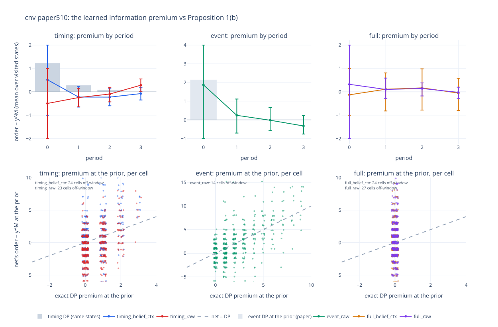

# INTERPRET.md — cnv policy readback (spec §14)

*Campaign closed 2026-10-13. Read back on every board: `paper510` (the run plan's target —
generalists, anchored on the exact DP and the paper's own per-cell output), `fig6a` / `fig6b`
(N = 100, beyond the run plan, no DP — the information ledger) and `base` (the first pass).
Instrument outputs live in each run's `probe/` and in `results/paper510/interpret/` (gitignored,
regenerable by the commands in `README.md`'s technical appendix); this file holds the conclusions,
`ESCALATION.md` #E118 the record.*

## Declared stances (from `cnv_schema.json`)

| stance | structure | claim | instrument |
|---|---|---|---|
| confirm | over-ordering (Proposition 1(b)): y^T ≥ y^M, less so under timing than event | the belief-fed policies stock above the myopic level as a function of the posterior; timing's excess is smaller than event's | `cnv_policy_probe.py` (on-policy premium vs each type's y^M and the DP; belief-surface sweep), `cnv_fitted_rule.py` (order = y^M + premium, scored paired), `cnv_plot_policy.py` (the overlay, with the paper's exact first-period premium per cell); at N = 100 `cnv_info_ledger.py` |
| bypass | the two-number sufficient statistic (S, T) of Proposition 2 | `timing_raw` (frame stack) matches `timing_belief` in profit; likewise `full_raw` vs `full_belief` | the outcome comparison on shared seed blocks (`cnv_policy_probe.py --pair`, the boards) |

## The instruments, validated first

- **The probe reads its references correctly.** Self-checked on every paper510 cell: each type's
  myopic rule agrees with the probe's reference on 100% of visited states for `timing_belief_ctx`,
  `full_belief_ctx`, `timing_raw` and `event_raw` (510 / 510 cells each; the event check plays an
  independent grid posterior, so it also validates the probe's copied prior grid). Re-run on #E8's
  `base` winner it reproduces #E16's readback: 83.0% agreement with the DP, 92.6% at or above y^M,
  mean excess +0.278. (The probe compared the `_ctx` modes against the wrong myopic rule until this
  pass; nothing in the record had used it on them.)
- **The fitted-rule scorer recovers a known answer.** #E8's premium read as a rule (+1 at the prior,
  0 after) scores 27.3634 on `base` = dp_timing +0.0009 ± 0.0039, and +0.021 ± 0.010 over the net.
- **The paper's reference maps onto the grid.** The paper's per-cell myopic first-period order
  (`NVLearning_*_myopic.txt`) equals our y^M at the prior on 507 / 510 cells.

## `paper510` — the run plan's target (one generalist per mode, 510 cells)

Protocol: 2048 seeds per cell from 0 (the shared prefix of the bars' 8192), CRN; the probe on the
screen block (256 episodes per cell from 1,000,000); grid summaries are means over cells — cells are
separate leaderboards. Premium = order − y^M of the policy's own observation type.

### confirm — over-ordering

**Verdict: confirmed in form and in the timing-below-event ordering; the per-cell size of the premium
is noise, and the rule that keeps the structure and drops the noise ties or beats the paper's
heuristic — under event observations it beats it.**

1. **At the prior** — every episode of a cell starts there, so the net's first order is one number
   per cell, set against the paper's own exact first-period premium:

   | arm | mean premium at the prior (exact DP) | cells with a premium > 0 (DP) | cells matching the DP's premium |
   |---|---|---|---|
   | `timing_belief_ctx` | **+0.52** (+0.55) | 252 (217) | 88 / 510 |
   | `timing_raw` | −0.50 (+0.55) | 168 (217) | 85 |
   | `event_raw` | **+1.87** (+2.15) | 305 (384) | 82 |
   | `full_belief_ctx` | −0.13 (0) | 219 (0) | 81 |
   | `full_raw` | +0.32 (0) | 222 (0) | 92 |

   On average the belief-fed timing net and the event net buy the DP's premium at the prior; cell by
   cell the generalists match it on 16–18% of cells.

2. **Timing below event.** At the prior the DP's premium is smaller under timing than under event on
   345 cells (equal on 164, larger on 1). The nets: `timing_raw` < `event_raw` on 350 cells (equal 37,
   greater 123); `timing_belief_ctx` < `event_raw` on 256 (equal 46, greater 208). Holds on average
   and cell by cell for the raw pair; by plurality for the belief pair.

3. **The fitted rule** — order = y^M + premium, the premium read from the net's own on-policy orders
   (rounded mean), scored on the protocol prefix and paired; the verdict branches were fixed before
   scoring (spec §14.2):

   | arm | net | rule, premium per cell × period | rule, premium per period | the type's myopic bar | net − bar | per-period rule − bar |
   |---|---|---|---|---|---|---|
   | `timing_belief_ctx` | 98.59 | 98.98 (+0.39 ± 0.005 over the net) | **99.28** — premium +1 at the prior, 0 after (+0.69 ± 0.006) | 99.28 (dp_timing 99.27) | −0.69 | +0.004 ± 0.007 |
   | `timing_raw` | 98.42 | 98.95 (+0.53 ± 0.005) | 99.28 — premium 0 (= y^M) (+0.86 ± 0.006) | 99.28 | −0.86 | 0 |
   | `event_raw` | 96.75 | 97.20 (+0.45 ± 0.004) | **97.54** — premium +2 at the prior, 0 after (+0.79 ± 0.006) | 97.44 (myopic_event; no event DP built) | −0.69 | **+0.100 ± 0.011** |
   | `full_belief_ctx` | 98.96 | 99.29 (+0.33 ± 0.003) | 99.66 — premium 0 (= y^M = the optimum) (+0.71 ± 0.005) | 99.66 (= dp_full) | −0.71 | 0 |
   | `full_raw` | 98.75 | 99.34 (+0.59 ± 0.005) | 99.66 — premium 0 (+0.92 ± 0.006) | 99.66 | −0.92 | 0 |

   (± over (cell, seed) pairs for the gains over the net; over cells for the per-period rule against
   the bar.) Every |fitted − net| is under 1% of the bar → branch 1: **the nets implement the predicted
   structure, myopic + an additive premium.** Every fitted rule beats the net it was read from.

**Reading.** The generalists learned the structure and the grid-average size of the information
premium — +1 at the prior under timing, +2 under event, nothing under full: the theory's shape — but not
its per-cell size. Their premiums scatter cell by cell, and the scatter costs 0.69–0.92 against the
myopic rule: no generalist beats its type's myopic rule on more than 47 of 510 cells. Rebuilt as the
theory's structure at the net's own average size, every net recovers the whole gap and more. The timing
rule ties myopic_timing on the grid (+0.004 ± 0.007 over cells; significantly above it on 36 cells,
below on 92); the full rules ARE myopic_full, the optimum; and **the event rule beats myopic_event —
+0.100 ± 0.011 over cells, above it on 303 of 510 cells (significantly on 208, significantly below on
115)**. That is where the theory puts the room: the exact DP's first-period premium is largest under
event observations (+2.15 on average), and the myopic event rule buys none. **The fitted rules are
therefore the shippable form of each net (spec §14.2)**: at this horizon (N = 4) they reach the myopic
rule under timing and full observation and pass it under event observation.

*Regenerate:* `python cnv_plot_policy.py -g paper510 --arm timing_belief_ctx=… --arm timing_raw=…
--arm event_raw=… --arm full_belief_ctx=… --arm full_raw=… --paper-dir results/paper510/reference/NVLearning`
(the probe dumps `…/probe/onpolicy_paper510.tsv`; the paper's output from
github.com/tong-wang/NVLearning, see the technical appendix). Statistics:
`results/paper510/interpret/confirm_stats_paper510.tsv`.

### bypass — the sufficient statistic

**Verdict: holds in profit, within 0.2 of the belief arm on the grid mean** (the board: `full_raw`
98.75 vs `full_belief_ctx` 98.96, `timing_raw` 98.42 vs `timing_belief_ctx` 98.59; #E29, #E31). The
readback adds one caveat: the raw timing net did not learn the premium at the prior (−0.50 on average
where the belief net buys +0.52), so the two encodings reach similar profit by different routes; both
full nets carry no premium.

## `fig6a` / `fig6b` — N = 100 (no DP: the information ledger)

At N = 100 no exact bar exists, and under censoring the myopic rule is a **lower** bound on the optimum
(myopic_full the upper). The ledger (`cnv_info_ledger.py`, 2048 protocol seeds, on each crown's own
path) splits a policy's gap to myopic into what it pays to deviate at its own belief (C: over- vs
under-ordering) and the information its beliefs gain over the myopic path (G); gap = G − C. Under full
observation G ≡ 0.

| cell · crown | gap to myopic, paired | C paid (over / under) | G got | first order − y^M |
|---|---|---|---|---|
| fig6a · `timing_raw` (#E116 t44) | −0.55 ± 0.68 | 3.36 (1.27 / 2.09) | **+2.81 ± 0.38** | **+2** |
| fig6a · `timing_belief_log` (#E66 t47) | −2.89 ± 0.61 | 2.72 (0.46 / 2.26) | −0.03 ± 0.20 | −1 |
| fig6a · `event_raw` (#E116 t53) | −7.12 ± 1.92 | 6.71 (2.44 / 4.27) | −0.36 ± 0.98 | −2 |
| fig6a · `full_raw` (#E116 t48) | −0.36 ± 0.10 | 0.52 (0.15 / 0.37) | 0 | −1 |
| fig6a · `full_belief_log` (#E67 t37) | −1.32 ± 0.15 | 1.37 (1.07 / 0.30) | 0 | +4 |
| fig6b · `timing_raw` (#E112) | +0.04 ± 0.76 | 3.69 (1.72 / 1.97) | **+3.56 ± 0.30** | **+4** |
| fig6b · `timing_belief_log` (#E83) | −4.72 ± 0.50 | 6.31 (3.33 / 2.98) | +1.87 ± 0.37 | +2 |
| fig6b · `event_raw` (#E117) | −6.06 ± 1.62 | 5.11 (1.85 / 3.26) | −1.01 ± 1.20 | −1 |
| fig6b · `full_raw` (#E117) | −0.99 ± 0.17 | 1.09 (0.55 / 0.54) | 0 | 0 |
| fig6b · `full_belief_log` (#E83) | −1.38 ± 0.22 | 1.39 (0.09 / 1.29) | 0 | +1 |

(2048 protocol seeds each, so the gaps differ from the boards' 8192-seed rows by Monte Carlo.)

**confirm at N = 100: the structure appears where the learning had a way to pay for it.** The
`timing_raw` crowns — the vine-trained raw frames — over-order at the prior (+2 at c = 1.0, +4 at
c = 1.5, where information is worth 4.6× more, #E83) and get almost exactly what they pay back as
information (G 2.81 against C 3.36; 3.56 against 3.69): Proposition 1(b)'s premium, sized. The
belief-fed timing crowns buy none (fig6a) or buy it and mis-size it (fig6b, C 6.31 for G 1.87); the
event crowns buy none (first order myopic −2 / −1, G −0.36 / −1.01 — their gaps are mostly under-ordering); the full crowns' gaps are execution alone, and
`full_belief_log` over-orders at the prior where no information is for sale (+4 / +1).
**bypass at N = 100: reversed in the raw frames' favour** — the raw crowns lead the belief crowns on
both types and both cells (README board), and the ledger says why on timing: the raw arm buys the
information, the belief arm does not.

## `base` — the first pass (2026-09-18, the specialist target before `paper510`)

### confirm — over-ordering, `base` / `timing_belief` (crowned: #E8 trial 90, 99.9% of dp_timing)

**Verdict: confirmed on this cell, with a narrow scope.** Evidence in
`ESCALATION.md` #E16. On-policy over 4096 visited states the trained policy
agrees with the exact DP's stocking level in 83% of states and stocks at or
above the myopic level y^M in 93%, with a mean excess of +0.28 units. The
structure is sharpest where the theory puts it: in period 0 every episode
stocks 10 where the myopic level is 9 and the DP's is 10 — Proposition 1(b)'s
over-order at the prior, exactly — and the excess decays to ≈ 0 by the last
period, where the DP coincides with the myopic level because no information
is worth buying any more. The fitted rule (the 2026-10-13 pass): the net's
premium by period, +1 / 0 / 0 / 0, scored as a rule, is the DP to the noise
(27.3634 = dp_timing +0.0009 ± 0.0039) and +0.021 ± 0.010 above the net. The scope
condition: on this concentrated-prior cell (Gamma(10, 1)) the whole over-order
is one unit in one period.

### confirm — over-ordering under event observations, `base` / `event_raw` (crowned: #E18 trial 33, = myopic_event)

**Verdict: confirmed in direction and magnitude** (`ESCALATION.md` #E19). The
tuned event policy stocks one unit above the event-model myopic level in
period 0 in every episode and +0.43 above it in period 1 — the largest and
longest-lived excess of the three types, as Proposition 1 predicts for the
least informative observation.

### the full type — no over-ordering is optimal, and the net over-orders anyway

Under full observation the optimum is the myopic level (Prop. 1(b)). The
tuned full_raw policy (#E15, 99.8% of dp_full) still stocks 10 where 9 is
optimal in period 0, in every episode; that one unit is its entire residual
gap (−0.058 ± 0.015). A readback with a cost attached, not a confirmation.

### bypass — the sufficient statistic (raw vs belief encodings)

**Verdict: bypass holds on `base`** (`ESCALATION.md` #E17, #E14, #E20). Each
type's raw arm (last period's observation, frame stack 4) and belief arm
(the conjugate posterior) were tuned separately and re-scored on the same
8192 protocol seeds:

| type | raw winner | belief winner | paired Δ (raw − belief) |
|---|---|---|---|
| timing | 27.342 | 27.342 | 0.0000 ± 0.0105 — identical profit on every seed |
| full | 27.443 | 27.464 | −0.022 ± 0.010 |

The timing-type policies are the same deterministic rule reached from
different inputs; the full-type raw arm gives up under 0.1% of the optimum.
The statistic Proposition 2 proves sufficient is rebuilt by the net from a
4-period memory. Along the way: the raw encodings learn at faithful defaults
where the belief encodings collapse (#E10–#E13), and the derived L1
configuration is worse than L0 on every raw arm — the winning raw
configurations moved to deeper nets and longer rollouts.

### confirm — over-ordering, the other belief arm (`full_belief`)

Read back (#E14): under full observation the DP equals the myopic level
(Prop. 1(b), y^F = y^M), and the crowned full_belief policy still stocks at
or above y^M in 93% of visited states with a mean excess of +0.26 — the same
needless period-0 unit as full_raw, and its residual gap (0.037 ± 0.014).
